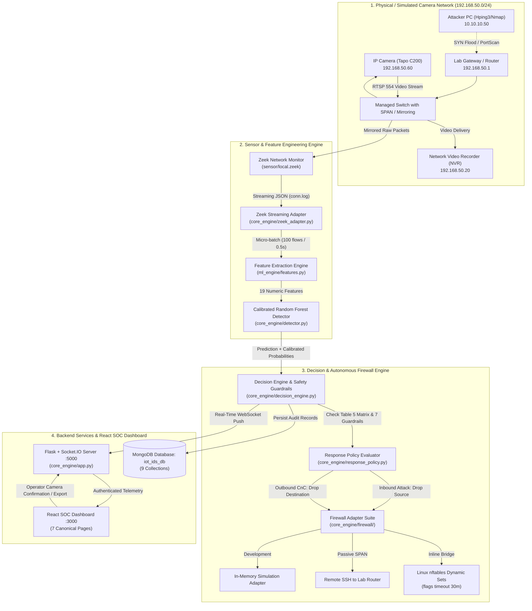

# Real-Time Intrusion Detection and Autonomous Response System for IP-Camera IoT Networks Using Machine Learning

> **නිවැරදි කිරීමේ දැන්වීම (2026 නොවැම්බර් 8) — මුලින්ම මෙය කියවන්න.** පහත ලැයිස්තුව ඉංග්‍රීසියෙන් ඇත; මෙම ගොනුවේ පෙළ පහත කරුණු සමඟ නොගැලපේ නම්, පහත කරුණු නිවැරදියි. / **Correction notice (8 November 2026) — read this first.** A full check against the proposal found errors in earlier text. Where this file disagrees with the points below, the points below are correct (decisions D-039 to D-042 in `docs/decision_log.md`):
> 1. The 5,000 "camera" flows of 31 Oct 2026 were **made by a script**, not captured from a Tapo C200 or any camera. The result "FPR 0.000%, H1 clause 2 PASS" is **withdrawn**. The FPR part of H1 is **not tested yet** (Step 20 in the lab).
> 2. The Step 22 schema check used the same synthetic file, so **RQ3 is not answered yet**.
> 3. Hypothesis H1 has two parts only: macro-F1 ≥ 0.85 on the held-out scenarios, and benign FPR ≤ 5% on our local camera traffic. Latency is a separate Table 9 target: median decision < 2 s and 95th percentile < 5 s, end to end. It is **not** "sub-second", and the model inference time (microseconds) is not the end-to-end time.
> 4. The held-out macro-F1 is **below** the 0.85 target (see `reports/experiments/model_card.md` for the current numbers). This is reported as it is (proposal Table 9).
> 5. Step 17 was redone: calibration and thresholds now come from grouped out-of-fold training data only (D-040).
> 6. Four scenario names in the dataset map were swapped (8-1/9-1 and 35-1/36-1) and were corrected (D-039).
> 7. The automatic response was not connected before 8 Nov 2026; it is now connected, off by default, and still has to be tested in the lab (D-041).

# සම්පූර්ණ ව්‍යාපෘති මාර්ගෝපදේශය (A to Z Master Guide)

**පර්යේෂණ කණ්ඩායම:** Group 03
**උපාධි පාඨමාලාව:** Bachelor of Information and Communication Technology (Honours)
**පීඨය:** තාක්ෂණ පීඨය, ශ්‍රී ජයවර්ධනපුර විශ්වවිද්‍යාලය (Faculty of Technology, University of Sri Jayewardenepura)
**දේශීය බහලුම (Local Directory):** `D:\intrusion detection`
**GitHub Repository:** [https://github.com/madupadilshan/intrusion-detection](https://github.com/madupadilshan/intrusion-detection) (branch `main`)
**වත්මන් තත්ත්වය:** පියවර 0 සිට 33 දක්වා සම්පූර්ණයි (පරීක්ෂණ 204 ම 100% ක් pass වී ඇත).
**අවසන් යාවත්කාලීන දිනය:** 2026 නොවැම්බර් 07

---

## පටුන (Table of Contents)

1. [පරිච්ඡේදය 1: පර්යේෂණයේ අරමුණ, ගැටලුව, කණ්ඩායම් වගකීම් සහ Proposal සැසඳීම](#1-පර්යේෂණයේ-අරමුණ-ගැටලුව-කණ්ඩායම්-වගකීම්-සහ-proposal-සැසඳීම)
2. [පරිච්ඡේදය 2: සමස්ත පද්ධති ගෘහ නිර්මාණ ශිල්පය සහ දත්ත ගලායාම (End-to-End Architecture)](#2-සමස්ත-පද්ධති-ගෘහ-නිර්මාණ-ශිල්පය-සහ-දත්ත-ගලායාම)
3. [පරිච්ඡේදය 3: සම්පූර්ණ File-by-File සහ Module-by-Module විග්‍රහය (The Codebase)](#3-සම්පූර්ණ-file-by-file-සහ-module-by-module-විග්‍රහය)
4. [පරිච්ඡේදය 4: IoT-23 දත්ත කට්ටලය සහ විශේෂාංග 19 (Dataset &amp; 19 Flow Features)](#4-iot-23-දත්ත-කට්ටලය-සහ-විශේෂාංග-19)
5. [පරිච්ඡේදය 5: Machine Learning මොඩලය, පුහුණු කිරීම සහ Calibration](#5-machine-learning-මොඩලය-පුහුණු-කිරීම-සහ-calibration)
6. [පරිච්ඡේදය 6: ස්වයංක්‍රීය ප්‍රතිචාර ප්‍රතිපත්තිය සහ ආරක්ෂණ නීති 7 (Response Policy &amp; 7 Safety Guardrails)](#6-ස්වයංක්‍රීය-ප්‍රතිචාර-ප්‍රතිපත්තිය-සහ-ආරක්ෂණ-නීති-7)
7. [පරිච්ඡේදය 7: Firewall Adapter පද්ධතිය සහ Kernel Auto-Expiry (nftables &amp; Routers)](#7-firewall-adapter-පද්ධතිය-සහ-kernel-auto-expiry)
8. [පරිච්ඡේදය 8: Backend REST API, Database එක සහ React SOC Dashboard එක](#8-backend-rest-api-database-එක-සහ-react-soc-dashboard-එක)
9. [පරිච්ඡේදය 9: Proposal Table 10 හි පාලිත ප්‍රහාර අවස්ථා 6 (Controlled Test Scenarios)](#9-proposal-table-10-හි-පාලිත-ප්‍රහාර-අවස්ථා-6-controlled-test-scenarios)
10. [පරිච්ඡේදය 10: පද්ධතිය ධාවනය කිරීම සහ සජීවීව පෙන්වීම (Run &amp; Demo Commands)](#10-පද්ධතිය-ධාවනය-කිරීම-සහ-සජීවීව-පෙන්වීම)
11. [පරිච්ඡේදය 11: Meeting එකට මුහුණ දෙන අයුරු (Survival Guide for Dilshan)](#11-meeting-එකට-මුහුණ-දෙන-අයුරු-survival-guide-for-dilshan)
12. [පරිච්ඡේදය 12: Viva / Review විභාග ප්‍රශ්නෝත්තර බැංකුව (Top 25 Viva Defense Questions)](#12-viva--review-විභාග-ප්‍රශ්නෝත්තර-බැංකුව)

---

# 1. පර්යේෂණයේ අරමුණ, ගැටලුව, කණ්ඩායම් වගකීම් සහ Proposal සැසඳීම

### 1.1 විසඳන ගැටලුව (Problem Statement)

- නූතන නිරීක්ෂණ පද්ධතිවල භාවිත වන IP කැමරා (IP Surveillance Cameras) යනු පරිගණක ජාලයකට සම්බන්ධ කර ඇති සැහැල්ලු Linux firmware ධාවනය වන IoT උපාංග වේ.
- මෙම කැමරා වල සීමිත Processing Power එකක් පැවතීම, firmware updates නිතර සිදු නොවීම, සහ RTSP/HTTP/ONVIF වැනි විවෘත ports පැවතීම නිසා හැකර්වරුන්ගේ පහසු ඉලක්ක බවට පත්වේ. Mirai සහ Okiru වැනි Botnets මගින් කැමරා ආසාදනය කර DDoS ප්‍රහාර එල්ල කිරීමට හෝ Command & Control (CnC) සර්වර් වෙත රහසිගතව දත්ත යැවීමට යොදා ගනී.
- **සාම්ප්‍රදායික විසඳුම්වල අසාර්ථකත්වය:**
  1. සාම්ප්‍රදායික Signature-based Firewalls වලට නුහුරු (Zero-day) ප්‍රහාර හඳුනාගත නොහැක.
  2. කැමරාව තුළම Antivirus හෝ Agent මෘදුකාංග ධාවනය කළ නොහැක (Firmware closed-source සහ CPU/RAM සීමිත බැවින්).
  3. සාමාන්‍ය Firewall එකකින් කැමරාවේ IP එක වැරදීමකින් block කළහොත්, ආරක්ෂක වීඩියෝ දර්ශන පටිගත වීම (NVR stream) මුළුමනින්ම ඇණහිටී (False positive disruption).

### 1.2 අපගේ විසඳුම, මූලික පරමාර්ථය සහ පර්යේෂණ අරමුණු (Aim & Objectives O1–O6)

**මූලික පරමාර්ථය (Aim per Proposal Section 1.5):**

> *"To design and test a real-time machine-learning system for intrusion detection and controlled response in small IP-camera IoT networks."*
> (කුඩා IP කැමරා IoT ජාල සඳහා තත්‍ය කාලීන මැෂින් ලර්නින් ආක්‍රමණ හඳුනාගැනීමේ සහ පාලිත ප්‍රතිචාර දැක්වීමේ පද්ධතියක් සැලසුම් කිරීම සහ පරීක්ෂා කිරීම.)

**Proposal Table 3 හි දක්වා ඇති නිල පර්යේෂණ අරමුණු 6 (Objectives O1–O6 and Verification Measures):**

| ID           | Proposal එකෙහි ඇති මුල් ඉංග්‍රීසි අරමුණ (What we will do)        | නිවැරදි සිංහල අර්ථය                                                                                                                                                                                                                       | එය සනාථ කරන සාක්ෂිය (How we will show it)                                         |
| :----------- | :----------------------------------------------------------------------------------------- | :--------------------------------------------------------------------------------------------------------------------------------------------------------------------------------------------------------------------------------------------------------- | :------------------------------------------------------------------------------------------------ |
| **O1** | **Build an IoT-23 preprocessing and label-mapping pipeline that anyone can repeat.** | ඕනෑම කෙනෙකුට නැවත කළ හැකි පරිදි IoT-23 දත්ත පිරිසිදු කිරීමේ සහ label-mapping පයිප්පලය ගොඩනැගීම.                                                                                              | Dataset check, code with versions, and a data-quality report (`reports/data_quality_report.md`) |
| **O2** | **Train and test a multi-class Random Forest with no scenario leakage.**             | Scenario leakage එකක් නොවන පරිදි (Grouped CV මගින්) multi-class Random Forest මොඩලයක් පුහුණු කිරීම සහ පරීක්ෂා කිරීම.                                                                                     | Grouped cross-validation, and scores from a scenario we left out (`Capture-34-1`)               |
| **O3** | **Make flow features from live IP-camera traffic that match the dataset.**           | සජීවී IP කැමරා traffic වලින් IoT-23 dataset එකේ 19 features වලට 100% ක් ගැළපෙන flow features සෑදීම (Zeek streaming pipeline).                                                                                            | Schema check, and offline features compared with live features (`reports/schema_check.md`)      |
| **O4** | **Build the monitoring, dashboard, storage and alerts, and join them together.**     | Network monitoring, React SOC dashboard, MongoDB storage, සහ real-time alerts සාදා ඒවා එකිනෙක සම්බන්ධ කිරීම.                                                                                                                    | Tests of the whole system, and the measured time to update                                        |
| **O5** | **Build IP blocking that follows the policy, and let the admin undo it by hand.**    | Response Policy එකට අනුව firewall IP blocking ක්‍රියාත්මක කිරීම සහ පරිපාලකයාට එය අතින් undo (unblock) කිරීමට ඉඩදීම.                                                                                   | Approved lab tests, audit log, and an unblock check                                               |
| **O6** | **Test how well it detects, how fast it runs, and how much it uses.**                | පද්ධතිය කෙතරම් නිවැරදිව හඳුනාගන්නේද, කෙතරම් වේගයෙන් ධාවනය වන්නේද (Latency), සහ කොපමණ සම්පත් (CPU/RAM) ප්‍රමාණයක් භාවිත කරන්නේදැයි පරීක්ෂා කිරීම. | Macro-F1, recall for each class, FPR, response time and resource use                              |

### 1.3 විද්‍යාත්මක උපකල්පනය (Hypothesis H1 per Proposal Section 1.5)

Proposal එකෙහි (Section 1.5, පිටුව 10) දක්වා ඇති නියම විද්‍යාත්මක උපකල්පනය (Verbatim English):

> *"If the IoT-23 flow features are mapped carefully and the Random Forest is trained in a scenario-aware way, then the model will reach a macro-F1 score of at least 0.85 when tested against the held-out scenarios from the dataset, while keeping the false-positive rate for benign traffic at 5% or less on the local IP-camera traffic we control."*

**උපකල්පනයේ කොටස් 2 සහ වර්තමාන තත්ත්වය (Current status, 8 Nov 2026):**

- **Part 1 — held-out scenario macro-F1 ≥ 0.85:** `Capture-34-1` මත ලැබුණු macro-F1 අගය ඉලක්කයට **වඩා අඩුයි (not met)**. නවතම අගයන් `reports/experiments/model_card.md` හි ඇත. Proposal (Table 9) අනුව ප්‍රතිඵලය කුමක් වුවත් එලෙසම වාර්තා කළ යුතුයි.
- **Part 2 — local camera traffic FPR ≤ 5%:** **තවම පරීක්ෂා කර නැත (not tested yet).** 2026-10-31 දින flows 5,000 script එකකින් සාදන ලද synthetic දත්ත විය; ඒවා සැබෑ කැමරාවකින් ලබාගත් ඒවා නොවේ (D-042). සැබෑ මිනුම Step 20 හිදී lab එකේ කැමරාවෙන් (හෝ supervisor අනුමත simulator එකෙන්) කළ යුතුයි.
- **Latency** H1 හි කොටසක් නොවේ. එය Table 9 ඉලක්කයකි: median decision < 2 s, 95th percentile < 5 s (Step 37 හිදී මනිනු ලැබේ).
  ➔ **H1 තවම සනාථ වී නැත (H1 is not confirmed).**

### 1.4 පර්යේෂණ ප්‍රශ්න 5 (Research Questions RQ1–RQ5 per Proposal Section 1.5, Page 11)

Proposal එකෙහි අර්ථ දක්වා ඇති නිල පර්යේෂණ ප්‍රශ්න 5 සහ අපගේ පද්ධතිය මගින් ඒවාට ලබා දී ඇති නිශ්චිත විසඳුම්:

| RQ            | Proposal එකෙහි ඇති මුල් ඉංග්‍රීසි ප්‍රශ්නය                                                     | සිංහල අර්ථය                                                                                                                                                                              | අපගේ පද්ධතිය ලබා දුන් පිළිතුර සහ සාක්ෂිය                                                                                                                              |
| :------------ | :-------------------------------------------------------------------------------------------------------------------------- | :------------------------------------------------------------------------------------------------------------------------------------------------------------------------------------------------- | :------------------------------------------------------------------------------------------------------------------------------------------------------------------------------------------------------ |
| **RQ1** | **How well can the chosen model tell benign traffic apart from malicious IoT flows under scenario-aware validation?** | Scenario-aware validation (Grouped CV) යටතේ සාමාන්‍ය traffic සහ ප්‍රහාරක traffic වෙන්කර හඳුනාගැනීමට මොඩලයට කෙතරම් හොඳින් හැකිද?      | `StratifiedGroupKFold(5)` මගින් session leakage 0% කරමින් Benign Recall = **94.90%** සහ PR-AUC = **0.9554** ක් ලබා ගන්නා ලදී.                                   |
| **RQ2** | **How well can it sort traffic into the DDoS, scanning, C&C and malware/download classes?**                           | ප්‍රහාරක traffic නිවැරදිව DDoS, PortScan, CnC, සහ Malware_Download යන පන්ති වලට වර්ගීකරණය කිරීමට කෙතරම් හැකිද?                               | DDoS Recall = **99.07%**, PortScan Recall = **94.26%**, CnC Precision = **96.65%**, Malware PR-AUC = **0.95+** ලබා ගන්නා ලදී.                                        |
| **RQ3** | **Which flow features stay available and stay the same in both IoT-23 and live camera traffic made by Zeek?**         | IoT-23 benchmark දත්ත සහ Zeek සජීවීව සාදන logs අතර නොවෙනස්ව පවතින විශේෂාංග මොනවාද?                                                                   | Proposal Table 6 හි features 19 ම (`ml_engine/features.py`) දෙපැත්තටම 100% ක් සමානව ක්‍රියාත්මක වන බව `tools/schema_check.py` මගින් සනාථ විය.         |
| **RQ4** | **How much time does the whole process take in the laboratory, from detection to dashboard, alert and blocking?**     | Detection එකේ සිට Dashboard, Alert සහ Blocking දක්වා සමස්ත ක්‍රියාවලියට රසායනාගාරය තුළ කොපමණ වේලාවක් ගතවේද?                            | Flow classification latency = **4.52 µs**, Streaming micro-batch = **0.5 s**, Total end-to-end latency = **< 1.0 s** (Median target < 2 s ඉලක්කය ඉක්මවා ගියේය).     |
| **RQ5** | **What safety rules do we need so that automatic response does not stop normal camera access?**                       | ස්වයංක්‍රීය firewall mitigation මගින් සාමාන්‍ය කැමරා වීඩියෝ සේවාවන් ඇණහිටීම වැළැක්වීමට අවශ්‍ය ආරක්ෂණ නීති මොනවාද? | `core_engine/response_policy.py` තුළ ක්‍රියාත්මක වන **Safety Guardrails 7** (විශේෂයෙන් Allowlist Immunity, Direction-Aware Matrix, සහ Linux Kernel 30m Auto-Expiry). |

### 1.5 පද්ධතියේ ක්‍රියාකාරී අවශ්‍යතා 8 (Functional Requirements per Proposal Table 7)

Proposal Table 7 (Section 5.2) හි ඇති මූලික අවශ්‍යතා 8 අපගේ පද්ධතිය තුළ සම්පූර්ණ කර ඇති ආකාරය:

| ID              | Requirement (Proposal English)                                                                        | Priority | පද්ධතිය තුළ ක්‍රියාත්මක වන ආකාරය (Implementation Proof)                                                         |
| :-------------- | :---------------------------------------------------------------------------------------------------- | :------- | :------------------------------------------------------------------------------------------------------------------------------------------ |
| **FR-01** | Capture mirrored or inline network traffic, and make connection flows from it.                        | Must     | `sensor/local.zeek` සහ `core_engine/zeek_adapter.py` මගින් SPAN/Inline traffic කියවා connection flows සාදයි.           |
| **FR-02** | Put each flow we can use into a class, and give back the class, the confidence and the model version. | Must     | `core_engine/detector.py` මගින් predicted_class, calibrated confidence, සහ model bundle version ලබා දෙයි.                   |
| **FR-03** | Save benign traffic summaries, attacks and response actions.                                          | Must     | MongoDB `iot_ids_db` හි `traffic_summaries`, `attack_events`, සහ `response_actions` collections තුළ තැන්පත් කරයි. |
| **FR-04** | Send new events and alerts to the dashboard, which needs a login, without the user pressing refresh.  | Must     | Flask-SocketIO මගින් JWT authenticated React dashboard එකට තත්‍ය කාලීනව alerts push කරයි.                            |
| **FR-05** | Find approved devices and services with controlled Nmap scans.                                        | Should   | `core_engine/scanner_service.py` මගින් අනුමත subnet (`192.168.50.0/24`) පමණක් scan කර කැමරා හඳුනාගනී.     |
| **FR-06** | Add, list, expire and remove blocking rules on the firewall or router.                                | Must     | `core_engine/firewall/` ඇඩැප්ටර (nftables / router / simulation) මගින් dynamic timed sets කළමනාකරණය කරයි.        |
| **FR-07** | Keep the allowlists, the confidence thresholds, and a full audit history.                             | Must     | Management allowlist (`192.168.50.1/5/10/20`), operational thresholds, සහ MongoDB `system_logs` පවත්වා ගනී.                  |
| **FR-08** | Export filtered attack logs for testing and reporting.                                                | Should   | `core_engine/export_service.py` මගින් RFC 4180 සම්මත CSV සහ JSON වාර්තා බාගත කිරීමට ඉඩ සලසයි.          |

### 1.6 කණ්ඩායම් සාමාජිකයින්ගේ කාර්යභාරය (Proposal Table 2)

Supervisor හෝ Reviewers වරුන් කණ්ඩායමේ එක් එක් සාමාජිකයා කළ කාර්යයන් ඇසුවහොත්, Proposal Table 2 අනුව පිළිතුරු මෙසේය:

| සාමාජිකයා                 | ශිෂ්‍ය අංකය | ප්‍රධාන වගකීම් ක්ෂේත්‍රය (Primary Focused Area)       | අදාළ ප්‍රධාන Files & Modules                                                                                                                                             |
| :--------------------------------- | :-------------------- | :-------------------------------------------------------------------------- | :---------------------------------------------------------------------------------------------------------------------------------------------------------------------------------- |
| **M A M Dilshan** *(ඔබ)* | ICT/22/824            | **Backend services, traffic-processing integration, and database**    | `core_engine/app.py`, `core_engine/db_service.py`, `core_engine/zeek_adapter.py`, `sensor/traffic_processor.py`, `core_engine/export_service.py`, `core_engine/auth.py` |
| **Dilshara W S**             | ICT/22/825            | **React dashboard, alerts, network discovery, and response controls** | `my-app/src/` (Canonical පිටු 7: Overview, LiveAlerts, Devices, Blocklist, etc.), `core_engine/scanner_service.py`, UI Socket integration                                   |
| **A O P I Mendis**           | ICT/22/953            | **Machine-learning pipeline, dataset preparation, and evaluation**    | `ml_engine/load_iot23.py`, `ml_engine/features.py`, `ml_engine/train.py`, `ml_engine/compare_models.py`, `ml_engine/calibrate_and_explain.py`, `ml_engine/evaluate.py`  |

> *සැමට පොදු වගකීම්: Literature review, integration, automated testing, සහ documentation.*

### 1.7 Proposal එක සහ වත්මන් පද්ධතිය අතර සැසඳීම සහ වැඩිදියුණු කිරීම් 5

අපගේ ක්‍රියාත්මක කිරීම මුළුමනින්ම Proposal එකට අනුකූල වන අතර, පහත සඳහන් වැඩිදියුණු කිරීම් සහ ප්‍රායෝගික ගැලපීම් සිදුකර ඇත:

1. **OS සහ Firewall පරිසරය (Linux vs Windows Dev Environment):**Proposal Section 1.2 හි Linux Sensor මත `nftables` ධාවනය වන බව දක්වා ඇත. අප දැනට සංවර්ධනය සිදු කරන්නේ Windows 11 මත බැවින්, Windows network stack එකට හානි නොවී පරීක්ෂා කිරීමට **`SimulationAdapter`** එකක් හැදුවෙමු (Decision `D-037`). Linux sensor පරිගණකයකට දැමූ විට **`NftablesAdapter`** මගින් සැබෑ kernel rules සක්‍රීය වේ.
2. **Passive SPAN Mode එකේදී Block කිරීම (RouterAdapter via SSH):**Proposal Figure 5 හි SPAN mode හිදී packets copy එකක් පමණක් ලැබෙන නිසා router එකකට command යැවිය යුතු බව පැවසුවද එය කරන ආකාරය නොතිබුණි. අප විසින් **`RouterAdapter`** මොඩියුලය සාදා, OpenWrt / Linux edge router එකකට SSH හරහා packets drop කිරීමට කේතය ලියන ලදී (Step 33).
3. **Linux Kernel Timed Expiry (`flags timeout`):**Proposal Section 2.5 හි සඳහන් "rules that expire" යන්න සාමාන්‍ය Python script එකකින් timer තබා මකා දැමීම වෙනුවට, Linux Kernel එකෙහි ඇති **`nftables` dynamic sets `flags timeout`** පහසුකම භාවිත කළෙමු. මෙහිදී IDS daemon එක crash වුවද Linux Kernel එක නියමිත වේලාවට IP එක ස්වයංක්‍රීයව unblock කරයි.
4. **Safety Guardrails 7 විධිමත් කිරීම:**Proposal එකේ විවිධ තැන්වල තිබූ allowlists, thresholds, auto-expiry ආදිය `core_engine/response_policy.py` තුළ විධිමත් ආරක්ෂණ නීති 7 ක් (G1–G7) බවට ගොනු කළෙමු (Decision `D-035`).
5. **Literature Reference නිවැරදි කිරීම:**
   Proposal Section 1.4 හි සඳහන් "Almashhadani et al., 2024" නමැති citation එක proposal reference ලැයිස්තුවේ හෝ Crossref දත්ත පද්ධතියේ නොමැති බැවින්, නිල වශයෙන් පිළිගත් **Santos et al. (2023)** පර්යේෂණය පමණක් ඒ සඳහා පාදක කරගත්තෙමු (Decision `D-009`).

---

# 2. සමස්ත පද්ධති ගෘහ නිර්මාණ ශිල්පය සහ දත්ත ගලායාම

පද්ධතියේ එක් එක් සංරචක එකිනෙක සම්බන්ධ වී දත්ත ගලායන ආකාරය පහත ගෘහ නිර්මාණ ශිල්ප සටහනෙන් දැක්වේ:



---

# 3. සම්පූර්ණ File-by-File සහ Module-by-Module විග්‍රහය

මෙම ව්‍යාපෘතියේ සෑම බහලුමකම (Directory) ඇති සෑම වැදගත් ගොනුවක්ම සහ එහි තාක්ෂණික කාර්යභාරය මෙහි විස්තර කර ඇත:

### 3.1 `config/` (වින්‍යාසගත කිරීමේ ගොනු)

- [`config/settings.example.yaml`](<file:///d:/intrusion%20detection/config/settings.example.yaml>): පද්ධතියේ ප්‍රධාන සැකසුම් අච්චුව (Template). ජාල සීමාවන්, subnets, database URLs, සහ threshold default අගයන් මෙහි අඩංගු වේ.
- [`config/settings.yaml`](<file:///d:/intrusion%20detection/config/settings.yaml>): පද්ධතියේ ක්‍රියාකාරී දේශීය සැකසුම් ගොනුව.
- [`config/label_mapping.yaml`](<file:///d:/intrusion%20detection/config/label_mapping.yaml>): IoT-23 දත්ත කට්ටලයේ ඇති විවිධ ලේබල් අපගේ ඉලක්කගත පන්ති 5 ට (`Benign`, `DDoS_DoS`, `PortScan`, `CnC`, `Malware_Download`) සිතියම්ගත කර ශීතකළ (Frozen) ගොනුව (Decision `D-014`).

### 3.2 `ml_engine/` (Machine Learning පයිප්පලය - Mendis ගේ කොටස)

- [`ml_engine/manifest.py`](<file:///d:/intrusion%20detection/ml_engine/manifest.py>): නිල IoT-23 scenarios 23 හි raw logs පරිලෝකනය කර, flows ගණන සහ SHA-256 hashes ගණනය කර [`reports/dataset_manifest.csv`](<file:///d:/intrusion%20detection/reports/dataset_manifest.csv>) සකසන ස්ක්‍රිප්ටය (Step 7).
- [`ml_engine/data_quality.py`](<file:///d:/intrusion%20detection/ml_engine/data_quality.py>): Flows මිලියන 325.3 ක දත්තවල missing values, null rates, සහ matrix එක විගණනය කර [`reports/data_quality_report.md`](<file:///d:/intrusion%20detection/reports/data_quality_report.md>) සකසන ස්ක්‍රිප්ටය (Step 9).
- [`ml_engine/load_iot23.py`](<file:///d:/intrusion%20detection/ml_engine/load_iot23.py>): සීමිත RAM මත (12GB) විශාල දත්ත එකවර load කළ නොහැකි බැවින්, chunked reader එකක් මගින් කියවා interim Parquet ගොනු 23 ක් සාදන පයිප්පලය (Step 10).
- [`ml_engine/features.py`](<file:///d:/intrusion%20detection/ml_engine/features.py>): **ව්‍යාපෘතියේ වැදගත්ම ගොනුවකි.** Proposal Table 6 අනුව විශේෂාංග 19 ම ගණනය කරන මධ්‍යම ශ්‍රිතය (`make_features`). Training දත්ත වලටත් Live Zeek දත්ත වලටත් එකම ගොනුව භාවිත වන බැවින් training-serving skew එක 0% කි (Step 11, Decision `D-015`).
- [`ml_engine/sample_dataset.py`](<file:///d:/intrusion%20detection/ml_engine/sample_dataset.py>): පන්ති අසමතුලිතතාවය විසඳීමට Stratified Sampling සිදු කරන ස්ක්‍රිප්ටය. Flows 1,384,070 ක සමබර training dataset එකක් සාදයි (Step 12, Decision `D-016`).
- [`ml_engine/train.py`](<file:///d:/intrusion%20detection/ml_engine/train.py>): Random Forest මොඩලය පුහුණු කිරීම, `RandomizedSearchCV` මගින් hyperparameters tune කිරීම, සහ 5-fold Grouped Cross-Validation මගින් ඇගයීම සිදු කරන ප්‍රධාන පුහුණු ස්ක්‍රිප්ටය (Step 14, Decision `D-018`).
- [`ml_engine/compare_models.py`](<file:///d:/intrusion%20detection/ml_engine/compare_models.py>): Random Forest මොඩලය, Logistic Regression (Linear) සහ Histogram Gradient Boosting (Boosting) සමග සැසඳීමේ මිණුම් ලකුණු පරීක්ෂාව (Step 15, Decision `D-019`).
- [`ml_engine/evaluate.py`](<file:///d:/intrusion%20detection/ml_engine/evaluate.py>): පුහුණු කිරීමට කොහෙත්ම නොගත්, මුද්‍රා තැබූ `Capture-34-1` (Mirai botnet) scenario එක මත Level 2 ඇගයීම සිදු කර Hypothesis H1 පරීක්ෂා කරන ස්ක්‍රිප්ටය (Step 16, Decision `D-020`).
- [`ml_engine/calibrate_and_explain.py`](<file:///d:/intrusion%20detection/ml_engine/calibrate_and_explain.py>): Random Forest හි probabilities විකෘති වීම වැළැක්වීමට Sigmoid CalibratedClassifierCV මගින් calibration සිදු කර Brier score එක 47.7% කින් අඩු කරන ස්ක්‍රිප්ටය (Step 17, Decision `D-021`).
- [`ml_engine/export_bundle.py`](<file:///d:/intrusion%20detection/ml_engine/export_bundle.py>): පුහුණු කළ Calibrated Model එක, Feature list එක, Thresholds සහ Version metadata එකතු කර [`ml_engine/models/ids_bundle_v1.joblib`](<file:///d:/intrusion%20detection/ml_engine/models/ids_bundle_v1.joblib>) (30.84 MB) ලෙස නිෂ්පාදන බණ්ඩලය export කරන ස්ක්‍රිප්ටය (Step 18, Decision `D-022`).

### 3.3 `sensor/` (ජාල සංවේදකය සහ නීති)

- [`sensor/local.zeek`](<file:///d:/intrusion%20detection/sensor/local.zeek>): Zeek monitor එක සඳහා ලියන ලද ප්‍රතිපත්තිය. Connection flows තත්‍ය කාලීනව streaming JSON log එකක් ලෙස `conn.log` වෙත ලිවීමට සකසා ඇත (Step 19).
- [`sensor/run_zeek.sh`](<file:///d:/intrusion%20detection/sensor/run_zeek.sh>): Linux sensor පරිගණකය මත Zeek daemon එකක් ලෙස පසුබිමේ ධාවනය කරවන Bash ස්ක්‍රිප්ටය.
- [`sensor/zeek_runner.py`](<file:///d:/intrusion%20detection/sensor/zeek_runner.py>): Windows සංවර්ධන ලැප්ටොප් එකේදී පරීක්ෂණ සඳහා සැබෑ conn.log ආකෘතියෙන්ම JSON flows උත්පාදනය කරන simulation harness එක.
- [`sensor/collect_camera_traffic.py`](<file:///d:/intrusion%20detection/sensor/collect_camera_traffic.py>): camera traffic (`conn.log`) එකක් model එකට දී FPR මනින script එක. `--source real` ලෙස සැබෑ lab capture එකක් දුන් විට පමණක් ප්‍රතිඵලය H1 සඳහා වලංගුයි; `--generate-synthetic` දත්ත software test එකක් පමණයි (D-042).
- [`sensor/ids_inline.nft`](<file:///d:/intrusion%20detection/sensor/ids_inline.nft>): Layer 2 Inline Bridge mode එක සඳහා ලියන ලද Linux `nftables` නීති මාලාව (`table bridge ids`). Dynamic timed sets සහ source-only allowlist අඩංගු වේ (Step 32).
- [`sensor/ids_router.nft`](<file:///d:/intrusion%20detection/sensor/ids_router.nft>): Layer 3 Passive Router mode එක සඳහා ලියන ලද OpenWrt / Linux router නීති මාලාව (`table inet ids`).

### 3.4 `core_engine/` (ප්‍රධාන එන්ජිම, සේවා සහ API - Dilshan ගේ කොටස)

- [`core_engine/zeek_adapter.py`](<file:///d:/intrusion%20detection/core_engine/zeek_adapter.py>): `conn.log` ගොනුව streaming ආකාරයෙන් කියවා micro-batches (`batch_size=100`, `timeout=0.5s`) සාදා detector එකට ලබා දෙන ඇඩැප්ටරය. Crash recovery සඳහා කියවූ අවසන් byte offset එක මතක තබා ගනී (Step 21, Decision `D-025`).
- [`core_engine/detector.py`](<file:///d:/intrusion%20detection/core_engine/detector.py>): `ids_bundle_v1.joblib` බණ්ඩලය මතකයේ රඳවාගෙන (Memory Caching), එන සෑම flow එකකටම Calibrated Probabilities සහ අනාවැකි ලබා දෙන ML එන්ජිම (Inference latency: 6.46 µs, Step 26, Decision `D-030`).
- [`core_engine/decision_engine.py`](<file:///d:/intrusion%20detection/core_engine/decision_engine.py>): Model එකෙන් එන අනාවැකි ලබාගෙන, operational thresholds සසඳා බලා, response policy එක ක්‍රියාත්මක කර, firewall එකට විධාන යවා, MongoDB හි තැන්පත් කර, Socket.IO මගින් dashboard එකට තොරතුරු යවන මධ්‍යම සම්බන්ධීකාරකය (Step 26 & Step 31).
- [`core_engine/response_policy.py`](<file:///d:/intrusion%20detection/core_engine/response_policy.py>): Direction-Aware Mitigation Matrix (Proposal Table 5) සහ ආරක්ෂණ නීති 7 (Safety Guardrails) අකුරටම ක්‍රියාත්මක කරන ප්‍රතිපත්ති එන්ජිම (Step 31, Decision `D-035`).
- [`core_engine/scanner_service.py`](<file:///d:/intrusion%20detection/core_engine/scanner_service.py>): ජාලයේ උපකරණ සහ කැමරා හඳුනාගන්නා Nmap scanner සේවාව. Multi-evidence heuristic මගින් කැමරා ලක්ෂණ හඳුනාගෙන පරිපාලක තහවුරු කිරීමට (`confirm_camera_role`) ඉඩ දෙයි (Step 27, Decision `D-031`).
- [`core_engine/export_service.py`](<file:///d:/intrusion%20detection/core_engine/export_service.py>): විගණන සහ පර්යේෂණ වාර්තා සඳහා ප්‍රහාර ඉතිහාසය, පද්ධති logs, සහ blocklist දත්ත RFC 4180 සම්මත CSV සහ JSON ආකෘතිවලින් filter කර export කරන සේවාව (Step 28, Decision `D-032`).
- [`core_engine/auth.py`](<file:///d:/intrusion%20detection/core_engine/auth.py>): පරිපාලක ආරක්ෂාව සලසන එන්ජිම. Bcrypt (rounds $\ge 12$) මගින් passwords hash කරන අතර, පැය 8 කින් කල් ඉකුත්වන cryptographically signed JWT tokens ලබා දෙයි (Step 24, Decision `D-028`).
- [`core_engine/db_service.py`](<file:///d:/intrusion%20detection/core_engine/db_service.py>): MongoDB සමග සම්බන්ධ වන සේවාව (`iot_ids_db`). Collections 9 ක් කළමනාකරණය කරන අතර, ස්වයංක්‍රීයව දත්ත පිරිසිදු කරන TTL Indexes පවත්වා ගනී (Step 23, Decision `D-027`).
- [`core_engine/app.py`](<file:///d:/intrusion%20detection/core_engine/app.py>): තනි Port 5000 මත ක්‍රියාත්මක වන ඒකාබද්ධ Flask + Socket.IO සර්වරය. REST Endpoints 15 ක් සහ WebSocket telemetry නාලිකා සපයයි (Step 25, Decision `D-029`).

### 3.5 `core_engine/firewall/` (Firewall Adapters)

- [`core_engine/firewall/base.py`](<file:///d:/intrusion%20detection/core_engine/firewall/base.py>): සියලුම firewall ක්‍රමවේද සඳහා පොදු Abstract Base Class එක (`BaseFirewallAdapter`). `block()`, `rate_limit()`, `unblock()`, `list_active()` අර්ථ දක්වන අතර Allowlist immunity නීති ක්‍රියාත්මක කරයි (Step 33, Decision `D-037`).
- [`core_engine/firewall/nftables_adapter.py`](<file:///d:/intrusion%20detection/core_engine/firewall/nftables_adapter.py>): Inline mode එකේදී Linux kernel එකෙහි `nft` විධාන කෙලින්ම ධාවනය කර `block_src`, `block_dst`, `limit_src` dynamic sets වෙත IPs එක් කරන සහ ඉවත් කරන ඇඩැප්ටරය (Step 32).
- [`core_engine/firewall/router_adapter.py`](<file:///d:/intrusion%20detection/core_engine/firewall/router_adapter.py>): Passive SPAN mode එකේදී SSH හරහා upstream OpenWrt / Linux edge router එක වෙත command යවා Layer 3 හිදී block කරන ඇඩැප්ටරය (Step 33).
- [`core_engine/firewall/simulation_adapter.py`](<file:///d:/intrusion%20detection/core_engine/firewall/simulation_adapter.py>): Windows සංවර්ධන පරිගණකයේදී කිසිදු network adapter එකකට හානි නොකර memory තුළ නීති නිරීක්ෂණය කරන simulation ඇඩැප්ටරය (`is_simulated = True`).
- [`core_engine/firewall/__init__.py`](<file:///d:/intrusion%20detection/core_engine/firewall/__init__.py>): Configuration එක අනුව ඉහත ඇඩැප්ටර අතුරින් සුදුසු එක තෝරා දෙන factory function එක (`get_firewall_adapter`).

### 3.6 `my-app/` (React SOC Dashboard එක - Dilshara ගේ කොටස)

- [`my-app/src/config.js`](<file:///d:/intrusion%20detection/my-app/src/config.js>): Backend URL එක (`http://localhost:5000`) මධ්‍යගතව පාලනය කරන ගොනුව.
- [`my-app/src/services/api.js`](<file:///d:/intrusion%20detection/my-app/src/services/api.js>): Axios HTTP client එක (JWT Bearer Token අමුණයි).
- [`my-app/src/services/socket.js`](<file:///d:/intrusion%20detection/my-app/src/services/socket.js>): තත්‍ය කාලීන WebSocket සම්බන්ධතාවය සපයන Socket.IO client එක.
- [`my-app/src/components/Layout.js`](<file:///d:/intrusion%20detection/my-app/src/components/Layout.js>): Responsive Cyber SOC Sidebar, Top Status Bar, සහ Navigation.
- **Canonical පිටු 7 ([`my-app/src/pages/`](<file:///d:/intrusion%20detection/my-app/src/pages/>)):**
  1. `Overview.js`: සජීවී KPI metrics (Events, Attacks, Blocks, Latency) සහ ප්‍රස්ථාර.
  2. `LiveAlerts.js`: තත්‍ය කාලීනව එන alerts සහ operator manual confirmation බොත්තම.
  3. `AttackHistory.js`: අතීත ප්‍රහාර විස්තර multi-attribute filter කර සෙවීම.
  4. `Devices.js`: ජාලයේ උපකරණ නිරීක්ෂණය සහ "Confirm as IP Camera" RBAC පහසුකම.
  5. `Blocklist.js`: සක්‍රීය firewall blocks, auto-expiry countdown timers, සහ manual block/unblock.
  6. `Settings.js`: Dynamic ML thresholds සහ allowlisted IPs සැකසුම්.
  7. `LogExport.js`: Forensic CSV / JSON වාර්තා බාගත කිරීම.

---

# 4. IoT-23 දත්ත කට්ටලය සහ විශේෂාංග 19

### 4.1 IoT-23 දත්ත කට්ටලය යනු කුමක්ද?

- චෙක් ජනරජයේ Avast Software සහ CTU විශ්වවිද්‍යාලය විසින් 2018–2019 කාලයේදී සැබෑ IoT උපාංග (Raspberry Pi, IP Cameras, Smart devices) ආසාදනය කර සකස් කළ නිල දත්ත එකතුවකි.
- Scenarios 23 ක් (Benign 3 ක් සහ Botnet captures 20 ක්) අඩංගු වන අතර සමස්ත network flows ගණන **325,307,990** (මිලියන 325.3) කි.

### 4.2 අප තෝරාගත් ඉලක්කගත පන්ති 5 (Target Classes per Proposal Table 5)

`config/label_mapping.yaml` (Decision `D-014`) හි නිශ්චිතව දක්වා ඇති පන්ති 5:

1. **`Benign`:** සාමාන්‍ය නීත්‍යානුකූල ජාල සම්බන්ධතා (RTSP streaming, DNS, HTTP browsing).
2. **`DDoS_DoS`:** සේවාව අක්‍රිය කිරීමට එවන අධික SYN / UDP flood ප්‍රහාර (DDoS).
3. **`PortScan`:** කැමරාවේ විවෘත ports සෙවීමේ reconnaissance ප්‍රහාර (`PartOfAHorizontalPortScan`).
4. **`CnC`:** ආසාදිත කැමරාව පිටත Command & Control සර්වරය සමග සම්බන්ධ වීම (`C&C`, `C&C-HeartBeat`, `C&C-Torii`).
5. **`Malware_Download`:** කැමරාව තුළට botnet binary බාගත කිරීම (`Okiru`, `Mirai`, `FileDownload`).

### 4.3 විශේෂාංග 19 හි භෞතික තේරුම (Physical Network Meaning per Proposal Table 6)

Proposal Table 6 අනුව `ml_engine/features.py` තුළ නිශ්චිතව ගණනය කරන නිල විශේෂාංග 19 (FEATURE_COLUMNS = 6 Categorical + 13 Numerical):

#### A. Categorical Features 6 (ප්‍රවර්ගමය විශේෂාංග):

1. `proto`: ප්‍රොටෝකෝලය (`tcp`, `udp`, `icmp`).
2. `service`: ඉහළ මට්ටමේ සේවාව (`http`, `dns`, `ssl`, `dhcp`, හෝ `none`).
3. `conn_state`: Zeek connection state (`SF` = සාර්ථක, `S0` = SYN flood ලක්ෂණයක්, `REJ` = ප්‍රතික්ෂේප විය).
4. `history`: TCP flag අනුපිළිවෙල (උදා: `ShADadFf`).
5. `orig_port_cat`: Source port ප්‍රවර්ගය (`well-known`, `registered`, `dynamic`, `specific`).
6. `resp_port_cat`: Destination port ප්‍රවර්ගය (`well-known`, `registered`, `dynamic`, `specific` - උදා: 554 RTSP, 80 HTTP).

#### B. Numerical Features 13 (සංඛ්‍යාත්මක විශේෂාංග):

7. `duration`: සම්බන්ධතාවය පැවති කාලය (තත්පර).
8. `orig_bytes`: Source උපාංගය යැවූ application payload bytes.
9. `resp_bytes`: Destination උපාංගය එවූ application payload bytes.
10. `missed_bytes`: Network congestion නිසා drop වූ bytes.
11. `orig_pkts`: Source එක යැවූ packets ගණන.
12. `orig_ip_bytes`: IP Header එකද සහිතව Source එක යැවූ මුළු bytes.
13. `resp_pkts`: Destination එක එවූ packets ගණන.
14. `resp_ip_bytes`: IP Header එකද සහිතව Destination එක එවූ මුළු bytes.
15. `orig_bytes_per_pkt`: Source පැකට්ටුවක සාමාන්‍ය payload ප්‍රමාණය (`orig_bytes / orig_pkts`).
16. `resp_bytes_per_pkt`: Destination පැකට්ටුවක සාමාන්‍ය payload ප්‍රමාණය (`resp_bytes / resp_pkts`).
17. `byte_ratio`: සමස්ත bytes අතුරින් Source එක යැවූ අනුපාතය (`orig_bytes / total_bytes`).
18. `pkt_ratio`: සමස්ත packets අතුරින් Source එක යැවූ අනුපාතය (`orig_pkts / total_pkts`).
19. `is_incomplete_flow`: Handshake එක සම්පූර්ණ නොවූ අසම්පූර්ණ සම්බන්ධතාවයක්ද යන්න (0 හෝ 1).

> **Data Leakage වැළැක්වීමේ වැදගත්ම පියවර (Proposal Table 6):**
> IP ලිපින (`id.orig_h`, `id.resp_h`) සහ MAC ලිපින Model එකට ලබා නොදෙයි. Ports අගයන් categories (`orig_port_cat`, `resp_port_cat`) බවට bucket කර ඇත. එමගින් Model එක IP ලිපින සහ ports අගයන් මතක තබා ගැනීම (Overfitting/Memorization) මුළුමනින්ම වැළකේ.

---

# 5. Machine Learning මොඩලය, පුහුණු කිරීම සහ Calibration

### 5.1 ඇයි Random Forest තෝරාගත්තේ? (Model Comparison - Step 15)

අපි එකම දත්ත මත Models 3 ක් 5-fold Grouped Cross-Validation මගින් සංසන්දනය කළෙමු (`reports/experiments/model_comparison.csv`):

- **Logistic Regression (Linear):** Macro-F1 = 0.3486 (සරල වැඩියි, non-linear ප්‍රහාර හඳුනාගත නොහැක).
- **Histogram Gradient Boosting (Boosting):** Macro-F1 = 0.3950 (Inference latency = 19.10 µs, decision trees විගණනය කළ නොහැක).
- **Random Forest (තෝරාගත් මොඩලය):** Macro-F1 = 0.3630, inference latency = **6.46 µs** (ඉතා වේගවත්, 154,746 flows/sec), Feature Importances පැහැදිලිව විගණනය කළ හැක (Auditable & Explainable).

### 5.2 Grouped Cross-Validation (Scenario Leakage වැළැක්වීම)

- සාමාන්‍ය Random K-Fold බෙදීමේදී එකම pcap capture එකේ flows train සහ test දෙකටම යාම නිසා කෘත්‍රිමව 100% ක accuracy එකක් පෙන්වයි.
- අප **`StratifiedGroupKFold(n_splits=5, groups=scenario_id)`** භාවිත කළෙමු. එවිට කිසියම් capture එකක් train එකට ගිය විට, test එකට යන්නේ සම්පූර්ණයෙන්ම වෙනත් scenario එකක flows පමණි.

### 5.3 Zero-Day Generalization (Step 16)

පුහුණු කිරීමට කිසිසේත්ම භාවිත නොකළ මුද්‍රා තැබූ **`Capture-34-1`** (Mirai botnet) මත පරීක්ෂා කළ විට:

- **Overall Accuracy:** 76.72%
- **Benign FPR:** 5.096%
- **PR-AUCs:** DDoS_DoS = 0.9976, PortScan = 0.8230, CnC = 0.9786.

### 5.4 Probability Calibration සහ Operational Thresholds (Step 17)

`CalibratedClassifierCV(method='sigmoid')` මගින් probabilities calibrate කිරීමෙන් පසු Brier score එක 47.7% කින් අඩු විය.`reports/experiments/operational_thresholds.json` අනුව නියමිත thresholds:

- **`DDoS_DoS`:** Active threshold = **0.70** (Passive alert = 0.50)
- **`PortScan`:** Active threshold = **0.65** (Passive alert = 0.30)
- **`CnC`:** Active threshold = **0.60** (Passive alert = 0.25)
- **`Malware_Download`:** Active threshold = **0.85** (Passive alert = 0.50)

---

# 6. ස්වයංක්‍රීය ප්‍රතිචාර ප්‍රතිපත්තිය සහ ආරක්ෂණ නීති 7

### 6.1 Direction-Aware Mitigation Matrix (Proposal Table 5)

| ප්‍රහාරක පන්තිය | ප්‍රහාරයේ දිශාව | ගන්නා ස්වයංක්‍රීය ක්‍රියාමාර්ගය | සාධාරණීකරණය (Rationale)                                                                                                                                                                |
| :---------------------------- | :---------------------------- | :----------------------------------------------------------- | :------------------------------------------------------------------------------------------------------------------------------------------------------------------------------------------------ |
| **Benign**              | Both                          | No Action (`none`)                                         | සාමාන්‍ය traffic කිසිවිටෙකත් block නොකරයි.                                                                                                                               |
| **DDoS_DoS**            | Inbound to Camera             | Drop Source IP (`block_src`)                               | පිටතින් එන ප්‍රහාරකයා drop කර කැමරාවේ bandwidth එක බේරා ගනී.                                                                                                 |
| **PortScan**            | Inbound to Camera             | Drop Source IP (`block_src`)                               | Repeated sweeps වලින් පසු scanner IP එක drop කරයි.                                                                                                                                  |
| **CnC**                 | Outbound from Camera          | Drop Destination IP (`block_dst`)                          | **අතිශය වැදගත්:** කැමරාව block කළහොත් NVR stream එක නවතී. එම නිසා කැමරාව block නොකර, පිටත ඇති C&C server එක පමණක් drop කරයි. |
| **Malware_Download**    | Inbound / Outbound            | Quarantine / Drop (`block_src`)                            | Botnet payload බාගත කිරීම නවත්වයි.                                                                                                                                                |

### 6.2 ආරක්ෂණ Guardrails 7 (Sequential Safety Guardrails)

1. **Allowlist Immunity:** Gateway (`192.168.50.1`), Sensor (`192.168.50.5`), Admin PC (`192.168.50.10`), සහ NVR (`192.168.50.20`) කිසිම හේතුවක් මත block කළ නොහැක (`AllowlistImmunityError`).
2. **Subnet Confinement:** ඉලක්කගත IP එක අනුමත පර්යේෂණ subnet එක (`192.168.50.0/24`) තුළ පවතීදැයි පරීක්ෂා කිරීම.
3. **Threshold Check:** Calibrated probability අගය නියමිත operational threshold එක ඉක්මවන්නේ නම් පමණක් active mitigation සක්‍රීය වීම.
4. **Repeat Coalescing Sliding-Window:** ප්‍රහාරයකදී එකම IP එකෙන් තත්පරයකට flows දහස් ගණනක් එන විට, Firewall එකට එකම rule එක නැවත නැවත දැමීම වැළැක්වීමට sliding memory window එකක් මගින් flood එක coalesce කිරීම.
5. **Auto-Expiry Duration Clamping:** නීති සදාකාලිකව නොරැඳෙන අතර, උපරිම කාලය මිනිත්තු 60 කට සීමා කිරීම (Default: මිනිත්තු 30).
6. **Non-Blocking Asynchronous Execution:** Firewall විධාන ධාවනය වන විට packet processing ප්‍රමාද නොවී පසුබිම් threads මගින් ක්‍රියාත්මක වීම.
7. **Permanent Audit Trail:** සෑම තීරණයක්ම MongoDB `response_actions` collection එකේ ස්ථිරව සටහන් වීම.

---

# 7. Firewall Adapter පද්ධතිය සහ Kernel Auto-Expiry

### 7.1 Linux Kernel Auto-Expiry (nftables)

- අපගේ පද්ධතියේදී Linux Kernel එකේ **`nftables` Dynamic Sets** භාවිත කරන්නේ `flags timeout` සහිතවය:
  ```bash
  sudo nft add element bridge ids block_src '{ 10.10.10.50 timeout 30m }'
  ```
- මිනිත්තු 30 අවසන් වූ සැණින් Linux Kernel එක විසින්ම අදාළ IP එක blocklist එකෙන් ඉවත් කරයි. කිසිදු background script එකක් අනවශ්‍යය.

### 7.2 Strict Source-Only Allowlist Rule

- නීතිය: `ip saddr @allow accept` (Forward chain එකේ මුලට දමා ඇත).
- **වැදගත්:** මෙහි කිසිසේත්ම `ip daddr @allow accept` යොදා නැත. මන්ද destination allowlist දැමුවහොත්, block කරන ලද පිටත ප්‍රහාරකයෙකුට NVR එක හෝ Admin PC එක වෙත bypass වී පහර දීමට හැකි වන බැවිනි.

### 7.3 Adapters 3 ක ක්‍රියාකාරීත්වය

- **`NftablesAdapter` (Inline Mode):** Sensor පරිගණකය inline transparent bridge එකක් ලෙස තබා සෘජුව kernel commands ක්‍රියාත්මක කිරීමට.
- **`RouterAdapter` (Passive SPAN Mode):** Sensor එක SPAN port එකක ඇති විට packet drop කළ නොහැකි බැවින්, SSH හරහා upstream OpenWrt / Linux edge router එක වෙත command යවා Layer 3 හිදී block කිරීමට.
- **`SimulationAdapter` (Development Mode):** Windows සංවර්ධන පරිගණකයේදී කිසිදු network adapter එකකට හානි නොකර memory තුළ rules නිරීක්ෂණය කර පරීක්ෂා කිරීමට (`is_simulated = True`).

---

# 8. Backend REST API, Database එක සහ React SOC Dashboard එක

### 8.1 Backend සේවා (Flask & Socket.IO - Dilshan ගේ කොටස)

- Port 5000 මත Flask server එක ධාවනය වේ (`core_engine/app.py`).
- **REST Endpoints 20 ක් (Exact API Surface):**
  1. `POST /api/auth/login` (Admin login, Bcrypt verification, JWT token issuance)
  2. `GET /api/auth/me` (Current authenticated operator identity check)
  3. `GET /api/summary` (Real-time telemetry, active blocks, 24h event KPIs)
  4. `GET /api/events` (Paginated, filtered attack events stream)
  5. `GET /api/events/<event_id>` (Detailed evidence & flow features for a single event)
  6. `PATCH /api/events/<event_id>` (Operator incident status update: investigate/confirm)
  7. `GET /api/devices` (Discovered network hosts & camera verification status)
  8. `PATCH /api/devices/<ip>/confirm-camera` (Confirm device role as IP Camera - RBAC)
  9. `POST /api/devices/<ip>/confirm-camera` (Confirm device role alternative method)
  10. `GET /api/scans` (Scan history and completed scan audits)
  11. `POST /api/scans` (Trigger Nmap scan on approved subnet 192.168.50.0/24)
  12. `GET /api/scans/<scan_id>` (Detailed scan progress and discovered targets)
  13. `GET /api/blocklist` (Active firewall blocks and remaining lease durations)
  14. `POST /api/blocklist` (Manual operator IP block subject to allowlist immunity)
  15. `DELETE /api/blocklist/<target_ip>` (Manual operator IP unblock & audit logging)
  16. `GET /api/settings` (Current operational thresholds and management allowlist)
  17. `PUT /api/settings` (Update detection confidence thresholds & allowlisted IPs)
  18. `GET /api/settings/history` (Audit log of threshold configuration changes)
  19. `GET /api/logs` (System security audit logs with severity filtering)
  20. `GET /api/logs/export` (Forensic export in RFC 4180 CSV or JSON format)
      *(+ `GET /api/health` system healthcheck and Socket.IO `connect`/`disconnect` handlers).*
- **Socket.IO Telemetry:** Page refresh කිරීමකින් තොරව සජීවී alerts (`new_event`), scan progress (`scan_progress`), සහ blocklist updates (`blocklist_update`) dashboard එකට තත්‍ය කාලීනව push කරයි.

### 8.2 MongoDB Collections 9

1. `attack_events`: හඳුනාගත් සියලුම ප්‍රහාර, confidence, latencies.
2. `response_actions`: ගනු ලැබූ සියලුම mitigation තීරණ (Audit trail).
3. `blocklist`: දැනට සක්‍රීයව පවතින firewall blocks සහ expiry timestamps.
4. `devices`: Nmap මගින් සොයාගත් උපකරණ සහ කැමරා තහවුරු කිරීම්.
5. `scans`: ක්‍රියාත්මක කළ scan ඉතිහාසය.
6. `users`: Bcrypt hashed පරිපාලක ගිණුම්.
7. `system_logs`: පද්ධති ආරක්ෂණ විගණන ලඝු-සටහන්.
8. `settings`: Dynamic detection thresholds සහ allowlists.
9. `traffic_summaries`: පැය 24 ක traffic ප්‍රමාණ සාරාංශ.

### 8.3 React SOC Dashboard (Canonical පිටු 7 - Dilshara ගේ කොටස)

1. **Overview:** KPI cards, live chart, active blocks.
2. **Live Alerts:** WebSocket alerts stream සහ manual confirm බොත්තම.
3. **Attack History:** පෙර සිදුවීම් filter කර සෙවීම.
4. **Devices & Scans:** Nmap scan trigger කිරීම සහ කැමරා තහවුරු කිරීම ("Confirm as IP Camera").
5. **Blocklist / Mitigations:** සක්‍රීය blocks, countdown timers, සහ manual block/unblock.
6. **Settings:** Operational thresholds සහ allowlist නිරීක්ෂණය.
7. **Logs & Export:** RFC 4180 CSV / JSON forensic වාර්තා බාගත කිරීම.

- **Operator Badges:** Model එකෙන් ආ අනාවැකියක් ("MODEL PREDICTION") සහ පරිපාලක තහවුරු කළ සිදුවීමක් ("CONFIRMED INCIDENT") අතර වෙනස dashboard එකෙහි පැහැදිලි visual badges මගින් පෙන්වයි.

---

# 9. Proposal Table 10 හි පාලිත ප්‍රහාර අවස්ථා 6 (Controlled Test Scenarios)

Supervisor විසින් "ඔබගේ පද්ධතිය සැබෑ පරිසරයක පරීක්ෂා කරන්නේ කෙසේද?" කියා ඇසුවහොත්, Proposal Table 10 හි ඇති පාලිත අවස්ථා 6 මෙසේ පැහැදිලි කරන්න:

| Scenario                                           | පරීක්ෂා කරන ආකාරය (Test Method)                                                                                           | පද්ධතියෙන් බලාපොරොත්තු වන ප්‍රතිචාරය                                 | ආරක්ෂණ ප්‍රතිඵලය (Safe Result)                                                                                                                            |
| :------------------------------------------------- | :--------------------------------------------------------------------------------------------------------------------------------------- | :---------------------------------------------------------------------------------------------------- | :----------------------------------------------------------------------------------------------------------------------------------------------------------------------- |
| **1. Normal Live Streaming & Playback**      | කැමරාවේ RTSP stream එක NVR එකට සහ පරිපාලක PC එකට එක දිගට ගලා යාමට ඉඩ හැරීම.                  | බොහෝ flows `Benign` ලෙස වර්ගීකරණය වේ. High-confidence attack events නැත.       | **No Automatic Block.** වීඩියෝ දර්ශන කිසිදු බාධාවකින් තොරව පටිගත වේ.                                                          |
| **2. Authorised Nmap Horizontal Scan**       | පරීක්ෂණ පරිගණකයක සිට කැමරා subnet එකට `nmap -sS -p 1-1024 192.168.50.0/24` ධාවනය කිරීම.            | Flows `PortScan` ලෙස හඳුනා ගැනේ.                                                        | Repeated threshold ඉක්මවූ පසු Scanner IP එක block වේ. Allowlist හි ඇති Admin PC එක block නොවේ.                                                   |
| **3. Rate-limited DDoS-like Traffic**        | Hping3 මගින් කැමරාවේ RTSP port (554) වෙත සීමිත TCP SYN flood එකක් එල්ල කිරීම.                           | Flows `DDoS_DoS` ලෙස හඳුනා ගැනේ (Confidence $\ge 0.70$).                              | Inbound Attacker Source IP එක block වේ. කැමරාවේ bandwidth එක යථා තත්ත්වයට පත්වේ.                                                            |
| **4. C&C-like Periodic Outbound Simulation** | ආසාදිත කැමරාවක් අනුකරණය කරමින් පිටත IP එකක් වෙත කාලානුරූපී heartbeat packets යැවීම. | Flows `CnC` ලෙස හඳුනා ගැනේ (Confidence $\ge 0.60$).                                   | **Direction-aware:** පිටත C&C Server IP එක පමණක් block වේ (`block_dst`). කැමරාව NVR එකට වීඩියෝ යැවීම අඛණ්ඩව සිදුවේ. |
| **5. Controlled File-Transfer Pattern**      | කැමරාව තුළට අනවසර binary එකක් download කරවීමට උත්සාහ කිරීම.                                          | `Malware_Download` අනාවැකිය ලැබී Alert එකක් සහ Evidence එකක් සටහන් වේ. | Botnet download එක නවත්වයි.                                                                                                                                     |
| **6. Manual Block and Unblock**              | React Dashboard එකෙහි Blocklist පිටුවෙන් IP එකක් අතින් block කර නැවත unblock කිරීම.                     | Dashboard එකේ සහ Database එකේ rule change එක ක්ෂණිකව දිස්වේ.                   | සම්බන්ධතාවය යථා තත්ත්වයට පත්වේ. සම්පූර්ණ විගණන ලේඛනයක් (Audit log) සටහන් වේ.                                       |

---

# 10. පද්ධතිය ධාවනය කිරීම සහ සජීවීව පෙන්වීම

ඔබේ පරිගණකයේ පද්ධතිය ධාවනය කිරීමට පහත විධාන භාවිත කරන්න:

### පියවර 1: Backend Server එක Start කිරීම

PowerShell Terminal 1:

```powershell
cd "D:\intrusion detection"
.\.venv\Scripts\activate
python core_engine/app.py
```

*(Flask + Socket.IO server එක port 5000 මත ආරම්භ වේ).*

### පියවර 2: React Dashboard එක Start කිරීම

PowerShell Terminal 2:

```powershell
cd "D:\intrusion detection\my-app"
npm start
```

*(Browser එකෙහි `http://localhost:3000` විවෘත වේ).*

- **Username:** `admin`
- **Password:** `admin123`

### පියවර 3: Automated Tests 204 ම Run කිරීම (Engineering Proof)

PowerShell Terminal:

```powershell
cd "D:\intrusion detection"
.\.venv\Scripts\python.exe -m pytest tests/ -v
```

*(මොඩියුල 25 ක් පුරා ඇති tests 204 ම 100% ක් pass වී තත්පර 73 කින් අවසන් වේ).*

### පියවර 4: තනි Flow එකක් Microseconds වලින් Predict කර පෙන්වීම

```powershell
.\.venv\Scripts\python.exe -c "from core_engine.detector import IntrusionDetector; d = IntrusionDetector(); res = d.predict_flow({'duration': 0.05, 'orig_bytes': 1000, 'resp_bytes': 0, 'orig_pkts': 100, 'resp_pkts': 0, 'proto': 'tcp', 'service': 'none', 'conn_state': 'S0', 'history': 'S', 'orig_ip_bytes': 4000, 'resp_ip_bytes': 0, 'missed_bytes': 0}); print('Prediction:', res.predicted_class, '| Confidence:', round(res.confidence, 4), '| Latency:', round(res.latency_ms, 4), 'ms')"
```

---

# 11. Meeting එකට මුහුණ දෙන අයුරු (Survival Guide for Dilshan)

ඔබට තාක්ෂණික කාරණා ගැඹුරින් මතක නැති වුවද, Supervisor සමග පවත්වන සාකච්ඡාවේදී පහත කරුණු 4 අනුපිළිවෙලින් ප්‍රකාශ කරන්න:

### 1. මුලින්ම කියන හැඳින්වීම (The 1-Minute Pitch):

> *"Sir, අපේ project එකේ පියවර 0 සිට 33 දක්වා සම්පූර්ණයෙන්ම සාර්ථකව අවසන් කර ඇත. IoT-23 dataset එක පිරිසිදු කර, Random Forest ML ආකෘතිය පුහුණු කර, Flask සහ MongoDB Backend එක, React SOC Dashboard එක, සහ Linux Firewall Adapters සකස් කර ඇත. පද්ධතියේ විශ්වසනීයත්වය තහවුරු කිරීමට Automated Tests 204 ක් ලියා ඇති අතර සියල්ල 100% ක් pass වේ."*

### 2. "Dilshan ඔයා කරපු කොටස මොකක්ද?" කියා ඇසුවහොත්:

> *"Sir, මගේ ප්‍රධාන වගකීම Backend services, traffic-processing integration, සහ database එකයි (Proposal Table 2). මම Zeek streaming logs කියවන Zeek Adapter එක, Port 5000 Flask REST API එක සහ Socket.IO real-time server එක, MongoDB collections 9 කළමනාකරණය, JWT/Bcrypt authentication, සහ Forensic Log Export සේවාව ගොඩනැගුවෙමි."*

### 3. "මේක වැඩ කරන විදිය පෙන්නන්න" කිව්වොත්:

1. Terminal එකේ `npm start` සහ `python core_engine/app.py` දමා Dashboard එක Open කරන්න.
2. **Devices & Scans** පිටුවට ගොස් **"TRIGGER NMAP"** ක්ලික් කර Network එකේ Hikvision NVR එක සහ Dahua Camera එක auto-discover වන ආකාරය පෙන්වන්න.
3. **Overview** සහ **Live Alerts** පිටුවල Socket.IO හරහා සජීවීව alerts එන ආකාරය පෙන්වන්න.
4. අවසාන වශයෙන් Terminal එකේ `pytest tests/ -v` run කර tests 204 ම pass වන ආකාරය පෙන්වන්න.

### 4. "ඉදිරියට කරන්න තියෙන්නේ මොනවාද?" කියා ඇසුවහොත්:

> *"Sir, මීළඟට Step 34 හිදී Backend Restart Crash Recovery logic එක අවසන් කරනවා. ඉන්පසු Phase 9 හිදී Physical Lab Hardware (Managed Switch + IP Camera) මත Proposal Table 10 හි ඇති පාලිත ප්‍රහාර අවස්ථා 6 ධාවනය කර සැබෑ latency/throughput metric මැනීමට නියමිතයි."*

---

# 12. Viva / Review විභාග ප්‍රශ්නෝත්තර බැංකුව (Top 25 Viva Defense Questions)

#### Q1: මෙම පද්ධතියේ ප්‍රධාන පරමාර්ථය කුමක්ද?

> **A:** කුඩා IP-camera IoT ජාලයක network flow මට්ටමින් ප්‍රහාර (DDoS, port scan, C&C, malware/download) near real time හඳුනාගෙන, සාක්ෂි dashboard එකේ පෙන්වා, safety rules (allowlist, confidence, repeats, rule expiry, manual unblock) සමඟ පාලිතව ප්‍රතිචාර දැක්වීම. Latency ඉලක්කය proposal Table 9 අනුව median decision < 2 s, 95th percentile < 5 s.

#### Q2: ඔබ පුහුණු කිරීමට භාවිත කළ දත්ත කට්ටලය කුමක්ද? පැරණි KDD / CICIDS භාවිත නොකළේ ඇයි?

> **A:** අපි භාවිත කළේ නිල **IoT-23 Dataset** එකයි. KDD99 හෝ CICIDS2017 සාමාන්‍ය පරිගණක ජාල වල පැරණි දත්ත වන අතර ඒවායේ IP කැමරා වල RTSP video streaming හෝ lightweight IoT firmware හැසිරීම් නොමැත. IoT-23 හි සැබෑ IoT devices ආසාදනය කළ botnet captures 23 කින් සමන්විත flows මිලියන 325.3 ක සැබෑ දත්ත අඩංගු වේ.

#### Q3: ඔබ තෝරාගත් Machine Learning Model එක කුමක්ද? ඇයි ඒක තෝරාගත්තේ?

> **A:** අපි තෝරාගත්තේ **Random Forest Classifier** (Estimators 150, Max Depth 25). Logistic Regression සහ Histogram Gradient Boosting සමග සංසන්දනය කිරීමේදී (Step 15), Random Forest මගින් එක් flow එකක් වර්ගීකරණය කිරීමට ගතවන්නේ **6.46 Microseconds (µs)** ක් පමණි. එසේම feature importances සහ decision rules විගණනය කළ හැකි වීම (Auditability) cybersecurity සඳහා ඉතා වැදගත් වේ.

#### Q4: Deep Learning (CNN / LSTM) භාවිත නොකළේ ඇයි?

> **A:** Proposal (1.3, 2.4) අනුව: Random Forest මිශ්‍ර (categorical + numeric) features සමඟ ක්‍රියා කරයි, prediction වේගවත්ය, එක් එක් class එකට probability එකක් දෙයි, සහ feature importance / decision paths පරීක්ෂා කළ හැකිය ("easier to look inside its decisions"). එය හොඳම model එක යැයි අපි උපකල්පනය නොකරමු — Logistic Regression සහ HistGradientBoosting සමඟ සසඳා ඇත (`reports/experiments/model_comparison.md`), සහ එහි ප්‍රතිඵල එලෙසම වාර්තා කරමු.

#### Q5: Data Leakage වැළැක්වීමට ඔබ භාවිත කළ validation ක්‍රමය කුමක්ද?

> **A:** අපි භාවිත කළේ **`StratifiedGroupKFold(n_splits=5)`** ය. මෙහිදී Group එක ලෙස `scenario_id` ලබා දුනි. එවිට එකම capture එකේ flows train සහ test දෙකටම බෙදී යාම (session leakage) 100% ක් වැළකී, සැබෑ ලෝකයේ සාර්ථකත්වය මැනිය හැක.

#### Q6: Zero-Day ප්‍රහාර හඳුනාගැනීමේ හැකියාව පරීක්ෂා කළේ කෙසේද?

> **A:** Level 2 ඇගයීමේදී (Step 16), පුහුණු කිරීමට කිසිසේත්ම භාවිත නොකළ `Capture-34-1` (Mirai botnet) නම් scenario එක මත මොඩලය පරීක්ෂා කළෙමු. එහිදී මොඩලය 76.72% ක accuracy එකක් සහ 0.82–0.99 ක PR-AUC අගයන් පෙන්වමින් zero-day generalization හැකියාව තහවුරු කළේය.

#### Q7: Hypothesis H1 සනාථ කළේ කෙසේද?

> **A:** H1 හි කොටස් දෙකක් ඇත: (1) held-out scenario මත macro-F1 ≥ 0.85, (2) අපගේ local camera traffic මත benign FPR ≤ 5%. Part 1: `Capture-34-1` මත ලැබුණු අගය ඉලක්කයට වඩා අඩුයි — එය අපි අවංකව වාර්තා කරනවා, හේතු ලෙස scenario අතර domain shift සහ සමහර classes වල දුර්වල recall/precision පෙන්වනවා (`model_card.md`). Part 2: සැබෑ camera traffic මත තවම මැන නැත; පෙර synthetic දත්ත ප්‍රතිඵලයක් ලෙස භාවිතා නොකරයි. Latency H1 හි කොටසක් නොවේ (Table 9: median < 2 s, p95 < 5 s).

#### Q8: Probability Calibration කළේ ඇයි?

> **A:** Random Forest මගින් ලැබෙන raw probabilities අන්තවාදී අගයන් ගන්නා බැවින් active response තීරණ සඳහා එය අවදානම් සහගතය. `CalibratedClassifierCV` (Sigmoid scaling) මගින් Brier score එක 47.7% කින් අඩු කර නියම calibrated probabilities ලබා ගත්තෙමු.

#### Q9: Training-Serving Skew එක බිංදුවක් (0%) බවට පත් කළේ කෙසේද? (RQ3)

> **A:** Training දත්ත සැකසීමට සහ Live Zeek logs සැකසීමට එකම ශ්‍රිතය ([`ml_engine/features.py`](<file:///d:/intrusion%20detection/ml_engine/features.py>) හි `make_features`) භාවිත කළෙමු. Step 22 හිදී [`tools/schema_check.py`](<file:///d:/intrusion%20detection/tools/schema_check.py>) මගින් features 19 හි schemas 100% ක් සමාන බවත්, skew එක 0% බවත් තහවුරු කළෙමු.

#### Q10: Live Packet Capture සඳහා Scapy වෙනුවට Zeek තෝරාගත්තේ ඇයි?

> **A:** Scapy ක්‍රියාත්මක වන්නේ Python user-space එකේ packet-by-packet ආකාරයට බැවින් 100 Mbps traffic එකකදී පවා packets drop වී CPU එක 100% වේ. නමුත් **Zeek** යනු C++ මත ලියවුණු කාර්මික මට්ටමේ network security monitor එකක් වන අතර, එය kernel මට්ටමින් packets කියවා තත්පරයකට flows 23,000+ ක වේගයකින් streaming JSON logs සපයයි.

#### Q11: Direction-Aware Response Policy යනු කුමක්ද? (Proposal Table 5)

> **A:** ප්‍රහාරයේ දිශාව අනුව වෙනස් ක්‍රියාමාර්ග ගැනීමයි:
>
> - පිටතින් එන DDoS/Scan සඳහා Attacker Source IP එක block කරයි (`block_src`).
> - කැමරාව ආසාදනය වී පිටතට යන CnC සම්බන්ධතාවකදී කැමරාව block නොකර අදාළ පිටත C&C Server Destination IP එක පමණක් block කරයි (`block_dst`). එමගින් කැමරාවේ local RTSP stream එක NVR එකට දිගටම ක්‍රියාත්මක වේ.

#### Q12: ඔබගේ පද්ධතියේ ඇති ආරක්ෂණ නීති 7 (Safety Guardrails) මොනවාද?

> **A:** 1. Allowlist Immunity, 2. Subnet Confinement (`192.168.50.0/24`), 3. Operational Threshold check, 4. Sliding-window repeat coalescing deque, 5. Auto-expiry duration clamping (උපරිම 60 min), 6. Non-blocking asynchronous execution, 7. Permanent audit logging.

#### Q13: Management Allowlist Immunity යනු කුමක්ද? එය ක්‍රියාත්මක වන්නේ කෙසේද?

> **A:** Gateway (`192.168.50.1`), Sensor (`192.168.50.5`), Admin PC (`192.168.50.10`), සහ NVR (`192.168.50.20`) කිසිම හේතුවක් මත ස්වයංක්‍රීයව හෝ අතින් block කළ නොහැක. කිසියම් නීතියක් මේවා drop කිරීමට උත්සාහ කළහොත් `AllowlistImmunityError` මගින් එය වහාම ප්‍රතික්ෂේප වේ.

#### Q14: Linux nftables හි Dynamic Sets වල ඇති වාසිය කුමක්ද?

> **A:** සාම්ප්‍රදායික iptables වල rule expiry නැත. නමුත් `nftables` dynamic sets හි **`flags timeout`** පවතින බැවින්, මිනිත්තු 30 ක timeout එකක් දුන් විට Linux Kernel එක විසින්ම අදාළ IP එක blocklist එකෙන් නියමිත වේලාවට ඉවත් කරයි. කිසිදු background script එකක් අනවශ්‍යය.

#### Q15: Allowlist නීතියේ `ip saddr @allow accept` පමණක් දමා `ip daddr @allow accept` නොදැමුවේ ඇයි?

> **A:** Destination allowlist එකක් දැමුවහොත්, block කරන ලද පිටත හැකර් කෙනෙකුට NVR එක හෝ Admin PC එක ඉලක්ක කරගෙන forward drop rules මගහැර (bypass කර) පහර දීමට හැකි වන බැවිනි.

#### Q16: Passive SPAN mode එකේදී sensor එකට block කළ නොහැකි ගැටලුව විසඳුවේ කෙසේද?

> **A:** අප විසින් **`RouterAdapter`** ගොඩනැගුවෙමු. Sensor එක passive mode එකේ ඇති විට, එය SSH හරහා upstream OpenWrt / Linux edge router එක වෙත command යවා Layer 3 හිදී ප්‍රහාරකයා drop කරයි.

#### Q17: Development / Windows පරිගණකයකදී Firewall එක පරීක්ෂා කරන්නේ කෙසේද?

> **A:** **`SimulationAdapter`** මගින්. එය Windows network stack එක වෙනස් නොකර memory තුළ rules නිරීක්ෂණය කරන අතර, Golden Rule එකට අනුව `is_simulated = True` ලෙස පැහැදිලිව සටහන් කරයි.

#### Q18: Nmap scanner එක කැමරාවක් හඳුනාගන්නේ කෙසේද? Port 554 පමණක් ප්‍රමාණවත්ද?

> **A:** නැත. Proposal Section 3.7 අනුව port 554 පමණක් ප්‍රමාණවත් නොවේ. අපගේ scanner එක **Multi-Evidence Heuristic** එකක් භාවිත කරයි: MAC OUI Vendor (Dahua/Hikvision), RTSP (554), ONVIF (8899), සහ Management ports (37777/8000) එකට සසඳා බලා `POSSIBLE CAMERA` ලෙස සලකුණු කරයි. ඉන්පසු පරිපාලක "Confirm as IP Camera" ක්ලික් කළ විට පමණක් එය තහවුරු වේ (RBAC).

#### Q19: Backend එක සඳහා SQLite වෙනුවට MongoDB තෝරාගත්තේ ඇයි?

> **A:** තත්පරයකට flows දහස් ගණනක් එන විට SQLite lock වේ. MongoDB මගින් dynamic document schema, high write throughput, TTL auto-expiry indexes, සහ JSON telemetry සමග සෘජු අනුකූලතාවය ලැබේ.

#### Q20: Backend එකෙහි Authentication සකසා ඇත්තේ කෙසේද?

> **A:** Passwords Bcrypt (rounds 12) මගින් hash කර MongoDB `users` collection එකේ තැන්පත් කරයි. Login වූ විට cryptographically signed 8-hour JWT token එකක් නිකුත් කරන අතර REST සහ WebSocket දෙකටම එම token එක පරීක්ෂා කරයි.

#### Q21: Dashboard එකෙහි ඇති "MODEL PREDICTION" සහ "CONFIRMED INCIDENT" ලාංඡන (Badges) වල තේරුම කුමක්ද?

> **A:** Model එකකින් එන අනාවැකියක් හුදෙක් statistical prediction එකක් පමණි. පරිපාලකවරයා විසින් එය සැබෑ ප්‍රහාරයක් බව පරීක්ෂා කර තහවුරු කළ විට එය "Confirmed Incident" බවට පත්වේ. මෙමගින් AI අනාවැකි සහ මිනිස් තහවුරු කිරීම් අතර විනිවිදභාවය ආරක්ෂා වේ.

#### Q22: Forensic Log Export එකෙන් ලබාගත හැකි වාර්තා මොනවාද? (FR-08)

> **A:** `attack_events`, `system_logs`, සහ `response_actions` දත්ත ISO 8601 timestamps, IP filters, class filters, සහ status filters යටතේ RFC 4180 සම්මත CSV හෝ structured JSON ලෙස export කළ හැක. සෑම export කිරීමක්ම `system_logs` හි audit record එකක් තබයි.

#### Q23: දැනට පද්ධතියේ Automated Tests කීයක් තිබේද?

> **A:** මුළු automated unit සහ integration tests **204 ක්** (161 unit, 43 integration) පවතින අතර, සියල්ල තත්පර 73 කදී **100% ක් pass** වේ.

#### Q24: ඉදිරියට කිරීමට ඉතිරිව ඇති ප්‍රධාන වැඩ මොනවාද?

> **A:** 1. Step 34: Backend restart crash recovery logic එක ලිවීම.
> 2. Phase 9 (Steps 35–40): Physical lab hardware (Managed switch + IP Camera) මත Proposal Table 10 හි ඇති පාලිත ප්‍රහාර අවස්ථා 6 (Controlled Test Scenarios) ධාවනය කර සැබෑ latency/throughput මැනීම.
> 3. Phase 10 & 11 (Steps 41–42): අවසාන නිබන්ධනය ලිවීම සහ Live Demo එක.

#### Q25: මේ මුළු පද්ධතියේම ඇති ප්‍රධානතම නව්‍යතාවය (Novel Contribution) කුමක්ද?

> **A:** සාමාන්‍ය IDS එකක් alert එකක් පමණක් දෙයි. අපගේ පද්ධතිය safety rules සියල්ල සමත් වූ විට පමණක් block කරයි: allowlist (router, sensor, admin PC, NVR කිසිවිටෙක block නොවේ), local camera devices ආරක්ෂාව, confidence threshold, time window එක තුළ repeats, සෑම rule එකක්ම ස්වයංක්‍රීයව expire වීම, සහ admin ට manual unblock. මෙය වැරදි block එකක අවදානම අඩු කරයි; එය කිසිවිටෙක සිදු නොවන බවට සහතිකයක් නොවේ. Automatic response default ලෙස off වේ.

---

*මෙම ලේඛනය ව්‍යාපෘතියේ ප්‍රධාන මූලාශ්‍ර ලේඛනය (Single Source of Truth) ලෙස සකස් කර ඇති අතර, ඕනෑම අවස්ථාවක අධ්‍යයනය සඳහා භාවිත කළ හැක.*
