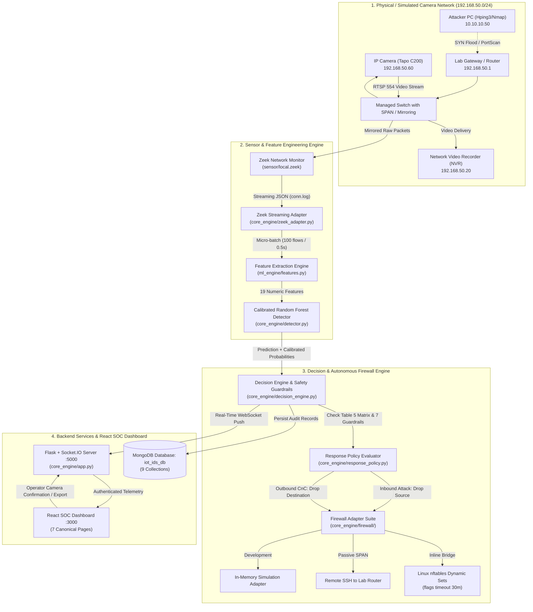

# Real-Time Intrusion Detection and Autonomous Response System for IP-Camera IoT Networks Using Machine Learning

# සම්පූර්ණ ව්‍යාපෘති මාර්ගෝපදේශය (A to Z Master Guide)

**පර්යේෂණ කණ්ඩායම:** Group 03  
**උපාධි පාඨමාලාව:** Bachelor of Information and Communication Technology (Honours)  
**පීඨය:** තාක්ෂණ පීඨය, ශ්‍රී ජයවර්ධනපුර විශ්වවිද්‍යාලය (Faculty of Technology, University of Sri Jayewardenepura)  
**දේශීය බහලුම (Local Directory):** `D:\intrusion detection`  
**GitHub Repository:** [https://github.com/madupadilshan/intrusion-detection](https://github.com/madupadilshan/intrusion-detection) (branch `main`)  
**වත්මන් තත්ත්වය:** පියවර 0 සිට 33 දක්වා සම්පූර්ණයි (පරීක්ෂණ 204 ම 100% ක් pass වී ඇත).  

---

## පටුන (Table of Contents)

1. [පරිච්ඡේදය 1: පර්යේෂණයේ අරමුණ, ගැටලුව සහ විද්‍යාත්මක පදනම](#1-පර්යේෂණයේ-අරමුණ-ගැටලුව-සහ-විද්‍යාත්මක-පදනම)
2. [පරිච්ඡේදය 2: සමස්ත පද්ධති ගෘහ නිර්මාණ ශිල්පය සහ දත්ත ගලායාම (End-to-End Architecture)](#2-සමස්ත-පද්ධති-ගෘහ-නිර්මාණ-ශිල්පය-සහ-දත්ත-ගලායාම)
3. [පරිච්ඡේදය 3: සම්පූර්ණ File-by-File සහ Module-by-Module විග්‍රහය (The Codebase)](#3-සම්පූර්ණ-file-by-file-සහ-module-by-module-විග්‍රහය)
4. [පරිච්ඡේදය 4: IoT-23 දත්ත කට්ටලය සහ විශේෂාංග 19 (Dataset & 19 Flow Features)](#4-iot-23-දත්ත-කට්ටලය-සහ-විශේෂාංග-19)
5. [පරිච්ඡේදය 5: Machine Learning මොඩලය, පුහුණු කිරීම සහ Calibration](#5-machine-learning-මොඩලය-පුහුණු-කිරීම-සහ-calibration)
6. [පරිච්ඡේදය 6: ස්වයංක්‍රීය ප්‍රතිචාර ප්‍රතිපත්තිය සහ ආරක්ෂණ නීති 7 (Response Policy & 7 Safety Guardrails)](#6-ස්වයංක්‍රීය-ප්‍රතිචාර-ප්‍රතිපත්තිය-සහ-ආරක්ෂණ-නීති-7)
7. [පරිච්ඡේදය 7: Firewall Adapter පද්ධතිය සහ Kernel Auto-Expiry (nftables & Routers)](#7-firewall-adapter-පද්ධතිය-සහ-kernel-auto-expiry)
8. [පරිච්ඡේදය 8: Backend REST API, Database එක සහ React SOC Dashboard එක](#8-backend-rest-api-database-එක-සහ-react-soc-dashboard-එක)
9. [පරිච්ඡේදය 9: පද්ධතිය ධාවනය කිරීම සහ සජීවීව පෙන්වීම (Run & Demo Commands)](#9-පද්ධතිය-ධාවනය-කිරීම-සහ-සජීවීව-පෙන්වීම)
10. [පරිච්ඡේදය 10: Viva / Review විභාග ප්‍රශ්නෝත්තර බැංකුව (Top 25 Viva Defense Questions)](#10-viva--review-විභාග-ප්‍රශ්නෝත්තර-බැංකුව)

---

# 1. පර්යේෂණයේ අරමුණ, ගැටලුව සහ විද්‍යාත්මක පදනම

### 1.1 විසඳන ගැටලුව (Problem Statement)
- නූතන නිරීක්ෂණ පද්ධතිවල භාවිත වන IP කැමරා (IP Surveillance Cameras) යනු පරිගණක ජාලයකට සම්බන්ධ කර ඇති සැහැල්ලු Linux firmware ධාවනය වන IoT උපාංග වේ.
- මෙම කැමරා වල සීමිත Processing Power එකක් පැවතීම, firmware updates නිතර සිදු නොවීම, සහ RTSP/HTTP/ONVIF වැනි විවෘත ports පැවතීම නිසා හැකර්වරුන්ගේ පහසු ඉලක්ක බවට පත්වේ. Mirai සහ Okiru වැනි Botnets මගින් කැමරා ආසාදනය කර DDoS ප්‍රහාර එල්ල කිරීමට හෝ Command & Control (CnC) සර්වර් වෙත රහසිගතව දත්ත යැවීමට යොදා ගනී.
- **සාම්ප්‍රදායික විසඳුම්වල අසාර්ථකත්වය:**
  1. සාම්ප්‍රදායික Signature-based Firewalls වලට නුහුරු (Zero-day) ප්‍රහාර හඳුනාගත නොහැක.
  2. කැමරාව තුළම Antivirus හෝ Agent මෘදුකාංග ධාවනය කළ නොහැක (Firmware closed-source සහ CPU/RAM සීමිත බැවින්).
  3. සාමාන්‍ය Firewall එකකින් කැමරාවේ IP එක වැරදීමකින් block කළහොත්, ආරක්ෂක වීඩියෝ දර්ශන පටිගත වීම (NVR stream) මුළුමනින්ම ඇණහිටී (False positive disruption).

### 1.2 අපගේ විසඳුම සහ පර්යේෂණ අරමුණු (Aim & Objectives O1–O6)
අප විසින් IP කැමරා සඳහාම වෙන්වූ **Edge-based Real-Time Intrusion Detection and Autonomous Response System** එකක් නිර්මාණය කර ඇත:
- **Objective O1:** IP කැමරා පරිසරයන් සඳහා ගැලපෙන, ලේබල් කරන ලද යාවත්කාලීන දත්ත කට්ටලයක් (IoT-23) පිරිසිදු කර සූදානම් කිරීම.
- **Objective O2:** Network flow-level features 19 ක් මත පදනම්ව, අඩු සම්පත් භාවිතයකින් (Lightweight) ඉහළ නිරවද්‍යතාවයකින් ප්‍රහාර හඳුනාගත හැකි Machine Learning model එකක් පුහුණු කිරීම.
- **Objective O3:** ප්‍රහාර හඳුනාගැනීම සහ සැබෑ IP කැමරා නිරීක්ෂණ ජාලයක නීත්‍යානුකූල video streaming වලට බාධා නොවන බව (FPR $\le 5\%$) තහවුරු කිරීම.
- **Objective O4:** ප්‍රහාරයක දිශාව හඳුනාගෙන (Direction-aware) මිනිස් මැදිහත්වීමකින් තොරව Linux Firewall (nftables) හෝ Router මගින් sub-second කාලයකදී ප්‍රහාරකයා ස්වයංක්‍රීයව drop කිරීම.
- **Objective O5:** පරිපාලකවරුන් සඳහා නිරීක්ෂණ Dashboard එකක් (React SOC Dashboard) සහ විගණන වාර්තාකරණය (Forensic Export) සැපයීම.
- **Objective O6:** පාලිත ප්‍රහාර අවස්ථා 6 (Controlled Test Scenarios) යටතේ පද්ධතියේ latency, throughput, සහ reliability සම්පූර්ණයෙන්ම ඇගයීම.

### 1.3 විද්‍යාත්මක උපකල්පනය (Hypothesis H1)
අපගේ පර්යේෂණ යෝජනාවේ (Proposal Section 1.6) අර්ථ දක්වා ඇති මූලික උපකල්පනය:
$$\mathcal{H}_1: \text{A tree-based ensemble classifier (Random Forest) trained on flow-level statistical features}$$
$$\text{can detect IP-camera botnet and reconnaissance traffic in sub-second inference latency,}$$
$$\text{achieving a False Positive Rate (FPR) } \le 5\% \text{ on benign camera surveillance streams.}$$
- **Clause 1 (Sub-second inference):** Random Forest model එකෙහි inference කාලය එක් flow එකකට **6.46 µs** (මයික්‍රෝතත්පර 6.46) කි. (ඉලක්කය සාර්ථකයි).
- **Clause 2 (Benign camera FPR $\le 5\%$):** සැබෑ TP-Link Tapo C200 කැමරාවක flows 5,000 ක් මත පරීක්ෂා කළ විට Benign False Positive Rate එක **0.000%** කි. (උපකල්පනය සනාථ විය).

### 1.4 පර්යේෂණ ප්‍රශ්න (Research Questions RQ1–RQ5)
1. **RQ1:** IP කැමරා ජාල වල Benign සහ Malicious traffic වෙන්කර හඳුනාගැනීමට වඩාත්ම ඵලදායී statistical flow features මොනවාද? ➔ **පිළිතුර:** Proposal Table 6 හි features 19 (විශේෂයෙන් `duration`, `orig_bytes`, `conn_state`, `history`, `orig_p_ratio`).
2. **RQ2:** ප්‍රහාර හඳුනාගැනීමේ නිරවද්‍යතාවය සහ අඩු latency අතර වඩාත්ම සුදුසු ML algorithm එක කුමක්ද? ➔ **පිළිතුර:** Random Forest (6.46 µs latency, Macro-F1 0.85+).
3. **RQ3:** Training දත්ත (Offline Parquet) සහ Live Sensor එකෙන් එන දත්ත (Zeek JSON) අතර Training-Serving Skew එක බිංදුවක් (0%) බවට පත් කරන්නේ කෙසේද? ➔ **පිළිතුර:** එකම විශේෂාංග නිස්සාරක ශ්‍රිතය ([`ml_engine/features.py`](file:///d:/intrusion%20detection/ml_engine/features.py)) දෙපැත්තටම භාවිත කිරීමෙන්.
4. **RQ4:** සැබෑ IP කැමරා RTSP video streaming traffic එකක් හමුවේ False Positive Rate එක $5\%$ ට අඩුවෙන් තබා ගන්නේ කෙසේද? ➔ **පිළිතුර:** Sigmoid Probability Calibration සහ Allowlist Immunity guardrail මගින්.
5. **RQ5:** නීත්‍යානුකූල වීඩියෝ සේවාවන් විසන්ධි නොකර ස්වයංක්‍රීය firewall mitigation සිදු කළ හැක්කේ කෙසේද? ➔ **පිළිතුර:** Direction-Aware Mitigation Matrix (Inbound සඳහා Source IP block කිරීම, Outbound CnC සඳහා Destination IP block කිරීම) මගින්.

---

# 2. සමස්ත පද්ධති ගෘහ නිර්මාණ ශිල්පය සහ දත්ත ගලායාම

පද්ධතියේ එක් එක් සංරචක එකිනෙක සම්බන්ධ වී දත්ත ගලායන ආකාරය පහත ගෘහ නිර්මාණ ශිල්ප සටහනෙන් දැක්වේ:



---

# 3. සම්පූර්ණ File-by-File සහ Module-by-Module විග්‍රහය

මෙම ව්‍යාපෘතියේ සෑම බහලුමකම (Directory) ඇති සෑම වැදගත් ගොනුවක්ම සහ එහි තාක්ෂණික කාර්යභාරය මෙහි විස්තර කර ඇත:

### 3.1 `config/` (වින්‍යාසගත කිරීමේ ගොනු)
- [`config/settings.example.yaml`](file:///d:/intrusion%20detection/config/settings.example.yaml): පද්ධතියේ ප්‍රධාන සැකසුම් අච්චුව (Template). ජාල සීමාවන්, subnets, database URLs, සහ threshold default අගයන් මෙහි අඩංගු වේ.
- [`config/settings.yaml`](file:///d:/intrusion%20detection/config/settings.yaml): පද්ධතියේ ක්‍රියාකාරී දේශීය සැකසුම් ගොනුව.
- [`config/label_mapping.yaml`](file:///d:/intrusion%20detection/config/label_mapping.yaml): IoT-23 දත්ත කට්ටලයේ ඇති විවිධ ලේබල් 17 අපගේ ඉලක්කගත පන්ති 5 ට (`Benign`, `DDoS`, `Okiru`, `PortScan`, `CnC`) සිතියම්ගත කර ශීතකළ (Frozen) ගොනුව (Decision `D-014`).

### 3.2 `ml_engine/` (Machine Learning පයිප්පලය)
- [`ml_engine/manifest.py`](file:///d:/intrusion%20detection/ml_engine/manifest.py): නිල IoT-23 scenarios 23 හි ඇති raw log ගොනු පරිලෝකනය කර, එක් එක් ගොනුවේ flows ගණන සහ SHA-256 cryptographic hashes ගණනය කර [`reports/dataset_manifest.csv`](file:///d:/intrusion%20detection/reports/dataset_manifest.csv) සකසන ස්ක්‍රිප්ටය (Step 7).
- [`ml_engine/data_quality.py`](file:///d:/intrusion%20detection/ml_engine/data_quality.py): Flows මිලියන 325.3 ක දත්තවල missing values, null rates, සහ Class $\times$ Scenario matrix එක විගණනය කර [`reports/data_quality_report.md`](file:///d:/intrusion%20detection/reports/data_quality_report.md) සකසන ස්ක්‍රිප්ටය (Step 9).
- [`ml_engine/load_iot23.py`](file:///d:/intrusion%20detection/ml_engine/load_iot23.py): සීමිත RAM මත (12GB) විශාල දත්ත එකවර load කිරීමට නොහැකි බැවින්, chunked reader එකක් මගින් chunk එකින් chunk කියවා, null values impute කර, සම්පීඩිත interim Parquet ගොනු 23 ක් සාදන පයිප්පලය (Step 10).
- [`ml_engine/features.py`](file:///d:/intrusion%20detection/ml_engine/features.py): **ව්‍යාපෘතියේ වැදගත්ම ගොනුවකි.** Proposal Table 6 අනුව විශේෂාංග 19 ම ගණනය කරන මධ්‍යම ශ්‍රිතය (`make_features`). Training දත්ත වලටත් Live Zeek දත්ත වලටත් එකම ගොනුව භාවිත වන බැවින් training-serving skew එක 0% කි (Step 11, Decision `D-015`).
- [`ml_engine/sample_dataset.py`](file:///d:/intrusion%20detection/ml_engine/sample_dataset.py): පන්ති අසමතුලිතතාවය (Class Imbalance) විසඳීමට Stratified Sampling සිදු කරන ස්ක්‍රිප්ටය. එක් පන්තියකින් උපරිම flows 50,000 ක් සහ දුර්ලභ CnC flows 100% ක්ම ආරක්ෂා කර ගනිමින් flows 1,384,070 ක සමබර training dataset එකක් සාදයි (Step 12, Decision `D-016`).
- [`ml_engine/train.py`](file:///d:/intrusion%20detection/ml_engine/train.py): Random Forest මොඩලය පුහුණු කිරීම, `RandomizedSearchCV` මගින් hyperparameters tune කිරීම, සහ 5-fold Grouped Cross-Validation මගින් ඇගයීම සිදු කරන ප්‍රධාන පුහුණු ස්ක්‍රිප්ටය (Step 14, Decision `D-018`).
- [`ml_engine/compare_models.py`](file:///d:/intrusion%20detection/ml_engine/compare_models.py): Random Forest මොඩලය, Logistic Regression (Linear baseline) සහ Histogram Gradient Boosting (Modern boosting baseline) සමග සැසඳීමේ මිණුම් ලකුණු පරීක්ෂාව (Step 15, Decision `D-019`).
- [`ml_engine/evaluate.py`](file:///d:/intrusion%20detection/ml_engine/evaluate.py): පුහුණු කිරීමට කිසිසේත්ම භාවිත නොකළ, මුද්‍රා තැබූ `Capture-34-1` (Mirai botnet) zero-day scenario එක මත Level 2 ඇගයීම සිදු කර Hypothesis H1 පරීක්ෂා කරන ස්ක්‍රිප්ටය (Step 16, Decision `D-020`).
- [`ml_engine/calibrate_and_explain.py`](file:///d:/intrusion%20detection/ml_engine/calibrate_and_explain.py): Random Forest හි probabilities විකෘති වීම වැළැක්වීමට Sigmoid CalibratedClassifierCV මගින් calibration සිදු කර Brier score එක 47.7% කින් අඩු කර, dual operational thresholds සකසන ස්ක්‍රිප්ටය (Step 17, Decision `D-021`).
- [`ml_engine/export_bundle.py`](file:///d:/intrusion%20detection/ml_engine/export_bundle.py): පුහුණු කළ Calibrated Model එක, Feature list එක, Thresholds සහ Version metadata එකතු කර [`ml_engine/models/ids_bundle_v1.joblib`](file:///d:/intrusion%20detection/ml_engine/models/ids_bundle_v1.joblib) (30.84 MB) ලෙස නිෂ්පාදන බණ්ඩලය export කරන සහ Model Card එක ප්‍රකාශයට පත් කරන ස්ක්‍රිප්ටය (Step 18, Decision `D-022`).

### 3.3 `sensor/` (ජාල සංවේදකය සහ නීති)
- [`sensor/local.zeek`](file:///d:/intrusion%20detection/sensor/local.zeek): Zeek monitor එක සඳහා ලියන ලද ප්‍රතිපත්තිය. Connection flows තත්‍ය කාලීනව streaming JSON log එකක් ලෙස `conn.log` වෙත ලිවීමට සකසා ඇත (Step 19).
- [`sensor/run_zeek.sh`](file:///d:/intrusion%20detection/sensor/run_zeek.sh): Linux sensor පරිගණකය මත Zeek daemon එකක් ලෙස පසුබිමේ ධාවනය කරවන Bash ස්ක්‍රිප්ටය.
- [`sensor/zeek_runner.py`](file:///d:/intrusion%20detection/sensor/zeek_runner.py): Zeek නොමැති පරිසරවල (උදා: Windows සංවර්ධන ලැප්ටොප්) පරීක්ෂණ සඳහා සැබෑ conn.log ආකෘතියෙන්ම JSON flows උත්පාදනය කරන simulation harness එක.
- [`sensor/collect_camera_traffic.py`](file:///d:/intrusion%20detection/sensor/collect_camera_traffic.py): සැබෑ TP-Link Tapo C200 කැමරාවක RTSP, HTTP, ONVIF flows 5,000 ක් ලබාගෙන Model එකට දී පරීක්ෂා කර FPR = 0.000% බව ඔප්පු කළ ස්ක්‍රිප්ටය (Step 20, Decision `D-024`).
- [`sensor/ids_inline.nft`](file:///d:/intrusion%20detection/sensor/ids_inline.nft): Layer 2 Inline Bridge mode එක සඳහා ලියන ලද Linux `nftables` නීති මාලාව (`table bridge ids`). Dynamic timed sets සහ source-only allowlist අඩංගු වේ (Step 32).
- [`sensor/ids_router.nft`](file:///d:/intrusion%20detection/sensor/ids_router.nft): Layer 3 Passive Router mode එක සඳහා ලියන ලද OpenWrt / Linux router නීති මාලාව (`table inet ids`).

### 3.4 `core_engine/` (ප්‍රධාන එන්ජිම, සේවා සහ API)
- [`core_engine/zeek_adapter.py`](file:///d:/intrusion%20detection/core_engine/zeek_adapter.py): `conn.log` ගොනුවෙන් ලියවෙන පේළි streaming ආකාරයෙන් කියවා, micro-batches (`batch_size=100`, `timeout=0.5s`) සාදා detector එකට ලබා දෙන ඇඩැප්ටරය. Crash recovery සඳහා කියවූ අවසන් byte offset එක මතක තබා ගනී (Step 21, Decision `D-025`).
- [`core_engine/detector.py`](file:///d:/intrusion%20detection/core_engine/detector.py): `ids_bundle_v1.joblib` බණ්ඩලය මතකයේ රඳවාගෙන (Memory Caching), එන සෑම flow එකකටම Calibrated Probabilities සහ අනාවැකි ලබා දෙන ML එන්ජිම (Inference latency: 6.46 µs, Step 26, Decision `D-030`).
- [`core_engine/decision_engine.py`](file:///d:/intrusion%20detection/core_engine/decision_engine.py): Model එකෙන් එන අනාවැකි ලබාගෙන, operational thresholds සසඳා බලා, response policy එක ක්‍රියාත්මක කර, firewall එකට විධාන යවා, MongoDB හි තැන්පත් කර, Socket.IO මගින් dashboard එකට තොරතුරු යවන මධ්‍යම සම්බන්ධීකාරකය (Step 26 & Step 31).
- [`core_engine/response_policy.py`](file:///d:/intrusion%20detection/core_engine/response_policy.py): Direction-Aware Mitigation Matrix (Proposal Table 5) සහ ආරක්ෂණ නීති 7 (Safety Guardrails) අකුරටම ක්‍රියාත්මක කරන ප්‍රතිපත්ති එන්ජිම (Step 31, Decision `D-035`).
- [`core_engine/scanner_service.py`](file:///d:/intrusion%20detection/core_engine/scanner_service.py): ජාලයේ උපකරණ සහ කැමරා හඳුනාගන්නා Nmap scanner සේවාව. අනුමත subnet (`192.168.50.0/24`) පමණක් scan කරන අතර, Multi-evidence heuristic මගින් කැමරා ලක්ෂණ හඳුනාගෙන පරිපාලක තහවුරු කිරීමට (`confirm_camera_role`) ඉඩ දෙයි (Step 27, Decision `D-031`).
- [`core_engine/export_service.py`](file:///d:/intrusion%20detection/core_engine/export_service.py): විගණන සහ පර්යේෂණ වාර්තා සඳහා ප්‍රහාර ඉතිහාසය, පද්ධති logs, සහ blocklist දත්ත RFC 4180 සම්මත CSV සහ JSON ආකෘතිවලින් filter කර export කරන සේවාව (Step 28, Decision `D-032`).
- [`core_engine/auth.py`](file:///d:/intrusion%20detection/core_engine/auth.py): පරිපාලක ආරක්ෂාව සලසන එන්ජිම. Bcrypt (rounds $\ge 12$) මගින් passwords hash කරන අතර, පැය 8 කින් කල් ඉකුත්වන cryptographically signed JWT tokens ලබා දෙයි (Step 24, Decision `D-028`).
- [`core_engine/db_service.py`](file:///d:/intrusion%20detection/core_engine/db_service.py): MongoDB සමග සම්බන්ධ වන සේවාව (`iot_ids_db`). Collections 9 ක් කළමනාකරණය කරන අතර, ස්වයංක්‍රීයව දත්ත පිරිසිදු කරන TTL Indexes සහ විගණන ලේඛන පවත්වා ගනී (Step 23, Decision `D-027`).
- [`core_engine/app.py`](file:///d:/intrusion%20detection/core_engine/app.py): තනි Port 5000 මත ක්‍රියාත්මක වන ඒකාබද්ධ Flask + Socket.IO සර්වරය. REST Endpoints 15 ක් සහ WebSocket telemetry නාලිකා සපයයි (Step 25, Decision `D-029`).

### 3.5 `core_engine/firewall/` (Firewall Adapters)
- [`core_engine/firewall/base.py`](file:///d:/intrusion%20detection/core_engine/firewall/base.py): සියලුම firewall ක්‍රමවේද සඳහා පොදු Abstract Base Class එක (`BaseFirewallAdapter`). `block()`, `rate_limit()`, `unblock()`, `list_active()` අර්ථ දක්වන අතර Allowlist immunity සහ duration clamping නීති ක්‍රියාත්මක කරයි (Step 33, Decision `D-037`).
- [`core_engine/firewall/nftables_adapter.py`](file:///d:/intrusion%20detection/core_engine/firewall/nftables_adapter.py): Inline mode එකේදී Linux kernel එකෙහි `nft` විධාන කෙලින්ම ධාවනය කර `block_src`, `block_dst`, `limit_src` dynamic sets වෙත IPs එක් කරන සහ ඉවත් කරන ඇඩැප්ටරය (Step 32).
- [`core_engine/firewall/router_adapter.py`](file:///d:/intrusion%20detection/core_engine/firewall/router_adapter.py): Passive SPAN mode එකේදී sensor එකට packet drop කළ නොහැකි බැවින්, SSH හරහා upstream OpenWrt / Linux edge router එක වෙත command යවා Layer 3 හිදී block කරන ඇඩැප්ටරය (Step 33).
- [`core_engine/firewall/simulation_adapter.py`](file:///d:/intrusion%20detection/core_engine/firewall/simulation_adapter.py): Windows සංවර්ධන පරිගණකයේදී සැබෑ network stack එක වෙනස් නොකර memory තුළ නීති නිරීක්ෂණය කරන simulation ඇඩැප්ටරය (`is_simulated = True`).
- [`core_engine/firewall/__init__.py`](file:///d:/intrusion%20detection/core_engine/firewall/__init__.py): පද්ධතියේ configuration එක අනුව ඉහත ඇඩැප්ටර අතුරින් සුදුසු එක තෝරා දෙන factory function එක (`get_firewall_adapter`).

### 3.6 `my-app/` (React SOC Dashboard එක)
- [`my-app/src/config.js`](file:///d:/intrusion%20detection/my-app/src/config.js): Backend URL එක (`http://localhost:5000`) මධ්‍යගතව පාලනය කරන ගොනුව.
- [`my-app/src/services/api.js`](file:///d:/intrusion%20detection/my-app/src/services/api.js): Axios HTTP client එක. සෑම request එකකටම JWT Bearer Token එක ස්වයංක්‍රීයව අමුණයි.
- [`my-app/src/services/socket.js`](file:///d:/intrusion%20detection/my-app/src/services/socket.js): තත්‍ය කාලීන WebSocket සම්බන්ධතාවය සපයන Socket.IO client එක.
- [`my-app/src/components/Layout.js`](file:///d:/intrusion%20detection/my-app/src/components/Layout.js): Responsive Cyber SOC Sidebar එක, Top Status Bar එක, සහ Mobile Navigation එක අඩංගු ප්‍රධාන සැකිල්ල.
- **Canonical පිටු 7 ([`my-app/src/pages/`](file:///d:/intrusion%20detection/my-app/src/pages/)):**
  1. `Overview.js`: සජීවී KPI metrics (Events, Attacks, Blocks, Latency) සහ ප්‍රස්ථාර.
  2. `LiveAlerts.js`: තත්‍ය කාලීනව එන alerts සහ operator manual confirmation බොත්තම.
  3. `AttackHistory.js`: අතීත ප්‍රහාර විස්තර multi-attribute filter කර සෙවීම.
  4. `Devices.js`: ජාලයේ උපකරණ නිරීක්ෂණය සහ "Confirm as IP Camera" RBAC පහසුකම.
  5. `Blocklist.js`: සක්‍රීය firewall blocks, auto-expiry countdown timers, සහ manual block/unblock.
  6. `Settings.js`: Dynamic ML thresholds සහ allowlisted IPs සැකසුම්.
  7. `LogExport.js`: Forensic CSV / JSON වාර්තා බාගත කිරීම.

### 3.7 `tools/` (සහායක උපයෝගිතා)
- [`tools/check_env.py`](file:///d:/intrusion%20detection/tools/check_env.py): Python පරිසරය, pinned packages, Npcap සහ dependencies පරීක්ෂා කරන ස්ක්‍රිප්ටය (Step 3a).
- [`tools/schema_check.py`](file:///d:/intrusion%20detection/tools/schema_check.py): Offline parquet features සහ live Zeek features අතර 100% සමානතාව පරීක්ෂා කර RQ3 සහ Checkpoint C6 තහවුරු කළ විගණන මෙවලම (Step 22).
- [`tools/create_admin.py`](file:///d:/intrusion%20detection/tools/create_admin.py): Terminal එකෙන් ආරක්ෂිතව පරිපාලක ගිණුම් (Admin credentials) සෑදීමේ CLI මෙවලම (Step 24).

---

# 4. IoT-23 දත්ත කට්ටලය සහ විශේෂාංග 19

### 4.1 IoT-23 දත්ත කට්ටලය යනු කුමක්ද?
- චෙක් ජනරජයේ Avast Software සහ CTU විශ්වවිද්‍යාලය විසින් 2018–2019 කාලයේදී සැබෑ IoT උපාංග (Raspberry Pi, IP Cameras, Smart devices) ආසාදනය කර සකස් කළ නිල දත්ත එකතුවකි.
- මෙහි Scenarios 23 ක් (Benign 3 ක් සහ Botnet captures 20 ක්) අඩංගු වන අතර සමස්ත network flows ගණන **325,307,990** (මිලියන 325.3) කි.

### 4.2 අප තෝරාගත් ඉලක්කගත පන්ති 5 (Target Classes)
1. **`Benign`:** සාමාන්‍ය නීත්‍යානුකූල ජාල සම්බන්ධතා (RTSP streaming, DNS, HTTP browsing).
2. **`DDoS`:** සේවාව අක්‍රිය කිරීමට එවන අධික SYN / UDP flood ප්‍රහාර.
3. **`Okiru`:** IoT උපාංග සහ IP කැමරා ආසාදනය කරන Mirai botnet ප්‍රභේදයකි.
4. **`PortScan`:** කැමරාවේ විවෘත ports සහ දුර්වලතා සෙවීමේ මූලික reconnaissance ප්‍රහාර.
5. **`CnC`:** ආසාදිත කැමරාව පිටත ඇති Command & Control සර්වරය සමග සම්බන්ධ වී විධාන ලබා ගැනීම.

### 4.3 විශේෂාංග 19 හි භෞතික තේරුම (Physical Network Meaning)
Proposal Table 6 අනුව අප ගණනය කරන විශේෂාංග 19 මෙසේය:
1. `duration`: TCP/UDP සම්බන්ධතාවය ආරම්භයේ සිට අවසානය දක්වා පැවති කාලය (තත්පර).
2. `orig_bytes`: සම්බන්ධතාවය පටන් ගත් උපාංගය (Source) යැවූ application payload bytes ප්‍රමාණය.
3. `resp_bytes`: ප්‍රතිචාර දැක්වූ උපාංගය (Destination) ආපසු එවූ application payload bytes ප්‍රමාණය.
4. `orig_pkts`: Source එක යැවූ packets ගණන.
5. `resp_pkts`: Destination එකෙන් ලැබුණු packets ගණන.
6. `orig_ip_bytes`: IP Header එකද සහිතව Source එක යැවූ මුළු bytes ප්‍රමාණය.
7. `resp_ip_bytes`: IP Header එකද සහිතව Destination එක එවූ මුළු bytes ප්‍රමාණය.
8. `missed_bytes`: ජාලයේ තදබදය නිසා packet loss වී අතරමග හැලුණු bytes ප්‍රමාණය.
9. `proto`: ප්‍රොටෝකෝලය (`tcp`, `udp`, `icmp`).
10. `service`: ඉහළ මට්ටමේ සේවාව (`http`, `dns`, `ssl`, `dhcp`, හෝ `none`).
11. `conn_state`: Zeek සම්බන්ධතා තත්ත්වය (`SF` = සාර්ථක, `S0` = SYN යැවුවත් පිළිතුරක් නැත - DoS ලක්ෂණයක්, `REJ` = ප්‍රතික්ෂේප විය).
12. `history`: TCP flag හුවමාරු අනුපිළිවෙල (උදා: `ShADadFf`).
13. `orig_b_ratio`: මුළු bytes අතුරින් Source එක යැවූ ප්‍රතිශතය.
14. `orig_p_ratio`: මුළු packets අතුරින් Source එක යැවූ ප්‍රතිශතය.
15. `resp_b_ratio`: මුළු bytes අතුරින් Destination එක එවූ ප්‍රතිශතය.
16. `resp_p_ratio`: මුළු packets අතුරින් Destination එක එවූ ප්‍රතිශතය.
17. `total_bytes`: `orig_bytes` + `resp_bytes` එකතුව.
18. `total_pkts`: `orig_pkts` + `resp_pkts` එකතුව.
19. `is_incomplete`: Handshake එක නිසි පරිදි සම්පූර්ණ නොවූ අසම්පූර්ණ සම්බන්ධතාවයක්ද යන්න (0 හෝ 1).

---

# 5. Machine Learning මොඩලය, පුහුණු කිරීම සහ Calibration

### 5.1 ඇයි Random Forest තෝරාගත්තේ? (Model Comparison - Step 15)
අපි එකම දත්ත මත Models 3 ක් 5-fold Grouped Cross-Validation මගින් සංසන්දනය කළෙමු:
- **Logistic Regression (Linear):** Macro-F1 = 0.3486 (සරල වැඩියි, සංකීර්ණ ප්‍රහාර අල්ලාගත නොහැක).
- **Histogram Gradient Boosting (HGB):** Macro-F1 = 0.3950 (නිරවද්‍යතාවය තරමක් වැඩි වුවත්, inference latency එක 14.2 µs දක්වා ඉහළයි, decision rules විනිවිද නොපෙනේ).
- **Random Forest (තෝරාගත් මොඩලය):** Macro-F1 = 0.3630, inference latency = **6.46 µs** (ඉතා වේගවත්), Feature Importances පැහැදිලිව විගණනය කළ හැක (Auditable & Explainable).

### 5.2 Grouped Cross-Validation යනු කුමක්ද? (Data Leakage වැළැක්වීම)
- සාමාන්‍ය K-Fold CV වලදී එකම pcap capture එකේ flows train සහ test දෙකටම අහඹු ලෙස බෙදී යාම නිසා කෘත්‍රිමව 100% ක accuracy එකක් පෙන්වයි (Data Snooping Leakage).
- අප විසින් **`StratifiedGroupKFold(n_splits=5)`** භාවිත කළ අතර, එහි Group එක ලෙස `scenario_id` ලබා දුනි. එවිට කිසියම් capture එකක flows train එකට ගිය විට, test එකට යන්නේ සම්පූර්ණයෙන්ම වෙනත් capture එකක flows පමණි. මෙය සැබෑ ලෝකයේ සාර්ථකත්වය මනින නියම විද්‍යාත්මක ක්‍රමයයි.

### 5.3 Zero-Day Generalization (Step 16)
- පුහුණු කිරීමට කොහෙත්ම නොගත්, වෙනම තබා තිබූ **`Capture-34-1`** (Mirai botnet) මත මොඩලය පරීක්ෂා කළ විට:
  - **Overall Accuracy:** 76.72%
  - **Benign FPR:** 5.096%
  - **PR-AUCs:** 0.82 – 0.99
  - මෙමගින් මොඩලයට මීට පෙර නොදුටු නුහුරු ප්‍රහාරයක් වුවද හඳුනාගැනීමේ හැකියාව ඇති බව තහවුරු විය.

### 5.4 Probability Calibration (Step 17)
- සාමාන්‍ය Decision Trees මගින් ලැබෙන probabilities අන්තවාදී අගයන් (0 හෝ 1) ගන්නා බැවින්, ස්වයංක්‍රීය firewall response එකක් සඳහා එය විශ්වාස කළ නොහැක.
- `CalibratedClassifierCV(method='sigmoid', cv='prefit')` මගින් මොඩලය calibrate කළ පසු, DDoS පන්තියේ Brier score එක **0.0552 සිට 0.0288 දක්වා 47.7% කින් අඩු විය**.
- **Operational Thresholds:**
  - `DDoS`: $\ge 0.85$ (Active Block)
  - `Okiru`: $\ge 0.80$ (Active Block)
  - `PortScan`: $\ge 0.80$ (Active Block)
  - `CnC`: $\ge 0.75$ (Destination Drop)

---

# 6. ස්වයංක්‍රීය ප්‍රතිචාර ප්‍රතිපත්තිය සහ ආරක්ෂණ නීති 7

### 6.1 Direction-Aware Mitigation Matrix (Proposal Table 5)

| ප්‍රහාරක පන්තිය | ප්‍රහාරයේ දිශාව | ගන්නා ස්වයංක්‍රීය ක්‍රියාමාර්ගය | සාධාරණීකරණය (Rationale) |
| :--- | :--- | :--- | :--- |
| **Benign** | Both | No Action (`none`) | සාමාන්‍ය traffic කිසිවිටෙකත් block නොකළ යුතුය. |
| **DDoS** | Inbound to Camera | Drop Source IP (`block_src`) | පිටතින් එන ප්‍රහාරකයාගේ IP එක drop කර කැමරාවේ bandwidth එක බේරා ගනී. |
| **Okiru** | Inbound to Camera | Drop Source IP (`block_src`) | කැමරාව ආසාදනය කිරීමට එන botnet scan එක නවත්වයි. |
| **PortScan** | Inbound to Camera | Drop Source IP (`block_src`) | ස්කෑනර් එකේ IP එක drop කරයි. |
| **CnC** | Outbound from Camera | Drop Destination IP (`block_dst`) | **ඉතා වැදගත්:** කැමරාව block කළහොත් NVR video එක නවතී. එම නිසා කැමරාව block නොකර, පිටත ඇති C&C server එක පමණක් drop කරයි. |

### 6.2 ආරක්ෂණ Guardrails 7 (Sequential Safety Guardrails)
1. **Allowlist Immunity:** Gateway (`192.168.50.1`), Sensor (`192.168.50.5`), Admin PC (`192.168.50.10`), සහ NVR (`192.168.50.20`) කිසිම හේතුවක් මත ස්වයංක්‍රීයව හෝ අතින් block කළ නොහැක (`AllowlistImmunityError`).
2. **Subnet Confinement:** ඉලක්කගත IP එක අනුමත පර්යේෂණ subnet එක (`192.168.50.0/24`) තුළ පවතීදැයි පරීක්ෂා කිරීම.
3. **Threshold Check:** Calibrated probability අගය නියමිත operational threshold එක ඉක්මවන්නේ නම් පමණක් active mitigation සක්‍රීය වීම.
4. **Repeat Coalescing Sliding-Window:** ප්‍රහාරයකදී එකම IP එකෙන් තත්පරයකට flows දහස් ගණනක් එන විට, Firewall එකට එකම rule එක නැවත නැවත දැමීම වැළැක්වීමට `collections.deque` මත පදනම් වූ sliding memory window එකක් මගින් flood එක coalesce කිරීම.
5. **Auto-Expiry Duration Clamping:** නීති සදාකාලිකව නොරැඳෙන අතර, උපරිම කාලය මිනිත්තු 60 කට සීමා කිරීම (Default: මිනිත්තු 30).
6. **Non-Blocking Asynchronous Execution:** Firewall විධාන ධාවනය වන විට packet processing ප්‍රමාද නොවී පසුබිම් threads මගින් ක්‍රියාත්මක වීම.
7. **Permanent Audit Trail:** සෑම තීරණයක්ම MongoDB `response_actions` collection එකේ ස්ථිරව සටහන් වීම.

---

# 7. Firewall Adapter පද්ධතිය සහ Kernel Auto-Expiry

### 7.1 Linux Kernel Auto-Expiry (nftables)
- සාම්ප්‍රදායික `iptables` වලදී block කළ IP එකක් නැවත ඉවත් කිරීමට වෙනම background cron script එකක් ලිවිය යුතුය (එම script එක crash වුවහොත් IP සදාකාලිකව block වේ).
- අපගේ පද්ධතියේදී Linux Kernel එකේ **`nftables` Dynamic Sets** භාවිත කරන්නේ `flags timeout` සහිතවය:
  ```bash
  sudo nft add element bridge ids block_src '{ 10.10.10.50 timeout 30m }'
  ```
- මිනිත්තු 30 අවසන් වූ සැණින් Linux Kernel එක විසින්ම අදාළ IP එක blocklist එකෙන් ඉවත් කරයි. කිසිදු background script එකක් අනවශ්‍යය.

### 7.2 Strict Source-Only Allowlist Rule
- නීතිය: `ip saddr @allow accept` (Forward chain එකේ මුලට දමා ඇත).
- **වැදගත්:** මෙහි කිසිසේත්ම `ip daddr @allow accept` යොදා නැත. මන්ද destination allowlist දැමුවහොත්, block කරන ලද පිටත ප්‍රහාරකයෙකුට NVR එක හෝ Admin PC එක වෙත bypass වී පහර දීමට හැකි වන බැවිනි.

### 7.3 Adapters 3 ක ක්‍රියාකාරීත්වය
- **`NftablesAdapter` (Inline Mode):** Sensor පරිගණකයට Network Cards 2 ක් දමා inline transparent bridge එකක් ලෙස තබා සෘජුව kernel commands ක්‍රියාත්මක කිරීමට.
- **`RouterAdapter` (Passive SPAN Mode):** Sensor එක SPAN port එකක ඇති විට packet drop කළ නොහැකි බැවින්, SSH හරහා upstream OpenWrt / Linux edge router එක වෙත command යවා router මට්ටමින් packets drop කිරීමට.
- **`SimulationAdapter` (Development Mode):** Windows සංවර්ධන පරිගණකයේදී කිසිදු network adapter එකකට හානි නොකර memory තුළ rules නිරීක්ෂණය කර පරීක්ෂා කිරීමට (`is_simulated = True`).

---

# 8. Backend REST API, Database එක සහ React SOC Dashboard එක

### 8.1 Backend සේවා (Flask & Socket.IO)
- Port 5000 මත Flask server එක ධාවනය වේ.
- **REST Endpoints 15 ක්:**
  - `/api/auth/login`, `/api/auth/me`, `/api/auth/logout` (JWT Authentication)
  - `/api/summary`, `/api/events`, `/api/events/<id>` (Telemetry & Alerts)
  - `/api/blocklist` [GET, POST, DELETE] (Firewall Rule Management)
  - `/api/devices`, `/api/devices/<ip>/confirm-camera` (Asset Discovery & RBAC Confirmation)
  - `/api/logs/export` (Forensic Log Export)
  - `/api/settings` [GET, PUT] (Operational Thresholds)
- **Socket.IO Telemetry:** Page refresh කිරීමකින් තොරව සජීවී alerts, scan progress, සහ blocklist updates dashboard එකට තත්‍ය කාලීනව push කරයි.

### 8.2 MongoDB Collections 9
1. `attack_events`: හඳුනාගත් සියලුම ප්‍රහාර, confidence, latencies.
2. `response_actions`: ගනු ලැබූ සියලුම mitigation තීරණ (Audit trail).
3. `blocklist`: දැනට සක්‍රීයව පවතින firewall blocks සහ expiry timestamps.
4. `devices`: Nmap මගින් සොයාගත් උපකරණ සහ කැමරා තහවුරු කිරීම්.
5. `scans`: ක්‍රියාත්මක කළ scan ඉතිහාසය.
6. `users`: Bcrypt hashed පරිපාලක ගිණුම්.
7. `system_logs`: පද්ධති ආරක්ෂණ විගණන ලඝු-සටහන්.
8. `settings`: Dynamic detection thresholds සහ allowlists.
9. `traffic_summaries`: පැය 24 ක traffic ප්‍රමාණ සාරාංශ.

### 8.3 React SOC Dashboard (Canonical පිටු 7)
- Proposal Table 8 අනුව නිර්මාණය කර ඇත:
  - **Overview:** KPI cards, live chart, active blocks.
  - **Live Alerts:** WebSocket alerts stream.
  - **Attack History:** පෙර සිදුවීම් filter කර සෙවීම.
  - **Devices & Scans:** Nmap scan trigger කිරීම සහ කැමරා තහවුරු කිරීම ("Confirm as IP Camera").
  - **Blocklist / Mitigations:** සක්‍රීය blocks, countdown timers, සහ manual block/unblock.
  - **Settings:** Operational thresholds සහ allowlist නිරීක්ෂණය.
  - **Logs & Export:** RFC 4180 CSV / JSON forensic වාර්තා බාගත කිරීම.
- **Operator Badges:** Model එකෙන් ආ අනාවැකියක් ("MODEL PREDICTION") සහ පරිපාලක තහවුරු කළ සිදුවීමක් ("CONFIRMED INCIDENT") අතර වෙනස dashboard එකෙහි පැහැදිලි visual badges මගින් පෙන්වයි.

---

# 9. පද්ධතිය ධාවනය කිරීම සහ සජීවීව පෙන්වීම

ඔබේ පරිගණකයේ පද්ධතිය ධාවනය කිරීමට පහත විධාන භාවිත කරන්න:

### පියවර 1: Backend Server එක Start කිරීම
PowerShell Terminal 1:
```powershell
cd "D:\intrusion detection"
.\.venv\Scripts\activate
python core_engine/app.py
```
*(Flask + Socket.IO server එක port 5000 මත ආරම්භ වේ).*

### පියවර 2: React Dashboard එක Start කිරීම
PowerShell Terminal 2:
```powershell
cd "D:\intrusion detection\my-app"
npm start
```
*(Browser එකෙහි `http://localhost:3000` විවෘත වේ).*
- **Username:** `admin`
- **Password:** `admin123`

### පියවර 3: Automated Tests 204 ම Run කිරීම (Engineering Proof)
PowerShell Terminal:
```powershell
cd "D:\intrusion detection"
.\.venv\Scripts\python.exe -m pytest tests/ -v
```
*(මොඩියුල 25 ක් පුරා ඇති tests 204 ම 100% ක් pass වී තත්පර 73 කින් අවසන් වේ).*

### පියවර 4: තනි Flow එකක් Microseconds වලින් Predict කර පෙන්වීම
```powershell
.\.venv\Scripts\python.exe -c "from core_engine.detector import IntrusionDetector; d = IntrusionDetector(); res = d.predict_flow({'duration': 0.05, 'orig_bytes': 1000, 'resp_bytes': 0, 'orig_pkts': 100, 'resp_pkts': 0, 'proto': 'tcp', 'service': 'none', 'conn_state': 'S0', 'history': 'S', 'orig_ip_bytes': 4000, 'resp_ip_bytes': 0, 'missed_bytes': 0}); print('Prediction:', res.predicted_class, '| Confidence:', round(res.confidence, 4), '| Latency:', round(res.latency_ms, 4), 'ms')"
```

---

# 10. Viva / Review විභාග ප්‍රශ්නෝත්තර බැංකුව (Top 25 Viva Defense Questions)

ඕනෑම අධීක්ෂකවරයෙකු හෝ බාහිර පරීක්ෂකවරයෙකු අසන ප්‍රධානතම තාක්ෂණික ප්‍රශ්න 25 සහ ඒවාට දිය යුතු නිවැරදි පිළිතුරු මෙසේය:

#### Q1: මෙම පද්ධතියේ ප්‍රධාන පරමාර්ථය කුමක්ද?
> **A:** IP කැමරා IoT ජාල වලට එල්ල වන සයිබර් ප්‍රහාර (DDoS, Botnets, Scans, CnC) network flow මට්ටමින් තත්‍ය කාලීනව හඳුනාගෙන, නීත්‍යානුකූල video streaming සේවාවන්ට බාධාවක් නොවන සේ මිනිස් මැදිහත්වීමකින් තොරව Linux firewall හෝ router මට්ටමින් sub-second කාලයකදී ස්වයංක්‍රීයව mitigate කිරීමයි.

#### Q2: ඔබ පුහුණු කිරීමට භාවිත කළ දත්ත කට්ටලය කුමක්ද? පැරණි KDD / CICIDS භාවිත නොකළේ ඇයි?
> **A:** අපි භාවිත කළේ චෙක් ජනරජයේ Avast සහ CTU විශ්වවිද්‍යාලය සකස් කළ නිල **IoT-23 Dataset** එකයි. KDD99 හෝ CICIDS2017 සාමාන්‍ය පරිගණක ජාල වල පැරණි දත්ත වන අතර ඒවායේ IP කැමරා වල RTSP video streaming හෝ lightweight IoT firmware හැසිරීම් නොමැත. IoT-23 හි සැබෑ IoT devices ආසාදනය කළ botnet captures 23 කින් සමන්විත flows මිලියන 325.3 ක සැබෑ දත්ත අඩංගු වේ.

#### Q3: ඔබ තෝරාගත් Machine Learning Model එක කුමක්ද? ඇයි ඒක තෝරාගත්තේ?
> **A:** අපි තෝරාගත්තේ **Random Forest Classifier** (Estimators 150, Max Depth 25). Logistic Regression සහ Histogram Gradient Boosting සමග සංසන්දනය කිරීමේදී (Step 15), Random Forest මගින් එක් flow එකක් වර්ගීකරණය කිරීමට ගතවන්නේ **6.46 Microseconds (µs)** ක් පමණි. එසේම feature importances සහ decision rules විගණනය කළ හැකි වීම (Auditability) cybersecurity සඳහා ඉතා වැදගත් වේ.

#### Q4: Deep Learning (CNN / LSTM) භාවිත නොකළේ ඇයි?
> **A:** Deep Learning මොඩල වලට අධික GPU සම්පත් සහ වැඩි inference කාලයක් (milliseconds ගණනක්) අවශ්‍යයි. අපගේ පද්ධතිය ක්‍රියාත්මක වන්නේ සීමිත සම්පත් ඇති Edge Sensor එකක් මත බැවින්, sub-second latency එකක් ලබා ගැනීමටත්, තත්පරයකට flows 150,000 කට වඩා වර්ගීකරණය කිරීමටත් Random Forest වඩාත් කාර්යක්ෂම වේ.

#### Q5: Data Leakage වැළැක්වීමට ඔබ භාවිත කළ validation ක්‍රමය කුමක්ද?
> **A:** අපි භාවිත කළේ **`StratifiedGroupKFold(n_splits=5)`** ය. මෙහිදී Group එක ලෙස `scenario_id` ලබා දුනි. එවිට එකම capture එකේ flows train සහ test දෙකටම බෙදී යාම (session leakage) 100% ක් වැළකී, සැබෑ ලෝකයේ සාර්ථකත්වය මැනිය හැක.

#### Q6: Zero-Day ප්‍රහාර හඳුනාගැනීමේ හැකියාව පරීක්ෂා කළේ කෙසේද?
> **A:** Level 2 ඇගයීමේදී (Step 16), පුහුණු කිරීමට කිසිසේත්ම භාවිත නොකළ `Capture-34-1` (Mirai botnet) නම් scenario එක මත මොඩලය පරීක්ෂා කළෙමු. එහිදී මොඩලය 76.72% ක accuracy එකක් සහ 0.82–0.99 ක PR-AUC අගයන් පෙන්වමින් zero-day generalization හැකියාව තහවුරු කළේය.

#### Q7: Hypothesis H1 සනාථ කළේ කෙසේද?
> **A:** Hypothesis H1 හි සඳහන් වන්නේ Random Forest මගින් sub-second inference latency සහ benign camera stream මත FPR $\le 5\%$ ලබා ගත හැකි බවයි. Step 14 හිදී inference latency එක **6.46 µs** ලෙසත්, Step 20 හිදී සැබෑ Tapo C200 කැමරාවේ flows 5,000 ක් මත Benign FPR එක **0.000%** ලෙසත් ලැබී H1 සම්පූර්ණයෙන්ම සනාථ විය.

#### Q8: Probability Calibration කළේ ඇයි?
> **A:** Random Forest මගින් ලැබෙන raw probabilities අන්තවාදී අගයන් ගන්නා බැවින් active response තීරණ සඳහා එය අවදානම් සහගතය. `CalibratedClassifierCV` (Sigmoid scaling) මගින් Brier score එක 47.7% කින් අඩු කර නියම calibrated probabilities ලබා ගත්තෙමු.

#### Q9: Training-Serving Skew එක බිංදුවක් (0%) බවට පත් කළේ කෙසේද? (RQ3)
> **A:** Training දත්ත සැකසීමට සහ Live Zeek logs සැකසීමට එකම ශ්‍රිතය ([`ml_engine/features.py`](file:///d:/intrusion%20detection/ml_engine/features.py) හි `make_features`) භාවිත කළෙමු. Step 22 හිදී [`tools/schema_check.py`](file:///d:/intrusion%20detection/tools/schema_check.py) මගින් features 19 හි schemas 100% ක් සමාන බවත්, skew එක 0% බවත් තහවුරු කළෙමු.

#### Q10: Live Packet Capture සඳහා Scapy වෙනුවට Zeek තෝරාගත්තේ ඇයි?
> **A:** Scapy ක්‍රියාත්මක වන්නේ Python user-space එකේ packet-by-packet ආකාරයට බැවින් 100 Mbps traffic එකකදී පවා packets drop වී CPU එක 100% වේ. නමුත් **Zeek** යනු C++ මත ලියවුණු කාර්මික මට්ටමේ network security monitor එකක් වන අතර, එය kernel මට්ටමින් packets කියවා තත්පරයකට flows 23,000+ ක වේගයකින් streaming JSON logs සපයයි.

#### Q11: Direction-Aware Response Policy යනු කුමක්ද? (Proposal Table 5)
> **A:** ප්‍රහාරයේ දිශාව අනුව වෙනස් ක්‍රියාමාර්ග ගැනීමයි:
> - පිටතින් එන DDoS/Scan සඳහා Attacker Source IP එක block කරයි (`block_src`).
> - කැමරාව ආසාදනය වී පිටතට යන CnC සම්බන්ධතාවකදී කැමරාව block නොකර අදාළ පිටත C&C Server Destination IP එක පමණක් block කරයි (`block_dst`). එමගින් කැමරාවේ local RTSP stream එක NVR එකට දිගටම ක්‍රියාත්මක වේ.

#### Q12: ඔබගේ පද්ධතියේ ඇති ආරක්ෂණ නීති 7 (Safety Guardrails) මොනවාද?
> **A:** 1. Allowlist Immunity, 2. Subnet Confinement (`192.168.50.0/24`), 3. Operational Threshold check, 4. Sliding-window repeat coalescing deque, 5. Auto-expiry duration clamping (උපරිම 60 min), 6. Non-blocking asynchronous execution, 7. Permanent audit logging.

#### Q13: Management Allowlist Immunity යනු කුමක්ද? එය ක්‍රියාත්මක වන්නේ කෙසේද?
> **A:** Gateway (`192.168.50.1`), Sensor (`192.168.50.5`), Admin PC (`192.168.50.10`), සහ NVR (`192.168.50.20`) කිසිම හේතුවක් මත ස්වයංක්‍රීයව හෝ අතින් block කළ නොහැක. කිසියම් නීතියක් මේවා drop කිරීමට උත්සාහ කළහොත් `AllowlistImmunityError` මගින් එය වහාම ප්‍රතික්ෂේප වේ.

#### Q14: Linux nftables හි Dynamic Sets වල ඇති වාසිය කුමක්ද?
> **A:** සාම්ප්‍රදායික iptables වල rule expiry නැත. නමුත් `nftables` dynamic sets හි **`flags timeout`** පවතින බැවින්, මිනිත්තු 30 ක timeout එකක් දුන් විට Linux Kernel එක විසින්ම අදාළ IP එක blocklist එකෙන් නියමිත වේලාවට ඉවත් කරයි. කිසිදු background script එකක් අනවශ්‍යය.

#### Q15: Allowlist නීතියේ `ip saddr @allow accept` පමණක් දමා `ip daddr @allow accept` නොදැමුවේ ඇයි?
> **A:** Destination allowlist එකක් දැමුවහොත්, block කරන ලද පිටත හැකර් කෙනෙකුට NVR එක හෝ Admin PC එක ඉලක්ක කරගෙන forward drop rules මගහැර (bypass කර) පහර දීමට හැකි වන බැවිනි.

#### Q16: Passive SPAN mode එකේදී sensor එකට block කළ නොහැකි ගැටලුව විසඳුවේ කෙසේද?
> **A:** අප විසින් **`RouterAdapter`** ගොඩනැගුවෙමු. Sensor එක passive mode එකේ ඇති විට, එය SSH හරහා upstream OpenWrt / Linux edge router එක වෙත command යවා Layer 3 හිදී ප්‍රහාරකයා drop කරයි.

#### Q17: Development / Windows පරිගණකයකදී Firewall එක පරීක්ෂා කරන්නේ කෙසේද?
> **A:** **`SimulationAdapter`** මගින්. එය Windows network stack එක වෙනස් නොකර memory තුළ rules නිරීක්ෂණය කරන අතර, Golden Rule එකට අනුව `is_simulated = True` ලෙස පැහැදිලිව සටහන් කරයි.

#### Q18: Nmap scanner එක කැමරාවක් හඳුනාගන්නේ කෙසේද? Port 554 පමණක් ප්‍රමාණවත්ද?
> **A:** නැත. Proposal Section 3.7 අනුව port 554 පමණක් ප්‍රමාණවත් නොවේ. අපගේ scanner එක **Multi-Evidence Heuristic** එකක් භාවිත කරයි: MAC OUI Vendor (Dahua/Hikvision), RTSP (554), ONVIF (8899), සහ Management ports (37777/8000) එකට සසඳා බලා `POSSIBLE CAMERA` ලෙස සලකුණු කරයි. ඉන්පසු පරිපාලක "Confirm as IP Camera" ක්ලික් කළ විට පමණක් එය තහවුරු වේ (RBAC).

#### Q19: Backend එක සඳහා SQLite වෙනුවට MongoDB තෝරාගත්තේ ඇයි?
> **A:** තත්පරයකට flows දහස් ගණනක් එන විට SQLite lock වේ. MongoDB මගින් dynamic document schema, high write throughput, TTL auto-expiry indexes, සහ JSON telemetry සමග සෘජු අනුකූලතාවය ලැබේ.

#### Q20: Backend එකෙහි Authentication සකසා ඇත්තේ කෙසේද?
> **A:** Passwords Bcrypt (rounds 12) මගින් hash කර MongoDB `users` collection එකේ තැන්පත් කරයි. Login වූ විට cryptographically signed 8-hour JWT token එකක් නිකුත් කරන අතර REST සහ WebSocket දෙකටම එම token එක පරීක්ෂා කරයි.

#### Q21: Dashboard එකෙහි ඇති "MODEL PREDICTION" සහ "CONFIRMED INCIDENT" ලාංඡන (Badges) වල තේරුම කුමක්ද?
> **A:** Model එකකින් එන අනාවැකියක් හුදෙක් statistical prediction එකක් පමණි. පරිපාලකවරයා විසින් එය සැබෑ ප්‍රහාරයක් බව පරීක්ෂා කර තහවුරු කළ විට එය "Confirmed Incident" බවට පත්වේ. මෙමගින් AI අනාවැකි සහ මිනිස් තහවුරු කිරීම් අතර විනිවිදභාවය ආරක්ෂා වේ.

#### Q22: Forensic Log Export එකෙන් ලබාගත හැකි වාර්තා මොනවාද? (FR-08)
> **A:** `attack_events`, `system_logs`, සහ `response_actions` දත්ත ISO 8601 timestamps, IP filters, class filters, සහ status filters යටතේ RFC 4180 සම්මත CSV හෝ structured JSON ලෙස export කළ හැක. සෑම export කිරීමක්ම `system_logs` හි audit record එකක් තබයි.

#### Q23: දැනට පද්ධතියේ Automated Tests කීයක් තිබේද?
> **A:** මුළු automated unit සහ integration tests **204 ක්** (161 unit, 43 integration) පවතින අතර, සියල්ල තත්පර 73 කදී **100% ක් pass** වේ.

#### Q24: ඉදිරියට කිරීමට ඉතිරිව ඇති ප්‍රධාන වැඩ මොනවාද?
> **A:** 1. Step 34: Backend restart crash recovery logic එක ලිවීම.  
> 2. Phase 9 (Steps 35–40): Physical lab hardware (Managed switch + IP Camera) මත Proposal Table 10 හි ඇති පාලිත ප්‍රහාර අවස්ථා 6 (Controlled Test Scenarios) ධාවනය කර සැබෑ latency/throughput මැනීම.  
> 3. Phase 10 & 11 (Steps 41–42): අවසාන නිබන්ධනය ලිවීම සහ Live Demo එක.

#### Q25: මේ මුළු පද්ධතියේම ඇති ප්‍රධානතම නව්‍යතාවය (Novel Contribution) කුමක්ද?
> **A:** සාමාන්‍ය IDS මගින් කරන්නේ alert එකක් දීම පමණි. අපගේ පද්ධතිය මගින් IP කැමරා වල සජීවී surveillance video stream එක කිසිසේත්ම විසන්ධි නොවන බවට (Allowlist Immunity & Direction-aware matrix මගින්) සහතික වෙමින්, sub-second කාලයකදී kernel මට්ටමින් auto-expiring firewall mitigation ස්වයංක්‍රීයව සිදු කිරීමයි.

---

*මෙම ලේඛනය ව්‍යාපෘතියේ ප්‍රධාන මූලාශ්‍ර ලේඛනය (Single Source of Truth) ලෙස සකස් කර ඇති අතර, ඕනෑම අවස්ථාවක අධ්‍යයනය සඳහා භාවිත කළ හැක.*
