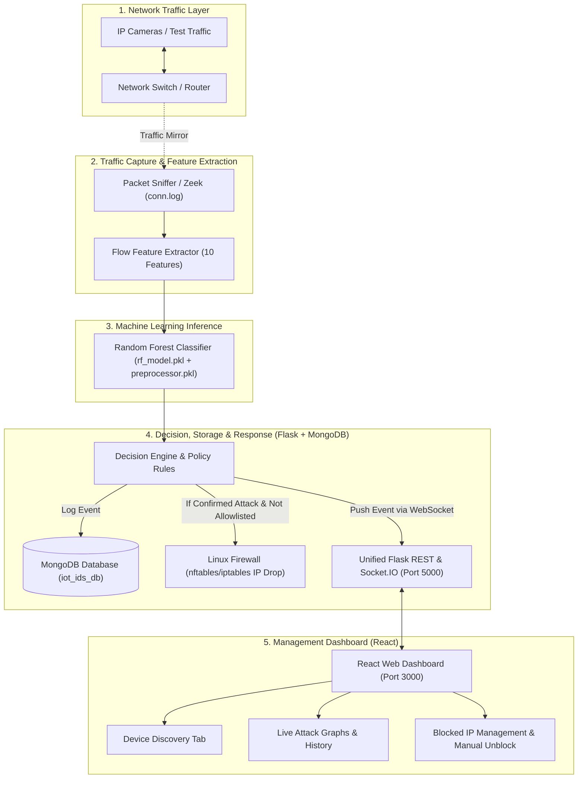

# Master Technical Guide: Real-Time Intrusion Detection and Response System for IP-Camera IoT Networks

> **ලේඛනයේ අරමුණ:**  
> මෙම ලේඛනය මගින් ව්‍යාපෘති Proposal එක (Official Research Proposal - July 2026) සහ දැනට Project Folder එකෙහි (`d:\intrusion detection`) පවතින කේතය (Existing Code) අතර ඇති සියලුම තාක්ෂණික වෙනස්කම් සහ අඩුපාඩු සංසන්දනය කර, Proposal එකෙහි නියමිත ප්‍රමිතියට (Academic & Practical Standards) 100% ක් අනුකූල වන සේ පද්ධතිය ආරම්භයේ සිට අවසානය දක්වා ගොඩනැගීමේ **සම්පූර්ණ, ඒකාබද්ධ පියවරෙන් පියවර ක්‍රියාත්මක කිරීමේ සැලැස්ම (Unified Step-by-Step Execution Roadmap)** සවිස්තරාත්මකව ඉදිරිපත් කරයි.

---

## 1. විධායක සංසන්දනය: දැනට ඇති තත්ත්වය vs Proposal එක අනුව විය යුතු ආකාරය (Gap Analysis)

| අංශය (Component) | දැනට Folder එකේ ඇති ආකාරය (Current Code) | Proposal එක අනුව විය යුතු ආකාරය (Proposal Standard) | කළ යුතු අත්‍යවශ්‍ය වෙනස්කම (Action Required) |
| :--- | :--- | :--- | :--- |
| **1. Traffic Capture & Feature Generation** | `iot23_attacks.py` හි **Scapy** මගින් packets අල්ලයි. Flow එකක් සම්පූර්ණ වන තෙක් නොසිට `duration=0, conn_state=6, history=22, service=0` ලෙස **dummy/placeholder values** දමා ඇත. | **Zeek (Bro)** ප්‍රධාන මෙවලම ලෙස භාවිත කළ යුතුය (Sec 3.5). Zeek හි `conn.log` මගින් TCP/UDP/ICMP සැබෑ flow records සාදා features 10 ලබාගත යුතුය. Scapy භාවිත වන්නේ packet debugging සහ attack simulation වලට පමණි. | Scapy dummy features ඉවත් කර, Zeek ගේ `conn.log` එක real-time කියවා (Log Tailer) features 10 නිවැරදිව ලබාගන්නා **`zeek_adapter.py`** සකස් කිරීම. |
| **2. Active Response & Mitigation (Firewall)** | ප්‍රහාරයක් හඳුනාගත් විට Console එකේ print කිරීම, DB එකට දැමීම සහ React එකට WebSocket message යැවීම පමණක් කරයි. **කිසිදු IP Blocking එකක් සිදු නොවේ.** | Attack එකක් තහවුරු වූ විට Linux **`nftables`** හෝ **`iptables`** මගින් Attacker IP එක ස්වයංක්‍රීයව Block (DROP) කළ යුතුය (Sec 3.7, FR-07). | Backend එකට `firewall_manager.py` එක් කර, attack එකක් ආ විට Linux firewall command එකක් run කර IP එක block කිරීමේ සහ unblock කිරීමේ logic එක ලිවීම. |
| **3. Safety & Allowlists** | Allowlist එකක් නොමැත. ඕනෑම IP එකක් attack එකක් ලෙස වැරදියට හඳුනාගත හැක (False Positive risk). | **Static Management Allowlist** එකක් අනිවාර්ය වේ. Admin IP, NVR (Recorder) IP, Router IP කිසිවිටෙකත් block නොවිය යුතුය (Sec 2.5, FR-08). | Backend එක තුළ Admin, NVR, Gateway IP ලිපින අඩංගු Allowlist එකක් පවත්වා ගැනීම සහ Confidence > 85% සහ repetition threshold සපිරෙන තුරු block නොකිරීම. |
| **4. Frontend Controls (React Dashboard)** | `IOTDetails.js` හි ප්‍රහාර graphs සහ logs පමණක් පෙන්වයි. Block වූ IP බැලීමට හෝ Admin ට "Unblock" කිරීමට UI එකක් නොමැත. | Dashboard එකෙන් Active Blocked IPs බැලීමට හැකි විය යුතු අතර, Admin ට එක් click එකකින් වැරදීමකින් block වූ IP එකක් **Manual Unblock** කිරීමට හැකි විය යුතුය (Sec 3.7, FR-07). | React Dashboard එකට "Blocked IP Management" panel එකක් සහ "Unblock" Button එකක් එක් කර Backend එකේ `/api/firewall/unblock` endpoint එකට සම්බන්ධ කිරීම. |
| **5. Backend Architecture & Database** | Services දෙකක් වෙන වෙනම ports 2ක run වේ (`iot23_attacks.py` port 5005, `network_scan.py` port 5012). DBs දෙකක් භාවිත වේ (`intrusion_detection` සහ `iot_security`). | තනි ඒකාබද්ධ Logical Data Model එකක් (Proposal Figure 4) යටතේ එක් MongoDB database එකක collections 5ක් පවත්වා ගත යුතුය. | MongoDB database එක `iot_ids_db` ලෙස එකතු කර, `devices`, `attack_events`, `response_actions`, `blocklist`, `system_logs` ලෙස collections 5 standardize කිරීම. |
| **6. Machine Learning Preprocessing** | `A.py` මගින් train කර ඇති `random_forest_model.pkl` එක 820 MB තරම් විශාලය. Numerical features අනවශ්‍ය ලෙස scale කර ඇත. | Proposal Sec 3.3 අනුව Random Forest සඳහා numerical scaling අවශ්‍ය නොවේ. Categorical values (`proto, conn_state, service, history`) නිවැරදිව Encode කළ යුතු අතර model එක optimized විය යුතුය. | Preprocessing pipeline එක (Encoders) සහ Model එක එකට save කර (`preprocessor.pkl` + `rf_model.pkl`), live pipeline එකට 100% ගැලපෙන සේ සකස් කිරීම. |
| **7. External Alerts (Telegram & Email)** | Proposal හි FR-05 යටතේ සඳහන් කර තිබුණි. | **අධීක්ෂක / ව්‍යාපෘති තීරණය අනුව මෙම කොටස සම්පූර්ණයෙන්ම ඉවත් කර ඇත.** | Telegram Bot සහ SMTP Email scripts අනවශ්‍යයි. Alerts සියල්ල React Dashboard සහ MongoDB Audit logs මගින් පමණක් සිදු වේ. |

---

## 2. පද්ධතියේ ප්‍රධාන සංරචක සහ තාක්ෂණික කාර්යභාරය



### Machine Learning Model එකට අවශ්‍ය Features 10:
1. `duration`: Connection එක විවෘතව පැවති කාලය (Seconds).
2. `proto`: Protocol අංකය (TCP = 6, UDP = 17, ICMP = 1).
3. `orig_bytes`: Source එකෙන් යැවූ bytes ප්‍රමාණය.
4. `resp_bytes`: Destination එකෙන් ලැබුණු bytes ප්‍රමාණය.
5. `missed_bytes`: Drop වූ bytes ප්‍රමාණය.
6. `orig_pkts`: Source එකෙන් යැවූ packets ගණන.
7. `resp_pkts`: Destination එකෙන් ලැබුණු packets ගණන.
8. `conn_state`: Connection එකේ අවසාන තත්ත්වය (SF, S0, OTH ආදිය).
9. `history`: State transition history string එක.
10. `service`: Application layer protocol එක (HTTP, DNS, RTSP ආදිය).

### හඳුනාගන්නා ප්‍රහාර පන්ති (5 Attack Classes):
* **Class 0 - Benign:** සාමාන්‍ය නිරවුල් කැමරා video streaming සහ සාමාන්‍ය network ගමනාගමනය.
* **Class 1 - DDoS / DoS:** Flooding ප්‍රහාර (LOIC, SYN Flood, UDP Flood).
* **Class 2 - Port Scan:** විවෘත ports සහ services සෙවීම (Nmap scans).
* **Class 3 - C&C (Command & Control):** පිටස්තර botnet servers සමඟ කෙරෙන periodic heartbeat සන්නිවේදනය.
* **Class 4 - Malware / FileDownload:** Mirai, Okiru ආදී malicious binaries download කිරීමට තැත් කිරීම.

---

## 3. ඉලක්කගත ඒකාබද්ධ Directory සැකැස්ම (Target Folder Structure)

ව්‍යාපෘතිය නියමිත ප්‍රමිතියට අනුව සංවිධානය කළ පසු root folder එක පහත පරිදි පිළිවෙලට පවතිනු ඇත:

```
d:\intrusion detection\
│
├── core_engine/                 <-- [UNIFIED BACKEND & SERVICES]
│   ├── app.py                   <-- Unified Flask & Socket.IO server (Port 5000)
│   ├── zeek_adapter.py          <-- Zeek conn.log tailer & flow builder
│   ├── firewall_manager.py      <-- Linux nftables/iptables block/unblock logic
│   ├── scanner_service.py       <-- Nmap network scanner
│   └── db_service.py            <-- MongoDB unified connection & models
│
├── ml_engine/                   <-- [MACHINE LEARNING PIPELINE]
│   ├── models/
│   │   ├── rf_model.pkl         <-- Optimized trained RF Model
│   │   └── preprocessor.pkl     <-- Categorical encoders & schema
│   ├── train_pipeline.py        <-- Grouped CV training script
│   └── evaluate_metrics.py      <-- Macro-F1, Confusion Matrix, FPR generator
│
├── my-app/                      <-- [REACT WEB DASHBOARD]
│   └── src/
│       ├── pages/
│       │   ├── IOTDetails.js    <-- Live attack graphs & alerts
│       │   ├── IoTDevicesDashboard.js <-- Discovered IP cameras
│       │   └── FirewallControls.js    <-- Blocked IPs & Manual Unblock UI
│       └── App.js
│
├── tests/                       <-- [TESTING & ATTACK SCRIPTS]
│   ├── attack_simulator.py      <-- Scapy SYN Flood / Port scan generator
│   └── replay_pcap.py           <-- Traffic replay script
│
└── PROJECT_EXPLANATION.md       <-- Master Architectural Guide
```

---

## 4. පද්ධතිය ගොඩනැගීමේ සම්පූර්ණ ඒකාබද්ධ පියවරෙන් පියවර මාර්ගෝපදේශය (Unified Step-by-Step Execution Roadmap)

පහත පියවර 8 ඔස්සේ ආරම්භයේ සිට අවසානය දක්වා ක්‍රමානුකූලව ක්‍රියාත්මක වීමෙන් පද්ධතිය Proposal එකේ සියලුම අරමුණු සපුරාලන පරිදි සාදා නිම කළ හැක.

---

### පියවර 1: ව්‍යාපෘති පරිසරය සහ Directory Layout එක සකස් කිරීම

* **අරමුණ:** විසිරී ඇති files එක් ක්‍රමවත් structure එකකට ගෙන ඒම සහ අවශ්‍ය Python libraries install කිරීම.
* **ක්‍රියාත්මක කළ යුතු පියවර:**
  1. `core_engine/`, `ml_engine/models/`, සහ `tests/` යන folders සෑදීම.
  2. මුළු backend එක සඳහාම අවශ්‍ය libraries අඩංගු `requirements.txt` ගොනුවක් සෑදීම:
     ```txt
     flask
     flask-socketio
     flask-cors
     pymongo
     scikit-learn
     joblib
     pandas
     numpy
     python-nmap
     scapy
     ```
  3. Dependencies install කරගැනීම:
     ```bash
     pip install -r requirements.txt
     ```
* **සාර්ථකත්වය තහවුරු කිරීම:** කිසිදු error එකක් නොමැතිව සියලුම libraries import කරගත හැකි වීම.

---

### පියවර 2: MongoDB දත්ත සමුදාය ඒකාබද්ධ කිරීම (Database Setup)

* **අරමුණ:** Proposals හි Figure 4 අනුව standard collections 5ක් සහිතව තනි database එකක් (`iot_ids_db`) සකස් කිරීම.
* **ක්‍රියාත්මක කළ යුතු පියවර:**
  1. MongoDB server එක ධාවනය කිරීම (Default port `27017`).
  2. `core_engine/db_service.py` ගොනුව නිර්මාණය කර, පහත collections කළමනාකරණය සඳහා functions ලිවීම:
     * `devices`: IP, MAC, Vendor, Device Type, Open Ports, Last Seen.
     * `attack_events`: Event ID, Timestamp, Source IP, Destination IP, Predicted Class, Confidence, Flow Features, Status.
     * `response_actions`: Action ID, Event ID, Target IP, Rule Type, Status, Timestamp.
     * `blocklist`: Blocked IP, Reason, Confidence, Blocked At, Expires At, Status (`Active` / `Unblocked`).
     * `system_logs`: Log ID, Actor, Event, Outcome, Timestamp.
  3. `ip` සහ `timestamp` fields සඳහා MongoDB Indexes යෙදීම (වේගවත් query සඳහා).
* **සාර්ථකත්වය තහවුරු කිරීම:** Test script එකක් මගින් record එකක් insert කර නැවත query කර පරීක්ෂා කිරීම.

---

### පියවර 3: Machine Learning Model එක සහ Preprocessor එක ප්‍රමිතිගත කිරීම

* **අරමුණ:** `iot23_attacks/iot23/` හි ඇති dataset එක භාවිතයෙන් numerical scaling නොමැතිව, categorical encoders පමණක් සහිත optimized model එකක් train කර evaluation metrics ලබා ගැනීම.
* **ක්‍රියාත්මක කළ යුතු පියවර:**
  1. `ml_engine/train_pipeline.py` script එක සකස් කිරීම:
     * `X_train.csv` හි features 10 නිවැරදිව තෝරා ගැනීම.
     * `proto`, `conn_state`, `history`, `service` සඳහා `OrdinalEncoder(handle_unknown='use_encoded_value', unknown_value=-1)` fit කිරීම.
     * Numerical features (`duration`, `orig_bytes`, `resp_bytes`, `orig_pkts`, `resp_pkts`, `missed_bytes`) raw numbers ලෙස තබා ගැනීම.
     * Random Forest Model එක `n_estimators=100`, `max_depth=20`, `class_weight='balanced'` සහිතව train කිරීම.
  2. Encoders අඩංගු `preprocessor.pkl` සහ Model එක අඩංගු `rf_model.pkl` ලෙස `ml_engine/models/` තුළ save කිරීම (Model size එක 100 MB ට අඩු මට්ටමකට පාලනය වේ).
  3. `ml_engine/evaluate_metrics.py` මගින්:
     * `X_test.csv` මත test කර **Macro-F1 score (ඉලක්කය: $\ge 0.85$)**, Precision, Recall, Confusion Matrix සහ False Positive Rate (FPR $\le 5\%$) ගණනය කර වාර්තාවක් ජනනය කිරීම.
* **සාර්ථකත්වය තහවුරු කිරීම:** Model එක input array එකක් දුන් විට ක්ෂණිකව (<10ms) class prediction එකක් සහ confidence අගයක් ලබා දීම.

---

### පියවර 4: Active Response & Firewall Mitigation Engine එක ගොඩනැගීම

* **අරමුණ:** Attack එකක් හඳුනාගත් විට Linux Firewall (`nftables` / `iptables`) මගින් ස්වයංක්‍රීයව block කිරීම සහ Admin හට unblock කිරීමට ඉඩ දීම.
* **ක්‍රියාත්මක කළ යුතු පියවර:**
  1. `core_engine/firewall_manager.py` script එක ලිවීම:
     * **Static Allowlist Check:** `127.0.0.1`, Router Gateway (`192.168.8.1`), Admin IP සහ NVR IP කිසිවිටෙකත් block නොකිරීමට validation එකක් දැමීම.
     * **Threshold Check:** Attack confidence > 0.85 වීම සහ කෙටි කාලයකදී (තත්පර 10 තුළ) අවම වශයෙන් 3 වතාවක් attack flows වාර්තා වීම තහවුරු කිරීම.
     * **Block Logic:** Linux command එක run කිරීම:
       `iptables -A INPUT -s <Attacker_IP> -j DROP`
     * **Audit Entry:** MongoDB හි `blocklist` සහ `response_actions` වෙත block කළ විස්තර ලිවීම.
     * **Unblock Function:** 
       `iptables -D INPUT -s <Attacker_IP> -j DROP` run කර MongoDB status එක `Unblocked` කිරීම.
     * *(සටහන: Windows පරිසරයේ test කරන විට error නොවීමට mock/simulation mode එකක් ඇතුළත් කිරීම).*
* **සාර්ථකත්වය තහවුරු කිරීම:** Test IP එකක් block කිරීමේ command එකක් දුන් විට එය DB එකේ record වී firewall rule එකක් ලෙස වැටීම.

---

### පියවර 5: Unified Backend API සහ WebSocket Server එක නිර්මාණය කිරීම

* **අරමුණ:** වෙන වෙනම පැවති Port 5005 (Attacks) සහ Port 5012 (Network Scan) එකම Flask app එකක් (Port 5000) තුළට ඒකාබද්ධ කිරීම.
* **ක්‍රියාත්මක කළ යුතු පියවර:**
  1. `core_engine/app.py` ලිවීම (Flask + Flask-SocketIO):
     * **CORS** enable කිරීම (`cors_allowed_origins="*"`).
  2. REST Endpoints සැකසීම:
     * `GET /api/devices`: ජාලයේ ඇති IP කැමරා සහ devices ලැයිස්තුව ලබා දීම.
     * `POST /api/scan`: Local subnet එක Nmap මගින් scan කර කැමරා සොයා ගැනීම.
     * `GET /api/attacks/history`: MongoDB වෙතින් අවසාන attacks ලබා ගැනීම.
     * `GET /api/attacks/stats`: Attack class distribution සංඛ්‍යාලේඛන ලබා දීම.
     * `GET /api/firewall/blocked`: දැනට block වී ඇති IP ලිපින ලබා දීම.
     * `POST /api/firewall/unblock`: Admin විසින් දෙන IP එක unblock කිරීම.
  3. WebSocket Events සකස් කිරීම:
     * `new_attack`: ප්‍රහාරයක් හඳුනාගත් සැනින් Dashboard එකට push කිරීම.
     * `traffic_update`: සාමාන්‍ය live traffic telemetry push කිරීම.
* **සාර්ථකත්වය තහවුරු කිරීම:** `python core_engine/app.py` run කළ විට Port 5000 හි server එක start වී endpoints නිවැරදිව JSON ප්‍රතිදාන ලබා දීම.

---

### පියවර 6: Live Traffic Capture සහ Zeek Flow Adapter එක සම්බන්ධ කිරීම

* **අරමුණ:** සැබෑ network traffic එකෙන් flow data ලබාගෙන ML model එකට යැවීම.
* **ක්‍රියාත්මක කළ යුතු පියවර:**
  1. Zeek සේවාව background එකේ run කිරීම (නැතහොත් capture කළ PCAP එකක් Zeek මගින් කියවීම):
     `zeek -i eth0` (Live interface) හෝ `zeek -C -r sample.pcap`
  2. `core_engine/zeek_adapter.py` ලිවීම:
     * Zeek විසින් ලියනු ලබන `conn.log` එක real-time කියවීම (File tailing).
     * සෑම අලුත් connection record එකකින්ම features 10 වෙන් කර ගැනීම.
     * `preprocessor.pkl` මගින් encode කර, `rf_model.pkl` වෙත යවා prediction එක ලබා ගැනීම.
     * Prediction එක Attack එකක් නම්, `firewall_manager.block_ip()` call කර React එකට Socket.IO event එකක් emit කිරීම.
  3. `tests/attack_simulator.py` සකස් කිරීම (Scapy භාවිතයෙන්):
     * SYN Flood, UDP Flood හෝ Port Scan traffic generate කර පද්ධතියේ detection එක පරීක්ෂා කිරීම.
* **සාර්ථකත්වය තහවුරු කිරීම:** Attack simulator එක run කළ විට Zeek `conn.log` හරහා එය model එකට ගොස් තත්පර 2ක් ඇතුළත attack එකක් ලෙස හඳුනා ගැනීම.

---

### පියවර 7: React Frontend Dashboard එක ඒකාබද්ධ කිරීම සහ යාවත්කාලීන කිරීම

* **අරමුණ:** React Dashboard එක Backend Port 5000 සමඟ සම්බන්ධ කර, Attacks, Devices සහ Blocked IPs කළමනාකරණය පෙන්වීම.
* **ක්‍රියාත්මක කළ යුතු පියවර:**
  1. `my-app/src/` හි API URLs Port 5000 වෙත update කිරීම:
     * `http://localhost:5000/api` සහ `ws://localhost:5000`.
  2. `IoTDevicesDashboard.js`:
     * Nmap scan results මගින් IP කැමරා (Hikvision, RTSP devices) ලස්සනට පෙන්වීම.
  3. `IOTDetails.js`:
     * WebSocket `new_attack` event එකට අනුව live graph එක සහ attack logs real-time පෙන්වීම.
  4. **නව Firewall Controls Component එකක් එක් කිරීම:**
     * Active Blocked IPs table එකක් පෙන්වීම.
     * සෑම IP එකක් ළඟම **"Unblock IP"** button එකක් තබා, එය click කළ විට `POST /api/firewall/unblock` endpoint එක call කර IP එක නිදහස් කිරීම.
* **සාර්ථකත්වය තහවුරු කිරීම:** `npm start` කර browser එකෙන් බැලූ විට, attack එකක් එන විට graph එක update වීම සහ "Unblock" click කළ විට table එකෙන් අදාළ IP එක ඉවත් වීම.

---

### පියවර 8: අවසාන පරීක්ෂණ, ඇගයීම සහ Viva නිරූපණය (Testing & Demo)

* **අරමුණ:** Proposal හි Table 9 සහ Table 10 හි ඇති Controlled Scenarios පරීක්ෂා කර සාර්ථකත්වය තහවුරු කිරීම.
* **පරීක්ෂා කළ යුතු අවස්ථා 5 (Test Scenarios):**
  1. **සාමාන්‍ය Video Streaming:** IP Camera එකකින් (හෝ IP Webcam app එකෙන්) video stream එකක් නිරන්තරයෙන් යවන විට Benign ලෙස හඳුනාගත යුතු අතර කිසිදු block වීමක් සිදු නොවිය යුතුය.
  2. **Port Scan ප්‍රහාරය:** Nmap මගින් කැමරාව scan කරන විට Class 2 (Port Scan) ලෙස හඳුනාගෙන scanner IP එක block විය යුතුය. Admin IP එක Allowlist එකේ ඇති බැවින් block නොවිය යුතුය.
  3. **DDoS Flooding ප්‍රහාරය:** Attack simulator මගින් flood කළ විට Class 1 (DDoS) ලෙස හඳුනාගෙන, තත්පර 2ක් ඇතුළත IP එක drop වී කැමරා video stream එක සාමාන්‍ය තත්ත්වයට පත් විය යුතුය.
  4. **Manual Rollback (Unblock):** Admin විසින් Dashboard එකෙන් Unblock කළ විට අදාළ IP එකට නැවත network access ලැබිය යුතුය.
  5. **Latency Measurement:** Packet capture එකේ සිට Prediction සහ Dashboard එකට ඒම දක්වා ගතවන කාලය තත්පර 2 ට වඩා අඩු විය යුතුය.

---

## 5. පද්ධතිය එක්වර ධාවනය කිරීමේ කෙටි උපදෙස් (Run Commands)

```bash
# 1. MongoDB ආරම්භ කිරීම
mongod --dbpath <data_path>

# 2. Unified Backend එක ධාවනය කිරීම (Terminal 1)
python core_engine/app.py

# 3. Zeek Traffic Processing Adapter එක ධාවනය කිරීම (Terminal 2)
python core_engine/zeek_adapter.py

# 4. React Dashboard එක ධාවනය කිරීම (Terminal 3)
cd my-app
npm start

# 5. පරීක්ෂණ ප්‍රහාරයක් එල්ල කිරීම (Terminal 4)
python tests/attack_simulator.py --attack ddos --target 192.168.8.105
```

# 5. පරීක්ෂණ ප්‍රහාරයක් එල්ල කිරීම (Terminal 4)
python tests/attack_simulator.py --attack ddos --target 192.168.8.105
```

