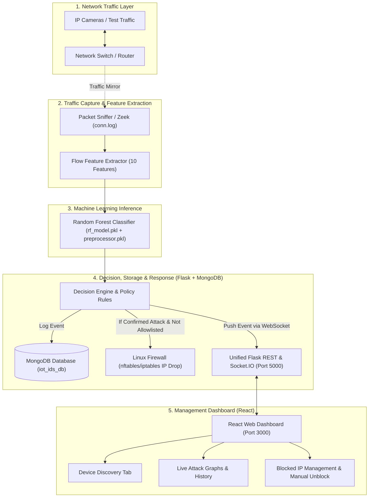

# Master Technical Guide: Real-Time Intrusion Detection and Response System for IP-Camera IoT Networks

> **Purpose of this Document:**  
> This document provides a comprehensive technical comparison between the official Research Proposal (July 2026) and the current code existing in the project repository (`d:\intrusion detection`). It highlights all technical gaps, explains how every component works, and presents a **complete, unified, step-by-step implementation roadmap** to build the entire system according to the required academic and practical standards.

---

## 1. Executive Comparison: Current Code vs. Proposal Standard (Gap Analysis)

The table below directly compares the current state of the repository with the mandatory requirements defined in the official project proposal:

| Component | Current State in Repository | Proposal Requirement | Action Required |
| :--- | :--- | :--- | :--- |
| **1. Traffic Capture & Feature Generation** | `iot23_attacks.py` uses **Scapy** to sniff individual packets. It inserts hardcoded **dummy/placeholder values** (`duration=0, conn_state=6, history=22, service=0`). | **Zeek (Bro)** must be the primary tool for production (Sec 3.5). Zeek's `conn.log` must generate true connection flow records. Scapy is only for packet debugging and attack simulation. | Remove Scapy dummy values and build **`zeek_adapter.py`** to tail Zeek's `conn.log` in real time and extract the genuine 10 flow features. |
| **2. Active Response & Mitigation (Firewall)** | When an attack is detected, the script only prints to the console, logs to DB, and sends a WebSocket message. **No IP blocking occurs.** | When an attack is confirmed, the system must automatically block (DROP) the attacker IP using Linux **`nftables`** or **`iptables`** (Sec 3.7, FR-07). | Implement **`firewall_manager.py`** in the backend to execute firewall drop commands and handle automatic and manual unblocking. |
| **3. Safety & Management Allowlists** | No allowlist exists. Any device (including admin or NVR) could theoretically be flagged as an attack (high false-positive risk). | A **Static Management Allowlist** is mandatory. The Admin IP, NVR (Camera Recorder) IP, and Gateway IP must never be blocked (Sec 2.5, FR-08). | Maintain an allowlist of trusted IPs in the backend. Ensure blocks only execute when confidence > 85% and repetition thresholds are met. |
| **4. Frontend Controls (React Dashboard)** | `IOTDetails.js` only displays attack history graphs and tables. There is no interface to view blocked IPs or unblock an IP. | The dashboard must display active blocked IPs and provide a **Manual Unblock** button for administrators to roll back false blocks (Sec 3.7, FR-07). | Add a "Blocked IP Management" component in the React app with an "Unblock" button wired to the backend API (`/api/firewall/unblock`). |
| **5. Backend Architecture & Database** | Two separate Flask apps run on different ports (`iot23_attacks.py` on 5005, `network_scan.py` on 5012) using two separate DBs (`intrusion_detection` and `iot_security`). | A single unified logical data model (Proposal Figure 4) must be used within one MongoDB database containing 5 standard collections. | Consolidate the backend into a unified service on Port 5000 and standardize the MongoDB database as **`iot_ids_db`** with 5 collections. |
| **6. Machine Learning Preprocessing** | `random_forest_model.pkl` is 820 MB. Numerical features were min-max scaled, which creates incompatibility with raw live network data. | Random Forest does not require numerical scaling (Sec 3.3). Only categorical variables (`proto, conn_state, service, history`) must be encoded. | Retrain and optimize the Random Forest model without numerical scaling. Save the categorical encoder alongside the model (`preprocessor.pkl` + `rf_model.pkl`). |
| **7. External Alerts (Telegram & Email)** | Originally listed under FR-05 in the proposal. | **Dropped per supervisor / project scope adjustment.** | Telegram Bot and SMTP Email scripts are not required. Real-time alerting is handled exclusively via the Web Dashboard and Audit Logs. |

---

## 2. System Architecture and Component Overview

The system operates across 5 functional layers:



### The 10 Connection Flow Features:
1. `duration`: Total duration of the network connection (in seconds).
2. `proto`: Network protocol numeric ID (TCP = 6, UDP = 17, ICMP = 1).
3. `orig_bytes`: Bytes sent by the connection originator (source).
4. `resp_bytes`: Bytes returned by the connection responder (destination).
5. `missed_bytes`: Number of dropped / missing bytes during transmission.
6. `orig_pkts`: Total packets sent by originator.
7. `resp_pkts`: Total packets sent by responder.
8. `conn_state`: Connection completion state (e.g., SF for normal close, S0 for SYN with no reply, OTH for other).
9. `history`: Connection state history sequence string.
10. `service`: Application layer protocol identified (HTTP, DNS, RTSP, or 0 for none).

### The 5 Target Attack Classes:
* **Class 0 - Benign:** Normal legitimate camera streaming and standard network traffic.
* **Class 1 - DDoS / DoS:** Flooding attacks (SYN floods, UDP floods, HTTP request bursts).
* **Class 2 - Port Scan:** Reconnaissance probing open ports (horizontal and vertical Nmap scans).
* **Class 3 - C&C (Command & Control):** Periodic beaconing and outbound heartbeat communication to botnet servers.
* **Class 4 - Malware / FileDownload:** Malicious binary downloads (Mirai, Okiru, shell scripts).

---

## 3. Target Unified Directory Layout

Once refactored, the project directory will be structured cleanly as follows:

```
d:\intrusion detection\
│
├── core_engine/                 <-- [UNIFIED BACKEND & SERVICES]
│   ├── app.py                   <-- Unified Flask & Socket.IO server (Port 5000)
│   ├── zeek_adapter.py          <-- Zeek conn.log tailer & flow builder
│   ├── firewall_manager.py      <-- Linux nftables/iptables block/unblock logic
│   ├── scanner_service.py       <-- Nmap network scanner
│   └── db_service.py            <-- MongoDB unified connection & models
│
├── ml_engine/                   <-- [MACHINE LEARNING PIPELINE]
│   ├── models/
│   │   ├── rf_model.pkl         <-- Optimized trained RF Model
│   │   └── preprocessor.pkl     <-- Categorical encoders & schema
│   ├── train_pipeline.py        <-- Grouped CV training script
│   └── evaluate_metrics.py      <-- Macro-F1, Confusion Matrix, FPR generator
│
├── my-app/                      <-- [REACT WEB DASHBOARD]
│   └── src/
│       ├── pages/
│       │   ├── IOTDetails.js    <-- Live attack graphs & alerts
│       │   ├── IoTDevicesDashboard.js <-- Discovered IP cameras
│       │   └── FirewallControls.js    <-- Blocked IPs & Manual Unblock UI
│       └── App.js
│
├── tests/                       <-- [TESTING & ATTACK SCRIPTS]
│   ├── attack_simulator.py      <-- Scapy SYN Flood / Port scan generator
│   └── replay_pcap.py           <-- Traffic replay script
│
├── PROJECT_EXPLANATION.md       <-- Master Architectural Guide (Sinhala)
└── PROJECT_EXPLANATION_EN.md    <-- Master Architectural Guide (English)
```

---

## 4. Complete Unified Step-by-Step Execution Roadmap

This 8-step roadmap outlines the exact, sequential engineering tasks required to build the entire working prototype from scratch.

---

### Step 1: Project Environment & Directory Setup

* **Objective:** Establish a clean, modular folder structure and install all necessary Python dependencies.
* **Actions:**
  1. Create the modular directories: `core_engine/`, `ml_engine/models/`, and `tests/`.
  2. Create a unified `requirements.txt` file in the root directory:
     ```txt
     flask
     flask-socketio
     flask-cors
     pymongo
     scikit-learn
     joblib
     pandas
     numpy
     python-nmap
     scapy
     ```
  3. Install dependencies in the Python environment:
     ```bash
     pip install -r requirements.txt
     ```
* **Verification:** Run a test script to confirm all libraries import without errors.

---

### Step 2: Unified MongoDB Database Configuration

* **Objective:** Replace fragmented databases with a single standardized MongoDB database (`iot_ids_db`) matching Proposal Figure 4.
* **Actions:**
  1. Start the local MongoDB service (Default port `27017`).
  2. Create `core_engine/db_service.py` to handle all CRUD operations across the 5 standard collections:
     * `devices`: IP address, MAC address, vendor name, device type, open ports, and last seen timestamp.
     * `attack_events`: Event ID, timestamp, source IP, destination IP, predicted class, confidence score, raw flow features, and status.
     * `response_actions`: Action ID, event ID, target IP, rule type, execution status, and timestamp.
     * `blocklist`: Blocked IP, reason, confidence, blocked at, expires at, and status (`Active` / `Unblocked`).
     * `system_logs`: Log ID, actor, event description, outcome, and timestamp.
  3. Apply database indexes on `ip` and `timestamp` fields for low-latency queries.
* **Verification:** Insert a test attack document and query it back using `db_service.py`.

---

### Step 3: Machine Learning Model & Preprocessor Standardization

* **Objective:** Train an optimized, lightweight Random Forest model using the IoT-23 dataset in `iot23_attacks/iot23/`, without numerical scaling, and generate standard evaluation metrics.
* **Actions:**
  1. Create `ml_engine/train_pipeline.py`:
     * Load `X_train.csv` and `y_train.csv`.
     * Retain numerical features (`duration`, `orig_bytes`, `resp_bytes`, `orig_pkts`, `resp_pkts`, `missed_bytes`) as raw numerical values (no min-max float scaling).
     * Fit an `OrdinalEncoder(handle_unknown='use_encoded_value', unknown_value=-1)` exclusively on categorical fields (`proto`, `conn_state`, `history`, `service`).
     * Train a `RandomForestClassifier` with balanced class weights (`n_estimators=100`, `max_depth=20`, `class_weight='balanced'`).
  2. Save both artifacts to `ml_engine/models/`:
     * `preprocessor.pkl` (Categorical encoders).
     * `rf_model.pkl` (Optimized model file, kept below 100 MB).
  3. Create `ml_engine/evaluate_metrics.py`:
     * Evaluate performance on `X_test.csv`.
     * Compute and output: **Macro-F1 score (Target: $\ge 0.85$)**, Precision, Recall, Confusion Matrix, and False Positive Rate on benign traffic (Target: $\le 5\%$).
* **Verification:** Confirm that calling `rf_model.predict()` on a 10-feature vector executes in under 10 milliseconds.

---

### Step 4: Active Response & Firewall Mitigation Engine

* **Objective:** Build the automated IP-blocking and unblocking logic using Linux `nftables` or `iptables`, protected by strict safety allowlists.
* **Actions:**
  1. Create `core_engine/firewall_manager.py`:
     * **Static Management Allowlist:** Implement a whitelist containing `127.0.0.1`, the Default Gateway (`192.168.8.1`), the Admin Workstation IP, and the NVR IP. These IPs must never be blocked.
     * **Threshold Policy:** Require that attack confidence exceeds 0.85 and that at least 3 attack flows are observed within a 10-second window before executing a block.
     * **Firewall Drop Rule Execution:**
       Execute the system command:
       `iptables -A INPUT -s <Attacker_IP> -j DROP`
     * **Audit Logging:** Save the block action to MongoDB collections `blocklist` and `response_actions`.
     * **Manual Unblock Function:**
       Execute `iptables -D INPUT -s <Attacker_IP> -j DROP` and update the status in MongoDB to `Unblocked`.
     * *(Note: Include a platform-agnostic simulation fallback so the engine runs gracefully on Windows during local development).*
* **Verification:** Call the block function on a dummy IP address and verify that the entry is recorded in MongoDB and the system command is triggered.

---

### Step 5: Unified Backend API & WebSocket Server

* **Objective:** Consolidate port 5005 (attacks) and port 5012 (scans) into a single Flask application running on Port 5000.
* **Actions:**
  1. Create `core_engine/app.py` using Flask and Flask-SocketIO with CORS enabled.
  2. Implement REST API endpoints:
     * `GET /api/devices`: Returns discovered IoT cameras and devices.
     * `POST /api/scan`: Triggers an active Nmap subnet scan to discover local devices.
     * `GET /api/attacks/history`: Returns recent detected attacks from MongoDB.
     * `GET /api/attacks/stats`: Returns attack classification statistics.
     * `GET /api/firewall/blocked`: Returns the list of currently blocked IPs.
     * `POST /api/firewall/unblock`: Unblocks a designated IP upon admin request.
  3. Implement WebSocket Events:
     * `new_attack`: Broadcasts real-time attack alerts to connected web clients.
     * `traffic_update`: Streams live connection telemetry.
* **Verification:** Run `python core_engine/app.py` and confirm that all endpoints return valid JSON responses at `http://localhost:5000`.

---

### Step 6: Live Traffic Capture & Zeek Flow Adapter

* **Objective:** Feed live network traffic into the system using Zeek connection logs (`conn.log`), and create attack simulation scripts for validation.
* **Actions:**
  1. Run Zeek on the network interface:
     `zeek -i eth0` (or replay a PCAP file: `zeek -C -r sample.pcap`).
  2. Create `core_engine/zeek_adapter.py`:
     * Monitor (tail) Zeek's `conn.log` file in real time as new connections complete.
     * Parse the connection record and extract the 10 target fields.
     * Transform features using `preprocessor.pkl`.
     * Execute `rf_model.predict_proba()` to determine attack type and confidence score.
     * If an attack is detected and meets policy criteria, invoke `firewall_manager.block_ip()` and emit a WebSocket event.
  3. Create `tests/attack_simulator.py` using Scapy:
     * Generate controlled SYN Floods, UDP Floods, and Port Scans for testing detection and response latency.
* **Verification:** Run the attack simulator and confirm that Zeek's `conn.log` captures the flow and triggers an alert within 2 seconds.

---

### Step 7: React Frontend Integration & Firewall Controls UI

* **Objective:** Update the React dashboard to communicate with the unified Port 5000 backend, display live telemetry, and provide interactive firewall controls.
* **Actions:**
  1. Update `my-app` configuration to point to Port 5000 (`http://localhost:5000/api` and `ws://localhost:5000`).
  2. Refactor `IoTDevicesDashboard.js`:
     * Fetch discovered cameras and network devices from `/api/devices`.
  3. Refactor `IOTDetails.js`:
     * Listen for `new_attack` WebSocket events and update the live Chart.js frequency graph without reloading the page.
  4. Create `FirewallControls.js`:
     * Display a table of actively blocked IPs (IP address, attack type, confidence, block timestamp, status).
     * Add an **"Unblock"** button next to each blocked IP that sends a `POST` request to `/api/firewall/unblock`.
* **Verification:** Launch `npm start`, simulate an attack, observe the UI update dynamically in real time, and verify that clicking "Unblock" successfully restores the IP.

---

### Step 8: End-to-End System Testing & Controlled Scenarios

* **Objective:** Validate the complete IDS/IPS prototype against Proposal Table 9 and Table 10 acceptance criteria.
* **Five Mandatory Test Scenarios:**
  1. **Normal Video Streaming:** Stream RTSP/HTTP video continuously from an IP camera (or the "IP Webcam" app). Verify that flows are classified as Benign and no false blocks occur (FPR $\le 5\%$).
  2. **Authorized Port Scan:** Run an Nmap scan against the camera. Verify detection as Class 2 (Port Scan), observe the scanner IP get blocked, and ensure the whitelisted Admin IP remains connected.
  3. **Rate-Limited DDoS Flood:** Launch a simulated SYN/HTTP flood. Verify detection as Class 1 (DDoS) within 2 seconds, observe the attacker IP get blocked, and verify that camera video streaming recovers immediately.
  4. **Manual Rollback (Unblock):** Click the "Unblock" button in the React dashboard and verify that the firewall drop rule is deleted and connectivity is restored.
  5. **Latency & Performance Measurement:** Measure total latency from traffic capture to firewall drop; ensure median decision time is $< 2$ seconds.

---

## 5. Quick Run Instructions (Terminal Commands)

```bash
# 1. Start MongoDB Service
mongod --dbpath <data_directory>

# 2. Start the Unified Backend API Server (Terminal 1)
python core_engine/app.py

# 3. Start the Zeek Traffic Processing Adapter (Terminal 2)
python core_engine/zeek_adapter.py

# 4. Start the React Frontend Dashboard (Terminal 3)
cd my-app
npm start

# 5. Launch a Controlled Test Attack (Terminal 4)
python tests/attack_simulator.py --attack ddos --target 192.168.8.105
```

