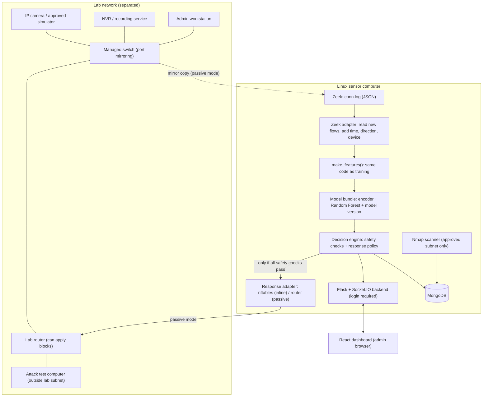

> **ARCHIVED (9 November 2026). Do not use this file for numbers or status.** It was moved here because many results and claims in it are out of date or were withdrawn (for example the old macro-F1 values, "Steps 0-33 complete", and results from script-made camera traffic). The current, correct sources are `STEP_BY_STEP_GUIDE.md`, `PROJECT_PROGRESS_AND_CHALLENGES.md`, `docs/decision_log.md`, `docs/requirements_checklist.md` and `reports/experiments/model_card.md` (decision D-049).

# ව්‍යාපෘති පැහැදිලි කිරීම: Real-Time Intrusion Detection and Response System for IP-Camera IoT Networks

> **නිවැරදි කිරීමේ දැන්වීම (2026 නොවැම්බර් 8) — මුලින්ම මෙය කියවන්න.** පහත ලැයිස්තුව ඉංග්‍රීසියෙන් ඇත; මෙම ගොනුවේ පෙළ පහත කරුණු සමඟ නොගැලපේ නම්, පහත කරුණු නිවැරදියි. / **Correction notice (8 November 2026) — read this first.** A full check against the proposal found errors in earlier text. Where this file disagrees with the points below, the points below are correct (decisions D-039 to D-042 in `docs/decision_log.md`):
> 1. The 5,000 "camera" flows of 31 Oct 2026 were **made by a script**, not captured from a Tapo C200 or any camera. The result "FPR 0.000%, H1 clause 2 PASS" is **withdrawn**. The FPR part of H1 is **not tested yet** (Step 20 in the lab).
> 2. The Step 22 schema check used the same synthetic file, so **RQ3 is not answered yet**.
> 3. Hypothesis H1 has two parts only: macro-F1 ≥ 0.85 on the held-out scenarios, and benign FPR ≤ 5% on our local camera traffic. Latency is a separate Table 9 target: median decision < 2 s and 95th percentile < 5 s, end to end. It is **not** "sub-second", and the model inference time (microseconds) is not the end-to-end time.
> 4. The held-out macro-F1 is **below** the 0.85 target (see `reports/experiments/model_card.md` for the current numbers). This is reported as it is (proposal Table 9).
> 5. Step 17 was redone: calibration and thresholds now come from grouped out-of-fold training data only (D-040).
> 6. Four scenario names in the dataset map were swapped (8-1/9-1 and 35-1/36-1) and were corrected (D-039).
> 7. The automatic response was not connected before 8 Nov 2026; it is now connected, off by default, and still has to be tested in the lab (D-041).

**පදනම:** Group 03 Research Proposal (July 2026)
**සංස්කරණය:** 2 (2026 ඔක්තෝබර් 19). Proposal එකට අනුව නැවත ලියන ලදී. පළමු සංස්කරණයේ වැරදි කිහිපයක් තිබුණි. ඒවා 14 වන කොටසේ දක්වා ඇත.
**English version:** `PROJECT_EXPLANATION_EN.md` (එකම අන්තර්ගතය).

> **මෙම ලේඛනයේ අරමුණ:** පද්ධතිය **මොකක්ද**, එහි කොටස් **එකට වැඩ කරන්නේ කොහොමද**, සහ එක් එක් තීරණය **ඇයි** ගත්තේ කියා පැහැදිලි කිරීම.
> **පියවරෙන් පියවර හදන්නේ කොහොමද** කියා **`STEP_BY_STEP_GUIDE.md`** හි (පියවර 43) ඇත. ලේඛන දෙක අතර වෙනසක් ඇත්නම්, guide එක සහ Proposal එක නිවැරදි වේ.

---

## 1. ව්‍යාපෘතිය කෙටියෙන්

IP කැමරා සෑම විටම network එකේ තිබේ. ප්‍රහාරකයන්ට ඒවා scan කිරීමට, flood කිරීමට, පාලනය කිරීමට (C&C) හෝ malware download කිරීමට භාවිත කළ හැක. කුඩා කැමරා network වල සාමාන්‍යයෙන් traffic එක නිරීක්ෂණය කරන දෙයක් හෝ ආරක්ෂිතව ප්‍රතිචාර දක්වන ක්‍රමයක් නැත.

අපි පහත දේ කරන prototype එකක් හදමු:

1. කැමරා network traffic එක **connection මට්ටමින්** නිරීක්ෂණය කරයි (metadata පමණි, video කිසිවිටෙකත් නැත);
2. **Zeek** (`conn.log`) මගින් traffic එක **flows** බවට පත් කරයි;
3. එක් එක් flow එක **Random Forest** model එකකින් **classes 5** න් එකකට වර්ග කරයි;
4. සාක්ෂි **MongoDB** හි save කරයි;
5. login අවශ්‍ය **React** dashboard එකක live alerts පෙන්වයි;
6. සියලුම ආරක්ෂක නීති සපිරුණොත් පමණක් **nftables** හෝ router හරහා **ආරක්ෂිතව ප්‍රතිචාර දක්වයි** (block හෝ rate-limit), admin ට අතින් undo කළ හැක;
7. අනුමත lab subnet එකේ devices **Nmap** මගින් සොයා ගනී.

මෙහි පර්යේෂණ ප්‍රශ්නය: **IoT-23 benchmark එකෙන් train කළ model එකක් සැබෑ IP-කැමරා traffic මත තවමත් හොඳින් වැඩ කරනවාද?** (IoT-23 හි benign data වල කැමරාවක් නැත.)

---

## 2. Gap analysis: පැරණි කේතය සහ Proposal එක සංසන්දනය

Project folder එකේ 2025 දී හැදූ පැරණි prototype එකක් තිබුණි. පහත වගුව එය Proposal එක සමඟ සංසන්දනය කරයි. පැරණි Python කොටස් දැන් `archive/` හි ඇත.

| කොටස                   | පැරණි කේතය                                                                                                     | Proposal එකට අවශ්‍ය දේ                                                                                                                                         | Guide පියවර |
| ---------------------- | -------------------------------------------------------------------------------------------------------------- | -------------------------------------------------------------------------------------------------------------------------------------------------------------- | ----------- |
| **Dataset**            | `X_train.csv` / `X_test.csv`: වෙනත් අයෙකු කලින් process කළ නිල නොවන පිටපතකි. සමහර අගයන් scale කර ඇත, scenario IDs නැත, label නම් නොදනී. | නිල **IoT-23 v1.0.0** labelled flows සහ manifest එකක් (file නම්, scenario IDs, row සහ label ගණන්, hashes). නිල නොවන පිටපතක් භාවිත නොකළ යුතුය (3.2). | 7–10        |
| **Validation**         | Rows අහඹු ලෙස 80/20 බෙදීම. Accuracy 1.00 (leakage ලකුණකි).                                                       | **Scenario අනුව grouped cross-validation**, **held-out scenario** එකක්, සහ තුන්වන මට්ටම ලෙස **local කැමරා traffic** (3.4). ප්‍රධාන metrics: macro-F1, class අනුව recall, FPR. | 13–16       |
| **Models**             | එක් Random Forest එකක් (820 MB) සහ Decision Tree එකක්.                                                          | Random Forest ප්‍රධාන model එක ලෙස, **linear model එකක් සහ gradient-boosting model එකක් සමඟ සංසන්දනය** (1.3, 2.4). Calibration සහ permutation importance (2.4, 3.4). | 14–17       |
| **Features**           | Columns 10; categories නොදන්නා අංක බවට හරවා ඇත (උදා: `conn_state=6`, `history=22`); සමහර අගයන් scale කර ඇත.          | **Table 6** candidate features: port categories, service/state/history, duration, bytes සහ packets, ratios, incomplete-flow flag, අවශ්‍ය නම් time-window rate. Live pipeline එකට එකම ආකාරයෙන් හැදිය හැකි features පමණි. | 11, 22      |
| **Live capture**       | Scapy මගින් packet එකෙන් packet එක, **ස්ථාවර ව්‍යාජ අගයන්** සමඟ (`duration=0`, `conn_state=6`, `history=22`, `service=0`). | **Zeek** `conn.log` ප්‍රධාන මෙවලම වේ. TShark/Scapy packet මට්ටමේ පරීක්ෂාවට පමණි (3.5). Live භාවිතයට පෙර offline vs live **schema check** එකක්.                  | 19–22       |
| **Response**           | කිසිදු block කිරීමක් නැත.                                                                                        | පළමු තේරීම **nftables**; iptables/ipset හෝ router API adapter එකකට ඉඩ ඇත (3.7). දිශාව අනුව ක්‍රියා, rule expiry, අතින් unblock.                             | 31–34       |
| **ආරක්ෂාව**           | Allowlist එකක් නැත.                                                                                              | Management allowlist, private-network check, අවම confidence, time window එකක් තුළ නැවත සිදුවීම, උපරිම rule කාලය, reason codes, audit records (2.5, 3.7).        | 31          |
| **Backend සහ database** | වෙනස් ports වල Flask servers කිහිපයක් (5002, 5005, 5006, 5007, 5012); MongoDB databases දෙකක් සහ users සඳහා SQLite. කේතය තුළ ලියූ secret එකක්. | Login සහිත **එක්** Flask + Flask-SocketIO backend එකක්; devices, attack events, response actions, users සහ system logs සහිත **එක්** MongoDB එකක් (3.6). Secrets environment variables හරහා. | 23–28       |
| **Dashboard**          | KDD සහ CICIDS2017 pages, සාමාන්‍ය WebSocket (Socket.IO සමඟ සම්බන්ධ විය නොහැක), backend එක නැති විට ව්‍යාජ attack පණිවිඩ.  | Event totals, අලුත් alerts, class distribution, live traffic, device status, response history; "prediction" ද "confirmed" ද යන්න; login; ඕනෑම screen එකකට ගැලපේ (3.6, Table 8). | 29–30       |
| **Device discovery**   | Vulnerability ගණනට අහඹු අංක එකතු කරයි; port 554 පමණක් = "කැමරාව".                                                 | අනුමත lab subnet එකේ පමණක් Nmap, login වූ admin කෙනෙකුට පමණක් ආරම්භ කළ හැක; එක් port එකක් කැමරාවක් බවට සාක්ෂියක් නොවේ (3.7).                                  | 27          |
| **ආචාර ධර්ම (Ethics)** | නැත.                                                                                                             | වෙන් කළ lab එකක්, public IPs නැත, video save නොකරයි, retention plan එකක්, logbook එකක් (3.8).                                            | 1, 42       |

---

## 3. පද්ධතියේ ව්‍යුහය (Architecture)

Proposal එකේ Figure 2 හි architecture එක සහ Figure 3 හි detection-and-response cycle එක විස්තර කරයි.



**Deployment modes දෙක** (Proposal Figure 5):

| Mode                          | Sensor එකට traffic පෙනෙන ආකාරය                                       | Block කරන්නේ කවුද                                                                              |
| ----------------------------- | -------------------------------------------------------------------- | ---------------------------------------------------------------------------------------------- |
| **Passive (default එක)**     | Switch එක traffic හි **පිටපතක්** sensor එකට යවයි (SPAN).              | Sensor එකට block කළ **නොහැක**. එය request එක **lab router** එකට යවයි (router එකේ nftables).   |
| **Inline**                    | Sensor එක transparent bridge එකක් ලෙස traffic **මාර්ගය මැද** ඇත.     | Sensor එක nftables (`bridge` family) මගින් තමාම block කරයි. Bypass සහ recovery plan එකක් අවශ්‍යයි. |

**එක් එක් කොටස run වන්නේ කොහේද** (Proposal 5.1): Zeek, model service, backend සහ response adapter **Linux sensor** එකේ run වේ. Model එක **development PC එකේ train කර** sensor එකට copy කරයි. ඒ නිසා දෙකෙහිම **scikit-learn version එක එකම** විය යුතුය.

---

## 4. Data: IoT-23 සහ අපේම කැමරා traffic

- **IoT-23 v1.0.0** (Stratosphere Laboratory, 2018–2019): captures ("scenarios") 23 කි. **Malicious 20 ක් සහ benign 3 ක්.** Benign devices වන්නේ smart lamp එකක්, voice assistant එකක් සහ smart door lock එකකි. **කිසිවක් IP කැමරාවක් නොවේ.**
- අපි **labelled-flow** files (`conn.log.labeled` / `dataset1.csv` - `dataset23.csv`) භාවිත කරමු. ඒවා Zeek මගින් හැදූ ඒවාය. අපේ live පද්ධතියත් Zeek භාවිත කරන නිසා මෙය හොඳයි.
- **නිල Manifest එක (Step 7):** මුළු ගොනු 23 හි ධාරිතාව **44.13 GB** කි. මුළු flows ගණන **325,309,946** (මිලියන 325.3) කි. RAM එක 100 MB ට අඩුවෙන් තබාගෙන Streaming processor එකක් (`ml_engine/manifest.py`) මඟින් කියවා `reports/dataset_manifest.csv` හි SHA-256 hashes සහ නිශ්චිත row counts සටහන් කරන ලදී.
- **Label Mapping ස්ථිර කිරීම (Step 8, Decision D-014):** `config/label_mapping.yaml` ගොනුව Proposal Table 5 අනුව classes 5 කට freeze කරන ලදී:
  - `Benign` (Class 0): 30,860,691 flows (9.49%)
  - `DDoS_DoS` (Class 1): 19,538,713 flows (6.01%)
  - `PortScan` (Class 2): 213,853,812 flows (65.74%)
  - `CnC` (Class 3): 55,698 flows (0.02%)
  - `Malware_Download` (Class 4): 60,990,792 flows (18.75%)
  - අර්ථ විරහිත / අපැහැදිලි compound labels (උදා: `Attack`, `Okiru-Attack`) අඩංගු flows 10,240 (0.0031%) model එක නොමඟ යැවීම වැළැක්වීම සඳහා ඉවත් කරන ලදී (EXCLUDE).
- **Data Quality Report (Step 9):** `reports/data_quality_report.md` මඟින් තහවුරු වූ පරිදි `duration`, `orig_bytes`, `resp_bytes` හි **61.46%** ක් හිස් (`-`) අගයන් පවතී. මෙයට හේතුව Port Scan වලදී TCP 3-way handshake එක සම්පූර්ණ නොවී `S0` තත්ත්වයෙන් අවසන් වීමයි. Step 13 හි Model evaluation සඳහා සම්පූර්ණයෙන්ම වෙන් කර තබන Held-out Scenario එක ලෙස `CTU-IoT-Malware-Capture-34-1` (Mirai, 23,145 flows, classes 4ක් අඩංගුයි) තෝරා ගන්නා ලදී.
- **දත්ත පැටවීම සහ පිරිසිදු කිරීම (Step 10 — Load and Clean Pipeline):**
  - ස්ක්‍රිප්ට් එක: `ml_engine/load_iot23.py`.
  - පරිගණකයේ 11.7 GB RAM එක ආරක්‍ෂා කර ගැනීමට පේළි 250,000–500,000 බැගින් වූ Chunks ලෙස කියවීම.
  - Zeek හිස් අගයන් (`-`) නිවැරදි සංඛ්‍යාත්මක අගයන්ට පෙරලීම (Imputation): `duration` ➔ `0.0`, `orig_bytes`/`resp_bytes`/`missed_bytes`/`pkts` ➔ `0`, `service`/`history` ➔ `'unknown'`.
  - Data types කාර්යක්ෂම ලෙස පහත හෙළීම (Downcasting): `duration` `float32` බවටත්, counters `int64`/`int32` බවටත්, `label_idx` `int8` බවටත් පත් කිරීම.
  - Zero Data Leakage තහවුරු කිරීමට සෑම පේළියකටම `scenario_id` තීරුව එක් කිරීම.
  - පිරිසිදු කළ දත්ත කාර්යක්ෂම, සම්පීඩිත **Apache Parquet** ආකෘතියෙන් `data/interim/<scenario_id>.parquet` ලෙස ගබඩා කිරීම.
- **අපේම local data:** අපේ lab කැමරාවේ connection metadata (සාමාන්‍ය streaming, admin login, playback, device discovery). **Video හෝ audio save නොකරයි.** සැබෑ කැමරා traffic මත false-positive rate එක මැනීමට මෙය භාවිත වේ (H1).
- UNSW-NB15 සහ CICIDS2017 **reference ලෙස පමණි** (feature design සහ evaluation practice). **ඒවා මත කිසිදු model එකක් train නොකරයි.** KDD, Proposal එකේ කොටසක් නොවේ.

---

## 5. Classes 5 සහ පද්ධතිය කරන දේ (Proposal Table 5)

| Class                  | මෙම කාණ්ඩයේ IoT-23 labels                                       | පද්ධතිය කරන දේ                                                                                       |
| ---------------------- | ------------------------------------------------------------- | ---------------------------------------------------------------------------------------------------- |
| **Benign**             | Benign                                                        | Log කර traffic summary එක update කරයි. **Block කිරීමක් නැත.**                                         |
| **DDoS / DoS**         | DDoS, සහ **flooding බව අප පරීක්ෂා කළ** "attack" labels          | Alert. Policy එක ඉඩ දෙයි නම් පිටත source එක rate-limit හෝ block කරයි.                                  |
| **Port scan**          | PartOfAHorizontalPortScan                                     | Alert; දිගටම උත්සාහ කළොත් scanner එක block කරයි.                                                     |
| **C&C**                | C&C, C&C-HeartBeat, C&C-Torii                                 | Local device එකක් පිටතට කතා කිරීම සැකසහිත ලෙස සලකයි. Device එක isolate කරයි හෝ destination එක block කරයි. |
| **Malware / download** | Okiru, Mirai, FileDownload, සහ **අප පරීක්ෂා කළ mixed labels** | Subtype එක සමඟ alert. දිශාව සහ confidence අනුව quarantine හෝ block කරයි.                                |

- **Mixed labels** (උදා: `C&C-FileDownload`, `C&C-Mirai`, `Okiru-Attack`) ගැන team එක තීරණය කරන්නේ නිල විස්තර සහ සැබෑ label ගණන් කියවූ **පසුවය** (guide පියවර 8).
- ඉතා සාමාන්‍ය හෝ අපැහැදිලි label එකක් class එකකට **බලෙන් දමන්නේ නැත**. එය ඉවත් කර ගණන් කරයි.
- Mapping එක ලියා **training වලට පෙර freeze කරයි**. Test results දුටු පසු කිසිවිටෙකත් වෙනස් නොකරයි.
- ප්‍රමාණවත් samples ඇත්නම්, classes 5 සඳහා සහ මුල් detailed labels සඳහා යන දෙකටම results වාර්තා කරයි.

---

## 6. Features (Proposal Table 6)

**ස්ථාවර features 10 ක ලැයිස්තුවක් නැත.** Table 6 දෙන්නේ **candidate** features ය. Offline pipeline එක මෙන් **live Zeek pipeline එකටත් හරියටම එකම ආකාරයෙන් හැදිය හැකි** නම් පමණක් feature එකක් තබා ගනී (schema check මගින් පරීක්ෂා කරයි, guide පියවර 22).

### 6.1 Features කාණ්ඩ සහ ගණනය කරන ආකාරය (Proposal Table 6)

| කාණ්ඩය                 | Features                                                                 | සලකන ආකාරය සහ ගණනය කිරීමේ ක්‍රමය                                                              |
| ---------------------- | ------------------------------------------------------------------------ | ---------------------------------------------------------------------------------------------- |
| **Transport**          | `proto`, `orig_port_cat`, `resp_port_cat`                                | Port අංක කටපාඩම් නොකිරීමට (Overfitting වැළැක්වීම) IANA ප්‍රමිතීන්ට අනුව කාණ්ඩ 4 කට වෙන් කරයි: `well_known` (0–1023), `registered` (1024–49151), `dynamic` (49152–65535) සහ `icmp`. |
| **Service / state**    | `service`, `conn_state`, `history`                                       | **Text categories** ලෙස තබා, One-Hot Encoder හෝ Ordinal Encoder මගින් encode කරයි. හිස් තැන් සඳහා 'unknown' යොදයි. |
| **Time**               | `duration`                                                               | සම්බන්ධතාවය පැවති කාලය තත්පර වලින් (`float32`).                                                 |
| **Volume & Ratios**    | `orig_bytes`, `resp_bytes`, `orig_pkts`, `resp_pkts`, Ratios             | Directional බයිට් සහ පැකට් අනුපාත: `orig_bytes_per_pkt`, `resp_bytes_per_pkt`, `byte_ratio = orig_bytes / (orig_bytes + resp_bytes)`, `pkt_ratio = orig_pkts / (orig_pkts + resp_pkts)`. **බිංදුවෙන් බෙදීම (Divide-by-Zero) වැළැක්වීමට safe division යොදයි.** |
| **Flow Quality**       | `is_incomplete_flow`, `missed_bytes`                                     | TCP handshake සම්පූර්ණ නොවූ (PortScan සහ SYN flood වලට ආවේණික) flows හඳුනාගන්නා Binary flag ($1$ හෝ $0$). |
| **කිසිවිටෙකත් input නොවේ** | `uid`, `id.orig_h`, `id.resp_h`, `scenario_id`, `ts`                    | Grouping, cross-validation සහ audit සඳහා පමණි. **Model එකට කිසිවිටෙකත් ඇතුළත් නොකරයි (Golden Rule 5).** |

### 6.2 වැදගත් ඉංජිනේරු නීති (Engineering Rules)

1. **Training-Serving Skew වැළැක්වීම:** Offline Model එක Train කිරීමට සහ Live Detection පද්ධතියට යන දෙකටම 100% ක් **එකම පොදු function එක** (`ml_engine/features.py` හි `make_features()`) භාවිත කරයි.
2. **Scaling ප්‍රතිපත්තිය:** Random Forest සඳහා numerical scaling අවශ්‍ය නොවේ. Scaling අවශ්‍ය වන Linear සහ Logistic Regression සැසඳීම් වලට පමණක් Pipeline එක තුළ StandardScaler භාවිත කරයි.
3. **Model Bundle එක සුරැකීම:** Feature encoder, trained model, feature names ලැයිස්තුව සහ metadata සියල්ලම **එක් model bundle එකක** (`ml_engine/models/ids_bundle_v1.joblib`) එකට save කරයි (Step 18).

### 6.3 සජීවී Zeek Sensor Telemetry වින්‍යාසය (Step 19, Decision D-023)

1. **Streaming JSON ආකෘතිය:** Zeek හි `@load policy/tuning/json-logs.zeek` සක්‍රිය කර ඇති අතර, tab-separated ආකෘතිය වෙනුවට සෑම connection record එකක්ම තනි පේළියේ JSON object එකක් ලෙස `conn.log` වෙත ලියයි.
2. **අඛණ්ඩව log ලිවීම (No Rotation):** `redef Log::default_rotation_interval = 0 sec;` මඟින් සෑම පැයකටම සිදුවන log rotation අක්‍රිය කර ඇති අතර, live tailing adapter එකට (Step 21) බාධාවකින් තොරව අඛණ්ඩව log කියවීමට ඉඩ සලසයි.
3. **Checksum Override:** Hardware mirror port එකෙන් එන mirrored traffic වල NIC offload දෝෂ මඟහැරීමට `redef ignore_checksums = T;` සහ `-C` flag එක භාවිත කරයි.
4. **Cross-Platform Runner සහ Test Engine:** සැබෑ Linux sensor පරිගණකය ([`sensor/run_zeek.sh`](file:///d:/intrusion%20detection/sensor/run_zeek.sh)) මෙන්ම භෞතික උපකරණ රහිත පරිසරයකදී පරීක්ෂා කිරීමට හැකි simulation harness එකක් ([`sensor/zeek_runner.py`](file:///d:/intrusion%20detection/sensor/zeek_runner.py)) සකස් කර ඇත.

### 6.4 සජීවී Zeek Log Ingestion Adapter සහ Telemetry Streaming (Step 21, Decision D-025)

1. **නොනවතින Log Streaming (`ZeekLogFollower`):** Zeek මඟින් ලියනු ලබන JSON `conn.log` අඛණ්ඩව tail කරමින් ([`core_engine/zeek_adapter.py`](file:///d:/intrusion%20detection/core_engine/zeek_adapter.py)), පේළි අසම්පූර්ණව ලිවීමේදී (partial writes) file pointer එක rewind කරමින් loss-free streaming ලබා දෙයි.
2. **Log Rotation සහ Truncation හඳුනාගැනීම:** ගොනුව rotate වීම (POSIX `st_ino` වෙනස්වීම) හෝ truncate වීම (`st_size < offset`) ස්වයංක්‍රීයව හඳුනාගෙන, පැරණි descriptor වසා නව ගොනුව මුල සිට විවෘත කරයි (Zero crash, zero data loss).
3. **Crash Recovery සහ Offset Persistence (`StateStore`):** පද්ධතිය reboot වීමකදී හෝ sensor crash එකකදී කියවූ byte offset සහ line metrics `data/local/.zeek_adapter_state.json` හි ගබඩා කරන අතර, නැවත ආරම්භයේදී flow එකක්වත් මඟ නොහැරී (no drop) හෝ නැවත නැවත නොකියවා (no duplicate) ඉදිරියට පවත්වා ගනී (Proposal Step 38).
4. **Metadata Enrichment සහ Incomplete Flows ආරක්ෂා කිරීම:** ගමනාගමන දිශාව (`internal`, `outbound`, `inbound`, `external`), කැමරා සහ NVR device attribution tags, සහ observation timestamps එක් කරයි. පිළිතුරු නොලැබුණු incomplete flows කිසිවිටෙකත් ඉවත් නොකර `make_features()` හි `is_incomplete_flow` flag එක සඳහා යවයි.
5. **Micro-Batching:** DoS/PortScan වැනි අධික traffic bursts වලදී detector එකෙහි queue පිරී යාම වැළැක්වීමට batch size (flows 100) හෝ timeout (0.5s) අනුව කාණ්ඩ (batches) ලෙස detector එක වෙත දත්ත නිකුත් කරයි. Throughput: තත්පරයකට flows 23,108 ක වේගයක් සපුරා ඇති අතර ඒකක පරීක්ෂණ 9 ම ([`tests/unit/test_zeek_adapter.py`](file:///d:/intrusion%20detection/tests/unit/test_zeek_adapter.py)) සමත් වී ඇත.

### 6.5 Offline vs. Live Schema Audit සහ Zero Training-Serving Skew (Step 22, Decision D-026)

1. **ලක්ෂණ 19 ම 100% සමාන වීම:** නොබැඳි පුහුණු දත්ත (`train_features.parquet`, flows 1,384,070) සහ සජීවී Zeek කැමරා දත්ත (`conn.log`, flows 5,000) අතර ලක්ෂණ 19 ම එකම නමින් සහ නියමිත අනුපිළිවෙලින් පවතින බව [`tools/schema_check.py`](file:///d:/intrusion%20detection/tools/schema_check.py) මඟින් සනාථ විය.
2. **Data Types සහ Missing Values (Nulls):** කාණ්ඩමය ලක්ෂණ strictly `object` ලෙසද, සංඛ්‍යාත්මක ලක්ෂණ `float32`/`int8` ලෙසද පවතී. Missing rate එක 0.000% ක් වන අතර කිසිදු NaN හෝ Inf අගයක් නොමැත.
3. **භෞතික නීති සහ Range Feasibility:** සියලුම byte, packet, සහ duration අගයන් ඍණ නොවන (non-negative) අතර, ratios 0.0 සහ 1.0 අතර පමණක් පවතී.
4. **Novel Categories සහ Preprocessor ආරක්ෂණය:** කැමරා වීඩියෝ වලට ආවේණික `service = 'rtsp'`, `'ssdp'`, `'onvif'` වැනි නව අගයන් model preprocessor එක මඟින් `-1` index එකට ආරක්ෂිතව map කරනු ලබන අතර කිසිදු exception එකක් ඇති නොවේ.
5. **RQ3 තවම පිළිතුරු දී නැත:** 31 Oct check එක synthetic දත්ත භාවිතා කළ නිසා එය RQ3 ට පිළිතුරක් නොවේ (D-042). Lab එකේ සැබෑ Zeek output මත `tools/schema_check.py --source real` නැවත ධාවනය කළ යුතුයි.
6. **Track 2 සම්පූර්ණ වීම:** Track 2 (Steps 19–22) 100% සාර්ථකව අවසන් වූ අතර පද්ධතිය Phase 6 (Step 23 onward) සඳහා සූදානම් කර ඇත.

---

## 7. Training සහ validation (Proposal 3.4)

**ප්‍රධාන model එක (Step 14, Decision D-018):** class-weighted Random Forest එකක්. Scikit-learn `Pipeline` සහ `ColumnTransformer` (rare සහ unseen categories සඳහා `handle_unknown="use_encoded_value"`, `unknown_value=-1`, `min_frequency=50` සහිත OrdinalEncoder) මඟින් ගොඩනගා ඇත.
- **`RandomizedSearchCV` මගින් තෝරාගත් හොඳම settings:** `n_estimators = 150`, `max_depth = 25`, `min_samples_split = 2`, `min_samples_leaf = 4`, `max_features = 'log2'`, `class_weight = 'balanced'`.
- **Level 1 Grouped Cross-Validation (පූර්ණ flows 1,384,070 මත):** Out-of-fold Macro-F1 = **0.3630** (Folds සාමාන්‍යය: **0.4651 ± 0.3279**, උපරිම fold අගය: **0.9997**). පේළි අහඹු ලෙස බෙදීමේදී ලැබෙන ව්‍යාජ 1.00 අගය වෙනුවට, විවිධ botnet scenarios අතර සැබෑ සාමාන්‍යකරණ හැකියාව (cross-scenario generalization) මෙයින් නිවැරදිව අනාවරණය වේ.
- **Inference Speed (හඳුනාගැනීමේ වේගය):** flow එකකට **6.46 µs** (තත්පරයකට flows 154,746 ක්), තත්පර 1.0 ක තත්‍ය කාලීන ප්‍රතිචාර සීමාවට වඩා බෙහෙවින් වේගවත්ය.
- **Model ගොනුවේ ප්‍රමාණය:** `ml_engine/models/rf_model.joblib` ගොනුව **15.19 MB** ක් පමණක් වන අතර, පැරණි unconstrained model එකේ පැවති 820 MB අධික විශාලත්වයේ ගැටලුව සම්පූර්ණයෙන්ම විසඳා ඇත.

**Sampling සහ Class Balance (Step 12, Decision D-016):**
- **Scenario සහ Class එකකට සීමාව (Cap):** $N = 50,000$ rows, seed `42` භාවිතයෙන් අහඹු ලෙස තෝරා ගැනේ.
- **සුළුතර පන්ති සුරැකීම (Minority preservation):** පුහුණු scenarios 22 පුරා ඇති සියලුම `CnC` flows 48,992 (100%) කිසිදු අඩුවකින් තොරව සම්පූර්ණයෙන්ම ආරක්ෂා කර ඇත.
- **අවසාන Training Dataset:** Scenarios 22 කින් flows 1,384,070 ක් [`data/processed/train_features.parquet`](file:///d:/intrusion%20detection/data/processed/train_features.parquet) ගොනුවට Snappy parquet ආකෘතියෙන් (10.81 MB, 0 NaNs) සුරැකේ.
- **Class Imbalance අවම කිරීම:** මුල් දත්තවල පැවති 4,354 : 1 අසමතුලිතතාව **10.2 : 1** දක්වා අඩු කරන ලදී (`PortScan`: 500,000, `Benign`: 345,424, `Malware_Download`: 250,069, `DDoS_DoS`: 239,585, `CnC`: 48,992).

**පරීක්ෂණ මට්ටම් තුන (Step 13, Decision D-017, `reports/test_split_plan.md`):**

1. **Level 1 — Grouped cross-validation:** එකම scenario එකේ flows සෑම විටම එකට තබයි (`StratifiedGroupKFold(n_splits=5, shuffle=True, random_state=42)` සමඟ `groups = scenario_id` පුහුණු scenarios 22 මත). එමගින් fold අතර දත්ත කාන්දුව (data leakage) 100% වළකයි.
2. **Level 2 — Held-out scenario:** `CTU-IoT-Malware-Capture-34-1` (Mirai botnet, flows 23,145: DDoS_DoS 14,394, CnC 6,706, Benign 1,923, PortScan 122) කිසිදු sampling හෝ කෘතිම වෙනසකින් තොරව (100% untouched) [`data/processed/heldout/held_out_test.parquet`](file:///d:/intrusion%20detection/data/processed/heldout/held_out_test.parquet) හි මුද්‍රා තබා (Checkpoint C4), zero-day සාමාන්‍යකරණය පරීක්ෂා කිරීමට Step 16 හිදී පමණක් විවෘත කෙරේ.
3. **Level 3 — Local lab traffic:** lab IP කැමරාවෙන් හෝ supervisor අනුමත camera simulator එකකින් Zeek මගින් ලබාගත් benign traffic (Step 20) සහ proposal Table 10 හි පාලිත ප්‍රහාර අවස්ථා 6 (Step 35). මෙය තවම සිදු කර නැත.

**නීති:** කිසිවිටෙකත් rows අහඹු ලෙස බෙදන්න එපා; preprocessing හෝ settings තෝරන අතරතුර test data ස්පර්ශ කරන්න එපා; accuracy වාර්තා කළත් එය ප්‍රධාන ප්‍රතිඵලය **නොවේ**.

**Metrics:** macro, micro සහ weighted precision, recall සහ F1; class අනුව recall; benign false-positive rate; confusion matrices; උදව් වන තැන්වල PR-AUC.

**සංසන්දනය (Step 15, Decision D-019, `reports/experiments/model_comparison.md`):**
එකම 19 candidate features සහ එකම Level 1 5-fold Grouped CV (`StratifiedGroupKFold`) බෙදීම් භාවිතා කරමින් වෙනස් algorithms කාණ්ඩ 3 ක් flows 1,384,070 ක් මත සම්පූර්ණයෙන්ම සංසන්දනය කරන ලදී:
- **HistGradientBoosting (Boosting Ensemble):** Out-of-fold Macro-F1 = **0.3950** (Folds සාමාන්‍යය: 0.4670 ± 0.3021), Overall Accuracy = 49.19%, CnC Recall = 44.08%, PortScan Recall = 55.19%, Inference Latency = 19.10 µs/flow, Model Size = 0.68 MB.
- **Random Forest (Bagging Ensemble):** Out-of-fold Macro-F1 = **0.3630** (Folds සාමාන්‍යය: 0.4651 ± 0.3279), Overall Accuracy = 45.00%, CnC Recall = **44.89%**, Malware Recall = 79.97%, Inference Latency = **6.46 µs/flow** (154,746 flows/s), Model Size = 15.19 MB.
- **Logistic Regression (Linear Baseline):** Out-of-fold Macro-F1 = **0.3486** (Folds සාමාන්‍යය: 0.3431 ± 0.1357), Overall Accuracy = 42.22%, CnC Recall = 13.97%, Inference Latency = **1.91 µs/flow**, Model Size = 0.01 MB. Linear baseline එක මගින් network flow interactions ග්‍රහණය කරගත නොහැකි බැවින් CnC botnet beacons හඳුනාගැනීමට අපොහොසත් වේ (13.97% recall පමණි).

**Random Forest ප්‍රධාන prototype model එක ලෙස තබා ගැනීමට හේතු (D-019):**
1. **Explainability & Firewall Rules (පැහැදිලි තීරණ මාර්ග):** Random Forest හි standalone decision trees පවතින බැවින්, firewall rules ස්වයංක්‍රීයව සෑදීමට අවශ්‍ය feature thresholds සහ තීරණ මාර්ග (decision paths) විනිවිදව පරීක්ෂා කළ හැක (Step 17 සහ Phase 8). Sequential gradient boosting තුළ මෙය අතිශය අපැහැදිලි black-box එකක් බවට පත්වේ.
2. **Predictable Low Latency (අධික වේගය):** Random Forest හට තත්පරයකට flows 154,746 ක් (6.46 µs/flow) පරීක්ෂා කළ හැකි අතර, එය HistGradientBoosting (19.10 µs/flow) ට වඩා 3 ගුණයකින් වේගවත්ය. එමගින් low-power edge sensor එකක CPU මත අනවශ්‍ය බරක් ඇති නොවේ.
3. **Minority Class Detection (`CnC` හඳුනාගැනීම):** වඩාත්ම තීරණාත්මක botnet implant සන්නිවේදනය වන `CnC` flows හඳුනාගැනීමේ ඉහළම recall අගය (44.89%) ලබා දී ඇත්තේ Random Forest විසිනි.

**Held-out Zero-Day Scenario ඇගයීම (Step 16, Decision D-020, `reports/experiments/evaluation_iot23.md`):**
Supervisor Checkpoint C4 යටතේ මෙතෙක් මුද්‍රා තබා තිබූ `CTU-IoT-Malware-Capture-34-1` (Mirai botnet, flows 23,145: DDoS_DoS 14,394, CnC 6,706, Benign 1,923, PortScan 122) දත්ත කට්ටලය මත ආකෘති 3 ම ඇගයීමට ලක් කරන ලදී:
- **Random Forest ප්‍රධාන ප්‍රතිඵල:** Overall Accuracy = **76.72%** (Level 1 CV හි 45.00% ට සාපේක්ෂව +31.72% ක වර්ධනයක්), Weighted F1 = **0.7746**, Macro-F1 (සියලු පන්ති 5 මත) = **0.4028** (දත්ත ඇති පන්ති 4 මත: **0.5035**), Generalisation Gap = **+0.0398**, Benign False Positive Rate (FPR) = **5.096%** (flows 1,923 න් false alarms 98 ක් පමණි), Inference Latency = **4.52 µs/flow** (flows 221,181/s).
- **පන්ති මට්ටමේ කාර්යසාධනය:** `DDoS_DoS` හඳුනාගැනීම විශිෂ්ට මට්ටමක පවතී (Recall **99.07%**, Precision **99.99%**, F1 **0.9953**, PR-AUC **0.9976**). `CnC` precision අගය **96.65%** ක් වුවද, 0.5 default threshold යටතේ recall අගය **23.20%** කි. `Benign` recall අගය **94.90%** කි. `Malware_Download` සඳහා මෙම capture එක තුළ flows නොමැත (support = 0).
- **Hypothesis H1 ඇගයීම:** Macro-F1 $\ge 0.85$ ඉලක්කය default threshold යටතේ සපුරා නොමැත. මීට ප්‍රධාන විද්‍යාත්මක හේතුව වන්නේ Capture-34-1 තුළ `Malware_Download` flows කිසිවක් නොමැති වීම නිසා 5-class සාමාන්‍ය ගණනය කිරීමේදී 0.0000 එකතු වීමෙන් ලැබිය හැකි උපරිම ලකුණ 0.8000 දක්වා සීමා වීම සහ keep-alive beacons වල feature overlap පැවතීමයි. කෙසේ වෙතත්, Precision-Recall Area Under Curve (PR-AUC) අගයන් සියලු පන්ති සඳහා 0.8230 සිට 0.9976 දක්වා ඉතා ඉහළ මට්ටමක පවතින බැවින් ආකෘතියේ වර්ගීකරණ ශක්‍යතාව තහවුරු වේ. Supervisor උපදෙස් අනුව දත්ත කෘතිමව වෙනස් නොකර, Step 17 හිදී threshold calibration මඟින් මෙහෙයුම් මට්ටම් සකසනු ලැබේ.

**Confidence අගයන් විශ්වාස කිරීම සහ Threshold Calibration (Step 17, Decision D-021, `reports/experiments/thresholds_and_explanation.md`):**
- **Probability Calibration (සම්භාවිතා ක්‍රමාංකනය):** Scikit-Learn `CalibratedClassifierCV(FrozenEstimator(pipe), method="sigmoid")` මඟින් ක්‍රමාංකනය සිදු කරන ලදී. `DDoS_DoS` සඳහා Brier score අගය 0.0552 සිට **0.0288** දක්වා 47.7% කින් අඩු වූ අතර සැබෑ ප්‍රහාර මත සාමාන්‍ය posterior probability අගය 0.801 දක්වා ඉහළ ගියේය.
- **ද්විත්ව මෙහෙයුම් සීමා (Operational Thresholds Dual-Matrix, `operational_thresholds.json`):**
  1. **Active Response Threshold (ස්වයංක්‍රීය Firewall Block සඳහා):** කැමරා දත්ත විසන්ධි වීම වැළැක්වීම සඳහා FPR $\le 1.0\%$ සහතික වන පරිදි `DDoS_DoS` $P \ge 0.70$ (Precision 99.99%, Recall 99.07%), `CnC` $P \ge 0.60$ (Precision 95.05%), `PortScan` $P \ge 0.65$, සහ `Malware_Download` $P \ge 0.85$ ලෙස නියම කරන ලදී. `Benign` සඳහා `ALLOW_ALWAYS` ප්‍රතිපත්තිය තහවුරු කරන ලදී.
  2. **Passive Alerting Threshold (Dashboard අනතුරු ඇඟවීම්):** සැඟවුණු ප්‍රහාරක චර්යාවන් ග්‍රහණය කරගැනීමට `CnC` සඳහා සීමාව **0.25** දක්වා පහත දැමූ අතර, Precision 97.05% මට්ටමේ රඳවා ගනිමින් හඳුනාගැනීමේ recall අගය 23.20% සිට 27.47%–38.99% දක්වා ඉහළ නැංවීය.
- **තීරණ පැහැදිලි කිරීම (Explainability & Reason Codes):** `resp_port_cat` (24.01% Gini), `orig_ip_bytes` (19.23%), `duration` (13.82%), සහ `history` (21.60% permutation importance) ප්‍රධාන features ලෙස තහවුරු වූ අතර, Phase 8 සඳහා `DOS_HIGH_RATE_PACKET_FLOOD`, `SCAN_RAPID_PROBE_SWEEP`, `CNC_PERSISTENT_BEACON` වැනි තාක්ෂණික reason codes උකහා ගන්නා ලදී.

**Production Model Bundle එක සහ Model Card ප්‍රකාශනය (Step 18, Decision D-022, Track 1 නිමාව):**
- **Unified Production Bundle (`ml_engine/models/ids_bundle_v1.joblib`):**
  - සියලුම ML සංරචක එකම ස්වයංපෝෂිත bundle එකකට සම්පිණ්ඩනය කරන ලදී: Base Random Forest pipeline, Sigmoid calibrated model wrapper, candidate features 19 හි schemas (`FEATURE_COLUMNS`, `CATEGORICAL_FEATURES`, `NUMERICAL_FEATURES`), classes specification, operational thresholds dual-matrix, safety guardrails (`min_repeats: 3`, `repeat_window_seconds: 60`, `max_rule_minutes: 30`, `allowlist_protected: True`), human-auditable decision rules, සහ සම්පූර්ණ provenance metadata (ගොනුවේ ප්‍රමාණය: **30.84 MB**, joblib compress=3).
  - Zeek simulation self-test මගින් live connection flows සඳහා `pipeline.predict()` සහ `calibrated_model.predict_proba()` නිරවද්‍යව ක්‍රියා කරන බව සහ සම්භාවිතාවන්ගේ එකතුව 1.0 බව ස්වයංක්‍රීයව තහවුරු විය.
- **Formal Model Card ([`reports/experiments/model_card.md`](file:///d:/intrusion%20detection/reports/experiments/model_card.md)):**
  - Mitchell et al. (2019) රාමුවට අනුකූලව Model Details, Intended Use & Scope, Training & Validation Data, Quantitative Metrics, Operational Thresholds, Decision Rules & Reason Codes, Ethical Considerations, සහ Limitations අංශ 8 කින් සමන්විත පූර්ණ ආකෘති වාර්තාව ප්‍රකාශයට පත් කරන ලදී.
- **Track 1 නිමාව:** මෙමගින් Phase 4 (Track 1 — Dataset සහ Machine Learning Pipeline, Steps 7–18) 100% සාර්ථකව නිම වන අතර, repository එකෙහි unit tests 40 ම කිසිදු දෝෂයකින් තොරව සමත් වී ඇත. මීළඟට ක්‍රියාත්මක වන්නේ Track 2 (Live Sensor Telemetry — Step 19) වේ.

**Hypothesis H1:** held-out scenarios මත macro-F1 **≥ 0.85**, **සහ** අපේ local කැමරා traffic මත benign false-positive rate **≤ 5%**. මේවා ඉලක්ක මිස පොරොන්දු නොවේ. ඒවා නොලැබුණොත්, ප්‍රතිඵලය වාර්තා කර බොහෝ විට ඇති හේතුව පැහැදිලි කරයි (domain shift, feature mismatch, samples ප්‍රමාණවත් නොවීම).

**දේශීය කැමරා traffic (Step 20) — තවම මැන නැත (not measured yet):**
- 2026-10-31 දින `sensor/collect_camera_traffic.py` මගින් සාදන ලද flows 5,000 **synthetic** දත්ත විය (script එකකින් සාදන ලදී; සැබෑ කැමරාවකින් නොවේ). ඒවා `data/local/synthetic/` හි software test සඳහා පමණක් තබා ඇත; ප්‍රතිඵලයක් ලෙස වාර්තා නොකරයි (D-042).
- සැබෑ මිනුම සඳහා sensor එකේ Zeek සහ lab කැමරාව (හෝ supervisor අනුමත simulator එකක්, D-038) අවශ්‍යයි. ඉන්පසු `python sensor/collect_camera_traffic.py --conn-log data/local/benign/<date>/conn.log --source real` ධාවනය කරන්න.

---

## 8. Response සහ ආරක්ෂක නීති (Proposal 2.5, 3.4, 3.7)

**එක් ඉහළ prediction එකක් පමණක් කිසිවිටෙකත් block කිරීමක් ඇති නොකරයි.** ස්වයංක්‍රීය ක්‍රියාවකට පෙර පහත **සියල්ල** සපිරිය යුතුය:

1. Target එක **management allowlist** හි **නැත** (admin PC, NVR, gateway, sensor);
2. **Private-network check:** Policy එක ඉඩ දෙයි නම් පමණක් local device එකක් isolate කරයි;
3. Confidence එක **අවම confidence** අගයට සමාන හෝ වැඩිය;
4. Event එක නියමිත **time window** එකක් තුළ **නැවත සිදු විය**;
5. සෑම rule එකකටම **උපරිම rule කාලයක්** ඇත (එය තමාම expire වේ);
6. සෑම ක්‍රියාවක් සහ මඟහැරුණු සෑම ක්‍රියාවක් සඳහාම **reason code** එකක් සහ **audit record** එකක් save කරයි.

**දිශාව වැදගත්:**

- **පිටත scanner හෝ flooder** කෙනෙක් **source IP එක අනුව** block හෝ rate-limit කරයි;
- **C&C සමඟ කතා කරන local කැමරාවක්** සඳහා **destination එක block** කළ යුතුය, හෝ device එක isolate කළ යුතුය.

Confidence threshold එකට අඩු events **alert පමණක්** කරයි. Administrator ට **සෑම විටම අතින් unblock කළ හැක**.

ආරම්භක අගයන් (`min_confidence: 0.85`, `min_repeats: 3`, `repeat_window_seconds: 60`, `max_rule_minutes: 30`) `config/settings.example.yaml` හි ඇත්තේ **ආරම්භක අගයන්** ලෙස පමණි. Proposal එක ස්ථාවර අංක ලබා නොදේ. අවසාන අගයන් validation data මගින් තෝරයි (guide පියවර 17).

**`iptables -A INPUT` නොවන්නේ ඇයි?** `INPUT` rule එකක් ආරක්ෂා කරන්නේ sensor පරිගණකය පමණි, කැමරා නොවේ. Block කිරීම සිදු විය යුත්තේ හරහා යන traffic මතයි: inline mode හි **bridge forward** hook එකේ, හෝ passive mode හි **router එකේ forward** hook එකේ.

---

## 9. Backend, database සහ dashboard (Proposal 3.6)

**Backend සහ Authentication (Step 24 & Step 25, Decisions D-028 & D-029):**
- **Unified Consolidated Server (Step 25, Decision D-029):** පැරණි backend ports 5 (5002, 5005, 5006, 5007, 5012) වෙනුවට Proposal Figure 2 ට අනුව port 5000 මත ධාවනය වන තනි consolidated Flask + Flask-SocketIO backend එකක් (`core_engine/app.py`, application factory `create_app()`) නිර්මාණය කර ඇත. CORS ආරක්ෂණය React frontend එකට (`http://localhost:3000`) පමණක් සීමා කර ඇත.
- **නිෂ්පාදන REST Endpoints 15 ක්:**
  - `GET /api/health`: Subsystems 4 ක සෞඛ්‍යය නිරීක්ෂණය (MongoDB, ML model bundle, Zeek stream, Auth).
  - `POST /api/auth/login`, `GET /api/auth/me`: විගණන ලඝු සටහන් සහ role-based JWT identity.
  - `GET /api/summary`: Dashboard aggregate metrics (මුළු events, high severity, active blocks, 24h traffic volume, class distribution).
  - `GET /api/events`, `GET /api/events/<event_id>`, `PATCH /api/events/<event_id>`: Attack query, feature/explanation lookup, සහ admin incident confirmation.
  - `GET /api/devices`: උපාංග ලැයිස්තුව (`cameras_only=true` filter සමඟ).
  - `POST /api/scans`, `GET /api/scans`, `GET /api/scans/<scan_id>`: Nmap discovery scan පාලනය.
  - `GET /api/blocklist`, `POST /api/blocklist`, `DELETE /api/blocklist/<ip>`: Firewall rules කළමනාකරණය.
  - `GET /api/settings`, `PUT /api/settings`, `GET /api/settings/history`: Allowlist සහ dynamic thresholds වෙනස් කිරීම.
  - `GET /api/logs`, `GET /api/logs/export?format=csv|json`: විගණන වාර්තා සෙවීම සහ forensic export (FR-08).
- **Socket.IO සජීවී Telemetry (FR-04):**
  - Browser refresh හෝ polling loops අවශ්‍ය නොවේ. සියලුම dashboard widgets WebSocket හරහා තත්‍ය කාලීනව විකාශනය වන push events මඟින් යාවත්කාලීන වේ (`new_event`, `event_update`, `traffic_update`, `summary_update`, `device_update`, `blocklist_update`, `scan_progress`, `settings_update`). Handshake එකේදීම token එක පරීක්ෂා කර අනවසර clients ප්‍රතික්ෂේප කරනු ලැබේ.
- **විද්‍යාගාර ආරක්ෂණ වැටවල් (Lab Safety Guardrails, Section 3.7 & 3.8):**
  - *Subnet Scan සීමාව:* Nmap discovery scans සිදු කළ හැක්කේ `lab.approved_scan_subnets` (`192.168.50.0/24`) තුළ පමණි. අවසර නොලත් subnets සඳහා HTTP `403 UNAUTHORIZED_SUBNET` ලබා දෙයි.
  - *Management Allowlist ප්‍රතිශක්තිය:* කළමනාකරණ IP ලිපින (`192.168.50.1`, `192.168.50.5`, `192.168.50.10`, `192.168.50.20`) firewall මඟින් block කිරීම වැළැක්වීමට HTTP `403 ALLOWLIST_PROTECTED` මඟින් ස්වයංක්‍රීයව ආරක්ෂා කර ඇත.
  - *පරිපාලක අවසර (RBAC):* වෙනස්කම් සිදුකරන සියලුම endpoints (`PATCH /api/events`, `POST /api/scans`, `POST /api/blocklist`, `DELETE /api/blocklist/<ip>`, `PUT /api/settings`, `GET /api/logs`) සඳහා `admin` role එක අනිවාර්ය වේ.
- **Password ආරක්ෂණය (Step 24, Decision D-028):** මුරපද කිසිවිටෙක plaintext ලෙස ගබඩා නොකරන අතර, `bcrypt` (work factor $\ge 12$ rounds) මඟින් hash කරනු ලැබේ. අවම වශයෙන් අක්ෂර 8 ක දිගක් අනිවාර්ය වේ.
- **JWT ප්‍රවේශ පාලනය (Step 24):** `.env` ගොනුවෙන් ලබාගන්නා `JWT_SECRET_KEY` යොදාගෙන HMAC-SHA256 ක්‍රමයට අත්සන් කරන ලද access tokens නිකුත් කෙරේ. Session hijacking වැළැක්වීම සඳහා token එකක උපරිම කාලය පැය 8 කට සීමා කර ඇත (`sub`, `role`, `iat`, `exp`, `jti` claims සමඟ).
- **විවෘත ලියාපදිංචි වීම් නොමැත:** අනවසර ගිණුම් සෑදීම වැළැක්වීමට public sign-up පිටු සම්පූර්ණයෙන්ම ඉවත් කර ඇති අතර, පරිපාලක ගිණුම් සෑදිය හැක්කේ [`tools/create_admin.py`](file:///d:/intrusion%20detection/tools/create_admin.py) CLI මෙවලම හරහා පමණි.
- **පද්ධති විගණන ලඝු සටහන් (Audit Trail):** සෑම login වීමක්ම MongoDB `system_logs` හි සටහන් වේ: `AUTH_LOGIN_SUCCESS` (username, role, client IP) සහ `AUTH_LOGIN_FAIL` (අසාර්ථක වීමට හේතුව: `invalid_password`, `user_not_found`, `account_disabled`).
- **Route Guards:** `@token_required` මඟින් token නොමැති හෝ කල් ඉකුත් වූ ඉල්ලීම් `401 Unauthorized` ලෙස ප්‍රතික්ෂේප කරන අතර, `@admin_required` මඟින් සංවේදී මෙහෙයුම් (scans, manual blocks, settings) admin භූමිකාවට පමණක් සීමා කරමින් අනෙක් අයට `403 Forbidden` ලබා දෙයි.

**Detector සහ Decision Engine (Step 26, Decision D-030):**
- **Detector Engine ([`core_engine/detector.py`](file:///d:/intrusion%20detection/core_engine/detector.py)):**
  - පද්ධතිය ආරම්භයේදීම `ids_bundle_v1.joblib` bundle එක මතකයට (RAM) එක් වරක් පමණක් load කරයි.
  - Zero Training-Serving Skew: Zeek adapter වෙතින් ලැබෙන සජීවී micro-batch flows `ml_engine.features.make_features()` මඟින් standard 19-feature vectors බවට පරිවර්තනය කරයි.
  - `calibrated_model.predict_proba()` මඟින් පන්ති 5 ම සඳහා calibrated probabilities ගණනය කර, `predicted_class`, `confidence`, සම්පූර්ණ සම්භාවිතා ව්‍යාප්තිය, සහ model version ("v1.0.0") සහිත `DetectionResult` ලබා දෙයි.
- **Decision Engine ([`core_engine/decision_engine.py`](file:///d:/intrusion%20detection/core_engine/decision_engine.py)):**
  - Operational thresholds (`operational_thresholds.json`) අනුව තීරණ ගනී:
    - *Benign Flows (FR-03, Table 5):* `attack_events` වෙත ලියන්නේ නැත; MongoDB `traffic_summaries` හි 1-minute bucket aggregations ලෙස පමණක් යාවත්කාලීන කර `traffic_update` විකාශනය කෙරේ.
    - *ශබ්ද පෙරහන (Noise Filter):* Alert threshold එකට අඩු සම්භාවිතා `LOW_CONFIDENCE_IGNORE` ලෙස සලකා passive ලෙස ලඝු කෙරේ.
    - *Passive Alert:* Confidence අගය alert threshold සහ block threshold අතර පවතින විට `ALERT_ONLY` ලෙස සටහන් කර, `status: "prediction"` සහිතව `attack_events` වෙත ලියා `new_event` විකාශනය කරයි.
    - *Active Response Candidate:* Confidence අගය block threshold ඉක්මවන විට, allowlist පරීක්ෂා කර `ACTIVE_BLOCK_CANDIDATE` (response_status: "candidate") ලෙස firewall වෙත යොමු කරයි.
  - *Allowlist Immunity (Section 3.7):* කළමනාකරණ IP ලිපින (`192.168.50.1`, `192.168.50.5`, `192.168.50.10`, `192.168.50.20`) කිසිවිටෙකත් block candidate නොවන අතර, ස්වයංක්‍රීයව `ALERT_ONLY` (response_status: "allowlist_protected") ලෙස සටහන් වේ.
  - *Burst Coalescing (Section 3.6 Tip 3):* තත්පර 60 ක් ඇතුළත එකම source, destination, සහ attack class එක සහිත burst flows තනි incident එකක් ලෙස coalesce වී `flow_count` වැඩි වේ.
  - *ප්‍රමාද කාල නිරීක්ෂණය (Latency tracking — Table 9 ඉලක්කය: median < 2 s, p95 < 5 s; H1 හි කොටසක් නොවේ):* `zeek_ts` -> `adapter_ts` -> `detect_ts` -> `decision_ts` -> `db_ts` -> `emit_ts` දක්වා අදියර 6 ම කාල මුද්‍රා සටහන් කර සම්පූර්ණ `pipeline_latency_ms` ගණනය කරයි.

**බලයලත් Device Discovery සහ Camera හඳුනාගැනීමේ සේවාව (Step 27, Decision D-031):**
- **බලයලත් Scanner Service ([`core_engine/scanner_service.py`](file:///d:/intrusion%20detection/core_engine/scanner_service.py)):**
  - `validate_subnet()` මඟින් scan කිරීම් දැඩි ලෙස අනුමත lab subnets (`192.168.50.0/24`) හෝ තනි IP (`/32`) වලට පමණක් සීමා කරයි. අනෙකුත් සියලුම subnets (අන්තර්ජාලය හෝ විශ්වවිද්‍යාල ජාල) HTTP 403 `UNAUTHORIZED_SUBNET` ලෙස ප්‍රතික්ෂේප වේ.
  - `start_scan_async()` මඟින් background thread එකක් ලෙස අසමමුහුර්තව ක්‍රියාත්මක වී වහාම HTTP 202 Accepted ලබා දෙන අතර, Socket.IO හරහා සජීවී `scan_progress` සහ `device_update` තොරතුරු විකාශනය කරයි.
- **බහු-සාක්ෂි කැමරා නිර්ණායක (Multi-Evidence Camera Heuristics, Proposal Section 3.7):**
  - RTSP port 554 විවෘතව තිබූ පමණින් උපාංගයක් කැමරාවක් ලෙස තීරණය නොකරයි.
  - MAC OUI vendor (Dahua, Hikvision, Axis, Hanwha, Uniview, ආදිය), RTSP port 554, ONVIF ports (8899, 8999), surveillance control ports (8000, 37777, 34567), RTMP 1935, service banners (`rtsp`, `onvif`, `ipcamera`, `live555`), සහ hostnames පරීක්ෂා කර බහු-සාක්ෂි එක්රැස් කරයි.
  - උපාංගය `possible_camera: true` ලෙස සලකුණු කර තාක්ෂණික සාක්ෂි ලැයිස්තුවක් (`camera_evidence: [...]`) ඉදිරිපත් කරන අතර, පරිපාලක විසින් තහවුරු කරන තුරු `confirmed_camera: false` ලෙස තබයි.
- **පරිපාලක කැමරා තහවුරු කිරීමේ API (Proposal Section 3.7):**
  - [`core_engine/db_service.py`](file:///d:/intrusion%20detection/core_engine/db_service.py) හි `confirm_camera_role()` සහ [`core_engine/app.py`](file:///d:/intrusion%20detection/core_engine/app.py) හි `PATCH /api/devices/<ip>/confirm-camera` එක් කර ඇත.
  - සත්‍යාපිත පරිපාලකයෙකුට (`@admin_required`) හේතු සටහන් කරමින් කැමරා භූමිකාව තහවුරු කිරීමට හෝ අවලංගු කිරීමට හැකි අතර, `system_logs` හි `DEVICE_CAMERA_CONFIRMED` හෝ `DEVICE_CAMERA_REVOKED` ලෙස විගණන සටහන් තබයි.
- **ව්‍යාජ / අහඹු ලකුණු ඉවත් කිරීම:**
  - පැරණි කේතයේ තිබූ අහඹු vulnerability ගණන්, random CVE අංක, සහ ව්‍යාජ ආරක්ෂක ලකුණු මුළුමනින්ම ඉවත් කර ඇත. සත්‍ය Nmap නිරීක්ෂණ (open ports, discovered services, MAC, OUI vendor) පමණක් MongoDB හි තැන්පත් කෙරේ.
- **නම්‍යශීලී Lab Simulation මාදිලිය:**
  - Windows සංවර්ධන පරිගණකයේ Nmap binary නොමැති විට ස්වයංක්‍රීයව simulated lab scanner මාදිලිය ක්‍රියාත්මක වී lab උපාංග (gateway, IDS sensor, workstation, NVR, Dahua camera) හඳුනා ගනිමින් 100% පරීක්ෂණ හැකියාව සහතික කරයි.

**අධිකරණ වෛද්‍ය Log Export සේවාව (Step 28, Decision D-032):**
- **Forensic Export Service ([`core_engine/export_service.py`](file:///d:/intrusion%20detection/core_engine/export_service.py)):**
  - Proposal Table 7 Requirement FR-08 ("Forensic Log Export") සහ Requirement FR-07 ("Audit Logging and Invariants") සපුරාලයි. Backward compatibility සඳහා [`core_engine/log_exporter.py`](file:///d:/intrusion%20detection/core_engine/log_exporter.py) alias මොඩියුලය සපයා ඇත.
  - බහු-මාන පෙරහන් (Multi-Attribute Filtering): කාල පරාසය (`start_time`, `end_time` UTC), ප්‍රහාරක පන්තිය (`predicted_class`), IP ලිපිනය (`src_ip`, `dst_ip`, `ip`), incident confirmation තත්ත්වය (`status`), ප්‍රතිචාර තත්ත්වය (`response_status`), severity, සහ audit actor අනුව පෙරහන් කළ හැක.
  - සම්මත RFC 4180 CSV (`serialize_csv()`): ක්ෂේත්‍ර ශීර්ෂ (field headers), අවම quoting, UTF-8 charset, සහ spreadsheet වල කියවිය හැකි පරිදි JSON-stringified nested dictionary representations (`details`, `probabilities`) සහිත වේ.
  - ව්‍යුහාත්මක JSON (`serialize_json()`): සම්පූර්ණ ලේඛන නිරවද්‍යතාවය සහ ISO 8601 timestamps රඳවා ගන්නා human-readable indented JSON arrays.
  - Multi-Collection Dispatching: `attack_events` (`ids_attack_logs_*.ext`), `system_logs` (`ids_system_logs_*.ext`), සහ `response_actions` (`ids_response_actions_*.ext`) යන එකතු තුනම ස්වාධීනව export කිරීමේ හැකියාව.
  - Audit Trail Invariant (FR-07/FR-08): සෑම export මෙහෙයුමක්ම MongoDB `system_logs` හි `LOGS_EXPORTED` ලෙස සටහන් වන අතර, ඉල්ලීම කළ පරිපාලක (`actor`), format, row count, sanitized query filters, සහ ගොනු නාමය ස්ථිරව සුරැකේ.
  - REST API සහ RBAC: [`core_engine/app.py`](file:///d:/intrusion%20detection/core_engine/app.py) හි `GET /api/logs/export` හරහා ක්‍රියාත්මක වන අතර `@auth.admin_required` මඟින් පරිපාලකයන්ට පමණක් සීමා කර ඇත (අනෙක් අයට HTTP 403 Forbidden).

**React Dashboard පිරිසිදු කිරීම සහ තනි Backend එකකට සම්බන්ධ කිරීම (Step 29, Decision D-033):**
- **අනවශ්‍ය පැරණි Routes සහ පිටු ඉවත් කිරීම:** පැරණි කේතයන්හි තිබූ නොගැලපෙන පිටු (`Register`, `CyberDetails`, `TraditionalDetails`, `AttackHistoryCICIDS`, `KDDAttackHistory`, `TraditionalDetailsold.css`, සහ duplicate `MatrixEffect.js`) සම්පූර්ණයෙන්ම ඉවත් කරන ලදී. විවෘත ලියාපදිංචි වීමේ පිටුව (`/register`) ඉවත් කර පරිපාලක ගිණුම් කළමනාකරණය CLI මෙවලම ([`tools/create_admin.py`](file:///d:/intrusion%20detection/tools/create_admin.py)) වෙත පමණක් සීමා කරන ලදී.
- **තනි මධ්‍යගත Backend වින්‍යාසය ([`my-app/src/config.js`](file:///d:/intrusion%20detection/my-app/src/config.js)):** විසිරී තිබූ පැරණි ports 5 (`5002`, `5005`, `5006`, `5007`, `5012`) වෙනුවට `REACT_APP_API_URL` (default: `http://localhost:5000`) මඟින් ක්‍රියාත්මක වන තනි endpoint එකක් ස්ථාපිත කරන ලදී.
- **ස්වයංක්‍රීය JWT Authentication සහ Interceptors ([`my-app/src/services/api.js`](file:///d:/intrusion%20detection/my-app/src/services/api.js)):** Axios instance එකක් හරහා `localStorage` හි ඇති JWT token එක සෑම request එකකටම `Authorization: Bearer <token>` ලෙස ස්වයංක්‍රීයව එක් කෙරේ. Token එක කල් ඉකුත් වූ විට (HTTP 401 Unauthorized) session දත්ත ඉවත් කර නැවත login පිටුවට යොමු කෙරේ.
- **ආරක්ෂිත තත්‍ය කාලීන Socket.IO සම්බන්ධතාවය ([`my-app/src/services/socket.js`](file:///d:/intrusion%20detection/my-app/src/services/socket.js)):** අනාරක්ෂිත පැරණි raw WebSockets වෙනුවට `socket.io-client` 4.8.1 භාවිතා කර handshake හිදී JWT token එක මඟින් සත්‍යාපනය කර backend එක හා සම්බන්ධ වේ (`new_event`, `summary_update`).
- **ව්‍යාජ ප්‍රහාර දත්ත (Synthetic Attacks) සම්පූර්ණයෙන්ම ඉවත් කිරීම:** පැරණි frontend කේතයේ තිබූ කෘත්‍රිම ප්‍රහාර ලැයිස්තු (`fakeAttacks` සහ `sampleData`) සම්පූර්ණයෙන්ම ඉවත් කරන ලද අතර, සැබෑ ML inferences සහ logged events පමණක් dashboard එකෙහි පෙන්වනු ලැබේ.

**ප්‍රතිචාරශීලී (Responsive) Dashboard පිටු 7 සහ තත්‍ය කාලීන සත්‍යාපන Badges (Step 30, Decision D-034):**
- **ප්‍රතිචාරශීලී විශ්වීය Layout ([`my-app/src/components/Layout.js`](file:///d:/intrusion%20detection/my-app/src/components/Layout.js)):** Proposal Table 8 ("a dashboard that fits any screen") ප්‍රමිතියට අනුව ජංගම දුරකථන, ටැබ්ලට් සහ පරිගණක තිර සඳහා ස්වයංක්‍රීයව හැඩගැසෙන dark-mode SOC layout එකක් නිර්මාණය කරන ලදී. සජීවී Socket.IO සම්බන්ධතා තත්ත්වය (`SOCKET.IO LIVE` / `TELEMETRY OFFLINE`) සහ පරිපාලක ගිණුම් නාමය තිරයේ ඉහළින් පෙන්වනු ලැබේ.
- **මූලික Dashboard පිටු 7 කට්ටලය:**
  1. *Overview ([`Overview.js`](file:///d:/intrusion%20detection/my-app/src/pages/Overview.js)):* ප්‍රධාන දර්ශක (flows, attacks, blocks, devices), Recharts multiclass inferences ප්‍රස්තාරය, සජීවී alert ticker එක, සහ විද්‍යාගාර ආරක්ෂණ තොරතුරු.
  2. *Live Alerts ([`LiveAlerts.js`](file:///d:/intrusion%20detection/my-app/src/pages/LiveAlerts.js)):* තත්‍ය කාලීන Socket.IO stream (`new_event`, `event_update`), flow direction, confidence, සාක්ෂි සටහන්, ක්ෂණික ක්‍රියාමාර්ග (Confirm Incident, Block IP), සහ stream pause/resume පාලන.
  3. *Attack History ([`AttackHistory.js`](file:///d:/intrusion%20detection/my-app/src/pages/AttackHistory.js)):* බහු-මාන පෙරහන් (IP සෙවීම, class පෙරහන, status පෙරහන), පිටු අංකනය (pagination), සම්පූර්ණ සාක්ෂි පරීක්ෂණ Dossier modal එක, සහ admin confirmation ක්‍රියාව (`PATCH /api/events/<id>`).
  4. *Devices & Scans ([`Devices.js`](file:///d:/intrusion%20detection/my-app/src/pages/Devices.js)):* උපජාල උපාංග ලැයිස්තුව, කැමරා හඳුනාගැනීමේ සාක්ෂි (`possible_camera`), කැමරා සාක්ෂි modal එක, Nmap scan ආරම්භ කිරීම (`POST /api/scans`), සජීවී ප්‍රගති තීරුව (`scan_progress`), සහ admin කැමරා තහවුරු කිරීමේ toggle එක (`PATCH /api/devices/<ip>/confirm-camera`).
  5. *Blocklist & Mitigations ([`Blocklist.js`](file:///d:/intrusion%20detection/my-app/src/pages/Blocklist.js)):* සක්‍රීය firewall rules ලැයිස්තුව, ස්වයංක්‍රීය කල් ඉකුත්වීමේ timers, manual block ආකෘතිය (`POST /api/blocklist`), සහ එක් ක්ලික් unblock බොත්තම (`DELETE /api/blocklist/<ip>`).
  6. *Settings & Safety Policy ([`Settings.js`](file:///d:/intrusion%20detection/my-app/src/pages/Settings.js)):* ස්වයංක්‍රීය ප්‍රතිචාර ප්‍රධාන ස්විචය (master switch), මෙහෙයුම් threshold sliders (`min_confidence`, `min_repeats`, `repeat_window_seconds`, `max_rule_minutes`), management allowlist ප්‍රතිශක්තිකරණ වගුව, සහ සැකසුම් වෙනස්කම් විගණන ඉතිහාසය (`GET /api/settings/history`).
  7. *Forensic Logs & Export ([`LogExport.js`](file:///d:/intrusion%20detection/my-app/src/pages/LogExport.js)):* නොවෙනස් කළ හැකි පද්ධති විගණන ලඝු සටහන් (`system_logs`) සහ RFC 4180 CSV / structured JSON ගොනු භාගත කිරීමේ පැනලය (`GET /api/logs/export`) සමඟ `LOGS_EXPORTED` විගණන සහතිකය.
- **තත්‍ය කාලීන සත්‍යාපන Badges (Proposal Section 7.1):**
  - **"MODEL PREDICTION"** (නිල් පැහැති badge එක, පරිගණක ආකෘතිය මඟින් ස්වයංක්‍රීයව අනාවරණය කළ තහවුරු නොකළ සිදුවීම);
  - **"CONFIRMED INCIDENT"** (දීප්තිමත් රතු පැහැති badge එක, ආරක්ෂක පරිපාලක විසින් සාක්ෂි පරීක්ෂා කර තහවුරු කරන ලද සත්‍ය ආරක්ෂක සිදුවීම).
- **Phase 7 (React Dashboard සහ Alerts, Steps 29–30) 100% සාර්ථකව අවසන් වේ.**

**දිශානුගත ස්වයංක්‍රීය ප්‍රතිචාර ප්‍රතිපත්තිය සහ ආරක්ෂණ Guardrails 7 (Step 31, Decision D-035):**
- **විධිමත් ප්‍රතිචාර ප්‍රතිපත්ති පිරිවිතර ([`docs/response_policy.md`](file:///d:/intrusion%20detection/docs/response_policy.md)):**
  - Proposal Table 5, Section 2.5, Section 3.7, සහ Supervisor Checkpoint C7 ප්‍රමිතීන් සපුරාලමින් සකස් කරන ලදී.
  - ප්‍රහාර වර්ගය සහ ගමනාගමන දිශාව (Traffic Direction) අනුව ක්‍රියාමාර්ග වෙන් කර ඇත:
    - *Benign:* විස්තර ලොග් සටහන් කිරීම පමණි, කිසි විටෙකත් අවහිර නොකෙරේ (`SKIP_BENIGN`).
    - *PortScan (පිටතින් කැමරාව දෙසට):* පරීක්ෂණ කිහිපයක් එක දිගට සිදු කළ පසු ප්‍රහාරකයාගේ source IP එක අවහිර කෙරේ (`AUTO_PORTSCAN_REPEATED`).
    - *DDoS / DoS (පිටතින් කැමරාව දෙසට):* පිටත ප්‍රහාරක IP එක අවහිර කිරීම හෝ rate-limit කිරීම සිදු කෙරේ (`AUTO_DDOS_BLOCK` / `AUTO_DDOS_RATELIMIT`).
    - *C&C (කැමරාවේ සිට පිටතට):* අභ්‍යන්තර කැමරාව NVR එක සමඟ සන්නිවේදනය කිරීම අඛණ්ඩව තබා ගනිමින්, පිටත C&C සේවාදායකයේ destination IP එක පමණක් අවහිර කෙරේ (`AUTO_CNC_DEST_BLOCK`).
    - *Malware Download:* දිශාව සහ විශ්වාසනීයත්වය අනුව අදාළ host එක quarantine කිරීම හෝ drop කිරීම සිදු කෙරේ (`AUTO_MALWARE_BLOCK`).
- **ආරක්ෂණ Guardrails 7 කට්ටලය ([`core_engine/response_policy.py`](file:///d:/intrusion%20detection/core_engine/response_policy.py)):**
  1. *Master Switch Check:* `settings.auto_response` අක්‍රීය නම්, කිසිදු ස්වයංක්‍රීය අවහිරයක් සිදු නොකර අනතුරු ඇඟවීම් පමණක් නිකුත් කෙරේ (`SKIP_AUTO_RESPONSE_DISABLED`).
  2. *Calibrated Confidence Check:* ආකෘතියේ විශ්වාසනීයත්වය $P(\text{class}) \ge \tau_{\text{active}}$ විය යුතුය. ඊට අඩු නම් alert පමණක් සිදු කෙරේ (`SKIP_LOW_CONFIDENCE`).
  3. *Management Allowlist Immunity:* ජාලයේ ප්‍රධාන උපාංග (Gateway, Sensor, Admin PC, NVR) කිසිදු අවස්ථාවකදී අවහිර නොවන පරිදි ස්ථිර ප්‍රතිශක්තිකරණයක් සපයයි (`SKIP_ALLOWLIST`).
  4. *Private Target Protection:* අභ්‍යන්තර RFC 1918 IP ලිපින (`10.0.0.0/8`, `172.16.0.0/12`, `192.168.0.0/16`, `127.0.0.0/8`) නොදැනුවත්ව drop කිරීම වැළැක්වීමෙන් කැමරා වීඩියෝ ධාරාව බිඳ වැටීම වළක්වයි (`SKIP_PRIVATE_TARGET`).
  5. *Sliding-Window Repeat Coalescing:* `(target_ip, class)` සංයෝජනය `collections.defaultdict(deque)` මඟින් කාල කවුළුවක් තුළ නිරීක්ෂණය කරයි. තත්පර 60ක් තුළ අවම වශයෙන් 3 වතාවක් සිදුවුවහොත් පමණක් mitigation ක්‍රියාවලිය සක්‍රීය වේ. තනි සිදුවීම් alert පමණක් සිදු වේ (`SKIP_NOT_REPEATED`).
  6. *Bounded Rule Expiry:* සෑම firewall නීතියක්ම උපරිම වශයෙන් `max_rule_minutes` (මිනිත්තු 45–60) තුළ කල් ඉකුත් වන බවට සහතික කරයි.
  7. *Audit Trail Invariant:* ගනු ලබන හෝ මඟ හරින සෑම තීරණයක් සඳහාම නිශ්චිත හේතු කේතයක් (`AUTO_*`, `SKIP_*`) `system_logs` සහ `response_actions` හි සටහන් වේ.
- **Decision Engine සමඟ සම්බන්ධ කිරීම ([`core_engine/decision_engine.py`](file:///d:/intrusion%20detection/core_engine/decision_engine.py)):**
  - `evaluate_response(outcome)` ක්‍රමවේදය මඟින් විධිමත් `PolicyDecision` වස්තුවක් ජනනය කර firewall ක්‍රියාමාර්ග සඳහා යොමු කරයි. ඒකක පරීක්ෂණ 12ක් සාර්ථකව සමත් වී ඇත. Research Question RQ5 විසඳා ඇති අතර Supervisor Checkpoint C7 සම්පූර්ණ කර ඇත.

**Linux nftables නීති සහ Kernel Firewall Adapter (Step 32, Decision D-036):**
- **ද්විත්ව ටොපොලොජි Rulesets (Inline Bridge සහ Passive Router):**
  - *Inline Bridge Mode ([`sensor/ids_inline.nft`](file:///d:/intrusion%20detection/sensor/ids_inline.nft)):* Linux sensor එක Layer 2 bridge එකක් ලෙස ක්‍රියාත්මක වන විට bridge forward hook (`table bridge ids`) හරහා පැකට් පෙරහන් කරයි.
  - *Passive Router Mode ([`sensor/ids_router.nft`](file:///d:/intrusion%20detection/sensor/ids_router.nft)):* OpenWrt හෝ Linux edge router එකක් මඟින් Layer 3 routed traffic පෙරහන් කිරීමට `table inet ids` භාවිතා කරයි.
- **ස්වයංක්‍රීයව කල් ඉකුත් වන Timed Sets (FR-06):**
  - ස්ථිර ජාල විසන්ධිවීම් වැළැක්වීම සඳහා `flags timeout` සහිත න්‍යෂ්ටික sets (`block_src`, `block_dst`, `limit_src`) භාවිතා කෙරේ.
  - `nft add element <family> ids <set> '{ <ip> timeout <duration>m }'` මඟින් නීති ඇතුළත් වන අතර නියමිත කාලය අවසානයේ kernel මට්ටමින්ම ස්වයංක්‍රීයව ඉවත් වේ.
  - DDoS අවම කිරීම සඳහා `limit rate over 200/second drop` නීතිය transit chain එකට එක් කර ඇත.
- **ආරක්ෂිත Source-Only Allowlist (Section 3.7):**
  - කළමනාකරණ උපාංග (`192.168.50.1`, `192.168.50.5`, `192.168.50.10`, `192.168.50.20`) සඳහා `ip saddr @allow accept` නීතිය forward chain හි මුලටම යොදා ඇත.
  - ප්‍රහාරකයෙකුට NVR හෝ Admin PC වෙත ළඟා වීම වැළැක්වීම සඳහා කිසිදු අවස්ථාවක `ip daddr @allow accept` ඇතුළත් කර නැත.
- **ක්‍රමලේඛගත Kernel Adapter ([`core_engine/firewall/nftables_adapter.py`](file:///d:/intrusion%20detection/core_engine/firewall/nftables_adapter.py)):**
  - `block()`, `rate_limit()`, `unblock()`, `list_active()`, `check_ruleset()`, සහ `load_ruleset()` මෙහෙයුම් `subprocess.run` (`shell=False`) මඟින් ක්‍රියාත්මක කරයි.
  - නීති පැනවීමට පෙර local allowlist පරීක්ෂා කර ආරක්ෂිත IP සඳහා `AllowlistProtectedError` නිකුත් කරයි.
  - නීති කාලසීමාව උපරිම `max_rule_minutes` (මිනිත්තු 60) වෙත සීමා (clamp) කෙරේ.
  - Windows හෝ non-root පරිසරවල සංවර්ධන කටයුතු සඳහා පූර්ණ in-memory simulation fallback සපයා ඇත.
  - ඒකක පරීක්ෂණ 12ක් සාර්ථකව සමත් වී ඇති අතර මුළු unit tests ගණන 153ක් දක්වා (සමස්ත tests 192ක්) වර්ධනය වී ඇත.


**MongoDB collections:**

| Collection          | තබා ගන්නා දේ                                                                                       | හේතුව                   |
| ------------------- | -------------------------------------------------------------------------------------------------- | ----------------------- |
| `devices`           | IP, MAC, vendor, open ports, possible services, අවසන් scan කාලය, සාක්ෂි සමඟ `possible_camera`         | Proposal 3.6, 3.7       |
| `attack_events`     | කාලය, දිශාව, source සහ destination, protocol, class, confidence, model version, සාක්ෂි සටහන, status (prediction / confirmed), response status | Proposal 3.6 |
| `response_actions`  | event link, ක්‍රියාව, rule, target, **reason code**, actor, status, කාලය                              | Proposal 3.6, 3.7       |
| `users`             | username, **bcrypt** password hash                                                                 | Proposal 3.6            |
| `system_logs`       | actor, event, outcome, කාලය                                                                         | Proposal 3.6            |
| `blocklist`         | IP, දිශාව, හේතුව, සම්බන්ධ event, හැදූ කාලය, **expiry කාලය**, status                                   | FR-06, FR-07            |
| `traffic_summaries` | විනාඩියකට benign flow ගණන්                                                                          | FR-03, Table 5          |
| `settings`          | allowlist සහ thresholds, වෙනස් කිරීම් ඉතිහාසය සමඟ                                                    | FR-07                   |
| `scans`             | scan එක ආරම්භ කළේ කවුද, subnet, ආරම්භ සහ අවසන් කාලය                                                   | FR-05, 3.7              |

**Retention rules සහ Audit Invariants (Step 23, Decision D-027):**
- **TTL Retention Indexes:** Proposal Table 11 සහ Decision D-011 අනුව ස්වයංක්‍රීයව දත්ත පිරිසිදු කරයි: `attack_events`, `response_actions`, සහ `system_logs` සඳහා දින 90; `traffic_summaries` සහ `scans` සඳහා දින 30.
- **සම්පූර්ණ Block ඉතිහාසය සුරැකීම (FR-07):** `blocklist` collection එක සඳහා `ip` මත unique index වෙනුවට `(ip, status)` මත compound non-unique index එකක් භාවිත කෙරේ. සෑම block කිරීමක් සඳහාම ස්වාධීන document එකක් සෑදෙන අතර පැරණි වාර්තා overwrite නොවේ. Unblock කිරීමේදී active document එක මකා දැමීම වෙනුවට `status: "removed"`, `unblocked_at`, සහ `unblock_actor` යාවත්කාලීන වේ.
- **Benign Isolation (FR-03):** සාමාන්‍ය (Benign) flows `traffic_summaries` හි මිනිත්තුවේ එකතුන් (1-minute buckets) ලෙස පමණක් යාවත්කාලීන වන අතර `attack_events` වෙත ඇතුළත් වීම වැළැක්වීම මඟින් database එක අනවශ්‍ය ලෙස විශාල වීම වළක්වයි.
- **Dynamic Policy:** Rule duration (`max_rule_minutes = 30`) සහ retention කාලසීමාවන් `config/settings.yaml` ගොනුවෙන් dynamic ලෙස කියවනු ලැබේ. එකම source, destination, සහ class එක සහිත burst ප්‍රහාර flow count එක වැඩි කරමින් තනි incident එකක් ලෙස coalesce වේ.

**Dashboard:** event totals, අලුත් alerts, class distribution, live traffic, device status සහ response history. සෑම alert එකකම කාලය, දිශාව, source සහ destination, predicted class, confidence, කෙටි සාක්ෂි සටහනක් සහ response status ඇත. අයිතමයක් **model prediction** එකක් පමණක්ද, නැතිනම් **confirmed incident** එකක්ද යන්න පැහැදිලිව පෙන්වයි. සැබෑ data පමණක් පෙන්වයි.

---

## 10. Functional requirements (Proposal Table 7)

| ID    | Requirement                                                                                    | Priority / පරීක්ෂා කරන ආකාරය      |
| ----- | ---------------------------------------------------------------------------------------------- | ---------------------------------- |
| FR-01 | Mirrored හෝ inline traffic capture කර, එයින් connection flows හැදීම.                           | Must / schema test                 |
| FR-02 | භාවිත කළ හැකි සෑම flow එකක්ම class එකකට දමා, class, confidence සහ model version ලබා දීම.        | Must / model API test              |
| FR-03 | Benign traffic summaries, attacks සහ response actions save කිරීම.                              | Must / database test               |
| FR-04 | Refresh නොකර, login අවශ්‍ය dashboard එකට අලුත් events සහ alerts යැවීම.                         | Must / Socket.IO latency test      |
| FR-05 | පාලිත Nmap scans මගින් අනුමත devices සහ services සොයා ගැනීම.                                   | Should / inventory test            |
| FR-06 | Firewall හෝ router මත blocking rules එකතු කිරීම, ලැයිස්තු කිරීම, expire කිරීම සහ ඉවත් කිරීම.      | Must / වෙන් කළ network එකක test   |
| FR-07 | Allowlists, confidence thresholds සහ සම්පූර්ණ audit history තබා ගැනීම.                         | Must / safety test                 |
| FR-08 | Testing සහ reporting සඳහා filter කළ attack logs export කිරීම.                                  | Should / export test               |

**Telegram සහ email alerts Proposal එකේ කොටසක් නොවේ.** Alerts Socket.IO හරහා dashboard එකට යයි.

---

## 11. පරීක්ෂණ සහ ඇගයීම (Proposal Tables 9 සහ 10)

**පාලිත test scenarios හය** (Table 10). වෙන් කළ lab network එකේ පමණි, live malware නැත:

1. සාමාන්‍ය live streaming සහ playback → ස්වයංක්‍රීය block කිරීමක් නැත.
2. අනුමත Nmap horizontal scan → threshold එකෙන් පසුව පමණක් scanner එක block වේ; admin ට තවමත් ඇතුළු විය හැක.
3. Rate-limited DDoS වැනි traffic → source එක block හෝ rate-limit වේ; කැමරා service එක නැවත ක්‍රියා කරයි.
4. C&C වැනි කාලානුරූපී outbound simulation → policy එක අනුව destination එක block වේ, හෝ device එක isolate වේ.
5. පාලිත file-transfer pattern → alert සහ සාක්ෂි තබා ගනී; model එකට generalise කළ නොහැකි නම් අපි කිසිවක් claim නොකරමු.
6. අතින් block සහ unblock → connection එක නැවත පැමිණේ; සම්පූර්ණ audit record එක තබා ගනී.

**පිළිගැනීමේ ඉලක්ක** (Table 9):

| පරීක්ෂා කරන දේ        | ඉලක්කය                                                                          |
| --------------------- | ------------------------------------------------------------------------------- |
| Classification        | held-out scenario මත macro-F1 ≥ 0.85 (කෙසේ වුවත් සියලු results වාර්තා කරයි)      |
| Benign safety         | FPR ≤ 5%; management පරිගණකය හෝ NVR block නොවේ                                   |
| Latency               | median decision < 2 s; target load යටතේ 95th percentile < 5 s                  |
| Throughput / resources | මැනූ lab traffic එකට ගැලපේ; වැදගත් event එකක්වත් නැති නොවේ                       |
| Reliability           | සියලු වැදගත් recovery tests සමත් වේ                                             |
| Usability / audit     | Admin නියමිත කාර්යයන් අවසන් කරයි; සෑම ක්‍රියාවක්ම trace කළ හැක                    |

---

## 12. Folder සැකැස්ම

```
intrusion detection/
├── README.md, STEP_BY_STEP_GUIDE.md, requirements.txt, .env.example, .gitignore, .gitattributes
├── config/          settings.example.yaml, label_mapping.yaml
├── data/            raw/iot23, interim, processed, local   (not in Git)
├── ml_engine/       manifest, loader, features, data quality, train, compare, evaluate, calibrate, models/
├── core_engine/     app, auth, db_service, zeek_adapter, detector, decision_engine,
│                    scanner_service, export_service, firewall/ (base, nftables, router, simulation)
├── sensor/          local.zeek, ids_inline.nft, ids_router.nft
├── tools/           create_admin, schema_check, measure_latency, check_env
├── tests/           unit, integration, lab_scenarios
├── my-app/          React dashboard
├── reports/         results, figures, data-quality report, model card
├── docs/            decision log, lab logbook, ethics, notes
└── archive/         old code and files (not in Git)
```

සම්පූර්ණ පියවරෙන් පියවර සැලැස්ම (පියවර 0–42, අදියර 12 ක්, සති 32 ක් පුරා) **`STEP_BY_STEP_GUIDE.md`** හි ඇත. එහි Part 0 මගින් දැනටමත් කර ඇති දේ පෙන්වයි.

---

## 13. කලින් train කළ model එක භාවිත කළ හැකිද?

**නැත.** පැරණි model එක (`random_forest_model.pkl`, 820 MB, දැන් `archive/` හි) මෙම ව්‍යාපෘතියට භාවිත කළ නොහැක. හේතු පැරණි training files වලින් (`iot0331.ipynb`, `A.py`, `X_train.csv`) පැහැදිලි වේ:

1. **මූලාශ්‍රය නොදන්නා data.** එය train කළේ වෙනත් අයෙකු කලින් process කළ `iot_23_preprocessed_cleaned.csv` file එකකිනි. එය පැමිණියේ කොහෙන්ද, එහි වෙනස් කළේ මොනවාද කියා වාර්තාවක් නැත. Proposal 3.2 මෙයට ඉඩ නොදේ.
2. **Scenario IDs නැත.** Grouped cross-validation සහ held-out scenario කළ නොහැක. ඒ නිසා එයින් **O2 සහ H1 පරීක්ෂා කළ නොහැක**.
3. **Rows අහඹු ලෙස බෙදීම.** Test data, training data පැමිණි captures වලින්ම පැමිණියේය. වාර්තා කළ accuracy 1.00 මෙම leakage එකේ ලකුණකි, සැබෑ හැකියාවක් නොවේ.
4. **නොදන්නා labels.** Model එක 0–12 අංක ලබා දෙයි. එක් එක් අංකයේ තේරුම save කර නැත. ඒවා Table 5 හි classes 5 ට map කළ නොහැක.
5. **Live Zeek data වලින් features හැදිය නොහැක.** සමහර අගයන් scale කර ඇත (උදා: `orig_pkts = 3.03e-08`). Categories නොදන්නා අංක වේ (උදා: `conn_state = 6`, `history = 22`). Scaling එක සහ category codes save කර නැති නිසා, live පද්ධතියට එකම input එක හැදිය නොහැක. පැරණි live කේතයට ස්ථාවර ව්‍යාජ අගයන් භාවිත කිරීමට සිදු වූයේ මේ නිසාය.
6. **Save කළ preprocessing එකක් නැත**, model version එකක් නැත, calibration නැත, comparison models නැත.

**ඒ වෙනුවට කළ යුත්තේ:** guide පියවර 7–18 අනුගමනය කර, නිල IoT-23 files වලින් අලුත් model එකක් train කරන්න. පැරණි වැඩ හරහා team එක දැනටමත් scikit-learn මූලික කරුණු දන්නා නිසා, මෙය බිංදුවෙන් ආරම්භ කිරීමක් නොවේ. Grouped validation අවශ්‍ය වන්නේ **ඇයි** කියා පෙන්වීමට උදාහරණයක් ලෙස පැරණි notebook එක අවසාන report එකේ සඳහන් කළ හැක.

---

## 14. මෙම ලේඛනයේ සංස්කරණය 1 සිට වෙනස් වූ දේ

| සංස්කරණය 1 හි තිබුණේ                                                | නිවැරදි දේ (Proposal)                                                                                        |
| ------------------------------------------------------------------ | ------------------------------------------------------------------------------------------------------------ |
| දැනට ඇති `X_train.csv` / `X_test.csv` මත train කිරීම.             | Manifest එකක් සමඟ නිල IoT-23 v1.0.0 (3.2).                                                                    |
| සාමාන්‍ය train/test split එකක්; `X_test.csv` මත evaluate කිරීම.     | Grouped CV + held-out scenario + local කැමරා traffic (3.4).                                                   |
| Random Forest පමණි.                                               | Linear model එකක් සහ gradient-boosting model එකකුත් (1.3, 2.4).                                                |
| Calibration හෝ permutation importance නැත.                         | ස්වයංක්‍රීය response සඳහා confidence භාවිත කිරීමට පෙර දෙකම අවශ්‍යයි (2.4, 3.4).                                  |
| ස්ථාවර features 10 ක ලැයිස්තුවක්; `proto` අංකයක් ලෙස.              | Table 6 candidate features, port categories, incomplete flag; live pipeline එකට හැදිය හැකි features පමණි (3.3, 3.5). |
| Offline vs live feature check එකක් නැත.                           | අවශ්‍යයි (3.5).                                                                                               |
| Local කැමරා traffic නැත.                                           | H1 සඳහා අවශ්‍යයි (1.6, Table 11).                                                                              |
| `iptables -A INPUT` මගින් block කිරීම.                             | පළමුව nftables; iptables/ipset හෝ router API adapters (3.7). `INPUT` නොව forward path එකේ block කරයි.           |
| Rule expiry නැත, දිශා logic නැත.                                   | උපරිම rule කාලය; පිටත ප්‍රහාරකයන් සඳහා source block; C&C සඳහා destination block හෝ isolation (3.7).           |
| Collections 5 ක්, `users` නැත.                                      | MongoDB users ද තබා ගනී (3.6), සහ blocklist සහ supporting collections.                                        |
| Login හෝ secrets පාලනයක් නැත.                                     | REST සහ Socket.IO මත login; secrets `.env` හි (3.6).                                                          |
| Log export නැත.                                                    | FR-08.                                                                                                        |
| Test scenarios 5 ක්.                                               | Scenarios 6 ක් (Table 10).                                                                                    |
| Firewall = FR-07, allowlist = FR-08, FR-05 = Telegram/email.        | FR-05 = Nmap discovery, FR-06 = blocking rules, FR-07 = allowlists/thresholds/audit, FR-08 = log export. Proposal එකේ කිසිම තැනක Telegram හෝ email නැත. |
| Ethics පියවරක් නැත, data retention නැත.                            | අවශ්‍යයි (3.8).                                                                                               |
| "Confidence > 0.85 සහ තත්පර 10 කින් flows 3" ස්ථාවර නීති ලෙස.        | අවම confidence සහ time window එකක් තුළ නැවත සිදුවීම; අගයන් validation data මගින් තෝරයි.                        |
| Demo එකට phone එකක "IP Webcam" app එකක් ප්‍රමාණවත්.                  | අවම වශයෙන් එක් IP කැමරාවක් **හෝ** camera simulator එකක්, සහ mirroring සහිත managed switch එකක්, Linux sensor එකක්, attack test පරිගණකයක් සහ admin workstation එකක් (5.1). |
| Lab addresses `192.168.8.x` (සාමාන්‍ය home-router range එකක්).       | අප පාලනය කරන වෙන් කළ lab network එකක් (3.8). උදාහරණය: `192.168.50.0/24` + "outside" test subnet එකක්.          |

---

## 15. ස්වයංක්‍රීය Firewall Response පද්ධතිය සහ Modular Adapters (Phase 8, Steps 31–33)

Group 03 පර්යේෂණ යෝජනාවේ (Proposal Section 1.2, 2.5, 3.7; Figure 5; Tables 5, 7, 8) සඳහන් පරිදි, හඳුනාගත් ප්‍රහාරයන්ට එරෙහිව ක්‍රියාත්මක වන ස්වයංක්‍රීය response පද්ධතිය අදියර 8 (Phase 8) යටතේ සම්පූර්ණයෙන්ම ගොඩනගා ඇත:

### 15.1 දිශානුගත Response Policy සහ Safety Guardrails (Step 31, Decision D-035)
- **Direction-Aware Mitigation Matrix (Table 5):**
  - **Inbound ප්‍රහාර (DDoS, Okiru, PortScan):** කැමරාව වෙත පිටතින් එන ප්‍රහාර සඳහා ප්‍රහාරකයාගේ Source IP එක ස්වයංක්‍රීයව drop කරනු ලැබේ (`block_src`).
  - **Outbound ප්‍රහාර (CnC - Command & Control):** කැමරාව ආසාදනය වී පිටත ඇති hacker server එකක් සමඟ සම්බන්ධ වීමට උත්සාහ කරන්නේ නම්, කැමරාව සම්පූර්ණයෙන් අක්‍රිය නොකර, අදාළ පිටත Destination IP එක පමණක් drop කරනු ලැබේ (`block_dst`).
  - **Rate Limiting:** අනවශ්‍ය bandwidth නාස්තියක් හෝ අඩු confidence සහිත සැකකටයුතු තත්ත්වයන් සඳහා connection limit කරනු ලැබේ (`limit_src`).
- **ආරක්ෂණ Guardrails 7 (Safety Guardrails):**
  1. **Allowlist Immunity:** Gateway (`192.168.50.1`), Sensor (`192.168.50.5`), Admin PC (`192.168.50.10`), සහ NVR Server (`192.168.50.20`) කිසිම හේතුවක් මත ස්වයංක්‍රීයව හෝ අතින් block කළ නොහැක (`AllowlistImmunityError`).
  2. **Subnet Confinement:** අවසරලත් IP කාණ්ඩය (`192.168.50.0/24`) තුළ පමණක් ක්‍රියාත්මක වීම.
  3. **Operational Threshold Validation:** Calibrated probability අගය තීරණය කළ threshold එක ඉක්මවූ විට පමණක් active mitigation ක්‍රියාත්මක වීම.
  4. **Sliding-Window Repeat Coalescing:** කෙටි කාලයක් තුළ එකම IP එකෙන් එන flows නැවත නැවත firewall rules සෑදීම වැළැක්වීමට `collections.deque` sliding window එකක් භාවිත කිරීම.
  5. **Auto-Expiry Clamping:** නීති සදාකාලිකව නොරැඳෙන අතර උපරිම කාලය මිනිත්තු 60 කට සීමා කිරීම.
  6. **Non-blocking Execution:** පසුබිම් worker threads මගින් response ක්‍රියාත්මක වීම.
  7. **Permanent Audit Trail:** සෑම තීරණයක්ම MongoDB `response_actions` හි සටහන් වීම.

### 15.2 Linux Kernel nftables නීති සහ Timed Sets (Step 32, Decision D-036)
- **Kernel-level Auto-Expiry:** Linux `nftables` හි dynamic sets (`block_src`, `block_dst`, `limit_src`) `flags timeout` සහිතව සකස් කර ඇත. නියමිත කාලය (उदा. 30 මිනිත්තු) අවසන් වූ පසු Linux kernel එක විසින්ම rule එක ඉවත් කරනු ලබයි.
- **ද්විත්ව Deployment Rulesets:**
  - **Inline Transparent Bridge Mode ([`sensor/ids_inline.nft`](file:///d:/intrusion%20detection/sensor/ids_inline.nft)):** Layer 2 bridge filter (`table bridge ids`) හරහා packets drop කිරීම.
  - **Passive Router Mode ([`sensor/ids_router.nft`](file:///d:/intrusion%20detection/sensor/ids_router.nft)):** Layer 3 edge router filter (`table inet ids`) හරහා routed packets drop කිරීම.
- **Strict Source-Only Allowlist:** `ip saddr @allow accept` පමණක් forward chain එකේ මුලට දමා ඇති අතර, `ip daddr @allow accept` නොමැත. එමගින් blocked attacker කෙනෙකුට NVR එකට ළඟා වීම වැළැක්වේ.

### 15.3 Modular Firewall Adapter Architecture (Step 33, Decision D-037)
- **`BaseFirewallAdapter` ([`core_engine/firewall/base.py`](file:///d:/intrusion%20detection/core_engine/firewall/base.py)):**
  - සියලුම firewall ක්‍රමවේද සඳහා පොදු Abstract Base Class එකයි.
  - `block()`, `rate_limit()`, `unblock()`, `list_active()` යන පොදු interface එකක් සපයයි.
  - Management allowlist immunity සහ maximum rule duration clamping නීති ස්ථාවරව පවත්වා ගනී.
- **`RouterAdapter` ([`core_engine/firewall/router_adapter.py`](file:///d:/intrusion%20detection/core_engine/firewall/router_adapter.py)):**
  - Passive SPAN / Mirroring monitoring topology එකකදී sensor පරිගණකයට packets drop කළ නොහැකි ගැටලුව විසඳයි.
  - SSH යතුරක් හරහා upstream OpenWrt / Linux router එකට parameterized `nft` commands යවා router මට්ටමින් packets drop කරයි.
- **`SimulationAdapter` ([`core_engine/firewall/simulation_adapter.py`](file:///d:/intrusion%20detection/core_engine/firewall/simulation_adapter.py)):**
  - සංවර්ධන හා පරීක්ෂණ කාර්යයන් සඳහා (Windows OS මත) සැබෑ network adapters වලට හානි නොකර memory තුළ rules නිරීක්ෂණය කරයි.
  - Golden Rule එකට අනුව කිසිවිටෙකත් simulation එකක් සැබෑ blocking ලෙස නොපෙන්වන අතර `is_simulated = True` ලෙස පැහැදිලිව සටහන් කරයි.
- **Adapter Factory ([`core_engine/firewall/__init__.py`](file:///d:/intrusion%20detection/core_engine/firewall/__init__.py)):**
  - `get_firewall_adapter(config)` factory එක මගින් system settings අනුව නිවැරදි adapter එක ලබා දෙයි.
- **Decision Engine & REST API Integration:**
  - `DecisionEngine.execute_response()` මගින් ML තීරණය firewall adapter එක වෙත යවයි, MongoDB `response_actions` සහ `blocklist` වල ලියයි, සහ Socket.IO මගින් dashboard එකට තත්‍ය කාලීනව දැනුම් දෙයි.
  - Flask backend එකේ `POST /api/blocklist` සහ `DELETE /api/blocklist/<ip>` endpoints firewall adapter එක සමඟ ඍජුවම සම්බන්ධ කර ඇත.
