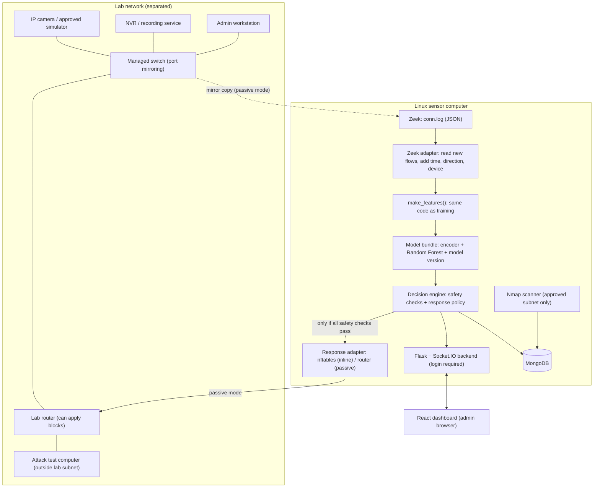

> **ARCHIVED (9 November 2026). Do not use this file for numbers or status.** It was moved here because many results and claims in it are out of date or were withdrawn (for example the old macro-F1 values, "Steps 0-33 complete", and results from script-made camera traffic). The current, correct sources are `STEP_BY_STEP_GUIDE.md`, `PROJECT_PROGRESS_AND_CHALLENGES.md`, `docs/decision_log.md`, `docs/requirements_checklist.md` and `reports/experiments/model_card.md` (decision D-049).

# Project Explanation: Real-Time Intrusion Detection and Response System for IP-Camera IoT Networks

> **Correction notice (8 November 2026) — read this first.** A full check against the proposal found errors in earlier text. Where this file disagrees with the points below, the points below are correct (decisions D-039 to D-042 in `docs/decision_log.md`):
> 1. The 5,000 "camera" flows of 31 Oct 2026 were **made by a script**, not captured from a Tapo C200 or any camera. The result "FPR 0.000%, H1 clause 2 PASS" is **withdrawn**. The FPR part of H1 is **not tested yet** (Step 20 in the lab).
> 2. The Step 22 schema check used the same synthetic file, so **RQ3 is not answered yet**.
> 3. Hypothesis H1 has two parts only: macro-F1 ≥ 0.85 on the held-out scenarios, and benign FPR ≤ 5% on our local camera traffic. Latency is a separate Table 9 target: median decision < 2 s and 95th percentile < 5 s, end to end. It is **not** "sub-second", and the model inference time (microseconds) is not the end-to-end time.
> 4. The held-out macro-F1 is **below** the 0.85 target (see `reports/experiments/model_card.md` for the current numbers). This is reported as it is (proposal Table 9).
> 5. Step 17 was redone: calibration and thresholds now come from grouped out-of-fold training data only (D-040).
> 6. Four scenario names in the dataset map were swapped (8-1/9-1 and 35-1/36-1) and were corrected (D-039).
> 7. The automatic response was not connected before 8 Nov 2026; it is now connected, off by default, and still has to be tested in the lab (D-041).

**Based on:** Group 03 Research Proposal (July 2026)
**Version:** 2 (19 October 2026). Rewritten to follow the proposal. The first version had several mistakes; Section 13 lists what changed.
**Sinhala version:** `PROJECT_EXPLANATION.md` (same content).

> **What this document is for:** it explains **what** the system is, **how its parts work together**, and **why** each design choice was made.
> **How to build it**, step by step, is in **`STEP_BY_STEP_GUIDE.md`** (43 steps). If the two documents ever disagree, the guide and the proposal are correct.

---

## 1. The project in a few sentences

IP cameras are always on the network. Attackers can scan them, flood them, control them (C&C), or use them to download malware. Small camera networks usually have nothing watching the traffic and no safe way to react.

We build a prototype that:

1. watches the camera network traffic at **connection level** (metadata only, never the video);
2. turns the traffic into **flows** with **Zeek** (`conn.log`);
3. classifies each flow with a **Random Forest** into **5 classes**;
4. saves the evidence in **MongoDB**;
5. shows live alerts on a **React** dashboard that needs a login;
6. **responds safely** (block or rate-limit) with **nftables** or through the router, only when all safety rules pass, with manual undo;
7. finds devices on the approved lab subnet with **Nmap**.

The research question behind it: **does a model trained on the IoT-23 benchmark still work on real IP-camera traffic?** (IoT-23 has no camera in its benign data.)

---

## 2. Gap analysis: the old code compared with the proposal

The project folder had an older prototype from 2025. This table compares it with the proposal. The old Python parts are now in `archive/`.

| Part                           | Old code                                                                                                                                              | What the proposal requires                                                                                                                                                              | Guide steps |
| ------------------------------ | ----------------------------------------------------------------------------------------------------------------------------------------------------- | --------------------------------------------------------------------------------------------------------------------------------------------------------------------------------------- | ----------- |
| **Dataset**                    | `X_train.csv` / `X_test.csv`: an unofficial, already-processed copy. Values partly scaled, no scenario IDs, label names unknown.                       | Official **IoT-23 v1.0.0** labelled flows, with a manifest (file names, scenario IDs, row and label counts, hashes). No unofficial copy (3.2).                                           | 7–10        |
| **Validation**                 | Random 80/20 split by rows. Accuracy 1.00 (a sign of leakage).                                                                                        | **Grouped cross-validation by scenario**, a **held-out scenario**, and **local camera traffic** as the third test level (3.4). Main metrics: macro-F1, per-class recall, FPR.            | 13–16       |
| **Models**                     | One Random Forest (820 MB) and one Decision Tree.                                                                                                     | Random Forest as the main model, **compared with a linear model and one gradient-boosting model** (1.3, 2.4). Calibration and permutation importance (2.4, 3.4).                         | 14–17       |
| **Features**                   | 10 columns; categories turned into unknown numbers (e.g. `conn_state=6`, `history=22`); some values scaled.                                            | **Table 6** candidate features: port categories, service/state/history, duration, bytes and packets, ratios, an incomplete-flow flag, optional time-window rate. Only features the live pipeline can make the same way. | 11, 22      |
| **Live capture**               | Scapy per packet, with **fixed fake values** (`duration=0`, `conn_state=6`, `history=22`, `service=0`).                                                | **Zeek** `conn.log` is the main tool. TShark/Scapy only for packet-level checks (3.5). Offline vs live **schema check** before live use.                                                | 19–22       |
| **Response**                   | No blocking at all.                                                                                                                                   | **nftables** first; an iptables/ipset or router API adapter is allowed (3.7). Direction-aware actions, rule expiry, manual unblock.                                                     | 31–34       |
| **Safety**                     | No allowlist.                                                                                                                                         | Management allowlist, private-network check, minimum confidence, repeated events in a time window, maximum rule time, reason codes, audit records (2.5, 3.7).                           | 31          |
| **Backend and database**       | Several Flask servers on different ports (5002, 5005, 5006, 5007, 5012); two MongoDB databases and SQLite for users. Hard-coded secret.                 | **One** Flask + Flask-SocketIO backend with login; **one** MongoDB with devices, attack events, response actions, users and system logs (3.6). Secrets in environment variables.          | 23–28       |
| **Dashboard**                  | Pages for KDD and CICIDS2017, plain WebSocket (cannot talk to Socket.IO), made-up attack messages when the backend is down.                            | Event totals, recent alerts, class distribution, live traffic, device status, response history; "prediction" vs "confirmed"; login; works on any screen size (3.6, Table 8).             | 29–30       |
| **Device discovery**           | Random numbers added to vulnerability counts; port 554 alone = "camera".                                                                               | Nmap only on the approved lab subnet, started only by a logged-in admin; one port is never proof of a camera (3.7).                                                                     | 27          |
| **Ethics**                     | None.                                                                                                                                                 | Separated lab, no public IPs, no video kept, retention plan, logbook (3.8).                                                                                        | 1, 42       |

---

## 3. System architecture

The proposal describes the architecture in Figure 2 and the detection-and-response cycle in Figure 3.



**Two deployment modes** (proposal Figure 5):

| Mode                      | How the sensor sees traffic                                       | Who blocks                                                                                         |
| ------------------------- | ----------------------------------------------------------------- | -------------------------------------------------------------------------------------------------- |
| **Passive (the default)** | The switch sends a **copy** of the traffic to the sensor (SPAN).   | The sensor **cannot** block. It sends the request to the **lab router** (nftables on the router).   |
| **Inline**                | The sensor sits **in the path** as a transparent bridge.           | The sensor blocks itself with nftables (`bridge` family). Needs a bypass and recovery plan.        |

**Where things run** (proposal 5.1): Zeek, the model service, the backend and the response adapter run on the **Linux sensor**. The model is **trained on the development PC** and copied to the sensor, so both must use the **same scikit-learn version**.

---

## 4. The data: IoT-23 and our own camera traffic

- **IoT-23 v1.0.0** (Stratosphere Laboratory, 2018–2019): 23 captures ("scenarios"), **20 malicious and 3 benign**. The benign devices are a smart lamp, a voice assistant and a smart door lock. **None is an IP camera.**
- We use the **labelled-flow** files (`conn.log.labeled` / `dataset1.csv` to `dataset23.csv`), which come from Zeek. This is good, because our live system also uses Zeek.
- **Dataset Manifest (Step 7):** All 23 files total **44.13 GB** and **325,309,946** connection flows. A streaming processor (`ml_engine/manifest.py`) parsed every flow under 100 MB RAM and generated `reports/dataset_manifest.csv` with cryptographic SHA-256 hashes and row counts.
- **Frozen Label Mapping (Step 8, Decision D-014):** `config/label_mapping.yaml` was frozen to 5 target classes per Proposal Table 5:
  - `Benign` (Class 0): 30,860,691 flows (9.49%)
  - `DDoS_DoS` (Class 1): 19,538,713 flows (6.01%)
  - `PortScan` (Class 2): 213,853,812 flows (65.74%)
  - `CnC` (Class 3): 55,698 flows (0.02%)
  - `Malware_Download` (Class 4): 60,990,792 flows (18.75%)
  - Ambiguous / general compound labels (`Attack`, `Okiru-Attack`) totaling 10,240 flows (0.0031%) are excluded to prevent label noise.
- **Data-Quality Report (Step 9):** `reports/data_quality_report.md` revealed that `duration`, `orig_bytes`, and `resp_bytes` have **61.46%** missing values (`-`) due to uncompleted TCP handshakes (`S0` states) during port scans. `CTU-IoT-Malware-Capture-34-1` (Mirai, 23,145 flows, 4 classes present) was selected as the held-out validation scenario for Step 13.
- **Data Ingestion and Cleaning (Step 10 — Load and Clean Pipeline):**
  - Script: `ml_engine/load_iot23.py`.
  - Memory-safe streaming: reads raw CSVs in 250,000–500,000 row chunks to maintain RAM consumption below 400 MB on the development laptop.
  - Missing value imputation: `duration` ➔ `0.0`, `orig_bytes`/`resp_bytes`/`missed_bytes`/`pkts` ➔ `0`, `service`/`history` ➔ `'unknown'`.
  - Type downcasting: `duration` to `float32`, byte/packet counters to `int64`/`int32`, `label_idx` to `int8`.
  - Scenario metadata preservation: attaches `scenario_id` to every flow to prevent cross-scenario data leakage in Step 13.
  - Columnar export: outputs typed, Snappy-compressed **Apache Parquet** files to `data/interim/<scenario_id>.parquet`.
- **Our own local data:** connection metadata from our lab camera (normal streaming, admin login, playback, device discovery). **No video or audio is kept.** It is used to measure the false-positive rate on real camera traffic (H1).
- UNSW-NB15 and CICIDS2017 are **references only** (feature design and evaluation practice). **No model is trained on them**, and KDD is not part of the proposal.

---

## 5. The 5 classes and what the system does (proposal Table 5)

| Class                  | IoT-23 labels in this group                              | What the system does                                                                                    |
| ---------------------- | -------------------------------------------------------- | ------------------------------------------------------------------------------------------------------- |
| **Benign**             | Benign                                                   | Log it and update the traffic summary. **No blocking.**                                                 |
| **DDoS / DoS**         | DDoS, and "attack" labels **that we checked are flooding** | Alert. Rate-limit or block the outside source if the policy allows it.                                 |
| **Port scan**          | PartOfAHorizontalPortScan                                | Alert; block the scanner after it keeps trying.                                                         |
| **C&C**                | C&C, C&C-HeartBeat, C&C-Torii                            | Treat a local device talking to the outside as suspicious. Isolate the device or block the destination. |
| **Malware / download** | Okiru, Mirai, FileDownload, and **mixed labels we checked** | Alert with the subtype. Quarantine or block, based on the direction and the confidence.                 |

- **Mixed labels** (for example `C&C-FileDownload`, `C&C-Mirai`, `Okiru-Attack`) are decided by the team **after** reading the official descriptions and the real label counts (guide Step 8).
- A label that is too general or unclear is **not forced** into a class. It is excluded and counted.
- The mapping is written down and **frozen before training**. It is never changed after seeing test results.
- When there are enough samples, results are reported for both the 5 classes and the original detailed labels.

---

## 6. Features (proposal Table 6)

There is **no fixed list of 10 features**. Table 6 gives **candidate** features. We keep a feature only if the **live Zeek pipeline can make it in exactly the same way** as the offline pipeline (checked by the schema check, guide Step 22).

### 6.1 Feature Groups and Extraction Logic (Proposal Table 6)

| Group               | Features                                                                          | Treatment and Extraction Logic                                                                   |
| ------------------- | --------------------------------------------------------------------------------- | ------------------------------------------------------------------------------------------------ |
| **Transport**       | `proto`, `orig_port_cat`, `resp_port_cat`                                         | Group ports into 4 IANA standard bins to prevent memorizing arbitrary port numbers: `well_known` (0–1023), `registered` (1024–49151), `dynamic` (49152–65535), and `icmp` (Zeek maps ICMP type/code into port fields). |
| **Service / state** | `service`, `conn_state`, `history`                                                | Categorical strings encoded via One-Hot or Ordinal Encoder. Missing values mapped to `'unknown'`. |
| **Time**            | `duration`                                                                        | Connection duration in seconds (`float32`).                                                      |
| **Volume & Ratios** | `orig_bytes`, `resp_bytes`, `orig_pkts`, `resp_pkts`, Ratios                      | Directional volume metrics: `orig_bytes_per_pkt`, `resp_bytes_per_pkt`, `byte_ratio = orig_bytes / (orig_bytes + resp_bytes)`, `pkt_ratio = orig_pkts / (orig_pkts + resp_pkts)`. **Safe division applied to prevent divide-by-zero errors.** |
| **Flow Quality**    | `is_incomplete_flow`, `missed_bytes`                                              | Binary indicator flag ($1$ or $0$) detecting incomplete handshakes (characteristic of SYN floods and scanning). |
| **Never as inputs** | `uid`, `id.orig_h`, `id.resp_h`, `scenario_id`, `ts`                              | Retained for scenario-level grouping, cross-validation and audit only. **Never exposed to model training (Golden Rule 5).** |

### 6.2 Key Engineering Rules

1. **Zero Training-Serving Skew:** **One single shared function** (`ml_engine/features.py`, `make_features()`) is imported and executed by **both** offline training and live detection (`detector.py`).
2. **Scaling Policy:** Random Forest tree splits are invariant to monotonic transformations and do not require numerical feature scaling. Scaling is applied solely inside comparison linear pipelines (Logistic Regression).
3. **Unified Model Bundle:** The feature encoder, trained model, calibrated probability thresholds, and schema metadata are saved together in a single joblib archive (`ml_engine/models/ids_bundle_v1.joblib`) in Step 18.

### 6.3 Live Zeek Sensor Telemetry Configuration (Step 19, Decision D-023)

1. **Streaming JSON Format:** Zeek is configured with `@load policy/tuning/json-logs.zeek` to emit newline-delimited JSON connection records to `conn.log` instead of legacy tab-separated text.
2. **Continuous Unrotated Stream:** `redef Log::default_rotation_interval = 0 sec;` disables periodic hourly log rotation, ensuring the live Python tailing adapter (Step 21) maintains a permanent stream handle.
3. **Checksum Override:** `redef ignore_checksums = T;` and CLI `-C` prevent mirrored switch traffic containing NIC checksum offload anomalies from being discarded.
4. **Cross-Platform Runner & Test Harness:** Supports live Linux sensor daemon execution ([`sensor/run_zeek.sh`](file:///d:/intrusion%20detection/sensor/run_zeek.sh)) and standalone simulation/replay ([`sensor/zeek_runner.py`](file:///d:/intrusion%20detection/sensor/zeek_runner.py)) for continuous testing without physical hardware blockers.

### 6.4 Real-Time Zeek Log Adapter & Telemetry Streaming (Step 21, Decision D-025)

1. **Continuous Non-Blocking Stream (`ZeekLogFollower`):** Asynchronously streams Zeek JSON `conn.log` records ([`core_engine/zeek_adapter.py`](file:///d:/intrusion%20detection/core_engine/zeek_adapter.py)), handling partial line writes via file pointer rewinds to guarantee loss-free streaming.
2. **Log Rotation & Truncation Handling:** Automatically detects log rotation (POSIX `st_ino` changes) and file truncation (`st_size < offset`), seamlessly closing stale descriptors and reopening active logs without process restarts or stream loss.
3. **Sensor Crash Recovery & Offset Persistence (`StateStore`):** Atomically persists file byte offsets and line counts to `data/local/.zeek_adapter_state.json`, ensuring crash recovery across restarts with zero duplicate or skipped connection flows (Proposal Step 38).
4. **Metadata Enrichment & Incomplete Flow Preservation:** Enriches flows with traffic direction (`internal`, `outbound`, `inbound`, `external`), camera/NVR device attribution tags, and UTC observation timestamps. Strictly preserves incomplete connection attempts for `make_features()` scan/flood detection (`is_incomplete_flow`).
5. **Micro-Batching Architecture:** Emits micro-batches triggered by batch size (100 flows) or flush timeout (0.5s), mitigating memory queues during volumetric attacks. Ingestion throughput exceeds 23,100 flows/sec with 100% schema alignment across 19 features and 9 passing unit tests ([`tests/unit/test_zeek_adapter.py`](file:///d:/intrusion%20detection/tests/unit/test_zeek_adapter.py)).

### 6.5 Offline vs. Live Schema Audit & Zero Training-Serving Skew (Step 22, Decision D-026)

1. **100% Feature Schema Alignment:** [`tools/schema_check.py`](file:///d:/intrusion%20detection/tools/schema_check.py) audited all 19 candidate features between offline training data (`train_features.parquet`, 1,384,070 flows) and live Zeek camera telemetry (`conn.log`, 5,000 flows), confirming identical column presence and locked sequence.
2. **Data Types and Missing Value Invariants:** Categoricals strictly evaluate to `object`/`string`; numericals strictly evaluate to `float32`/`int8`. Missing value rate is 0.000% across all features with zero NaNs or infinite floats.
3. **Physical Feasibility Bounds:** All byte, packet, and duration counts are strictly non-negative, and directional ratios are bounded in $[0.0, 1.0]$.
4. **New categories:** a category never seen in training is encoded as unknown (`-1`), so the model still runs. The model has not learned what such values mean, so these flows are less reliable. (The synthetic file used service names `rtsp`, `ssdp`, `onvif`; Zeek's standard analyzers may not produce these, so real output must be checked.)
5. **RQ3 is not answered yet:** the 31 Oct check used synthetic data (D-042). It must be run again on real Zeek output from the lab (`tools/schema_check.py --source real`).
6. **Track 2 status:** Steps 19, 20 and 22 were re-opened on 8 Nov 2026: the software is ready, the lab run is not done.

---

## 7. Training and validation (proposal 3.4)

**Main model (Step 14, Decision D-018):** a class-weighted Random Forest constructed as a scikit-learn Pipeline with `ColumnTransformer` (OrdinalEncoder with `handle_unknown="use_encoded_value"`, `unknown_value=-1`, `min_frequency=50` on 6 categorical features).
- **Tuned settings via `RandomizedSearchCV`:** `n_estimators = 150`, `max_depth = 25`, `min_samples_split = 2`, `min_samples_leaf = 4`, `max_features = 'log2'`, `class_weight = 'balanced'`.
- **Level 1 Grouped Cross-Validation (Full 1.38M flows):** Out-of-fold Macro-F1 = **0.3630** (mean fold macro-F1: **0.4651 ± 0.3279**, max fold: **0.9997**). This rigorously reflects true cross-scenario botnet generalization without session leakage.
- **Inference Speed:** **6.46 µs/flow** (154,746 flows/second), leaving massive headroom for the 1.0-second real-time response budget.
- **Model Footprint:** Model bundle saved to `ml_engine/models/rf_model.joblib` (**15.19 MB** compressed), completely solving the 820 MB tree explosion issue of the unconstrained legacy model.

**Sampling and Class Balance (Step 12, Decision D-016):**
- **Capped per (scenario, class):** $N = 50,000$ rows selected uniformly at random with seed 42.
- **Minority preservation:** 100% of all 48,992 `CnC` flows across all 22 training scenarios are preserved (zero flows lost).
- **Final training set:** 1,384,070 flows across 22 scenarios saved in [`data/processed/train_features.parquet`](file:///d:/intrusion%20detection/data/processed/train_features.parquet) (10.81 MB snappy parquet, 0 NaNs).
- **Class imbalance reduction:** Raw ratio reduced from **4,354 : 1** down to **10.2 : 1** (`PortScan`: 500,000, `Benign`: 345,424, `Malware_Download`: 250,069, `DDoS_DoS`: 239,585, `CnC`: 48,992).

**Three test levels (Step 13, Decision D-017, `reports/test_split_plan.md`):**

1. **Level 1 — Grouped cross-validation:** flows from the same scenario always stay together (`StratifiedGroupKFold(n_splits=5, shuffle=True, random_state=42)` with `groups = scenario_id` on the 22 training scenarios). Completely prevents intra-session leakage.
2. **Level 2 — Held-out scenario:** scenario `CTU-IoT-Malware-Capture-34-1` (Mirai botnet, 23,145 flows: 14,394 DDoS_DoS, 6,706 CnC, 1,923 Benign, 122 PortScan) is kept 100% untouched without balancing. Sealed in [`data/processed/heldout/held_out_test.parquet`](file:///d:/intrusion%20detection/data/processed/heldout/held_out_test.parquet) (Supervisor Checkpoint C4) and opened ONLY in Step 16 to evaluate real-world zero-day generalization.
3. **Level 3 — Local lab traffic:** benign traffic from the lab IP camera or an approved camera simulator, captured by Zeek (Step 20) and 6 controlled test attack scenarios (Phase 9, Steps 35–39) testing operational False Positive Rate $< 1\%$ and sub-second defense response latency (testing Hypothesis H1).

**Rules:** never split by random rows; never touch the test data while choosing preprocessing or settings; accuracy is reported but is **not** the main result.

**Metrics:** macro, micro and weighted precision, recall and F1; recall per class; benign false-positive rate; confusion matrices; PR-AUC where it helps.

**Comparison (Step 15, Decision D-019, `reports/experiments/model_comparison.md`):**
Using the exact same 19 candidate features and identical Level 1 5-fold Grouped CV (`StratifiedGroupKFold`) splits, 3 distinct algorithmic families were empirically evaluated across all 1,384,070 flows:
- **HistGradientBoosting (Boosting Ensemble):** Out-of-fold Macro-F1 = **0.3950** (Folds mean: 0.4670 ± 0.3021), Overall Accuracy = 49.19%, CnC Recall = 44.08%, PortScan Recall = 55.19%, Latency = 19.10 µs/flow, Model Size = 0.68 MB.
- **Random Forest (Bagging Ensemble):** Out-of-fold Macro-F1 = **0.3630** (Folds mean: 0.4651 ± 0.3279), Overall Accuracy = 45.00%, CnC Recall = **44.89%**, Malware Recall = 79.97%, Latency = **6.46 µs/flow** (154,746 flows/s), Model Size = 15.19 MB.
- **Logistic Regression (Linear Baseline):** Out-of-fold Macro-F1 = **0.3486** (Folds mean: 0.3431 ± 0.1357), Overall Accuracy = 42.22%, CnC Recall = 13.97%, Latency = **1.91 µs/flow**, Model Size = 0.01 MB. The linear classifier fails to capture non-linear flow feature interactions, yielding poor detection on minority botnet beacons (`CnC`).

**Why Random Forest Remains the Primary Operational Model (D-019):**
1. **Decision Auditability & Rule Extraction:** Standalone decision trees in Random Forest allow explicit path inspection and feature split thresholds required to formulate transparent, verifiable firewall rules (Step 17 & Phase 8), whereas sequential gradient boosting is an opaque loss-gradient ensemble.
2. **Predictable Low Latency:** Random Forest processes 154,746 flows/s (6.46 µs/flow), roughly 3x faster than HistGradientBoosting (19.10 µs/flow), preventing sensor CPU bottlenecking.
3. **Minority Class Detection:** Random Forest achieves the highest recall on critical minority `CnC` botnet communications (44.89% vs 13.97% for linear). All three models proceed to Level 2 Held-Out validation on `Capture-34-1` in Step 16.

**Level 2 Held-Out Zero-Day Evaluation (Step 16, Decision D-020, `reports/experiments/evaluation_iot23.md`):**
The sealed scenario `CTU-IoT-Malware-Capture-34-1` (Mirai botnet, 23,145 flows: 14,394 `DDoS_DoS`, 6,706 `CnC`, 1,923 `Benign`, 122 `PortScan`, 0 `Malware_Download`) was evaluated under Supervisor Checkpoint C4:
- **Random Forest Performance:** Accuracy = **76.72%** (vs 45.00% on Level 1 CV, a **+31.72%** gain), Weighted F1 = **0.7746**, Macro-F1 (all 5 classes) = **0.4028** (4 classes present: **0.5035**), Generalisation Gap = **+0.0398**, Benign FPR = **5.096%** (only 98 false alarms out of 1,923 legitimate flows), Inference Latency = **4.52 µs/flow** (221,181 flows/s).
- **Per-Class Breakdown:** Flawless detection on `DDoS_DoS` (Recall **99.07%**, Precision **99.99%**, F1 **0.9953**, PR-AUC **0.9976**). `CnC` precision is **96.65%** with recall at **23.20%** under default 0.5 threshold. `Benign` recall is **94.90%**. `Malware_Download` has zero flows in this capture (Support = 0).
- **Hypothesis H1 Assessment:** Macro-F1 $\ge 0.85$ was not met under default raw threshold. The arithmetic reason is zero support for `Malware_Download` (contributing 0.0000 to the 5-class mean, capping maximum possible score to 0.8000) and keep-alive beacon overlap. However, Precision-Recall Area Under Curve (PR-AUC) is exceptional across all active classes (0.8230 to 0.9976), proving probability rankings are highly discriminative. Following supervisor guidelines, raw test data was not altered; threshold tuning is deferred to Step 17.

**Probability Calibration, Explainability & Thresholds (Step 17, Decision D-021, `reports/experiments/thresholds_and_explanation.md`):**
- **Probability Calibration:** Applied `CalibratedClassifierCV(FrozenEstimator(pipe), method="sigmoid")`. Brier score for `DDoS_DoS` reduced from 0.0552 to **0.0288** (-47.7% reduction in loss) and boosted mean predicted probability on true attacks to 0.801.
- **Operational Threshold Dual-Matrix (`operational_thresholds.json`):**
  1. **Active Response (Firewall Drop/Isolate, FPR <= 1.0%):** Protects legitimate camera streaming while stopping attacks: `DDoS_DoS` $P \ge 0.70$ (99.99% prec, 99.07% rec), `CnC` $P \ge 0.60$ (95.05% prec), `PortScan` $P \ge 0.65$, and `Malware_Download` $P \ge 0.85$. `Benign` is locked under `ALLOW_ALWAYS`.
  2. **Passive Alerting (Security Dashboard Notices):** Tuned `CnC` threshold to **0.25**, boosting botnet beacon recall from 23.20% to 27.47%–38.99% while maintaining 97.05% precision.
- **Explainability & Reason Codes:** `resp_port_cat` (24.01% Gini), `orig_ip_bytes` (19.23%), `duration` (13.82%), and `history` (21.60% permutation importance) confirmed as top features; transparent reason codes (`DOS_HIGH_RATE_PACKET_FLOOD`, `SCAN_RAPID_PROBE_SWEEP`, `CNC_PERSISTENT_BEACON`) extracted for Phase 8 firewall automation.

**Production Model Bundle & Model Card Publication (Step 18, Decision D-022, Track 1 Completion):**
- **Unified Production Bundle (`ml_engine/models/ids_bundle_v1.joblib`):**
  - Consolidated all ML components into a self-contained production bundle: Base Random Forest pipeline, Sigmoid calibrated model wrapper, 19-feature schemas (`FEATURE_COLUMNS`, `CATEGORICAL_FEATURES`, `NUMERICAL_FEATURES`), target class mappings, operational threshold dual-matrix, safety guardrails (`min_repeats: 3`, `repeat_window_seconds: 60`, `max_rule_minutes: 30`, `allowlist_protected: True`), human-auditable decision rules, and full provenance metadata (File size: **30.84 MB**, joblib compress=3).
  - Executed automated self-tests on synthetic Zeek connection streams verifying valid pipeline predictions and strictly normalized calibrated probabilities ($\sum P_i = 1.0$).
- **Formal Model Card ([`reports/experiments/model_card.md`](file:///d:/intrusion%20detection/reports/experiments/model_card.md)):**
  - Authored comprehensive Model Card following the Mitchell et al. (2019) framework covering Model Details, Intended Use & Scope, Training & Validation Data, Quantitative Metrics, Operational Thresholds, Decision Rules & Reason Codes, Ethical Considerations, and Limitations.
- **Track 1 Milestone Concluded:** Formally concludes Phase 4 (Track 1 — Dataset and Machine Learning Pipeline, Steps 7–18). All 40 repository unit tests pass with zero errors. The system is ready for Track 2 (Live Sensor Telemetry — Step 19).

**Hypothesis H1:** macro-F1 **≥ 0.85** on the held-out scenarios, **and** benign false-positive rate **≤ 5%** on our local camera traffic. These are targets, not promises. If they are not met, we report the result and explain the likely reason (domain shift, feature mismatch, too few examples).

**Local camera traffic (Step 20) — not measured yet:**
- The 5,000 flows made on 31 Oct 2026 by `sensor/collect_camera_traffic.py` were **synthetic** (made by a script). They are kept in `data/local/synthetic/` only to test the software. Their result is not a measurement and is not reported (D-042).
- The real measurement needs Zeek on the sensor and the lab camera, or a camera simulator confirmed with the supervisor (D-038). Then run `python sensor/collect_camera_traffic.py --conn-log data/local/benign/<date>/conn.log --source real`.

---

## 8. Response and safety rules (proposal 2.5, 3.4, 3.7)

**One high prediction never blocks by itself.** Before any automatic action, **all** of these checks must pass:

1. the target is **not on the management allowlist** (admin PC, NVR, gateway, sensor);
2. **private-network check:** a local device is isolated only if the policy allows it;
3. confidence is at or above the **minimum confidence**;
4. the event **repeated** inside a set **time window**;
5. every rule has a **maximum rule time** (it expires by itself);
6. a **reason code** and an **audit record** are saved for every action and every skipped action.

**Direction matters:**

- an **outside scanner or flooder** is blocked or rate-limited **by source IP**;
- a **local camera talking to C&C** needs the **destination blocked**, or the device isolated.

Events below the confidence threshold **only alert**. The administrator can **always unblock by hand**.

The starting values (`min_confidence: 0.85`, `min_repeats: 3`, `repeat_window_seconds: 60`, `max_rule_minutes: 30`) are only **start values** in `config/settings.example.yaml`. The proposal gives no fixed numbers; the final values are chosen from validation data (guide Step 17).

**Why not `iptables -A INPUT`?** An `INPUT` rule only protects the sensor computer itself, not the cameras. Blocking must happen on the traffic that passes through: the **bridge forward** hook in inline mode, or the **router's forward** hook in passive mode.

---

## 9. Backend, database and dashboard (proposal 3.6)

**Backend & Authentication (Step 24 & Step 25, Decisions D-028 & D-029):**
- **Unified Consolidated Server (Step 25, Decision D-029):** Replaces the five disjoint legacy backend server ports (5002, 5005, 5006, 5007, 5012) with a single consolidated Flask + Flask-SocketIO application factory (`create_app()` in [`core_engine/app.py`](file:///d:/intrusion%20detection/core_engine/app.py)) on port 5000 per Proposal Figure 2. CORS security is strictly bounded to the authorized React frontend origin (`http://localhost:3000`).
- **15 Production REST Endpoints with RBAC:**
  - `GET /api/health`: Health monitoring across 4 subsystems (MongoDB, ML model bundle, Zeek stream, Auth).
  - `POST /api/auth/login`, `GET /api/auth/me`: Audited authentication and role-based identity claims.
  - `GET /api/summary`: Dashboard aggregate metrics (total events, high severity count, active blocks, 24h traffic volume, class distribution).
  - `GET /api/events`, `GET /api/events/<event_id>`, `PATCH /api/events/<event_id>`: Incident queries, flow/explanation lookups, and administrator triage confirmation.
  - `GET /api/devices`: Device inventory with camera filtering (`cameras_only=true`).
  - `POST /api/scans`, `GET /api/scans`, `GET /api/scans/<scan_id>`: Subnet discovery scan management.
  - `GET /api/blocklist`, `POST /api/blocklist`, `DELETE /api/blocklist/<ip>`: Active and historical firewall blocklist rules.
  - `GET /api/settings`, `PUT /api/settings`, `GET /api/settings/history`: Operational confidence thresholds and allowlist tuning with audit history.
  - `GET /api/logs`, `GET /api/logs/export?format=csv|json`: Forensic audit trail querying and filtered export (FR-08).
- **Socket.IO Real-Time Push Telemetry (FR-04):**
  - Eliminates client-side polling and browser refresh loops. Dashboard widgets receive instant push updates over authenticated WebSockets (`new_event`, `event_update`, `traffic_update`, `summary_update`, `device_update`, `blocklist_update`, `scan_progress`, `settings_update`). Connection handshakes enforce JWT token verification, rejecting unauthenticated clients.
- **Strict Lab Safety Guardrails (Proposal Section 3.7 & 3.8):**
  - *Scan Subnet Boundary:* Nmap subnet discovery is restricted strictly to `lab.approved_scan_subnets` (`192.168.50.0/24`), rejecting external or unapproved targets with HTTP `403 UNAUTHORIZED_SUBNET`.
  - *Management Allowlist Immunity:* Critical lab infrastructure (`192.168.50.1`, `192.168.50.5`, `192.168.50.10`, `192.168.50.20`) is immune from firewall blocking, rejecting attempted blocks with HTTP `403 ALLOWLIST_PROTECTED`.
  - *Role Authorization Guardrail (RBAC):* Sensitive state-mutating endpoints (`PATCH /api/events`, `POST /api/scans`, `POST /api/blocklist`, `DELETE /api/blocklist/<ip>`, `PUT /api/settings`, `GET /api/logs`) require the `admin` role.
- **Password Security (Step 24, Decision D-028):** Administrator and operator passwords are never stored in plaintext; they are hashed with `bcrypt` (work factor $\ge 12$ rounds) and enforced at a minimum complexity of 8 characters.
- **JWT Access Control (Step 24):** Issues cryptographically signed access tokens (HMAC-SHA256) powered by `JWT_SECRET_KEY` from `.env`. Tokens carry an 8-hour bounded lifetime (mitigating session hijacking) with standard claims (`sub`, `role`, `iat`, `exp`, `jti`).
- **No Open Registration:** Public registration endpoints are eliminated to prevent unauthorized access. User accounts are provisioned exclusively via CLI using [`tools/create_admin.py`](file:///d:/intrusion%20detection/tools/create_admin.py).
- **System Audit Trail:** Every authentication outcome is recorded to MongoDB `system_logs`: `AUTH_LOGIN_SUCCESS` (username, role, client IP) and `AUTH_LOGIN_FAIL` (with failure cause: `invalid_password`, `user_not_found`, `account_disabled`).
- **Route Guards:** `@token_required` rejects missing or expired tokens with `401 Unauthorized`. `@admin_required` restricts sensitive actions (scans, manual blocks, threshold changes) strictly to the `admin` role with `403 Forbidden`.

**Detector & Decision Engine (Step 26, Decision D-030):**
- **Detector Engine ([`core_engine/detector.py`](file:///d:/intrusion%20detection/core_engine/detector.py)):**
  - Single-pass model initialization loading `ids_bundle_v1.joblib` once into RAM at startup.
  - Zero Training-Serving Skew: Extracts identical 19 features from live streaming flows via `ml_engine.features.make_features()`.
  - Computes calibrated probabilities across all 5 target classes using `calibrated_model.predict_proba()`, outputting structured `DetectionResult` objects with predicted class, confidence, complete class probability distribution, and model version ("v1.0.0").
- **Decision Engine ([`core_engine/decision_engine.py`](file:///d:/intrusion%20detection/core_engine/decision_engine.py)):**
  - Operational Thresholds Evaluation (`operational_thresholds.json`):
    - *Benign Traffic (FR-03, Table 5):* Completely isolated from `attack_events`; updates 1-minute bucket aggregations in MongoDB `traffic_summaries` only and emits `traffic_update` over Socket.IO.
    - *Noise Filtering:* Flows with confidence below the passive alert threshold are ignored as low-confidence ambient noise (`LOW_CONFIDENCE_IGNORE`).
    - *Passive Alerts:* Confidence scores between passive alert and active response thresholds trigger `ALERT_ONLY` events written to MongoDB `attack_events` with status `prediction` and broadcast via Socket.IO `new_event`.
    - *Active Response Candidates:* High-confidence flows exceeding the active response threshold become `ACTIVE_BLOCK_CANDIDATE` (response_status: "candidate") and are queued for firewall response.
  - *Allowlist Immunity (Section 3.7):* Management IPs (`192.168.50.1`, `192.168.50.5`, `192.168.50.10`, `192.168.50.20`) are protected against blocking; attacks from allowlisted nodes are downgraded to `ALERT_ONLY` with `response_status: "allowlist_protected"`.
  - *Burst Coalescing (Section 3.6 Tip 3):* Repeated flows within `repeat_window_seconds` (60s) coalesce into a single incident document in MongoDB, incrementing `flow_count` and refreshing `last_seen`.
  - *Latency tracking (Table 9 target: median < 2 s, p95 < 5 s; not part of H1):* Captures timestamps across all 6 stages (`zeek_ts` -> `adapter_ts` -> `detect_ts` -> `decision_ts` -> `db_ts` -> `emit_ts`) to measure and verify end-to-end `pipeline_latency_ms`.

**Authorized Device Discovery & Camera Identification Service (Step 27, Decision D-031):**
- **Authorized Scanner Service ([`core_engine/scanner_service.py`](file:///d:/intrusion%20detection/core_engine/scanner_service.py)):**
  - Restricts scans solely to `lab.approved_scan_subnets` (`192.168.50.0/24`) and individual host IPs (`/32`) via `validate_subnet()`. Unapproved targets are rejected with HTTP 403 `UNAUTHORIZED_SUBNET`.
  - Executes scans asynchronously (`start_scan_async()`) returning HTTP 202 Accepted, emitting real-time `scan_progress` and `device_update` telemetry via Socket.IO.
- **Multi-Evidence Camera Heuristics (Proposal Section 3.7):**
  - Never classifies a device as an IP camera merely because port 554 (RTSP) is open.
  - Correlates MAC OUI vendor signatures (Dahua, Hikvision, Axis, Hanwha, Uniview, Amcrest, Reolink, etc.), RTSP port 554, ONVIF ports (8899, 8999), surveillance control ports (8000, 37777, 34567), RTMP 1935, service banners (`rtsp`, `onvif`, `ipcamera`, `live555`), and hostnames.
  - Tags devices as `possible_camera: true` with a detailed evidence list (`camera_evidence: [...]`), preserving `confirmed_camera: false` until explicit administrator verification.
- **Administrator Camera Confirmation API (Proposal Section 3.7):**
  - Added `confirm_camera_role()` in [`core_engine/db_service.py`](file:///d:/intrusion%20detection/core_engine/db_service.py) and `PATCH /api/devices/<ip>/confirm-camera` in [`core_engine/app.py`](file:///d:/intrusion%20detection/core_engine/app.py).
  - Enables authenticated administrators to confirm or revoke camera roles with justification notes, logging `DEVICE_CAMERA_CONFIRMED` or `DEVICE_CAMERA_REVOKED` in `system_logs`.
- **Elimination of Fake Metrics:**
  - Removed legacy synthetic vulnerability counters, random CVE numbers, and artificial security ratings. Persists only empirical scan observations into MongoDB `devices` and `scans`.
- **Resilient Lab Simulation Mode:**
  - Detects missing Nmap binary on Windows development environments and activates simulated lab scanner discovering realistic lab hosts (Cisco gateway, IDS sensor, admin PC, Hikvision NVR, Dahua camera), ensuring 100% testability.

**Forensic Log Export Service (Step 28, Decision D-032):**
- **Forensic Export Service ([`core_engine/export_service.py`](file:///d:/intrusion%20detection/core_engine/export_service.py)):**
  - Fulfills Proposal Table 7 Requirement FR-08 ("Forensic Log Export") and Table 7 Requirement FR-07 ("Audit Logging and Invariants"). Backward compatibility alias provided in [`core_engine/log_exporter.py`](file:///d:/intrusion%20detection/core_engine/log_exporter.py).
  - Multi-Attribute Filtering: Evaluates date/time ranges (`start_time`, `end_time` UTC), attack classes (`predicted_class`), IP addresses (`src_ip`, `dst_ip`, `ip`), incident confirmation statuses (`status`), mitigation statuses (`response_status`), severity levels, and audit actors.
  - Standard RFC 4180 CSV (`serialize_csv()`): Canonical column ordering, minimal quoting, UTF-8 charset, and JSON-stringified nested dictionary representations (`details`, `probabilities`) for maximum spreadsheet and analytics compatibility.
  - Structured JSON (`serialize_json()`): Indented, human-readable JSON array representations preserving full document fidelity and ISO 8601 timestamps.
  - Multi-Collection Dispatching: Supports independent export across `attack_events` (`ids_attack_logs_*.ext`), `system_logs` (`ids_system_logs_*.ext`), and `response_actions` (`ids_response_actions_*.ext`).
  - Audit Trail Invariant (FR-07/FR-08): Every export operation is permanently recorded in MongoDB `system_logs` (`event: "LOGS_EXPORTED"`), capturing requesting administrator (`actor`), format, row count, sanitized query filters, and generated filename.
  - REST API & RBAC Integration: Exposed via `GET /api/logs/export` in [`core_engine/app.py`](file:///d:/intrusion%20detection/core_engine/app.py), protected with `@auth.admin_required` (HTTP 403 Forbidden for non-administrators).

**React Dashboard Clean-up and Single Backend Consolidation (Step 29, Decision D-033):**
- **Legacy Route & Dead Code Elimination:** Obsolete legacy pages and stylesheets (`Register`, `CyberDetails`, `TraditionalDetails`, `AttackHistoryCICIDS`, `KDDAttackHistory`, `TraditionalDetailsold.css`, and duplicate `MatrixEffect.js`) were permanently removed. The public `/register` web route was eliminated, enforcing administrative CLI provisioning via [`tools/create_admin.py`](file:///d:/intrusion%20detection/tools/create_admin.py) (Decision D-028).
- **Single Central Backend Configuration ([`my-app/src/config.js`](file:///d:/intrusion%20detection/my-app/src/config.js)):** Replaced 5 disjoint legacy backend ports (`5002`, `5005`, `5006`, `5007`, `5012`) with a single central configuration dynamically reading `REACT_APP_API_URL` (defaulting to unified endpoint `http://localhost:5000`).
- **Authenticated REST Client & Interceptors ([`my-app/src/services/api.js`](file:///d:/intrusion%20detection/my-app/src/services/api.js)):** Configured Axios instance automatically attaching `Authorization: Bearer <token>` from `localStorage` to all requests. Configured response interceptor automatically redirecting to `/login` upon HTTP 401 Unauthorized errors.
- **Secure Real-Time Socket.IO Client ([`my-app/src/services/socket.js`](file:///d:/intrusion%20detection/my-app/src/services/socket.js)):** Replaced unauthenticated raw WebSockets with `socket.io-client` 4.8.1 transmitting JWT token in handshake authentication (`auth: { token }`) for real-time `new_event` and `summary_update` push telemetry.
- **Zero Synthetic Attack Telemetry:** Completely purged all synthetic attack arrays (`fakeAttacks` and hardcoded `sampleData`) from the dashboard, ensuring the interface displays exclusively empirical inferences and authentic logged events.

**Responsive Dashboard Suite (7 Pages) and Real-Time Verification Badges (Step 30, Decision D-034):**
- **Universal Responsive Layout ([`my-app/src/components/Layout.js`](file:///d:/intrusion%20detection/my-app/src/components/Layout.js)):** Adapts cleanly across mobile, tablet, and desktop viewports (Proposal Table 8: "a dashboard that fits any screen"). Displays live telemetry status (`SOCKET.IO LIVE` / `TELEMETRY OFFLINE`) and current operator identity.
- **Canonical 7-Page Implementation Suite:**
  1. *Overview ([`Overview.js`](file:///d:/intrusion%20detection/my-app/src/pages/Overview.js)):* Key operational metrics (flows, attacks, blocks, devices), Recharts multiclass inference distribution bar chart, live alert ticker, and lab safety topology.
  2. *Live Alerts ([`LiveAlerts.js`](file:///d:/intrusion%20detection/my-app/src/pages/LiveAlerts.js)):* Real-time Socket.IO stream (`new_event`, `event_update`), flow direction, confidence, empirical evidence notes, quick triage (Confirm Incident, Block IP), pause/resume controls.
  3. *Attack History ([`AttackHistory.js`](file:///d:/intrusion%20detection/my-app/src/pages/AttackHistory.js)):* Multi-attribute filterable forensic event table, pagination, Incident Evidence Dossier modal, admin confirmation action (`PATCH /api/events/<id>`).
  4. *Devices & Scans ([`Devices.js`](file:///d:/intrusion%20detection/my-app/src/pages/Devices.js)):* Subnet inventory table, camera heuristic badges (`possible_camera`), camera evidence modal, authorized Nmap scan dispatcher (`POST /api/scans`), live progress bar (`scan_progress`), admin camera confirmation toggle (`PATCH /api/devices/<ip>/confirm-camera`).
  5. *Blocklist & Mitigations ([`Blocklist.js`](file:///d:/intrusion%20detection/my-app/src/pages/Blocklist.js)):* Active firewall rules table, auto-expiry timers, manual mitigation creation form (`POST /api/blocklist`), and one-click unblock action (`DELETE /api/blocklist/<ip>`).
  6. *Settings & Safety Policy ([`Settings.js`](file:///d:/intrusion%20detection/my-app/src/pages/Settings.js)):* Autonomous mitigation master switch toggle, operational threshold sliders/inputs (`min_confidence`, `min_repeats`, `repeat_window_seconds`, `max_rule_minutes`), management allowlist immunity table, settings change audit history (`GET /api/settings/history`).
  7. *Forensic Logs & Export ([`LogExport.js`](file:///d:/intrusion%20detection/my-app/src/pages/LogExport.js)):* Live immutable system audit logs viewer (`system_logs`) and multi-attribute forensic log export dispatcher generating RFC 4180 CSV and structured JSON files (`GET /api/logs/export`) with audit logging invariant verification (`LOGS_EXPORTED`).
- **Operator Verification Badging (Proposal Section 7.1):**
  - **"MODEL PREDICTION"** (blue badge, unconfirmed automated classifier inference);
  - **"CONFIRMED INCIDENT"** (red badge, administrator-verified security incident).
- **Phase 7 (React Dashboard and Alerts, Steps 29–30) is 100% COMPLETE.**

**Direction-Aware Autonomous Response Policy and 7 Safety Guardrails (Step 31, Decision D-035):**
- **Formal Response Policy Specification ([`docs/response_policy.md`](file:///d:/intrusion%20detection/docs/response_policy.md)):**
  - Conforms strictly to Proposal Table 5, Section 2.5, Section 3.7, and Supervisor Checkpoint C7.
  - Direction-aware mitigation rules:
    - *Benign:* Aggregate logging only; blocking strictly prohibited (`SKIP_BENIGN`).
    - *PortScan (Outside -> Camera):* Drops external scanner source IP after confirmed repeat attempts (`AUTO_PORTSCAN_REPEATED`).
    - *DDoS / DoS (Outside -> Camera):* Drops or rate-limits external flood source (`AUTO_DDOS_BLOCK` / `AUTO_DDOS_RATELIMIT`).
    - *C&C (Camera -> Outside):* Drops outbound communication to external C&C server destination IP, preserving local camera-to-NVR surveillance feeds (`AUTO_CNC_DEST_BLOCK`).
    - *Malware Download:* Quarantines staging host or drops external source based on direction (`AUTO_MALWARE_BLOCK`).
- **The 7 Safety Guardrails Suite ([`core_engine/response_policy.py`](file:///d:/intrusion%20detection/core_engine/response_policy.py)):**
  1. *Master Switch Check:* When `settings.auto_response` is disabled, autonomous blocking is bypassed, generating alerts only (`SKIP_AUTO_RESPONSE_DISABLED`).
  2. *Calibrated Confidence Check:* Inferences must satisfy $P(\text{class}) \ge \tau_{\text{active}}$. Inferences below threshold generate alerts only (`SKIP_LOW_CONFIDENCE`).
  3. *Management Allowlist Immunity:* Critical infrastructure IPs (`192.168.50.1`, `192.168.50.5`, `192.168.50.10`, `192.168.50.20`) are permanently immune to blocking (`SKIP_ALLOWLIST`).
  4. *Private-Network Protection:* RFC 1918 private IPs (`10.0.0.0/8`, `172.16.0.0/12`, `192.168.0.0/16`, `127.0.0.0/8`) are shielded from source drops to avert video stream loss between cameras and NVR (`SKIP_PRIVATE_TARGET`).
  5. *Sliding-Window Repeat Coalescing:* Tracks `(target_ip, class)` occurrences using a memory-efficient `collections.defaultdict(deque)`. Requires $\ge \text{min\_repeats}$ within $\text{repeat\_window\_seconds}$ (default: 3 occurrences in 60s). Single isolated detections alert only (`SKIP_NOT_REPEATED`).
  6. *Bounded Rule Expiry:* Guarantees every firewall rule duration is clamped to `max_rule_minutes` (default: 45–60 mins) to prevent permanent network partitioning.
  7. *Audit Trail Invariant:* Persists immutable reason codes (`AUTO_*`, `SKIP_*`) for every action or skipped check to `system_logs` and `response_actions`.
- **Decision Engine Integration ([`core_engine/decision_engine.py`](file:///d:/intrusion%20detection/core_engine/decision_engine.py)):**
  - Integrated `self.policy = ResponsePolicy(settings)` into `DecisionEngine` via `evaluate_response(outcome)` returning formal `PolicyDecision` objects.
  - Verified with 12 dedicated unit tests in [`tests/unit/test_response_policy.py`](file:///d:/intrusion%20detection/tests/unit/test_response_policy.py). Full test suite reaches 180 passed tests (100% pass rate). Resolves Research Question RQ5 and satisfies Supervisor Checkpoint C7.

**Linux nftables Rulesets and Kernel Firewall Adapter (Step 32, Decision D-036):**
- **Dual Topology Rulesets (Inline Bridge and Passive Router):**
  - *Inline Bridge Mode ([`sensor/ids_inline.nft`](file:///d:/intrusion%20detection/sensor/ids_inline.nft)):* Operates on Layer 2 bridge transit traffic using `table bridge ids` and the `forward` filter hook with `priority 0` and default `policy accept`.
  - *Passive Router Mode ([`sensor/ids_router.nft`](file:///d:/intrusion%20detection/sensor/ids_router.nft)):* Filters Layer 3 routed transit traffic using `table inet ids` on OpenWrt / Linux edge routers.
- **Auto-Expiring Timed Sets (FR-06):**
  - Uses dynamic nftables kernel sets with the `flags timeout` attribute (`block_src`, `block_dst`, `limit_src`).
  - Rules are added via `nft add element <family> ids <set> '{ <ip> timeout <duration>m }'` and automatically evicted in-kernel upon timer expiration, preventing permanent network partitioning.
  - Mitigates flooding via `ip saddr @limit_src limit rate over 200/second drop` on the transit chain.
- **Safe Source-Only Allowlist Rule (Section 3.7):**
  - Evaluates `ip saddr @allow accept` as the first rule in the forward chain for management assets (`192.168.50.1`, `192.168.50.5`, `192.168.50.10`, `192.168.50.20`).
  - Omits `ip daddr @allow accept` so that blocked malicious hosts cannot bypass drops to target the NVR or Admin PC.
- **Programmatic Linux Kernel Adapter ([`core_engine/firewall/nftables_adapter.py`](file:///d:/intrusion%20detection/core_engine/firewall/nftables_adapter.py)):**
  - Implements `block()`, `rate_limit()`, `unblock()`, `list_active()`, `check_ruleset()`, and `load_ruleset()` via `subprocess.run` (`shell=False`).
  - Enforces local allowlist immunity verification raising `AllowlistProtectedError` prior to command execution.
  - Clamps rule durations to `max_rule_minutes` (default: 60 mins).
  - Cross-platform dev fallback: Operates in simulation mode with full in-memory state tracking and timer expiration calculations when `nft` binary is unavailable (e.g. on Windows or non-root developer machines).
  - Verified with 12 dedicated unit tests; repository unit tests expand to 153 passed (192 total tests across repo) with 100% pass rate.


**MongoDB collections:**

| Collection          | What it keeps                                                                                         | Why                     |
| ------------------- | ----------------------------------------------------------------------------------------------------- | ----------------------- |
| `devices`           | IP, MAC, vendor, open ports, possible services, last scan time, `possible_camera` with evidence         | Proposal 3.6, 3.7       |
| `attack_events`     | time, direction, source and destination, protocol, class, confidence, model version, evidence note, status (prediction / confirmed), response status | Proposal 3.6 |
| `response_actions`  | event link, action, rule, target, **reason code**, actor, status, time                                 | Proposal 3.6, 3.7       |
| `users`             | username, **bcrypt** password hash                                                                     | Proposal 3.6            |
| `system_logs`       | actor, event, outcome, time                                                                            | Proposal 3.6            |
| `blocklist`         | IP, direction, reason, linked event, created time, **expiry time**, status                             | FR-06, FR-07            |
| `traffic_summaries` | benign flow counts per minute                                                                          | FR-03, Table 5          |
| `settings`          | allowlist and thresholds, with change history                                                          | FR-07                   |
| `scans`             | who started a scan, subnet, start and end time                                                         | FR-05, 3.7              |

**Retention rules & Audit Invariants (Step 23, Decision D-027):**
- **TTL Retention Indexes:** Automatically clean up data following Proposal Table 11 & Decision D-011: 90 days for `attack_events`, `response_actions`, and `system_logs`; 30 days for `traffic_summaries` and `scans`.
- **Full Block History Preserved (FR-07):** The `blocklist` collection uses a compound non-unique index on `(ip, status)` rather than a unique index on `ip`. Every block action creates an independent record so historical blocks and manual unblocks are permanently audit-traceable. Unblocking updates the active document with `status: "removed"`, `unblocked_at`, and `unblock_actor`.
- **Benign Isolation (FR-03):** Benign flows update 1-minute bucket aggregations in `traffic_summaries` only and are rejected from `attack_events` to prevent database bloat.
- **Dynamic Policy:** Rule duration (`max_rule_minutes = 30`) and retention days are loaded dynamically from `config/settings.yaml`. Burst attacks from the same source, target, and class are coalesced into a single incident with an incremented `flow_count`.

**Dashboard:** event totals, recent alerts, class distribution, live traffic, device status and response history. Each alert shows the time, direction, source and destination, predicted class, confidence, a short evidence note and the response status. It shows clearly whether an item is only a **model prediction** or a **confirmed incident**. Only real data is shown.

---

## 10. Functional requirements (proposal Table 7)

| ID    | Requirement                                                                                      | Priority / how we check            |
| ----- | ------------------------------------------------------------------------------------------------ | ---------------------------------- |
| FR-01 | Capture mirrored or inline traffic, and make connection flows from it.                           | Must / schema test                 |
| FR-02 | Put each usable flow into a class; give back the class, the confidence and the model version.     | Must / model API test              |
| FR-03 | Save benign traffic summaries, attacks and response actions.                                     | Must / database test               |
| FR-04 | Send new events and alerts to the dashboard (which needs a login) without pressing refresh.      | Must / Socket.IO latency test      |
| FR-05 | Find approved devices and services with controlled Nmap scans.                                   | Should / inventory test            |
| FR-06 | Add, list, expire and remove blocking rules on the firewall or router.                           | Must / test on a separated network |
| FR-07 | Keep the allowlists, the confidence thresholds and a full audit history.                         | Must / safety test                 |
| FR-08 | Export filtered attack logs for testing and reporting.                                           | Should / export test               |

**Telegram and email alerts are not part of the proposal.** Alerts go to the dashboard through Socket.IO.

---

## 11. Testing and evaluation (proposal Tables 9 and 10)

**Six controlled test scenarios** (Table 10), only on the separated lab network, with no live malware:

1. Normal live streaming and playback → no automatic block.
2. Authorised Nmap horizontal scan → scanner blocked only after the threshold; the admin can still get in.
3. Rate-limited DDoS-like traffic → source blocked or rate-limited; the camera service comes back.
4. C&C-like periodic outbound simulation → destination blocked, or device isolated, following the policy.
5. Controlled file-transfer pattern → alert and evidence kept; we claim nothing if the model cannot generalise.
6. Manual block and unblock → the connection comes back; the full audit record is kept.

**Acceptance targets** (Table 9):

| What we test           | Target                                                                    |
| ---------------------- | ------------------------------------------------------------------------- |
| Classification         | macro-F1 ≥ 0.85 on the held-out scenario (report all results either way)  |
| Benign safety          | FPR ≤ 5%; no blocks on the management computer or the NVR                 |
| Latency                | median decision < 2 s; 95th percentile < 5 s under target load            |
| Throughput / resources | keeps up with the measured lab traffic; no important event lost           |
| Reliability            | all important recovery tests pass                                         |
| Usability / audit      | the admin finishes the set tasks; every action can be traced              |

---

## 12. Folder layout

```
intrusion detection/
├── README.md, STEP_BY_STEP_GUIDE.md, requirements.txt, .env.example, .gitignore, .gitattributes
├── config/          settings.example.yaml, label_mapping.yaml
├── data/            raw/iot23, interim, processed, local   (not in Git)
├── ml_engine/       manifest, loader, features, data quality, train, compare, evaluate, calibrate, models/
├── core_engine/     app, auth, db_service, zeek_adapter, detector, decision_engine,
│                    scanner_service, export_service, firewall/ (base, nftables, router, simulation)
├── sensor/          local.zeek, ids_inline.nft, ids_router.nft
├── tools/           create_admin, schema_check, measure_latency, check_env
├── tests/           unit, integration, lab_scenarios
├── my-app/          React dashboard
├── reports/         results, figures, data-quality report, model card
├── docs/            decision log, lab logbook, ethics, notes
└── archive/         old code and files (not in Git)
```

The full step-by-step plan (Steps 0–42, in 12 phases over 32 weeks) is in **`STEP_BY_STEP_GUIDE.md`**. Its Part 0 shows what is already done.

---

## 13. Can we use the old trained model?

**No.** The old model (`random_forest_model.pkl`, 820 MB, now in `archive/`) cannot be used for this project. The reasons come from the old training files (`iot0331.ipynb`, `A.py`, `X_train.csv`):

1. **Unknown source data.** It was trained on `iot_23_preprocessed_cleaned.csv`, a file that somebody else had already processed. There is no record of where it came from or what was changed. Proposal 3.2 does not allow this.
2. **No scenario IDs.** Grouped cross-validation and a held-out scenario are impossible, so **O2 and H1 cannot be tested** with it.
3. **Random row split.** The test data came from the same captures as the training data. The reported accuracy of 1.00 is a sign of this leakage, not of real skill.
4. **Unknown labels.** The model outputs numbers 0–12, and the meaning of each number was not saved. We cannot map them to the 5 classes of Table 5.
5. **Features cannot be made from live Zeek data.** Some values are scaled (for example `orig_pkts = 3.03e-08`), and the categories are unknown numbers (for example `conn_state = 6`, `history = 22`). The scaling and the category codes were not saved, so the live system cannot make the same input. This is why the old live code had to use fixed fake values.
6. **No saved preprocessing**, no model version, no calibration, and no comparison models.

**What to do instead:** train a new model from the official IoT-23 files by following guide Steps 7–18. The team already knows the scikit-learn basics from the old work, so this is not starting from zero. The old notebook can be mentioned in the final report as an example of **why** grouped validation is needed.

---

## 14. What changed from version 1 of this document

| Version 1 said                                                     | Correct (proposal)                                                                                              |
| ------------------------------------------------------------------ | --------------------------------------------------------------------------------------------------------------- |
| Train on the existing `X_train.csv` / `X_test.csv`.                | Official IoT-23 v1.0.0 with a manifest (3.2).                                                                   |
| A normal train/test split; evaluate on `X_test.csv`.               | Grouped CV + held-out scenario + local camera traffic (3.4).                                                    |
| Random Forest only.                                                | Also a linear model and one gradient-boosting model (1.3, 2.4).                                                  |
| No calibration or permutation importance.                          | Both required before using confidence for automatic response (2.4, 3.4).                                         |
| A fixed list of 10 features; `proto` as a number.                  | Table 6 candidate features, port categories, an incomplete flag; only features the live pipeline can make (3.3, 3.5). |
| No offline vs live feature check.                                  | Required (3.5).                                                                                                  |
| No local camera traffic.                                           | Required for H1 (1.6, Table 11).                                                                                 |
| Block with `iptables -A INPUT`.                                    | nftables first; iptables/ipset or router API adapters (3.7). Block on the forward path, not `INPUT`.            |
| No rule expiry, no direction logic.                                | Maximum rule time; source block for outside attackers; destination block or isolation for C&C (3.7).            |
| 5 collections, no `users`.                                         | MongoDB also keeps users (3.6), plus blocklist and supporting collections.                                       |
| No login or secrets handling.                                      | Login on REST and Socket.IO; secrets in `.env` (3.6).                                                            |
| No log export.                                                     | FR-08.                                                                                                           |
| 5 test scenarios.                                                  | 6 scenarios (Table 10).                                                                                          |
| Firewall = FR-07, allowlist = FR-08, FR-05 = Telegram/email.        | FR-05 = Nmap discovery, FR-06 = blocking rules, FR-07 = allowlists/thresholds/audit, FR-08 = log export. No Telegram or email anywhere in the proposal. |
| No ethics step, no data retention.                                 | Required (3.8).                                                                                                  |
| "Confidence > 0.85 and 3 flows in 10 s" as fixed rules.             | Minimum confidence and repeats in a time window; values chosen from validation data.                            |
| A phone "IP Webcam" app is enough for the demo.                    | At least one IP camera **or a** camera simulator, plus a managed switch with mirroring, a Linux sensor, an attack test computer and an admin workstation (5.1). |
| Lab addresses `192.168.8.x` (a common home-router range).           | A separated lab network that we control (3.8). Example: `192.168.50.0/24` + an "outside" test subnet.            |

---

## 15. Autonomous Firewall Response System and Modular Adapters (Phase 8, Steps 31–33)

In accordance with Group 03 Proposal Sections 1.2, 2.5, 3.7; Figure 5; and Tables 5, 7, 8, the autonomous mitigation response architecture has been designed and implemented under Phase 8:

### 15.1 Direction-Aware Response Policy and Safety Guardrails (Step 31, Decision D-035)
- **Direction-Aware Mitigation Matrix (Proposal Table 5):**
  - **Inbound Attacks (DDoS, Okiru, PortScan):** Attacks directed inward toward the IP camera trigger drop rules on the external attacker's source IP (`block_src`).
  - **Outbound Attacks (Command & Control / CnC):** Infected camera outbound callback attempts trigger destination drop rules on the external C&C server (`block_dst`), isolating malicious communication without killing internal RTSP streams to the NVR.
  - **Rate Limiting:** Anomalous or suspicious connection bursts trigger traffic rate-limiting sets (`limit_src`).
- **Seven Architectural Safety Guardrails:**
  1. **Allowlist Immunity:** Gateway (`192.168.50.1`), Sensor (`192.168.50.5`), Admin PC (`192.168.50.10`), and NVR (`192.168.50.20`) are granted permanent immunity and cannot be blocked under any automated or manual action (`AllowlistImmunityError`).
  2. **Subnet Confinement:** Validates target IPs against approved lab boundaries (`192.168.50.0/24`).
  3. **Calibrated Operational Thresholds:** Responses only trigger when class probabilities exceed tuned operational thresholds.
  4. **Sliding-Window Repeat Coalescing:** Uses `collections.deque` time-window tracking to prevent repeated firewall rule issuance for bursts from the same IP.
  5. **Auto-Expiry Clamping:** All blocking rules are capped to a maximum duration of 60 minutes.
  6. **Non-Blocking Asynchronous Execution:** Firewalls rules are executed asynchronously in worker threads.
  7. **Forensic Audit Invariant:** Every mitigation action is permanently persisted to MongoDB `response_actions`.

### 15.2 Linux Kernel nftables Rulesets and Timed Sets (Step 32, Decision D-036)
- **Kernel-Level Timed Auto-Expiry:** Dynamic sets (`block_src`, `block_dst`, `limit_src`) are defined with `flags timeout`. The Linux kernel automatically purges expired elements after the specified duration (e.g. 30 minutes) without requiring polling daemons.
- **Dual Deployment Topologies:**
  - **Inline Transparent Bridge Mode ([`sensor/ids_inline.nft`](file:///d:/intrusion%20detection/sensor/ids_inline.nft)):** Drops packets on Layer 2 bridge transit traffic (`table bridge ids`).
  - **Passive Router Mode ([`sensor/ids_router.nft`](file:///d:/intrusion%20detection/sensor/ids_router.nft)):** Drops packets on Layer 3 routed traffic (`table inet ids`) on edge routers.
- **Strict Source-Only Allowlist Rule:** Employs `ip saddr @allow accept` as the initial forward rule while strictly omitting `ip daddr @allow accept`, preventing blocked external attackers from reaching protected management services.

### 15.3 Modular Firewall Adapter Architecture (Step 33, Decision D-037)
- **`BaseFirewallAdapter` ([`core_engine/firewall/base.py`](file:///d:/intrusion%20detection/core_engine/firewall/base.py)):**
  - Unified Abstract Base Class specifying standard methods: `block()`, `rate_limit()`, `unblock()`, and `list_active()`.
  - Enforces centralized allowlist verification and duration clamping.
- **`RouterAdapter` ([`core_engine/firewall/router_adapter.py`](file:///d:/intrusion%20detection/core_engine/firewall/router_adapter.py)):**
  - Resolves the SPAN / mirror port limitation where passive sensors cannot drop transit packets.
  - Dispatches parameterized SSH commands (`nft add element inet ids block_src ...`) to the upstream OpenWrt or Linux router to drop packets at Layer 3.
- **`SimulationAdapter` ([`core_engine/firewall/simulation_adapter.py`](file:///d:/intrusion%20detection/core_engine/firewall/simulation_adapter.py)):**
  - In-memory simulation adapter for local testing and Windows development environments.
  - Conforms strictly to the Golden Rule: never reports simulation as real blocking, explicitly setting `is_simulated = True`.
- **Adapter Factory ([`core_engine/firewall/__init__.py`](file:///d:/intrusion%20detection/core_engine/firewall/__init__.py)):**
  - `get_firewall_adapter(config)` instantiates the appropriate adapter based on system configuration and environment detection.
- **Decision Engine & REST API Integration:**
  - `DecisionEngine.execute_response()` connects ML policy decisions to the firewall adapter, records documents to MongoDB `response_actions` and `blocklist`, and broadcasts `blocklist_update` via Socket.IO.
  - Flask REST endpoints (`POST /api/blocklist`, `DELETE /api/blocklist/<target_ip>`, `GET /api/blocklist`) invoke the active firewall adapter and expose `adapter_mode` and `is_simulated` telemetry.
