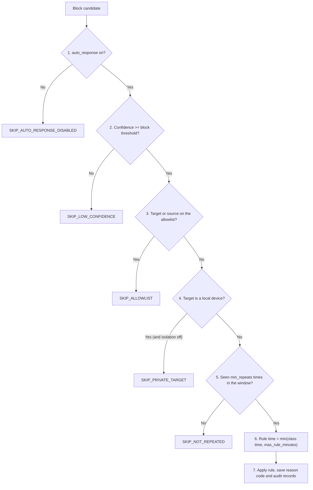

# Response Policy and Safety Rules

**Version:** 2.0 (8 November 2026; replaces version 1.0)
**Proposal:** Sections 2.5, 3.4, 3.7; Table 5; Table 9; Table 10; Table 11; FR-06, FR-07; RQ5
**Code:** `core_engine/response_policy.py`, `core_engine/decision_engine.py` (`respond_to_outcome`)
**Tests:** `tests/unit/test_response_policy.py`, `tests/unit/test_auto_response.py`

---

## 1. Why this policy exists

> **RQ5 (proposal 1.5):** "What safety rules do we need so that automatic response does not stop normal camera access?"

A wrong alert only wastes time. A wrong block can cut off the administrator or stop the NVR recording (proposal 2.5). So the system blocks only when **every** rule in Section 4 passes, every block ends by itself, and the administrator can always unblock by hand.

## 2. From a flow to a decision

1. Zeek writes a finished flow to `conn.log`. The live runner (`core_engine/runner.py`) reads it.
2. The model gives the top class and its calibrated probability (the *confidence*).
3. The decision engine compares the confidence with the two thresholds of that class (chosen in Step 17 from training data only, `reports/experiments/operational_thresholds.json`):
   - below the **alert threshold** → ignored as noise;
   - at or above the alert threshold → **alert** (saved in MongoDB, shown on the dashboard);
   - at or above the **block threshold** → **block candidate** → goes to the response policy (Section 4).
4. A class whose block threshold is `none` is **never blocked automatically**. It only raises alerts.
5. **How the block thresholds are chosen (D-046, proposal 3.4).** Step 17 replays this whole rule (confidence threshold, then `min_repeats` candidates for the same target inside `repeat_window_seconds`, one block per target per `max_rule_minutes`) on the grouped out-of-fold training flows. The block threshold is the lowest value where at least 10 blocks happen, at least 95% of them are fired by a truly malicious flow, and at most 1% of the benign targets are blocked. Current values (11 Nov 2026, model v3.1.0, D-054): block CnC 0.30, PortScan 0.88; DDoS_DoS **rate-limit** 0.30 (D-055: no block threshold was found, so the outside flood source is rate-limited from its alert threshold); Malware_Download alert only. Values of model v3.0.0 (D-052): CnC 0.30, PortScan 0.91; DDoS_DoS and Malware_Download alert only. Program downloads seen in Zeek's files.log raise an alert (`RULE_EXECUTABLE_DOWNLOAD`), never a block. Values of model v2.0.0 (D-051): CnC 0.30, PortScan 0.95; DDoS_DoS and Malware_Download are alert only (fewer than 10 replayed blocks). Earlier values (model v1, 9 Nov 2026): PortScan 0.30, CnC 0.39. See `reports/experiments/operational_thresholds.json`.
5. Benign flows go only to the traffic summary (FR-03). They are never blocked.

## 3. What is blocked, by class and direction (proposal Table 5)

"Local" means inside `lab.local_networks` in `config/settings.yaml` (the camera LAN, for example `192.168.50.0/24`). Everything else is "outside", including the private test network `10.10.10.0/24`.

| Class | Typical direction | Target of the block | Rule time | Reason code |
| --- | --- | --- | --- | --- |
| Benign | any | never blocked | — | `SKIP_BENIGN` |
| PortScan | outside → camera | the scanner (source IP), only after repeats | 30 min | `AUTO_PORTSCAN_REPEATED` |
| DDoS_DoS | outside → camera | the flood source (source IP): **rate-limit** (packets over 200/s dropped, set `limit_src`) when Step 17 has no block threshold (D-055); block when it has one | up to `max_rule_minutes` | `AUTO_DDOS_RATELIMIT` / `AUTO_DDOS_BLOCK` |
| CnC | local device → outside | the outside destination (C&C server) | up to `max_rule_minutes` | `AUTO_CNC_DEST_BLOCK` |
| Malware_Download | outside ↔ local | the outside host | up to `max_rule_minutes` | `AUTO_MALWARE_BLOCK` |

Notes:
- Isolating a local device (Table 5: "isolate the device") is allowed only when `response.allow_device_isolation: true`. It is `false` by default, so a local camera is never blocked automatically.
- Rate limiting (Table 5: "rate-limit or block") is used automatically for DDoS_DoS since D-055 (11 Nov 2026). `response.ddos_rate_limit: false` turns it off (DDoS is then alert only). A local device is never rate-limited. A stored rule records its action, so a restart restores a rate-limit as a rate-limit.

## 4. The safety rules (all must pass)

1. **Master switch.** `response.auto_response` in `settings.yaml`. **Default: off.** Turn it on only for planned lab tests, and write that in the lab logbook.
2. **Confidence.** The confidence must reach the class block threshold from Step 17. `response.min_confidence` (default 0.30, D-046) is a lower limit for every class: a class threshold below it is raised to it.
3. **Allowlist.** Router, sensor, admin PC and NVR (`allowlist` in `settings.yaml`) are never blocked. The firewall adapters check the allowlist again before they change any rule.
4. **Local-network protection.** A target inside `lab.local_networks` is not blocked, unless device isolation is allowed.
5. **Repeats.** The same target and class must be seen `min_repeats` times within `repeat_window_seconds` (default 3 times in 60 seconds). One high prediction never blocks by itself (proposal 3.4).
6. **Rule expiry.** Every rule has a timeout and is removed by nftables when it ends (`max_rule_minutes`, default 30).
7. **Audit.** Every block is saved in `blocklist` and `response_actions`, and the dashboard gets a `blocklist_update`. For every block candidate, the reason code (an `AUTO_*` code when acted, a `SKIP_*` code when not) is saved on the attack event as `response_reason`.

While a block on an IP is active, new flows from the same attack do not create new rules (`already_blocked`). After a manual unblock, a new attack can be blocked again.

## 5. Settings the administrator can change

| Setting | Where | Applied |
| --- | --- | --- |
| `auto_response`, `allow_device_isolation`, `adapter`, `local_networks` | `config/settings.yaml` | at server start |
| `allowlist`, `min_confidence`, `min_repeats`, `repeat_window_seconds`, `max_rule_minutes` | dashboard Settings page (`PUT /api/settings`) | at once; each change is saved with its old value, new value, user, time and reason (FR-07) |

## 6. Reason codes

| Code | Meaning |
| --- | --- |
| `AUTO_PORTSCAN_REPEATED` | Outside scanner blocked after repeated scans |
| `AUTO_DDOS_BLOCK` | Flood source blocked |
| `AUTO_DDOS_RATELIMIT` | Flood source rate-limited automatically (D-055) |
| `AUTO_CNC_DEST_BLOCK` | Outside C&C destination blocked |
| `AUTO_MALWARE_BLOCK` | Outside download/staging host blocked |
| `ADMIN_MANUAL_ENFORCEMENT` / `ADMIN_MANUAL_UNBLOCK` | Administrator block / unblock from the dashboard |
| `SKIP_BENIGN` | Benign traffic; never blocked |
| `SKIP_AUTO_RESPONSE_DISABLED` | Master switch is off |
| `SKIP_LOW_CONFIDENCE` | Confidence below the block threshold (or the class is alert-only) |
| `SKIP_ALLOWLIST` | Allowlisted management device |
| `SKIP_PRIVATE_TARGET` | Target is a local camera-network device |
| `SKIP_NOT_REPEATED` | Not repeated enough inside the time window yet |

## 7. Where blocks are applied (proposal 1.2, Figure 5)

| Mode | Who blocks | Setting |
| --- | --- | --- |
| Passive (default) | the lab router, by SSH + nftables (`sensor/ids_router.nft`) | `response.adapter: router` |
| Inline | the sensor itself (`sensor/ids_inline.nft`) | `response.adapter: nftables` |
| Development on Windows | nothing is blocked; rules are only recorded and marked `simulated` | `response.adapter: simulation` |

Results from the `simulation` adapter must never be reported as real blocking.
