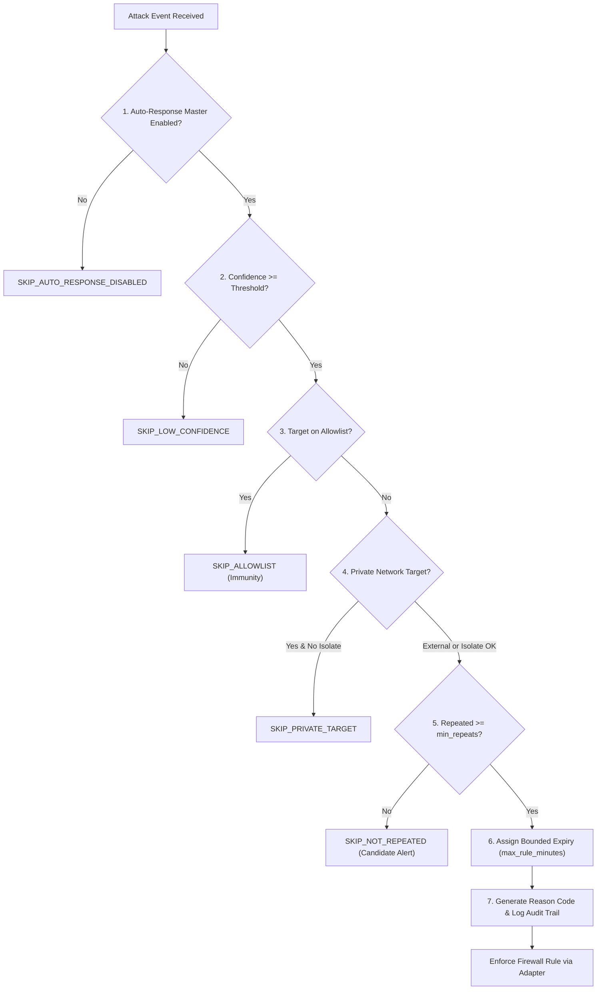

# Response Policy and Safety Guardrail Specifications

**Document Version:** 1.0.0  
**Project:** Real-Time Intrusion Detection and Autonomous Response System for IP-Camera IoT Networks  
**Group:** 03 — BICT (Hons), Faculty of Technology, University of Sri Jayewardenepura  
**Governing Proposal Sections:** Sections 2.5, 3.4, 3.6, 3.7; Table 5; Requirements FR-06, FR-07; Research Question RQ5; Supervisor Checkpoint C7.

---

## 1. Executive Summary & Purpose

In an operational IP-camera surveillance network, an erroneous or unconstrained automated defense action risks severing mission-critical video streams, isolating the Network Video Recorder (NVR), or locking out system administrators. 

This document defines the formal **Autonomous Response Policy and Safety Guardrails** governing the system. It enforces direction-aware rules, calibrated multi-class decision trees, sliding-window repeat coalescing, permanent allowlist immunity, and bounded rule lifetimes.

---

## 2. Research Question Alignment (RQ5)

> **Research Question RQ5:**  
> *How can an autonomous intrusion response engine mitigate malicious IP camera network traffic (DDoS, scans, C&C) without disrupting authorized administrative access or benign video streaming?*

**Policy Solution:**
1. **Zero-Touch Benign Traffic:** Normal RTSP streaming, playback, and ONVIF discovery are never subjected to firewall drop actions.
2. **Direction-Aware Targeting:** Incoming floods and scanner sweeps drop the external source IP; outgoing Command & Control beacons drop the external destination IP; local cameras are never blocked from transmitting to the NVR unless emergency local quarantine is specifically triggered.
3. **Multi-Barrier Safety Verification:** Automated blocking requires passing seven independent, non-bypassable safety checkpoints.

---

## 3. Direction-Aware Mitigation Matrix

Per Group 03 Proposal Table 5 and Section 3.7, response actions are conditioned on both the predicted attack class and the verified network traffic direction:

| Attack Class | Traffic Vector / Direction | Automated Action (If Safety Passes) | Target Entity | Duration | Default Reason Code |
| :--- | :--- | :--- | :--- | :--- | :--- |
| **Benign** | Any direction | Log flow aggregate to summary only. **NEVER BLOCK.** | None | — | `SKIP_BENIGN` |
| **PortScan** | External Inbound (`outside -> camera`) | Alert. Block scanner source IP after `min_repeats` within window. | Source IP | 30 mins | `AUTO_PORTSCAN_REPEATED` |
| **DDoS_DoS** | External Inbound (`outside -> camera`) | Alert. Rate-limit or drop source IP after `min_repeats`. | Source IP | 60 mins | `AUTO_DDOS_BLOCK` |
| **CnC** | Internal Outbound (`camera -> outside`) | Alert. Drop communication to external C&C server. | Destination IP | 60 mins | `AUTO_CNC_DEST_BLOCK` |
| **Malware_Download** | Inbound / Outbound | Alert. Drop staging source / quarantine infected device. | External IP | 60 mins | `AUTO_MALWARE_BLOCK` |
| **Any Attack** | Below Confidence Threshold | Passive Alert only. No firewall modification. | None | — | `SKIP_LOW_CONFIDENCE` |

---

## 4. The 7 Safety Checkpoints

Before any automated firewall rule (`nftables` drop/rate-limit) is dispatched, the `ResponsePolicy` evaluates seven mandatory safety rules. If any check fails, **no mitigation action is applied**, but an audit event is logged with the corresponding `SKIP_*` reason code:

### Checkpoint 1: Master Enablement (`auto_response`)
- The system checks `settings.auto_response`. If disabled by the administrator, the engine operates in passive alerting mode only (`SKIP_AUTO_RESPONSE_DISABLED`).

### Checkpoint 2: Minimum Calibrated Confidence (`min_confidence`)
- The predicted probability for the attack class must satisfy $P(\text{class}) \ge \tau_{\text{active}}$ (default $\ge 0.60 - 0.85$ depending on class). Low-confidence inferences generate alerts but never trigger automated firewall drops (`SKIP_LOW_CONFIDENCE`).

### Checkpoint 3: Management Allowlist Immunity
- Verified against the lab management allowlist (`192.168.50.1`, `192.168.50.5`, `192.168.50.10`, `192.168.50.20`).
- **Rule:** An allowlisted IP is **never blocked under any circumstances**. If an attack pattern originates from or targets an allowlisted IP, the action is downgraded to `ALERT_ONLY` with reason `SKIP_ALLOWLIST`.

### Checkpoint 4: Private Subnet Target Protection
- Private IP addresses (`10.0.0.0/8`, `172.16.0.0/12`, `192.168.0.0/16`) represent local infrastructure.
- Inbound drops must never be applied to internal camera IPs, as doing so would break local NVR ingestion. Private nodes are only isolated if the operator explicitly authorizes device quarantine (`SKIP_PRIVATE_TARGET`).

### Checkpoint 5: Sliding-Window Repeat Coalescing (`min_repeats`)
- To avoid over-reacting to transient network spikes or single-packet anomalies, the engine tracks event occurrences using a memory-efficient `collections.defaultdict(deque)` sliding window.
- **Condition:** $\text{Count}((IP, \text{class})) \ge \text{min\_repeats}$ within $\text{repeat\_window\_seconds}$ (default: 3 occurrences within 60 seconds).
- Single events produce an alert and increment the counter, but do not block (`SKIP_NOT_REPEATED`).

### Checkpoint 6: Bounded Expiry (`max_rule_minutes`)
- No firewall rule is indefinite. Every automated block is injected into `nftables` sets with an explicit timeout flag (`timeout 30m` or `timeout 60m`).
- Maximum rule duration is clamped to `max_rule_minutes` (default: 60 minutes) to prevent permanent network partitioning.

### Checkpoint 7: Complete Reason Code & Audit Invariant
- Every executed block and every skipped action must be recorded with an immutable reason code to `system_logs` and `response_actions` in MongoDB.

---

## 5. Canonical Reason Codes

| Reason Code | Type | Description |
| :--- | :--- | :--- |
| `AUTO_PORTSCAN_REPEATED` | Automated Block | External scanner blocked after exceeding probe repeat count. |
| `AUTO_DDOS_BLOCK` | Automated Block | Volumetric flood source blocked after threshold exceedance. |
| `AUTO_DDOS_RATELIMIT` | Automated Limit | Flooding source subjected to rate limiting. |
| `AUTO_CNC_DEST_BLOCK` | Automated Block | Outbound C&C destination server blocked from camera reach. |
| `AUTO_MALWARE_BLOCK` | Automated Block | Staging host blocked during malware download attempt. |
| `MANUAL_BLOCK` | Operator Action | Security administrator manually enforced block via dashboard. |
| `MANUAL_UNBLOCK` | Operator Action | Security administrator manually removed block via dashboard. |
| `RULE_EXPIRED` | Maintenance | Timeout set expired and rule automatically aged out. |
| `SKIP_BENIGN` | Guardrail Skip | Benign traffic flow; blocking prohibited. |
| `SKIP_ALLOWLIST` | Guardrail Skip | Target is an allowlisted management asset (immunity triggered). |
| `SKIP_PRIVATE_TARGET` | Guardrail Skip | Target is an internal IP camera; drop averted to maintain NVR. |
| `SKIP_LOW_CONFIDENCE` | Guardrail Skip | Model prediction confidence below operational threshold. |
| `SKIP_NOT_REPEATED` | Guardrail Skip | Flow has not met minimum repetition threshold within window. |
| `SKIP_AUTO_RESPONSE_DISABLED` | Guardrail Skip | Master auto-response switch is disabled by administrator. |

---

## 6. Implementation Reference

The policy is implemented in [`core_engine/response_policy.py`](file:///d:/intrusion%20detection/core_engine/response_policy.py) and integrated into [`core_engine/decision_engine.py`](file:///d:/intrusion%20detection/core_engine/decision_engine.py). Unit test suite [`tests/unit/test_response_policy.py`](file:///d:/intrusion%20detection/tests/unit/test_response_policy.py) validates all 7 safety invariants and fulfills Checkpoint C7.
