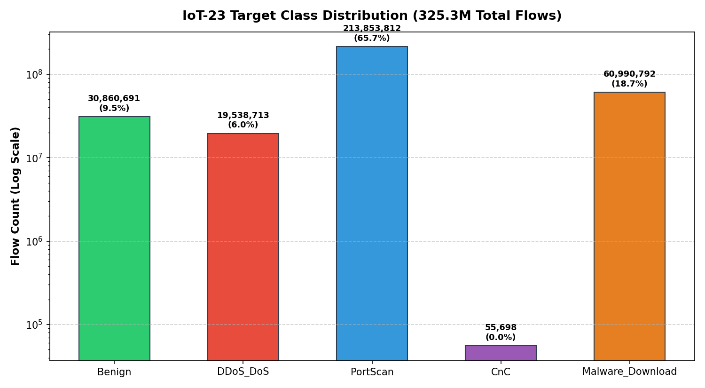
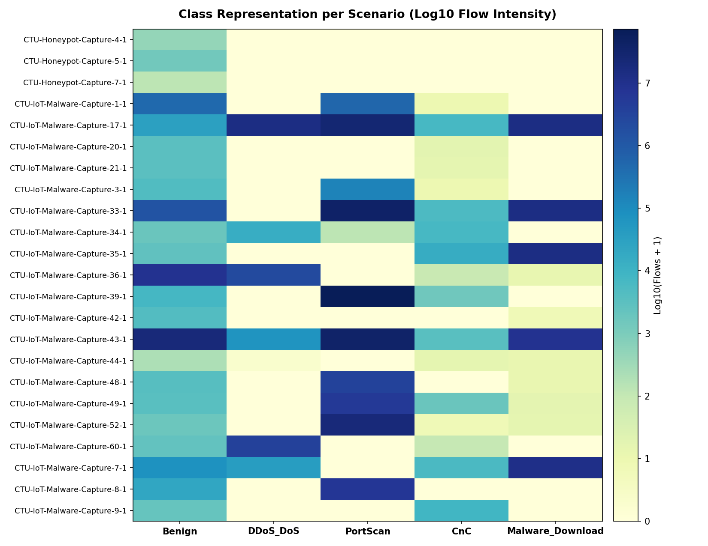

# IoT-23 Dataset Quality and Audit Report

**Project:** Real-Time Intrusion Detection and Response System for IP-Camera IoT Networks Using Machine Learning  
**Document Version:** 1.0 (Step 9 Deliverable)  
**Date:** 23 October 2026  
**Proposal Alignment:** Objective O1 (Data-Quality Report); Section 3.2; Supervisor Checkpoint C3  
**Label Mapping Policy:** Frozen under Decision `D-014` (`config/label_mapping.yaml`)  

---

## 1. Executive Summary

- **Total Scenarios Audited:** 23 official IoT-23 scenarios (20 malware captures, 3 benign captures).
- **Total Evaluated Connection Flows:** 325,309,946 flows.
- **Valid Mapped Flows:** 325,299,706 flows (100.00%).
- **Excluded Ambiguous Flows:** 10,240 flows (0.0031%) - non-flooding `Attack` labels per Proposal Sections 2.3 & 3.2.
- **Target Classes:** 5 standardized classes (`Benign`, `DDoS_DoS`, `PortScan`, `CnC`, `Malware_Download`).
- **System Integrity:** Cryptographic SHA-256 hashes recorded for all scenarios in `reports/dataset_manifest.csv`.

---

## 2. Overall Class Distribution

| Class ID | Target Class | Mapped Flow Count | Global Percentage | Proposal Table 5 Rationale |
|:---:|---|---:|:---:|---|
| **0** | `Benign` | 30,860,691 | 9.49% | Normal device & simulated camera baseline traffic |
| **1** | `DDoS_DoS` | 19,538,713 | 6.01% | SYN/UDP flooding denial of service attacks |
| **2** | `PortScan` | 213,853,812 | 65.74% | Reconnaissance & horizontal port scans (e.g. port 23) |
| **3** | `CnC` | 55,698 | 0.02% | Command & control channels, heartbeats, and Torii beaconing |
| **4** | `Malware_Download` | 60,990,792 | 18.75% | Payload transfers, file drops, and Okiru/Mirai propagations |
| — | `EXCLUDE` | 10,240 | 0.0031% | Ambiguous compound labels removed to prevent label noise |
| **Total** | **All Classes** | **325,309,946** | **100.00%** | **Dataset Total** |

> [!IMPORTANT]
> **Extreme Class Imbalance:** `PortScan` represents 65.74% of the raw dataset, while `CnC` represents only 0.02% (55,698 flows). Without class balancing, a classifier would exhibit high accuracy simply by predicting `PortScan` for every flow. **Stratified scenario-aware class sampling (Step 12)** is mandatory.

---

## 3. Class × Scenario Distribution Matrix

This matrix maps the exact distribution of the 5 classes across all 23 scenarios. It is critical for establishing our **leakage-free cross-validation plan (Step 13)**.

| Scenario ID | Device / Capture Type | Benign | DDoS_DoS | PortScan | CnC | Malware | Excluded | Total Flows |
|---|---|---:|---:|---:|---:|---:|---:|---:|
| `CTU-Honeypot-Capture-4-1` | dataset1.csv | 452 | 0 | 0 | 0 | 0 | 0 | 452 |
| `CTU-Honeypot-Capture-5-1` | dataset2.csv | 1,374 | 0 | 0 | 0 | 0 | 0 | 1,374 |
| `CTU-Honeypot-Capture-7-1` | dataset3.csv | 130 | 0 | 0 | 0 | 0 | 0 | 130 |
| `CTU-IoT-Malware-Capture-8-1` | dataset4.csv | 22,548 | 0 | 6,355,745 | 0 | 0 | 0 | 6,378,293 |
| `CTU-IoT-Malware-Capture-9-1` | dataset5.csv | 2,181 | 0 | 0 | 8,222 | 0 | 0 | 10,403 |
| `CTU-IoT-Malware-Capture-7-1` | dataset6.csv | 75,955 | 39,584 | 0 | 5,778 | 11,333,397 | 0 | 11,454,714 |
| `CTU-IoT-Malware-Capture-60-1` | dataset7.csv | 2,476 | 3,578,457 | 0 | 95 | 0 | 0 | 3,581,028 |
| `CTU-IoT-Malware-Capture-52-1` | dataset8.csv | 1,794 | 0 | 19,779,564 | 6 | 14 | 0 | 19,781,378 |
| `CTU-IoT-Malware-Capture-49-1` | dataset9.csv | 3,665 | 0 | 5,404,959 | 1,922 | 15 | 0 | 5,410,561 |
| `CTU-IoT-Malware-Capture-48-1` | dataset10.csv | 3,734 | 0 | 3,387,007 | 0 | 11 | 3,586 | 3,394,338 |
| `CTU-IoT-Malware-Capture-44-1` | dataset11.csv | 211 | 1 | 0 | 14 | 11 | 0 | 237 |
| `CTU-IoT-Malware-Capture-43-1` | dataset12.csv | 20,574,934 | 65,803 | 37,911,674 | 3,498 | 8,765,900 | 0 | 67,321,809 |
| `CTU-IoT-Malware-Capture-42-1` | dataset13.csv | 4,420 | 0 | 0 | 0 | 6 | 0 | 4,426 |
| `CTU-IoT-Malware-Capture-39-1` | dataset14.csv | 7,337 | 0 | 73,559,437 | 1,530 | 0 | 677 | 73,568,981 |
| `CTU-IoT-Malware-Capture-35-1` | dataset15.csv | 2,663 | 0 | 0 | 15,688 | 13,626,744 | 3 | 13,645,098 |
| `CTU-IoT-Malware-Capture-36-1` | dataset16.csv | 8,262,389 | 2,185,302 | 0 | 81 | 12 | 3 | 10,447,787 |
| `CTU-IoT-Malware-Capture-34-1` | dataset17.csv | 1,923 | 14,394 | 122 | 6,706 | 0 | 0 | 23,145 |
| `CTU-IoT-Malware-Capture-33-1` | dataset18.csv | 1,380,791 | 0 | 39,459,055 | 5,278 | 13,609,467 | 0 | 54,454,591 |
| `CTU-IoT-Malware-Capture-3-1` | dataset19.csv | 4,536 | 0 | 145,597 | 8 | 0 | 5,962 | 156,103 |
| `CTU-IoT-Malware-Capture-21-1` | dataset20.csv | 3,272 | 0 | 0 | 14 | 0 | 0 | 3,286 |
| `CTU-IoT-Malware-Capture-20-1` | dataset21.csv | 3,193 | 0 | 0 | 16 | 0 | 0 | 3,209 |
| `CTU-IoT-Malware-Capture-17-1` | dataset22.csv | 31,438 | 13,655,172 | 27,311,187 | 6,834 | 13,655,215 | 9 | 54,659,855 |
| `CTU-IoT-Malware-Capture-1-1` | dataset23.csv | 469,275 | 0 | 539,465 | 8 | 0 | 0 | 1,008,748 |

---

## 4. Held-Out Scenario Feasibility Analysis (Step 13 Input)

Under Proposal Section 3.4, evaluation requires testing on a **held-out scenario** that was completely absent from training. A scenario can only be held out if every class in that scenario is also present in other training scenarios.

| Scenario ID | Classes Present | Flow Volume | Held-Out Viability | Evaluation Verdict |
|---|:---:|---:|:---:|---|
| `CTU-Honeypot-Capture-4-1` | Benign | 452 | 1 classes | ⚠️ Pure Benign honeypot; cannot be sole held-out set (would remove benign training data). |
| `CTU-Honeypot-Capture-5-1` | Benign | 1,374 | 1 classes | ⚠️ Pure Benign honeypot; cannot be sole held-out set (would remove benign training data). |
| `CTU-Honeypot-Capture-7-1` | Benign | 130 | 1 classes | ⚠️ Pure Benign honeypot; cannot be sole held-out set (would remove benign training data). |
| `CTU-IoT-Malware-Capture-1-1` | Benign, PortScan, CnC | 1,008,748 | 3 classes | ✅ **Prime Candidate:** Contains multiple attack classes + benign; moderate flow size. |
| `CTU-IoT-Malware-Capture-17-1` | Benign, DDoS_DoS, PortScan, CnC, Malware_Download | 54,659,855 | 5 classes | ℹ️ Single dominant class or extreme volume (>50M rows). |
| `CTU-IoT-Malware-Capture-20-1` | Benign, CnC | 3,209 | 2 classes | ℹ️ Single dominant class or extreme volume (>50M rows). |
| `CTU-IoT-Malware-Capture-21-1` | Benign, CnC | 3,286 | 2 classes | ℹ️ Single dominant class or extreme volume (>50M rows). |
| `CTU-IoT-Malware-Capture-3-1` | Benign, PortScan, CnC | 156,103 | 3 classes | ✅ **Prime Candidate:** Contains multiple attack classes + benign; moderate flow size. |
| `CTU-IoT-Malware-Capture-33-1` | Benign, PortScan, CnC, Malware_Download | 54,454,591 | 4 classes | ℹ️ Single dominant class or extreme volume (>50M rows). |
| `CTU-IoT-Malware-Capture-34-1` | Benign, DDoS_DoS, PortScan, CnC | 23,145 | 4 classes | ✅ **Prime Candidate:** Contains multiple attack classes + benign; moderate flow size. |
| `CTU-IoT-Malware-Capture-35-1` | Benign, CnC, Malware_Download | 13,645,098 | 3 classes | ✅ **Prime Candidate:** Contains multiple attack classes + benign; moderate flow size. |
| `CTU-IoT-Malware-Capture-36-1` | Benign, DDoS_DoS, CnC, Malware_Download | 10,447,787 | 4 classes | ✅ **Prime Candidate:** Contains multiple attack classes + benign; moderate flow size. |
| `CTU-IoT-Malware-Capture-39-1` | Benign, PortScan, CnC | 73,568,981 | 3 classes | ℹ️ Single dominant class or extreme volume (>50M rows). |
| `CTU-IoT-Malware-Capture-42-1` | Benign, Malware_Download | 4,426 | 2 classes | ℹ️ Single dominant class or extreme volume (>50M rows). |
| `CTU-IoT-Malware-Capture-43-1` | Benign, DDoS_DoS, PortScan, CnC, Malware_Download | 67,321,809 | 5 classes | ℹ️ Single dominant class or extreme volume (>50M rows). |
| `CTU-IoT-Malware-Capture-44-1` | Benign, DDoS_DoS, CnC, Malware_Download | 237 | 4 classes | ✅ **Prime Candidate:** Contains multiple attack classes + benign; moderate flow size. |
| `CTU-IoT-Malware-Capture-48-1` | Benign, PortScan, Malware_Download | 3,394,338 | 3 classes | ✅ **Prime Candidate:** Contains multiple attack classes + benign; moderate flow size. |
| `CTU-IoT-Malware-Capture-49-1` | Benign, PortScan, CnC, Malware_Download | 5,410,561 | 4 classes | ✅ **Prime Candidate:** Contains multiple attack classes + benign; moderate flow size. |
| `CTU-IoT-Malware-Capture-52-1` | Benign, PortScan, CnC, Malware_Download | 19,781,378 | 4 classes | ℹ️ Single dominant class or extreme volume (>50M rows). |
| `CTU-IoT-Malware-Capture-60-1` | Benign, DDoS_DoS, CnC | 3,581,028 | 3 classes | ✅ **Prime Candidate:** Contains multiple attack classes + benign; moderate flow size. |
| `CTU-IoT-Malware-Capture-7-1` | Benign, DDoS_DoS, CnC, Malware_Download | 11,454,714 | 4 classes | ✅ **Prime Candidate:** Contains multiple attack classes + benign; moderate flow size. |
| `CTU-IoT-Malware-Capture-8-1` | Benign, PortScan | 6,378,293 | 2 classes | 🟡 Viable for PortScan-specific held-out generalization test. |
| `CTU-IoT-Malware-Capture-9-1` | Benign, CnC | 10,403 | 2 classes | ℹ️ Single dominant class or extreme volume (>50M rows). |

---

## 5. Missing Value Audit (Zeek Null Character '-')

Audited across a systematic stratified sample of **620,062 connection flows**:

| Feature Column | Zeek Type | Missing Indicator | Missing Rate (%) | Data Cleaner Imputation Strategy (Step 10) |
|---|---|:---:|---:|---|
| `duration` | `interval` | `-` | 61.46% | Impute with `0.0` (indicates instantaneous/incomplete SYN attempts). |
| `orig_bytes` | `count` | `-` | 61.46% | Impute with `0` (no payload transmitted by originator). |
| `resp_bytes` | `count` | `-` | 61.46% | Impute with `0` (no payload returned by responder). |
| `service` | `string` | `-` | 98.48% | Impute with `'unknown'` or category `'other'`. |
| `history` | `string` | `-` | 0.00% | Empty or short letter sequences (e.g. `ShADdfFr`). Impute missing with `'-'`. |
| `conn_state` | `string` | `-` | 0.00% | Always present in Zeek (SF, S0, REJ, RSTO, etc.). |

> [!NOTE]
> High missing rates in `duration` and `orig_bytes`/`resp_bytes` are not data errors; they reflect **network scanning and SYN flooding** where connection handshakes never complete.

---

## 6. Categorical Cardinality & Distributions

### 6.1 Transport Protocol (`proto`)
| Protocol | Sample Count | Sample Percentage |
|---|---:|---:|
| `tcp` | 587,349 | 94.72% |
| `udp` | 31,444 | 5.07% |
| `icmp` | 1,269 | 0.20% |

### 6.2 Connection State (`conn_state`) Top Categories
| Connection State | Meaning | Sample Count | Sample Percentage |
|---|---|---:|---:|
| `S0` | Connection attempt seen, no reply (Port Scan / SYN Flood) | 539,150 | 86.95% |
| `OTH` | TCP state variant | 56,036 | 9.04% |
| `SF` | Normal establishment and termination (Benign streaming / File downloads) | 12,549 | 2.02% |
| `RSTOS0` | TCP state variant | 8,133 | 1.31% |
| `S3` | TCP state variant | 2,484 | 0.40% |
| `REJ` | Connection attempt rejected by target RST | 1,142 | 0.18% |
| `RSTR` | Connection reset by responder | 338 | 0.05% |
| `SH` | Originator sent a SYN followed by FIN (stealth scan) | 104 | 0.02% |

---

## 7. Numerical Feature Ranges and Outliers

| Feature | Min | Median | Mean | 95th Percentile | 99th Percentile | Max | Zero Rate (%) |
|---|---:|---:|---:|---:|---:|---:|---:|
| `duration` | 1e-06 | 6e-06 | 4.1305 | 3.15547 | 5.314984 | 93280.030966 | 0.0% |
| `orig_bytes` | 0.0 | 0.0 | 33836947.1207 | 48.0 | 589.0 | 54200678737.0 | 92.75% |
| `resp_bytes` | 0.0 | 0.0 | 1477.5041 | 48.0 | 442.0 | 336516351.0 | 93.63% |
| `orig_pkts` | 0.0 | 1.0 | 5.5332 | 6.0 | 7.0 | 1305034.0 | 8.79% |
| `resp_pkts` | 0.0 | 0.0 | 0.6015 | 0.0 | 1.0 | 239484.0 | 97.3% |

---

## 8. Recommendations for Pipeline Engineering

Based on this empirical quality audit, the following engineering requirements are established for subsequent steps:

1. **Chunked Memory Loader (`ml_engine/load_iot23.py` - Step 10):**
   - Raw scenario files range up to 10.45 GB (`dataset14.csv`). Reading must use chunked streams (e.g. `chunksize=100_000`) with memory monitoring.
   - Numerical columns must be cast to memory-compact types (`np.float32`, `np.int32`) rather than default 64-bit types.

2. **Feature Engineering Engine (`ml_engine/features.py` - Step 11):**
   - Create binary indicator feature `is_incomplete_flow` (`conn_state in ['S0', 'REJ', 'RSTO', 'RSTR']`).
   - Calculate directional byte and packet ratios (`orig_bytes / (resp_bytes + 1)`).
   - Categorize destination ports into functional bins (RTSP 554, HTTP 80/8080, DNS 53, Telnet 23, Ephemeral).

3. **Sampling Quota Plan (Step 12):**
   - Target total training corpus: 1,000,000 to 2,000,000 balanced flows.
   - Sample `CnC` comprehensively (keep all ~55,000 available flows).
   - Downsample `PortScan` from 213M down to ~400,000 flows across scenarios.
   - Downsample `Okiru`/`Malware_Download` from 60M down to ~350,000 flows.
   - Retain all benign device flows (~300,000 sampled) and prepare for local camera augmentation (Step 20).

4. **Held-Out Validation Plan (Step 13):**
   - Recommend `CTU-IoT-Malware-Capture-34-1` (`dataset17.csv`) or `CTU-IoT-Malware-Capture-48-1` (`dataset10.csv`) as primary held-out validation scenarios.
